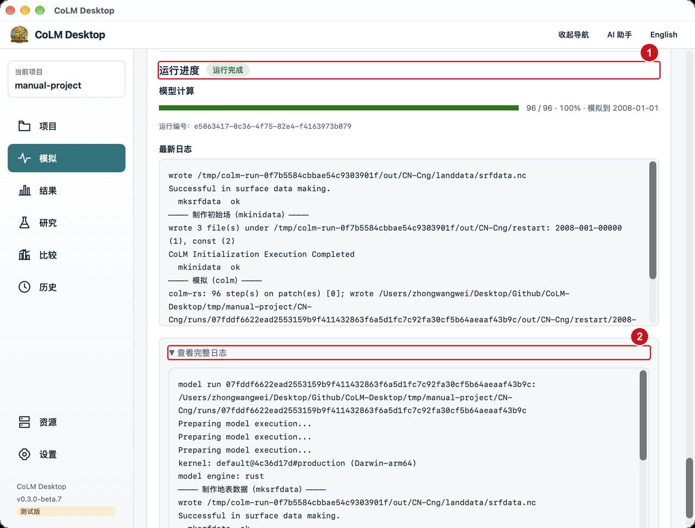

# CoLM Desktop 用户手册

**适用版本：** `0.3.0-beta.7`（测试版）  
**平台：** macOS（Apple Silicon / Intel）、Windows x86_64、Linux x86_64  
**手册截图：** 2026-11-07/08 在 macOS 上由真实窗口采集；示例项目为 `~/Desktop/Github/CoLM-Desktop/tmp/manual-project`（CN-Cng 示例算例，缩到 2008-01-01 → 2008-01-03 便于演示）。  
**附录：** [CLI 命令参考](#appendix-c) · [配置字段总表（964 项）](#appendix-a) · [参数库索引（1369 项）](#appendix-b)

> **警告：** 当前是 **Beta** 版本。请保留原始数据与算例备份；正式科研使用前独立核验结果。

## 目录

1. [安装与启动](#1-安装与启动)
2. [10 分钟快速开始](#2-10-分钟快速开始)
3. [界面总览](#3-界面总览)
4. [项目与算例](#4-项目与算例)
5. [新建模拟向导](#5-新建模拟向导)
6. [算例五步设置](#6-算例五步设置)
7. [运行算例](#7-运行算例)
8. [批量运行](#8-批量运行)
9. [结果页](#9-结果页)
10. [研究页](#10-研究页)
11. [比较页（OpenBench）](#11-比较页openbench)
12. [历史页](#12-历史页)
13. [资源页与远程服务器](#13-资源页与远程服务器)
14. [设置页](#14-设置页)
15. [模型版本](#15-模型版本)
16. [准备输入数据](#16-准备输入数据)
17. [AI 助手](#17-ai-助手)
18. [命令行 `colm-cli`](#18-命令行-colm-cli)
19. [区域与流域算例（Heihe 实测）](#19-区域与流域算例heihe-实测)
20. [配置参数总览](#20-配置参数总览)
21. [文件与目录布局](#21-文件与目录布局)
22. [故障排查](#22-故障排查)
23. [附录](#23-附录)

---

## 交付物

本手册同时提供三种可读格式，内容一致：

| 文件 | 用途 |
|---|---|
| [`README.md`](README.md) | 源文件（Markdown，适合 GitHub 浏览与继续编辑） |
| [`CoLM-Desktop-用户手册.html`](CoLM-Desktop-用户手册.html) | 单文件 HTML（含封面，图片已内嵌，可直接浏览器打开/打印） |
| [`CoLM-Desktop-用户手册.pdf`](CoLM-Desktop-用户手册.pdf) | PDF（约 203 页，含封面、全部附录与 48 张标注截图，适合分发/打印） |
| [`CoLM-Desktop-用户手册.md`](CoLM-Desktop-用户手册.md) | 合并版 Markdown（正文 + 三个附录，便于全文搜索） |
| [`images/`](images/) | 48 张真实窗口截图（含编号标注，JPEG） |
| [`cover.html`](cover.html) / [`cover-preview.jpg`](cover-preview.jpg) | 封面设计稿（HTML 可视化 / 图片预览） |
| [`appendices/`](appendices/) | CLI 命令、964 项配置字段、1369 项参数库三个附录 |

> 截图里的红色圆圈数字就是操作顺序；图下方文字给出每个编号对应控件。示例运行环境：macOS + 本机 Rust 引擎，示例项目缩到 3 天以控制演示时间。

---

# 1. 安装与启动

## 1.1 系统要求

| 项目 | 要求 |
|---|---|
| 操作系统 | macOS 12+（Apple Silicon / Intel）、Windows 10/11 x86_64、主流 Linux x86_64 |
| 磁盘 | 安装包约 0.5–1 GB；每个官方模型修订的源码快照约 126 MB；OpenBench 环境约 400 MB（可选） |
| 内存 | 站点算例 4 GB 起；空间/全球算例按网格规模准备 32 GB 以上 |
| 网络 | 下载安装包与首次获取模型修订需要；OpenBench、AI 助手、远程服务器按需 |
| 本机依赖 | **不需要**自行安装 Rust、Fortran、MPI、NetCDF；安装包已带 Rust 引擎与 `colm-cli` |

## 1.2 安装

### 发行版安装包（推荐）

从 [GitHub Releases](https://github.com/zhongwangwei/CoLM-Desktop/releases) 下载对应平台：

| 平台 | 文件 | 安装方式 |
|---|---|---|
| macOS Apple Silicon | `CoLM-Desktop_*_aarch64.dmg` | 打开 DMG，把 CoLM Desktop 拖进"应用程序" |
| macOS Intel | `CoLM-Desktop_*_x64.dmg` | 同上 |
| Windows x86_64 | `.msi` 或 `.exe` | 双击安装 |
| Linux x86_64 | `.AppImage` / `.deb` / `.rpm` | AppImage 加执行权限直接运行；deb/rpm 用系统包管理器安装 |

首次启动会创建应用数据目录（见[第 21 章](#21-文件与目录布局)），并自动登记当前官方模型修订（约 126 MB 源码快照）。

### 从源码运行（开发/自定义构建）

```bash
# 1) 前端依赖
cd gui && npm ci

# 2) 首次构建 Rust 内核（站点默认预设）
cd .. && ./oracle/scripts/build_kernel.sh default

# 3) 开发模式启动桌面端（Tauri v2）
cd gui/src-tauri && cargo tauri dev

# 4) 只构建命令行（引擎 workspace）
cargo build --release -p colm-cli    # 产物 target/release/colm-cli
```

> 桌面端的完整打包命令、Windows/Linux 交叉构建与签名说明见仓库 `README.md` 的"从源码构建"一节。安装包内已包含 `colm-cli` 与 `mksrfdata-rs`/`mkinidata-rs`/`colm-rs` 四个程序。

## 1.3 第一次启动

启动后进入**首页**（图 1）。左下角显示版本号与"测试版"标记；右侧是 AI 助手面板（默认展开，可点右上角"AI 助手"收起）。首次启动请先完成两件事：

1. **确认模型版本**：默认使用"官方版"（首页"模型版本"卡片）。切换入口见[第 15 章](#15-模型版本)。
2. **配置数据路径**（可选）：如果你有自己的项目目录、地表数据目录、Runtime 与强迫场目录，可到"资源 → 默认数据路径"登记；新建模拟时会自动填值。

---

# 2. 10 分钟快速开始

下面用内置 CN-Cng 草地示例，从"打开项目"到"看到结果"走一遍。全过程本机运行、不依赖服务器。

1. **打开项目**：首页点"打开项目"（图 1 的 **④**），或直接点"最近的项目"里的 `manual-project`。首次使用可点"打开示例 → CN-Cng"。
2. **打开算例**：项目页列出项目中的算例（图 4），点 `CN-Cng`。
3. **核对五步设置**（图 6–图 11）：算例页顶部有 ①运行环境与保存位置 → ②范围与网格 → ③数据与时段 → ④模型结构与方案 → ⑤检查与运行。示例算例已经配好，可以直接从第 1 步点"下一步"到最后。
4. **开始运行**：在第 5 步底部点"开始运行"（图 13）。本机 Rust 引擎会依次执行：
   - `mksrfdata`：制作地表数据；
   - `mkinidata`：制作初始场；
   - `colm`：主模拟。
   3 天示例在普通笔记本上通常 **10 秒–1 分钟** 完成；日志逐阶段显示（图 14）。
5. **查看结果**：点右上角"查看结果"或左侧"结果"（图 18）：可以看到评估总览、平均偏差、RMSE、有效配对和时序/观测评估页签。
6. **查看历史**：左侧"历史"（图 23）会记录这次运行，可导出 `CSV` / `JSON`。
7. **再跑一个批量**：返回项目页 →"批量运行"（图 16）：勾选两个站点 →"开始运行"，两个算例并发跑完（图 17）。

下面是本次演示实际跑出的日志（节选）：

```text
──── 制作地表数据（mksrfdata）────
Successful in surface data making.
  mksrfdata  ok
──── 制作初始场（mkinidata）────
CoLM Initialization Execution Completed
  mkinidata  ok
──── 模拟（colm）────
colm-rs: 96 step(s) on patch(es) [0]; wrote .../out/CN-Cng/restart/2008-003-00000/...
colm-rs: 1 history file(s)
CoLM Execution Completed.
  colm       ok
```

---

# 3. 界面总览


**图 1 标注：** ① 模型版本卡片（官方版/已有版本/新建修改版） ② "已有版本"入口 ③ "新建模拟" ④ "打开项目" ⑤ "准备输入数据" ⑥ 最近项目 ⑦ 左侧主导航 ⑧ AI 助手开关 ⑨ 语言切换。

界面分为三块：

- **顶部栏**：软件名、当前项目、AI 助手开关、语言（中文/English）。
- **左侧导航**：

| 导航 | 作用 |
|---|---|
| 项目 | 首页/当前项目：模型版本、新建模拟、打开项目、准备输入数据 |
| 模拟 | 当前算例的五步设置与运行 |
| 结果 | 运行结果评估、图表、导出 |
| 研究 | 参数修改、率定、不确定性、AI 研究、改源码 |
| 比较 | OpenBench 跨模拟评估 |
| 历史 | 全部操作记录、筛选与导出 |
| 资源 | 计算服务器、本机环境、默认数据路径 |
| 设置 | 界面语言/外观、助手入口、模型缓存、帮助 |

- **主面板**：随导航切换；页面内的长表单支持滚动，底部通常固定"上一步/下一步"或"开始运行"。

> 操作顺序的读法：每张截图的红色圆圈数字就是建议点击顺序；图下方文字给出对应关系。多步页面按"①→②→…"操作即可。

## 3.1 English 界面

软件内置中英文两套完整界面。点右上角 `English` 即可切换，所有页面、按钮、错误信息都会同步切换；再点 `中文` 切回。


**图 2 标注：** ① Project ② Simulation ③ Results ④ History ⑤ Resources ⑥ Settings。


**图 3 标注：** 英文界面的历史页（筛选、导出、记录卡片与中文版一一对应）。

---

# 4. 项目与算例


**图 4 标注：** ① 返回项目首页 ② 项目路径 ③ 站点算例卡片（点开进入五步设置） ④ 空间算例卡片 ⑤ 选择其他目录 ⑥ 批量运行 ⑦ 新建模拟。

- **项目 = 一个目录**，目录下每个子文件夹是一个算例（含 `case.nml`、`forcing.nml`、`site.nc`/`mesh.nc` 等）。
- 点算例卡片进入[第 6 章](#6-算例五步设置)。
- "选择其他目录"可打开任意位置的项目；打开后会出现在首页"最近的项目"。
- 项目页和首页的"打开项目"都优先从**历史记录**找回做过的项目；项目页另有"从历史项目打开"，按项目聚合历史、显示算例/研究数量，选中后直接打开。
- 历史里没有的新目录才用"选择目录/切换目录"走系统文件夹选择器。
- "新建模拟"进入[第 5 章](#5-新建模拟向导)。
- "批量运行"进入[第 8 章](#8-批量运行)。

> 当前项目会显示在左侧导航顶部与页面标题；切换项目请回首页"打开项目"或项目页"选择其他目录"。

---

# 5. 新建模拟向导


**图 5 标注：** ① 五步向导 ② Rust 引擎（推荐） ③ Fortran 官方引擎 ④ “保存到项目目录” ⑤ 模拟名称（模拟保存目录与下一步在下方）。

新建模拟与编辑已有算例共用同一套五步结构，但**基础配置（网格类型、引擎、尺寸）在创建时固定**，已有算例不能再改（可在第 1 步看到相应提示）。

## 5.1 第 1 步：运行环境与保存位置

| 字段 | 说明 |
|---|---|
| 运行位置 | "本机"，或服务器（先在"资源"里添加服务器）。服务器运行见[第 13 章](#13-资源页与远程服务器) |
| 计算引擎 | **Rust 引擎（推荐）**：所有网格、无需 Fortran/MPI 环境；**Fortran 官方引擎**：传统科学基线，需要匹配的编译配置（本机需构建内核；服务器上需远程内核） |
| 保存到项目目录 | 勾选后算例保存在当前项目下；取消可手选目录 |
| 模拟名称 | 必填；不能含路径分隔符 |
| 模拟保存目录 | 由项目目录 + 模拟名称自动组合；可手动改 |
| 类型/网格 | 站点、经纬度网格、非结构网格、流域网格等（由后续步骤或入口决定） |

## 5.2 第 2–5 步

- **第 2 步 范围与网格**：站点选经纬度；空间算例选网格类型、范围、分辨率/非结构文件。
- **第 3 步 数据与时段**：模拟起止日期、预热、站点/地表/Runtime/强迫场路径与强迫参数。
- **第 4 步 模型结构与方案**：地类方案、土壤水力、变饱和流、河湖汇流、LUC、BGC、城市、作物、材料过程等开关，以及"完整参数目录"。其中 USGS 地类方案已退休、未全面测试，不建议新研究使用。
- **第 5 步 检查与运行**：时间步长/输出设置、变量选择、编译配置、提交阶段，最后"开始运行"。

各字段的完整清单见[附录 A：配置字段总表](#appendix-a)（964 项，按页面分组）。

---

# 6. 算例五步设置

打开已有算例后，顶部显示五个步骤；已完成的步骤带 ✓。下面按步骤说明重点。所有图都是同一示例算例 `CN-Cng`。

## 6.1 第 1 步：运行环境与保存位置


**图 6 标注：** ① 五步导航 ② 运行位置 ③ 计算引擎 ④ 算例路径 ⑤ 输出目录 ⑥ 更改路径 ⑦ 下一步。

要点：
- 运行位置默认"本机"；切到服务器后，下方会显示服务器负载、分区与作业状态。
- 计算引擎在创建时确定；已有算例如需换引擎，请新建模拟。
- 算例路径与输出目录用于定位配置/结果；模型版本运行会在算例目录下 `runs/<操作号>/` 生成独立运行副本。

## 6.2 第 2 步：范围与网格


**图 7 标注：** ① 单点说明 ② 站点经度 ③ 站点纬度 ④ 下一步。

- 站点算例可在这里调整经纬度；**网格在创建时固定**，换网格需新建模拟。
- 空间算例的第 2 步显示范围/网格字段，并在创建后锁定（只能查看）；若需更换网格请新建模拟。

## 6.3 第 3 步：数据与时段


**图 8 标注：** ① 开始日期 ② 结束日期 ③ 日历选择 ④ 预热结束日期 ⑥ 选择 CBL 文件 ⑦ 选择臭氧文件（⑤“预热循环重复次数”在同一区域下方）。


**图 9 标注：** ① 站点文件 ② 地表数据目录 ③ Runtime 数据目录 ④ 强迫场配置（其下的强迫场目录/数据集在同一卡片内）。

关键字段：

| 字段 | 说明 |
|---|---|
| 开始/结束日期 | 支持 `YYYY-MM-DD` 或 `YYYYMMDD`；结束日期是截止时刻。结束必须晚于开始 |
| 预热起始日期 | CoLM 总是从模拟开始日期起算，只读 |
| 预热结束日期 | 留空 = 不预热；模型先跑预热，重置后重复指定次数再进入正式模拟 |
| 站点文件 | `site.nc`，单站地表数据 |
| 地表数据目录 | RawData 目录（空间算例或需要重做地表时）；
| Runtime 数据目录 | 模型运行所需附加数据 |
| 强迫场配置 | `forcing.nml` 路径 |
| 强迫场数据目录/数据集 | 强迫场根目录与数据集名（如 `JRA3Q`、`CMFD`、`POINT`）；可选值来自客户端模板注册表，不是随便填 |
| 观测高度方式/高度 | 强迫场风速/气温/湿度观测高度 |
| 数据含缺测值 | 是否声明缺测值属性与名称 |
| 各变量时间间隔/偏移 | 强迫场变量时间步长与偏移（8 个变量，逗号分隔） |

> 强迫场 `dataset` 必须写引擎实际识别的标识（如 `CMFD`、`ERA5`、`CMIP6`、`POINT`），不是模板文件名（`ERA5_LEddy`、`MPI-ESM1-2-HR_ssp585` 是模板名，会被拒绝）。

## 6.4 第 4 步：模型结构与方案


**图 10 标注：** ① 土壤水力方案（同屏可见 Campbell/van Genuchten 选项与变饱和流开关；河湖汇流等在下方继续）。

- **土壤水力方案**：Campbell 或 van Genuchten；van Genuchten 必须开启变饱和流。
- **过程开关**：变饱和流、河湖汇流、土地覆盖变化、BGC、城市、作物、材料过程等。是否可用取决于当前内核编译宏与算例尺度（例如 SinglePoint 不支持土地覆盖变化）。
- **参数卡片**：次网格与植被、土壤方案、水热过程、生态与生地化、其他模型选项；点"完整参数目录"可搜索全部 1369 个参数。
- 参数修改只写入当前算例的覆盖，不派生新版本；要形成可复用版本，请用"研究 → 新建修改版"并冻结。

## 6.5 第 5 步：检查与运行


**图 11 标注：** ① 时间步长 ② 输出间隔 ③ 重启文件间隔 ④ 推荐核心量 ⑤ 一键全开启 ⑥ 全部变量（变量表在下方）。


**图 12 标注：** ① 检查并运行 ② 本次提交设置 ③ 运行位置 ④ 编译配置（⑤“本次提交阶段”在同一卡片下方）。


**图 13 标注：** ① 记录其他文件指纹 ② NML 配置预览 ③ 上一步 ④ 开始运行。

要点：
- 输出变量可在"推荐核心量（39）"与"全部变量"之间切换；一键全开/全清。
- **提交阶段**：全部（地表→初始化→主模拟）/ 仅地表 / 仅初始化 / 仅主模拟；切换阶段会自动标记需要重跑的阶段。
- "记录其他文件指纹"默认关闭；开启后会校验输入/程序/输出内容哈希，更严格但更慢。
- 点"开始运行"前会检查输入文件；缺文件会直接列出。
- 运行过程中可"停止"；关闭窗口前如有运行中任务会先询问。

---

# 7. 运行算例


**图 14 标注：** ① 运行记录 ② 运行状态/完成信息 ③ 查看完整日志 ④ 查看结果。



**图 15 标注：** ① 运行进度 ② 完整日志。

- 本机运行：Rust 引擎直接执行三个阶段；日志按阶段分段。
- 远程运行：提交后每约 10 秒核对一次状态；可在"运行进度"查看阶段、日志末尾、服务器作业详情，并可停止/取回结果。
- 失败时展开日志定位；常见原因见[第 22 章](#22-故障排查)。

本次演示实际运行的输出目录（节选）：

```text
tmp/manual-project/CN-Cng/runs/07fddf66…/
├── case.nml            # 物化后的运行配置
├── forcing.nml
├── model-run.json      # 运行清单（版本、输入哈希、产物路径）
└── out/CN-Cng/
    ├── landdata/srfdata.nc
    ├── restart/2008-003-00000/…restart….nc
    └── history/CN-Cng_hist_2008-01.nc
```

---

# 8. 批量运行


**图 16 标注：** ① 调整运行站点（可选） ② 检查并运行 ③ 算例与时段摘要 ④ 模型与引擎 ⑤ 运行位置 ⑥ 同时运行站点数 ⑦ 提交阶段。


**图 17 标注：** ① 进度汇总 ② 完成/失败计数 ③ 查看站点结果 ④ 只选失败站点重跑。

操作顺序：
1. 项目页点"批量运行"；
2. 在"调整运行站点"里勾选要运行的站点（默认全选；可按未完成/失败筛选）；
3. 选择运行位置（本机/服务器）、模型版本、引擎与提交阶段；
4. 点"开始运行"；
5. 查看每个站点的进度；失败的站点可"只选失败或已停止的"重跑；
6. 完成后点"查看站点结果"或左侧"结果"查看。

**打包与并发：**
- 本机：`同时运行站点数` 决定并发进程数，单点每站固定 1 线程。
- 服务器（Slurm/LSF/PBS）：站点批量默认**按节点打包**——同一批站点进入服务器队列，每个节点作业一次占满节点核数，站点数多时自动多开节点；不再"一个站点占一个节点"。
- Rust 空间算例的并行预算（节点×每节点核数）与站点打包互斥，界面只显示适用的那一种。

本次演示的批量结果：**2 个站点全部完成，0 失败**（与图 17 一致）。

---

# 9. 结果页


**图 18 标注：** ① 结果与评估标题 ② 切换运行记录 ③ 分析范围 ④ 结果/时序/观测/闭合四个页签 ⑤ 导出完整 CSV ⑥ 返回模拟。


**图 19 标注：** ① 评估设置 ② 已确认的现象与有效观测匹配 ③ 平均偏差/RMSE/有效配对 ④ 候选原因 ⑤ 版本出处与科学比较。

- **分析范围**：单站点 / 多站点（多站点需同一批运行记录）。
- **页签**：结果总览、时序分析、观测评估、闭合诊断。
- **指标**：平均偏差、RMSE、有效配对数量、观测覆盖；时间基准按运行设置（模型钟/本地标准时）。
- **导出完整 CSV**：导出当前分析范围的时序数据。
- **版本出处**：显示运行使用的模型版本/修订与科学比较入口（跨版本对照需在"比较"页用 OpenBench）。

---

# 10. 研究页


**图 20 标注：** ① 修改参数（手动） ② 参数率定 ③ 不确定性分析 ④ AI 学习参数 ⑤ AI 替换过程 ⑥ 修改源码 ⑦ 打开已有研究。

| 方法 | 用途 |
|---|---|
| 修改参数（手动） | 直接改全局/地类/PFT/PC 参数；不跑研究，直接建草稿 |
| 参数率定 | 用观测寻找适合当前时段与算例的参数（支持共享参数跨站点验证） |
| 不确定性分析 | 敏感性分析与结果变化范围 |
| AI 学习参数 | 根据站点特征预测参数 |
| AI 替换过程 | 用网络替代选定过程并验证适用性 |
| 修改源码 | 复制源码改 Rust/Fortran，编译与测试后形成修订 |

研究跑完后，结果先写进新版本的**草稿**，审阅后冻结为模型修订；结果不比默认参数好时拒绝写回。任务进度、收敛、观测约束程度都显示在"当前研究"区域。

> **Rust 固定引擎**：研究页不再提供计算引擎、服务器前处理引擎或编译配置下拉；研究固定使用 Rust，内核由所选算例的网格/地类/作物设置自动匹配。没有匹配内核时会直接提示，不会静默改用其他内核。已有的旧研究仍按它冻结的引擎与内核运行。
>
> **CROP**：Rust 的单点和空间作物算例都不再要求 CROP 编译内核；单点由站点文件的作物数组识别，空间由“作物过程”开关（正的播种日）识别，CLI 会自动加 `--crop`。Fortran 引擎仍需真正的 CROP 内核。
>
> **USGS**：地类方案中的 USGS 已标记为“已退休 · 未全面测试”，保留给已有 USGS 算例和兼容性对照，不建议新研究使用。

---

# 11. 比较页（OpenBench）


**图 21 标注：** ① 安装、重装与维护（展开后有一键安装；环境状态/本次评估在该节上下方）。

- OpenBench 安装在软件自己的数据目录（约 400 MB），不碰系统 Python，不与你自己的 OpenBench 混用；
- 首次使用：展开"安装、重装与维护" → 一键安装（uv → 专用 Python 3.12 → OpenBench 及依赖），需要联网；
- 安装完成后在"本次评估"选择模拟、参考数据、指标/评分、时间尺度（可到年/月气候态），可本机或服务器运行；日志实时显示、可停止，只取回报告；
- 支持登记模型变量、非标准模拟与多参考数据；评估报告在结果页/比较页查看。


**图 22 标注：** ②"安装、重装与维护"折叠区 ④ 安装位置（打开目录）；环境状态与一键安装在同页上下方。

> 安装过程会先装 uv（约 20 MB，校验后使用），再装专用 Python 3.12，最后装 OpenBench 及依赖（约 400 MB，需要联网）。三个状态全部显示"已安装"后，"本次评估"区域才会出现配置表单。

---

# 12. 历史页


**图 23 标注：** ① 搜索 ② 类型筛选 ③ 状态筛选 ④ 查询 ⑤ 更多筛选 ⑥ 导出 CSV ⑦ 项目记录 ⑧ 清空历史记录。

- 记录每一次运行、研究、配置修改与远程操作；点击记录查看依据与后续操作；
- 筛选可按类型、状态、算例、服务器等组合；
- 导出 `CSV` / `JSON`（全局历史导出为**一行一操作**，不会把批量运行折叠掉）；
- 清空历史可选择是否同时删除本机算例文件夹与未确认结束的记录（危险操作会二次确认）。


**图 24 标注：** ① 项目时间线 ② 打开这个项目 ③ 算例记录 ④ 关闭。同一批（一次批量运行）的操作合并成一行；展开后可点算例查看详情、删除或对比。

---

# 13. 资源页与远程服务器


**图 25 标注：** ① 添加服务器 ② 检查本机后端与模型内核 ③ 默认项目目录 ④ 默认地表数据目录 ⑤ 默认 Runtime 数据目录 ⑥ 默认强迫场数据路径 ⑦ 保存默认数据路径（本机服务器卡片在页面中部）。

## 13.1 本机

- 显示 CPU 核数、可用编译配置（内核预设）；
- "检查本机后端与模型内核"会验证 `colm-cli`、sidecar 与内核清单；
- 默认数据路径用于新建模拟时自动填值；新建后改用的路径会同步回这里。

## 13.2 添加远程服务器（SSH）


**图 26 标注：** ① 集群预设 ② 显示名称 ③ 服务器地址/SSH 别名 ④ 认证方式（config/密钥/密码） ⑤ 服务器工作目录 ⑥ 默认数据路径（可折叠区）。保存前请先点"检查连接"，全部检查项通过后再保存。


"添加服务器"后填写：

| 字段 | 说明 |
|---|---|
| 名称 | 显示名，也是 `remote.json` 里的 host 别名 |
| SSH 别名/主机 | `~/.ssh/config` 里的 Host，或 `user@host`；需要密码时可用一次性登录缓存 |
| 工作根目录 | 服务器上的 CoLM-Desktop 根目录（引擎、内核、作业、算例副本都在此） |
| 调度器 | `auto` / `bare` / `slurm` / `lsf` / `pbs`；分区/队列、账号、时限 |
| 节点与核数 | 每节点核数用于站点打包与并行预算 |
| 环境准备（env script） | 在服务器每次远程命令前执行，例如 `module load ...` / `source /etc/profile.d/modules.sh; module load ...`。编 Fortran 内核/运行服务器作业都依赖它 |
| 目录映射（map） | 本机路径前缀 = 服务器路径前缀，用于把本地数据目录对应到服务器（如 PLUMBER2s/Sitedata） |
| 环境变量/指令 | 额外 `--directive`（Slurm `#SBATCH` 行）、内存等 |

> 关键规则：
> 1. **外部数据目录必须 map**（强迫场、rawdata、Runtime、Sitedata）。目录不会被自动上传；普通文件（如算例目录内的 `site.nc`、`forcing.nml`）在物化运行时由 CLI staging 自动带走。
> 2. Fortran 引擎需要先在服务器上构建内核（"资源 → 服务器 → 准备环境/内核"），并设置正确的 `env script`（gfortran + MPI + NetCDF-Fortran）。
> 3. Rust 引擎首次远程运行会在服务器上构建 Rust 引擎（登录节点编好），需要 Rust/Cargo/CMake；安装包支持离线自举，也可提前 `remote-engine-prepare`。

## 13.3 服务器运行流程

1. 资源页添加服务器 → 检查连接与目录；
2. 算例第 1 步把"运行位置"切到该服务器；
3. 第 5 步选编译配置/引擎、提交阶段 → "开始运行"；
4. 运行进度里查看服务器作业状态、日志、节点/分区；可"核对服务器状态"、取消、取回结果；
5. 远程结果只取回所需变量/月份（可压缩），本机"结果"页打开。

常用远程 CLI 示例见[第 18.6 节](#186-远程服务器与集群)。

---

# 14. 设置页


**图 27 标注：** ① 语言 ② 外观 ③ 默认展开专家设置 ④ 配置 AI 助手 ⑤ 检查可释放空间 ⑥ 整理模型缓存 ⑦ 强制清理旧官方版本（帮助在页面下方）。

- **界面**：语言（中文/English）、外观（浅色/深色/跟随系统）、默认展开专家设置。
- **AI 助手**：跳到助手设置（服务地址、模型、API Key、联网搜索、审批方式等），见[第 17 章](#17-ai-助手)。
- **模型缓存**：每次软件更新登记新的官方修订与约 126 MB 源码快照；启动时会自动整理没有被算例/研究/历史使用的旧官方修订（保留最新与被依赖的修订）。"检查可释放空间"先统计，"整理模型缓存"按策略清理，"强制清理"需二次确认。
- **帮助**：关于、版本、文档入口。


**图 28 标注：** ① 配置 AI 助手 ② 模型缓存说明 ③ 检查可释放空间 ④ 整理模型缓存 ⑤ 强制清理旧官方版本 ⑥ 帮助。

---

# 15. 模型版本


**图 29 标注：** ① "选择已有版本"对话框 ② 官方版修订卡片 ③ 清理旧的官方版本 ④ 关闭。

首页"模型版本"卡片有三种入口：

| 入口 | 说明 |
|---|---|
| 官方版 | 随软件提供、不可修改；每个版本对应一个冻结修订与源码快照 |
| 已有版本 | 列出所有已保存修订（含自己冻结的修改版、旧官方修订），可切换/删除；删除前会检查绑定 |
| 新建修改版 | 进入"研究"：手动改参数、率定、不确定性、AI、改源码；研究结果经草稿审阅后**冻结**为新修订 |

注意事项：
- 运行算例时选择的版本会绑定到算例（`model-binding.json`），重启后保持；
- 修改版与官方版可同时存在，结果页/比较页按版本比较；
- 旧官方修订被自动/手动清理后，绑定它的算例会提示重新绑定；
- 清理/删除是不可逆操作，界面会二次确认并说明项目/研究/历史文件保留。

---

# 16. 准备输入数据


**图 30 标注：** ① 准备任务 ② 原始输入文件 ③ 独立输出路径 ④ 检查输入 ⑤ 高级设置。

用途：制作站点文件、转换/修复强迫场，供新建算例使用。典型流程：

1. **选择准备任务**：站点建站 / 强迫场转换 / 强迫场缺测修复；
2. **选择原始输入文件**（CSV/TXT/NetCDF 等；ERA5 下载需本机配置 CDS 凭据）；
3. **设置独立输出路径**：原始文件不改，产物写到独立路径；
4. **检查输入**：自动识别分隔符、列名、单位、时间范围与站点；
5. **高级设置**：观测高度、单位换算、缺测处理、变量映射等；
6. **生成数据**：写入产物；
7. **用于新算例** 或 **安装到数据集目录并扫描**：安装到 `Sitedata/`、`Forcing/` 后自动调用 `scan_sites` 刷新数据集，页面显示识别到的站点数量。站点与强迫场词干不同会提示无法配对。

产物页会显示 `site_kind`/`mode`、`from_lookup` 计数与 warning；rawdata 为零栅格时给出显式警告而不是静默回退。


**图 31 标注：** ① 准备任务 ② 原始输入文件 ③ 独立输出路径 ④ 检查输入 ⑤ 高级设置（展开后含观测高度、变量映射等）。

---

# 17. AI 助手


**图 32 标注：** ① 新对话 ② 会话历史 ③ 上下文范围（项目/算例/模拟/结果/研究） ④ 内置示例站点 ⑤ 输入框 ⑥ 发送/停止 ⑦ 助手设置。


**图 33 标注：** ① 运行后端 ② 服务商 ③ 模型选择 ④ 历史范围 ⑤ 未登记 API Key 提示；联网搜索与文档检索等高级项在设置页下方（需滚动查看）。

## 17.1 首次配置

1. 打开助手设置 → 填写服务地址（如 `https://api.deepseek.com`）、模型名、API Key；
2. 选择 API 格式（chat completions / responses 等）、思考程度、超时；
3. 如使用联网搜索/数据外发，勾选确认外发目标；
4. 保存。若助手正在运行，保存后会自动重配；重配失败会提示"设置已保存，但助手重配失败……下一次发送会自动重试"，不会丢设置。

## 17.2 使用

- 助手**理解当前页面上下文**（项目/算例/模拟/结果/研究），能读取页面合同并执行登记的按钮操作；
- 发送前可修改问题；支持附件（PDF/DOCX/TXT）；
- 工具调用会显示"完成/失败"卡片，可展开查看参数与错误；
- **危险操作（删除、覆盖、清空等）仍需人工确认**；审批方式可在设置里选；
- 页面上的按钮都登记为助手可执行动作；配置字段受页面合同约束——例如空间算例第 2 步的范围字段在助手工具中也是只读（`ui_fill` 会返回 `cannot be changed here`），避免绕过界面约束；
- 会话历史按项目保存，可恢复；上下文接近窗口上限时会提示并折叠较早工具结果。


## 17.3 文件与检索

- 可附加本机 PDF/DOCX/文本文档；
- 联网搜索使用 DeepSeek Search API（需 Key）；
- 文档检索可接本机 Xerj 节点（默认关闭；可用户自己运行，也可由应用托管固定版本）；
- 模型/代码问题会路由官方 CoLM 与 CoLM-Desktop 仓库检索，回答带出处；不编造提交/PR。

---

# 18. 命令行 `colm-cli`

`colm-cli` 与桌面端使用同一套引擎/算例/模型注册表。安装包内路径（macOS）：

```text
/Applications/CoLM Desktop.app/Contents/MacOS/colm-cli
# 或源码构建产物
target/release/colm-cli
```

查看全部命令：

```bash
colm-cli --help
```

> 完整命令索引与 `--help` 原文见[附录 C：CLI 命令参考](#appendix-c)（68 组用法、`.--help` 全文）。

## 18.1 通用约定

- 大多数命令支持 `--json 1` 输出机器可读结果；
- 模型相关命令可带 `--model-root <目录>`（默认 `~/Library/Application Support/CoLM-Desktop/models` 或对应平台目录）与 `--model-id/--model-revision`；
- 远程命令共享 `--host`、`--root`、`--scheduler`、`--partition`、`--walltime`、`--env-script` 等选项；
- 错误信息同时给中英文时，脚本可按固定文本匹配；退出码非 0 表示失败。

## 18.2 站点与强迫场

```bash
# 扫描站点目录（--quick 跳过强迫场读取）
colm-cli scan --dir "$HOME/Library/Application Support/edu.sysu.colm.desktop/examples/Sitedata" --quick 1

# 从 CSV/TXT 建站点文件（带 rawdata 可抽取土壤等字段）
colm-cli site-new --out ./CN-Demo_site.nc --lon 113.5 --lat 23.5 \
  --mode igbp --rawdata /path/to/rawdata --json 1

# 强迫场目录探测/修复
colm-cli forcing-directory-probe --help   # 见 --help 中 remote/forcing 组
```

**实际运行示例**（本手册验证时执行）：

```console
$ colm-cli scan --dir ".../examples/Sitedata" --quick 1 --out sites.json
$ head -c 300 sites.json
[
  {
    "name": "AT-Neu",
    "site_file": ".../Sitedata/AT-Neu_2010-2012_FLUXNET-CH4_site.nc",
    "met_file": ".../Forcing/AT-Neu_2010-2012_FLUXNET-CH4_Met.nc",
```

## 18.3 算例创建与运行

```bash
# 运行一个已有算例（本机 Rust 引擎；--kernel 指向已构建内核）
colm-cli run ./my-project/CN-Cng --kernel ./kernels/default --stream 1

# 指定阶段/重跑
colm-cli run ./my-project/CN-Cng --kernel ./kernels/default --stage mksrfdata

# 查看历史变量目录
colm-cli history-catalog ./my-project/CN-Cng

# 导出/裁剪历史
colm-cli history-subset ./my-project/CN-Cng --out ./subset --vars f_fevpa,f_fsena --from 2008-01 --to 2008-01
```

本次演示实际运行的 `history-catalog` 输出：

```json
{"files":1,"steps":48,"start":1199147400,"end":1199316600,
 "variables":[{"name":"f_alb","units":"-","long_name":"averaged albedo","kind":"category", ...}]}
```

## 18.4 模型版本

```bash
colm-cli model-list --model-root "$HOME/Library/Application Support/CoLM-Desktop/models" --json 1
colm-cli model-get --model-root ... --model-id official --model-revision 185
colm-cli model-freeze --model-root ... --model-id <draft-id> --asset-root ./assets
```

修改版运行：`--model-version <名称>` 或 `--model-id/--model-revision`；运行会物化到算例目录的 `runs/<操作号>/`，结果与运行清单（`model-run.json`）一起保存，可追溯。

## 18.5 评估/研究/历史

```bash
colm-cli evaluation-plan <case> --obs <Flux.nc> --kernel <kernel-dir>
colm-cli study-params
colm-cli history-subset ...
colm-cli model-changes --model-root ... --version <id> --revision <n>
```

## 18.6 远程服务器与集群

```bash
# 构建远程 Fortran 内核（服务器需 gfortran + MPI + NetCDF-Fortran）
colm-cli remote-kernel --host my-cluster --root /path/colm-desktop --preset default \
  --env-script 'source /etc/profile.d/modules.sh; module load gcc mpi netcdf' \
  --scheduler slurm --partition debug --walltime 00:30:00

# 远程运行（Rust 引擎，默认；需本机内核目录提供宏清单）
colm-cli remote-run ./my-project/CN-Cng --host my-cluster --root /path/colm-desktop \
  --kernel ./kernels/default --map /local/data=/server/data --upload-unmapped 1

# 远程 Fortran 引擎
colm-cli remote-run ... --engine fortran --preset default --remote-kernel auto

# 站点批量打包（同一批共享 --pack-batch 值）
colm-cli remote-run ./site1 --host my-cluster --root ... --kernel ... --pack-batch <batch-id> --cores-per-node 64
colm-cli remote-run ./site2 --host my-cluster --root ... --kernel ... --pack-batch <batch-id> --cores-per-node 64

# 查询/取消/取回
colm-cli remote-status ./site1 --host my-cluster --root ...
colm-cli remote-cancel ./site1 --host my-cluster --root ...
colm-cli remote-fetch ./site1 --host my-cluster --root ... --vars f_fevpa,f_fsena
```

> - 远程作业的 SSH 凭据可由桌面端以 stdin 注入（`COLM_SSH_AUTH_STDIN=1`）；命令行直接使用时按 `~/.ssh/config` 连接。
> - 外部大数据目录用 `--map`；算例内部普通文件（site.nc 等）会随 staging 自动上传。
> - 打包批量：同一批站点进同一队列，载体作业按节点槽位并发；每站 1 rank/1 线程。

## 18.7 常用诊断

```bash
colm-cli remote-probe --host my-cluster
colm-cli remote-kernels --host my-cluster --root /path/colm-desktop
colm-cli remote-engines --host my-cluster --root /path/colm-desktop
colm-cli remote-load --host my-cluster
colm-cli verify-completed-outputs ./my-project/CN-Cng
```

---

# 19. 区域与流域算例（Heihe 实测）

本章的例子都在同一台机器上实际跑过：数据来自 `/Volumes/Data`（Heihe 边界、JRA3Q 强迫、CoLMrawdata、CoLMruntime 单元汇流数据），时间窗口 2003-02-01 → 2003-02-04。

## 19.1 项目里同时放站点/区域/流域算例


**图 34 标注：** ① 区域算例 `region-heihe` ② 流域算例 `watershed-heihe`（huahai 边界） ③ 流域算例 `watershed-huangwei`（huangwei 边界） ④ 批量运行入口。算例卡片的"已有结果"表示该算例已有运行输出。

## 19.2 区域算例（latlon 经纬度网格）

区域算例使用 0.25° 经纬度网格，范围 **96.25–104.25°E、37.75–43.25°N**（Heihe 流域+周边），强迫场 JRA3Q，开启区域单元汇流（河湖流）。


**图 35 标注：** ① 空间模拟说明（网格创建后固定） ② 模拟范围/网格分辨率字段（只读，换网格需新建模拟）。


**图 36 标注：** ① 开始日期 ② 结束日期（空间算例同样支持预热与日内秒）。


**图 37 标注：** ① 强迫场配置 ② 强迫场数据目录（JRA3Q） ③ 强迫场数据集。


**图 38 标注：** ① "4. 河湖汇流"过程 ② 该过程右侧的"设置"。


**图 39 标注：** ① 河湖流与水库设置对话框 ② 单元流域河网文件（`grid_routing_data_15min.nc`） ③ 河湖汇流最大子步长等参数。区域单元汇流开关、水库调度方案、估算河道深度等都在这里；改完点"保存设置"。


**图 40 标注：** ① 编译配置（区域网格需要 `latlon` 内核） ② 开始运行。

**实际运行结果（CLI 实跑）**：

```text
kernel: latlon@4c36d17d#production (Darwin-arm64)
model engine: rust
=== colm-stage colm ok ===
  colm       ok
EXIT:0
```

- 96 个时间步（3 天，3600 秒步长），输出 `out/region-heihe/history/`、`restart/`；区域网格由 `DEF_GRIDBASED_lon_res/lat_res=0.25` 自动构建（无需 `DEF_file_mesh`）。
- 河湖流：latlon 内核编译了 `GridRiverLakeFlow`，运行时读取 2.0 GB 的 15min 单元汇流数据。

## 19.3 流域算例（shapefile 边界 → unstructured 网格）

流域算例用 `/Volumes/Data/Data/Heihe-shp/heihe_boundary_with_huahai.shp` 生成非结构网格（0.5°，113 个活跃单元），边界内 267 个 LCT patch，保留河湖流开关。

```bash
# 1) 由流域边界生成非结构网格（0.5° = 720×360 全球网格中落在边界内的单元）
colm-cli mesh-new --out watershed-heihe/mesh.nc --nlon 720 --nlat 360 \
  --grid-kind unstructured --shp /Volumes/Data/Data/Heihe-shp/heihe_boundary_with_huahai.shp

# 2) 建空间算例（JRA3Q 强迫、本机 rawdata/runtime、3 天）
colm-cli spatial-new --grid-kind unstructured --mesh watershed-heihe/mesh.nc \
  --out watershed-heihe --forcing watershed-heihe/forcing.nml \
  --rawdata /Volumes/Data/CoLMrawdata --runtime /Volumes/Data/CoLMruntime \
  --start 2003-02-01 --end 2003-02-04 --timestep 3600 \
  --name watershed-heihe --mode igbp
```


**图 41 标注：** ① 空间模拟说明 ② 模拟范围（由边界文件决定，创建后锁定）。


**图 42 标注：** ① 强迫场配置/目录（JRA3Q）；② 地表数据与 Runtime 目录同区域算例。


**图 43 标注：** ① "4. 河湖汇流" ② "设置"。


**图 44 标注：** ① 河湖流与水库设置 ② 单元流域河网文件（本机 15min 数据）。


**图 45 标注：** ① 编译配置（unstructured 内核） ② 开始运行。

**实际运行结果（GUI 实跑）**：


**图 46 标注：** ① 运行进度（mksrfdata → mkinidata → colm 三阶段）。


**图 47 标注：** ① 运行进度 ② 完成状态。

```text
wrote 113 spatial land elements and 267 LCT patches
Regional unit-catchment network: 2084 unit catchments in 77 river systems,
  written to .../riverlake/unitcatchment_regional.nc
colm-rs: 96 step(s) on 267 spatial patch(es) in 4 block(s)
CoLM Execution Completed.
=== colm-stage colm ok ===
```

**第二个流域边界（`heihe_huangwei.shp`）** 也用同样流程实跑：0.5° 网格取到 **59 个活跃单元**（177 个 spatial patch），区域河网 **1758 个单元流域、24 个河系**，3 天 96 步，`EXIT 0`：

```text
Regional unit-catchment network: 1758 unit catchments in 24 river systems
colm-rs: 96 step(s) on 177 spatial patch(es) in 4 block(s)
CoLM Execution Completed.
=== colm-stage colm ok ===
EXIT:0
```


**图 48 标注：** ① 结果与评估 ② 切换运行记录 ③ 分析范围 ④ 结果/时序/观测/闭合页签。空间算例的"模拟与观测"显示**区域平均（按纬度加权）**，下方"空间分布"可逐帧看格点（示例：潜热通量水当量 `f_lfevpa`）。

## 19.4 区域 vs 流域：怎么选

| | 区域（latlon） | 流域（unstructured / catchment） |
|---|---|---|
| 网格 | 规则经纬度网格，`DEF_GRIDBASED_lon_res/lat_res` | 边界文件生成的非结构网格（或用户提供的 catchment mesh） |
| 典型用途 | 区域气候/陆面模拟、与格点观测比较 | 按流域边界做水文/汇流、河湖流 |
| 河湖流 | `GridRiverLakeFlow` + 单元汇流文件（latlon 内核已编入） | 内核含 `GridRiverLakeFlow`，需 `DEF_UnitCatchment_file` +（流域）`unitcatchment_regional` |
| 本例规模 | 0.25°，32×22 单元 | 0.5°，113 单元 / 267 LCT patch |
| 结果展示 | 区域平均 + 空间分布 | 区域平均 + 空间分布（按网格） |

数据准备要点：
- 区域强迫：JRA3Q 目录需含 `tmp2m/tmp2m_YYYY_MM.nc` 等 8 个变量子目录；`forcing.nml` 的 `DEF_forcing%startyr/endyr` 覆盖模拟年份；
- Heihe 边界 shapefile 必须与 `.shx/.dbf/.prj` 同目录；
- `DEF_UnitCatchment_file` 指向 `CoLMruntime/unitcatchment/grid_routing_data_15min.nc`（区域）或用户自己的 unit catchment mesh；
- 空间算例不支持"参数调优/不确定性分析"（界面会自动提示）。

> 说明：本章"区域"用 CLI 实跑验证（EXIT 0），"流域"用 GUI 实跑并截图；两者使用同一套 Rust 引擎与本地内核。

---

# 20. 配置参数总览

界面里所有可编辑字段来自 CoLM namelist schema，共 **964 项**；参数库（研究/助手用）共 **1369 项**。

## 19.1 按页面的参数分组

| 页面/分组 | 主要字段 |
|---|---|
| 运行环境与保存位置 | `DEF_CASE_NAME`、算例/输出目录、引擎、版本绑定 |
| 范围与网格 | `SITE_lon_location`、`SITE_lat_location`、网格/范围/分辨率字段 |
| 数据与时段 | `DEF_simulation_time%*`、`DEF_dir_rawdata`、`DEF_dir_runtime`、`DEF_forcing_namelist`、`DEF_dir_forcing`、`DEF_forcing%*` |
| 模型结构与方案 | 地类方案、土壤水力、过程开关、参数覆盖、参数卡片 |
| 检查与运行 | `DEF_simulation_time%timestep`、输出/重启频率、历史变量、提交阶段、指纹开关 |
| 运行/配置（高级） | 并行、调试、诊断、数据同化等 |

## 19.2 字段表怎么查

- 完整字段表：[附录 A](#appendix-a)（按页面分组，含类型、默认值、可选值、依赖宏、派生标记与说明）；
- 参数库：[附录 B](#appendix-b)（按分类，含参数 ID、原始键、默认值、作用域、可见性、源码位置）。

常用字段速查：

| 字段 | 含义 | 备注 |
|---|---|---|
| `DEF_CASE_NAME` | 算例名 | 字母/数字/`-`/`_`，不能有路径分隔符 |
| `DEF_simulation_time%start_year/month/day/sec` | 模拟开始 | 结束必须晚于开始 |
| `DEF_simulation_time%timestep` | 时间步长（秒） | 单点常用 1800/3600 |
| `DEF_HIST_FREQ` | 历史输出间隔 | 支持步/时/日/月/年 |
| `DEF_WRST_FREQ` | 重启文件间隔 | 用于续跑 |
| `SITE_fsitedata` | 站点文件路径 | 站点算例必需 |
| `DEF_dir_forcing` / `DEF_forcing%dataset` | 强迫场目录/数据集标识 | 标识必须是引擎实际认识的集合（CMFD/ERA5/CMIP6/POINT 等） |
| `DEF_dir_rawdata` | 地表数据/原始数据目录 | 空间算例或重建地表时需要 |
| `DEF_dir_runtime` | Runtime 数据目录 | 部分过程/资产需要 |
| `DEF_USE_*` | 过程开关 | 是否可用取决于内核编译宏与算例尺度 |

---

# 21. 文件与目录布局

```text
# 项目
<project>/
├── <case>/
│   ├── case.nml                 # 算例配置
│   ├── forcing.nml              # 强迫场配置
│   ├── site.nc / mesh.nc        # 站点或网格输入
│   ├── model-binding.json       # 绑定的模型版本
│   ├── .colm-desktop.json       # 算例界面配置（引擎、运行位置等）
│   ├── runs/<操作号>/           # 模型版本运行的物化副本与结果
│   └── out/                     # 直接运行的默认输出
└── ...

# 应用数据目录（macOS 示例）
~/Library/Application Support/CoLM-Desktop/
├── models/                      # 模型注册表：versions/、sources/、drafts/、runs/
├── history.sqlite3              # 历史台账
├── openbench/                   # OpenBench 私有环境（可选）
└── live-runs/                   # 运行中/残留标记

~/Library/Application Support/edu.sysu.colm.desktop/
├── remote.json                  # 远程服务器配置
├── assistant.json / assistant-keys.json  # 助手设置与 Key
├── examples/                    # 内置示例（Sitedata/Forcing/Observation/Runtime）
└── recent.json                  # 最近项目与界面偏好
```

> 不同平台目录不同：Windows 用 `%APPDATA%\CoLM-Desktop` 等，Linux 用 `~/.local/share/CoLM-Desktop`；桌面端会自动解析。命令行默认模型根目录与历史数据库跟随同一应用数据目录。

---

# 22. 故障排查

| 现象 | 可能原因 | 处理 |
|---|---|---|
| 启动后看不到项目/算例 | 项目目录选择不对 | 首页"打开项目 → 选择目录"，或检查 `recent.json` |
| 新建模拟提示无权/路径无效 | 目标目录不存在/不可写 | 换目录；检查磁盘权限 |
| 运行时缺 `site.nc`/`forcing.nml` | 输入路径被移动 | 第 3 步重新选择；或修复强迫场配置引用 |
| `dataset` 被拒绝 | 填了模板名而非引擎标识 | 用 `CMFD`/`ERA5`/`CMIP6`/`POINT` 等实际标识；见 6.3 |
| Fortran 引擎提示编译配置缺失 | 本机/服务器没有匹配内核 | 资源页构建内核（本机）或 `remote-kernel`（服务器） |
| 远程运行报 "no server path" | 外部目录未 map | 资源→服务器→目录映射；目录不会自动上传 |
| 远程运行报 "host key unknown/changed" | 首次连接或主机密钥变化 | 终端先 `ssh <别名>` 确认并接受密钥 |
| 远程 Fortran 内核构建失败 | 环境脚本没载入 gfortran/MPI/NetCDF-Fortran | 检查 `--env-script`；登录节点可编译，计算节点可能缺开发包 |
| 结果页没有数据 | 没取回结果或变量/月份裁剪为空 | 运行进度里"取回结果"；检查分析范围 |
| 历史导出少了站点 | 用了折叠视图 | 历史导出默认一行一操作；批量运行会展开 |
| 助手无法发送 | 未登记 API Key/服务不可达 | 助手设置填地址+Key；检查网络 |
| 助手提示"重配失败" | 保存成功但启动校验失败（如外发确认缺失） | 按提示补全外发确认/Key；设置已保存，下次发送重试 |
| 空间算例第 2 步字段不可改 | 网格创建后固定 | 新建模拟；助手也不能绕过（契约只读） |
| 模型版本被清理后算例报错 | 旧官方修订被自动/手动清理 | 版本对话框重新选一个可用修订并迁移 |

更多开发/构建问题见仓库 `docs/implementation-verification.md`、`docs/design.md` 与 GitHub Issues。

---

# 23. 附录

- [附录 A：配置字段总表（964 项）](#appendix-a)
- [附录 B：参数库索引（1369 项）](#appendix-b)
- [附录 C：CLI 命令参考（含完整 `--help`）](#appendix-c)

---

## 本手册的示例与证据

| 示例 | 状态 | 证据 |
|---|---|---|
| 单站 CN-Cng 本机 Rust 运行（3 天） | 实际运行完成 | 图 14/15；日志显示 mksrfdata/mkinidata/colm 全 ok；输出 `history/CN-Cng_hist_2008-01.nc` |
| 2 站点批量运行 | 实际运行完成（2/2，0 失败） | 图 16/17 |
| Heihe 区域算例（latlon 0.25°，JRA3Q） | CLI 实跑 EXIT 0（96 步） | 图 35–40；`tmp/manual/data/region-run.log` |
| Heihe 流域算例（huahai 边界→unstructured，0.5°） | GUI 实跑完成：113 空间单元/267 LCT patch、2084 单元流域/77 河系、96 步 EXIT ok | 图 41–48 |
| Heihe 流域算例（huangwei 边界→unstructured，0.5°） | CLI 实跑 EXIT 0：59 活跃单元/177 patch、96 步 | `tmp/manual/data/huangwei-run.log` |
| CLI `scan` | 实际执行 | 输出 AT-Neu/CN-Cng 等 4 个示例站点 JSON |
| CLI `site-new` | 实际执行 | 生成 `CN-Demo_site.nc` 与 JSON 字段摘要 |
| CLI `history-catalog` | 实际执行 | 输出 48 步、变量目录 JSON |
| 真实远程 Slurm（Rust/Fortran、pack、ranks=1） | 已在 tianhe 实测 | 见 `docs/implementation-verification.md` 2026-11-07 验收章节 |

*手册生成日期：2026-11-08；软件版本 0.3.0-beta.7。*


---

<div style="page-break-after: always;"></div>

<a id="appendix-a"></a>

# 附录 A：配置字段总表（964 项）

本表由桌面端 `describe_fields` 命令导出，覆盖 CoLM namelist 的全部字段。`文件` 列表示字段写进哪个 namelist（`nl_colm` = case.nml，`nl_colm_forcing` = forcing.nml，`nl_colm_history` = history.nml，其余为材料/同位素等扩展 namelist）。`派生` 为“是”的字段由程序覆盖，界面上应视为只读。`依赖宏` 表示该字段只有在对应编译宏开启的内核里才有意义。

| # | 字段 | 分组 | 文件 | 类型 | 默认值 | 可选值 | 依赖宏 | 派生 | 说明 |
|---|---|---|---|---|---|---|---|---|---|
## 初始场

| # | 字段 | 分组 | 文件 | 类型 | 默认值 | 可选值 | 依赖宏 | 派生 | 说明 |
|---|---|---|---|---|---|---|---|---|---|
| 1 | `DEF_USE_CN_INIT` | 初始场 | `nl_colm` | Logical | `.false.` |  |  |  |  |
| 2 | `DEF_USE_SnowInit` | 初始场 | `nl_colm` | Logical | `.false.` |  |  |  |  |
| 3 | `DEF_USE_SoilInit` | 初始场 | `nl_colm` | Logical | `.false.` |  |  |  |  |
| 4 | `DEF_USE_WaterTableInit` | 初始场 | `nl_colm` | Logical | `.false.` |  |  |  |  |
| 5 | `DEF_file_SnowInit` | 初始场 | `nl_colm` | Character { len: 256 } | `null` |  |  |  |  |
| 6 | `DEF_file_SoilInit` | 初始场 | `nl_colm` | Character { len: 256 } | `null` |  |  |  |  |
| 7 | `DEF_file_WaterTable` | 初始场 | `nl_colm` | Character { len: 256 } | `null` |  |  |  |  |
| 8 | `DEF_file_cn_init` | 初始场 | `nl_colm` | Character { len: 256 } | `null` |  |  |  |  |

## 地表数据

| # | 字段 | 分组 | 文件 | 类型 | 默认值 | 可选值 | 依赖宏 | 派生 | 说明 |
|---|---|---|---|---|---|---|---|---|---|
| 9 | `DEF_USE_ESACCI` | 地表数据 | `` | Logical | `.false.` |  |  | 是 |  |
| 10 | `DEF_USE_GLC30` | 地表数据 | `` | Logical | `.false.` |  |  | 是 |  |
| 11 | `DEF_USE_IGBP` | 地表数据 | `` | Logical | `.false.` |  |  | 是 |  |
| 12 | `DEF_USE_USGS` | 地表数据 | `` | Logical | `.false.` |  |  | 是 |  |
| 13 | `DEF_FAST_PC` | 地表数据 | `nl_colm` | Logical | `.true.` |  |  |  |  |
| 14 | `DEF_HighResSoil` | 地表数据 | `nl_colm` | Logical | `.true.` |  |  |  |  |
| 15 | `DEF_HighResUrban_albedo` | 地表数据 | `nl_colm` | Character { len: 256 } | `null` |  |  |  |  |
| 16 | `DEF_HighResVeg` | 地表数据 | `nl_colm` | Logical | `.true.` |  |  |  |  |
| 17 | `DEF_LAI_CHANGE_YEARLY` | 地表数据 | `nl_colm` | Logical | `.true.` |  |  |  |  |
| 18 | `DEF_LAI_END_YEAR` | 地表数据 | `nl_colm` | Integer | `2020` |  |  |  |  |
| 19 | `DEF_LAI_MONTHLY` | 地表数据 | `nl_colm` | Logical | `.true.` |  |  |  |  |
| 20 | `DEF_LAI_START_YEAR` | 地表数据 | `nl_colm` | Integer | `2000` |  |  |  |  |
| 21 | `DEF_LANDONLY` | 地表数据 | `nl_colm` | Logical | `.true.` |  |  |  |  |
| 22 | `DEF_LULCC_SCHEME` | 地表数据 | `nl_colm` | Integer | `1` | 1, 2 |  |  |  |
| 23 | `DEF_PC_CROP_SPLIT` | 地表数据 | `nl_colm` | Logical | `.true.` |  |  |  |  |
| 24 | `DEF_SOIL_REFL_SCHEME` | 地表数据 | `nl_colm` | Integer | `2` | 1, 2 |  |  |  |
| 25 | `DEF_SOLO_PFT` | 地表数据 | `nl_colm` | Logical | `.false.` |  |  |  |  |
| 26 | `DEF_SUBGRID_SCHEME` | 地表数据 | `nl_colm` | Character { len: 256 } | `LCT` |  |  |  |  |
| 27 | `DEF_Srfdata_CompressLevel` | 地表数据 | `nl_colm` | Integer | `1` |  |  |  |  |
| 28 | `DEF_USE_DOMINANT_PATCHTYPE` | 地表数据 | `nl_colm` | Logical | `.false.` |  |  |  |  |
| 29 | `DEF_USE_LCT` | 地表数据 | `nl_colm` | Logical | `.true.` |  |  |  |  |
| 30 | `DEF_USE_LULCC` | 地表数据 | `nl_colm` | Logical | `.false.` |  |  |  |  |
| 31 | `DEF_USE_PC` | 地表数据 | `nl_colm` | Logical | `.false.` |  |  |  |  |
| 32 | `DEF_USE_PFT` | 地表数据 | `nl_colm` | Logical | `.false.` |  |  |  |  |
| 33 | `DEF_USE_SOILPAR_UPS_FIT` | 地表数据 | `nl_colm` | Logical | `.true.` |  |  |  |  |
| 34 | `DEF_dir_existing_srfdata` | 地表数据 | `nl_colm` | Character { len: 256 } | `path/to/landdata` |  |  |  |  |
| 35 | `DEF_dir_rawdata` | 地表数据 | `nl_colm` | Character { len: 256 } | `path/to/rawdata/` |  |  |  |  |
| 36 | `DEF_rawdata_namelist` | 地表数据 | `nl_colm` | Character { len: 256 } | `./rawdata/colm2024.nml` |  |  |  |  |
| 37 | `USE_srfdata_from_3D_gridded_data` | 地表数据 | `nl_colm` | Logical | `.false.` |  |  |  |  |
| 38 | `USE_srfdata_from_larger_region` | 地表数据 | `nl_colm` | Logical | `.false.` |  |  |  |  |
| 39 | `USE_zip_for_aggregation` | 地表数据 | `nl_colm` | Logical | `.true.` |  |  |  |  |

## 城市

| # | 字段 | 分组 | 文件 | 类型 | 默认值 | 可选值 | 依赖宏 | 派生 | 说明 |
|---|---|---|---|---|---|---|---|---|---|
| 40 | `DEF_URBAN_BEM` | 城市 | `nl_colm` | Logical | `.true.` |  |  |  |  |
| 41 | `DEF_URBAN_LUCY` | 城市 | `nl_colm` | Logical | `.true.` |  |  |  |  |
| 42 | `DEF_URBAN_ONLY` | 城市 | `nl_colm` | Logical | `.false.` |  |  |  |  |
| 43 | `DEF_URBAN_RUN` | 城市 | `nl_colm` | Logical | `.false.` |  |  |  |  |
| 44 | `DEF_URBAN_TREE` | 城市 | `nl_colm` | Logical | `.true.` |  |  |  |  |
| 45 | `DEF_URBAN_WATER` | 城市 | `nl_colm` | Logical | `.true.` |  |  |  |  |
| 46 | `DEF_URBAN_type_scheme` | 城市 | `nl_colm` | Integer | `2` | 1, 2 |  |  |  |
| 47 | `DEF_USE_CANYON_HWR` | 城市 | `nl_colm` | Logical | `.true.` |  |  |  |  |
| 48 | `USE_SITE_urban_ecology` | 城市 | `nl_colm` | Logical | `.true.` |  |  |  |  |
| 49 | `USE_SITE_urban_geometry` | 城市 | `nl_colm` | Logical | `.true.` |  |  |  |  |
| 50 | `USE_SITE_urban_human` | 城市 | `nl_colm` | Logical | `.true.` |  |  |  |  |
| 51 | `USE_SITE_urban_radiation` | 城市 | `nl_colm` | Logical | `.true.` |  |  |  |  |
| 52 | `USE_SITE_urban_thermal` | 城市 | `nl_colm` | Logical | `.false.` |  |  |  |  |

## 强迫场

| # | 字段 | 分组 | 文件 | 类型 | 默认值 | 可选值 | 依赖宏 | 派生 | 说明 |
|---|---|---|---|---|---|---|---|---|---|
| 53 | `DEF_DS_HiresTopographyDataDir` | 强迫场 | `nl_colm` | Character { len: 256 } | `null` |  |  |  |  |
| 54 | `DEF_DS_LONGWAVE_LAPSE_RATE` | 强迫场 | `nl_colm` | Real | `0.032_r8` |  |  |  | Glacier longwave lapse rate [W m-2 m-1] |
| 55 | `DEF_DS_LONGWAVE_LIMIT` | 强迫场 | `nl_colm` | Real | `0.5_r8` |  |  |  | Relative longwave correction limit [0,1] |
| 56 | `DEF_DS_SHORTWAVE_LIMIT` | 强迫场 | `nl_colm` | Real | `0.5_r8` |  |  |  | Full-mode relative shortwave correction limit [0,1] |
| 57 | `DEF_DS_SHORTWAVE_SIMPLE_LIMIT` | 强迫场 | `nl_colm` | Real | `0.2_r8` |  |  |  | Simple-mode relative shortwave correction limit [0,1] |
| 58 | `DEF_DS_TEMP_LAPSE_RATE` | 强迫场 | `nl_colm` | Real | `0.006_r8` |  |  |  | Temperature lapse rate [K m-1] |
| 59 | `DEF_DS_longwave_adjust_scheme` | 强迫场 | `nl_colm` | Character { len: 5 } | `II` | I, II |  |  |  |
| 60 | `DEF_DS_precipitation_adjust_scheme` | 强迫场 | `nl_colm` | Character { len: 5 } | `I` | I, II, III |  |  |  |
| 61 | `DEF_Forcing_Interp_Method` | 强迫场 | `nl_colm` | Character { len: 20 } | `arealweight` | arealweight, bilinear |  |  | 'arealweight' (default) or 'bilinear' |
| 62 | `DEF_USE_CBL_HEIGHT` | 强迫场 | `nl_colm` | Logical | `.false.` |  |  |  |  |
| 63 | `DEF_USE_ClimForcing_for_Spinup` | 强迫场 | `nl_colm` | Logical | `.false.` |  |  |  |  |
| 64 | `DEF_USE_Forcing_Downscaling` | 强迫场 | `nl_colm` | Logical | `.false.` |  |  |  |  |
| 65 | `DEF_USE_Forcing_Downscaling_Simple` | 强迫场 | `nl_colm` | Logical | `.false.` |  |  |  |  |
| 66 | `DEF_dir_forcing` | 强迫场 | `nl_colm_forcing` | Character { len: 256 } | `path/to/forcing/data` |  |  |  |  |
| 67 | `DEF_forcing%CBL_dtime` | 强迫场 | `nl_colm_forcing` | Integer | `21600` |  |  |  |  |
| 68 | `DEF_forcing%CBL_fprefix` | 强迫场 | `nl_colm_forcing` | Character { len: 256 } | `TPHWL6Hrly/clmforc.cruncep.V4.c2011.0.5d.TPQWL.` |  |  |  |  |
| 69 | `DEF_forcing%CBL_offset` | 强迫场 | `nl_colm_forcing` | Integer | `10800` |  |  |  |  |
| 70 | `DEF_forcing%CBL_tintalgo` | 强迫场 | `nl_colm_forcing` | Character { len: 256 } | `linear` |  |  |  |  |
| 71 | `DEF_forcing%CBL_vname` | 强迫场 | `nl_colm_forcing` | Character { len: 256 } | `blh` |  |  |  |  |
| 72 | `DEF_forcing%HEIGHT_Q` | 强迫场 | `nl_colm_forcing` | Real | `50.` |  |  |  |  |
| 73 | `DEF_forcing%HEIGHT_T` | 强迫场 | `nl_colm_forcing` | Real | `50.` |  |  |  |  |
| 74 | `DEF_forcing%HEIGHT_V` | 强迫场 | `nl_colm_forcing` | Real | `100.0` |  |  |  |  |
| 75 | `DEF_forcing%HEIGHT_mode` | 强迫场 | `nl_colm_forcing` | Character { len: 256 } | `absolute` |  |  |  |  |
| 76 | `DEF_forcing%NVAR` | 强迫场 | `nl_colm_forcing` | Integer | `8` |  |  |  | variable number of forcing data |
| 77 | `DEF_forcing%data2d` | 强迫场 | `nl_colm_forcing` | Logical | `.true.` |  |  |  | data in 2 dimension (lon, lat) |
| 78 | `DEF_forcing%dataset` | 强迫场 | `nl_colm_forcing` | Character { len: 256 } | `CRUNCEP` | CPL7, CRUNCEPV4, CRUNCEPV7, GSWP2, GSWP3, POINT, PRINCETON, QIAN |  |  |  |
| 79 | `DEF_forcing%dim2d` | 强迫场 | `nl_colm_forcing` | Logical | `.true.` |  |  |  | lat/lon value in 2 dimension (lon, lat) |
| 80 | `DEF_forcing%dtime` | 强迫场 | `nl_colm_forcing` | Integer | `(/21600,21600,21600,21600,0,21600,21600,21600/)` |  |  |  |  |
| 81 | `DEF_forcing%endmo` | 强迫场 | `nl_colm_forcing` | Integer | `12` |  |  |  | end month of forcing data |
| 82 | `DEF_forcing%endyr` | 强迫场 | `nl_colm_forcing` | Integer | `2003` |  |  |  | end year of forcing data |
| 83 | `DEF_forcing%fprefix` | 强迫场 | `nl_colm_forcing` | Character { len: 256 } | `(/ 'TPHWL6Hrly/clmforc.cruncep.V4.c2011.0.5d.TPQWL.', 'TPHWL6Hrly/clmforc.cruncep.V4.c2011.0.5d.TPQWL.', 'TPHWL6Hrly/clmforc.cruncep.V4.c2011.0.5d.TPQWL.', 'Precip6Hrly/clmforc.cruncep.V4.c2011.0.5d.Prec.', 'NULL                                           ', 'TPHWL6Hrly/clmforc.cruncep.V4.c2011.0.5d.TPQWL.', 'Solar6Hrly/clmforc.cruncep.V4.c2011.0.5d.Solr. ', 'TPHWL6Hrly/clmforc.cruncep.V4.c2011.0.5d.TPQWL.' /)` |  |  |  |  |
| 84 | `DEF_forcing%groupby` | 强迫场 | `nl_colm_forcing` | Character { len: 256 } | `month` | day, month, year |  |  | file grouped by year/month |
| 85 | `DEF_forcing%has_missing_value` | 强迫场 | `nl_colm_forcing` | Logical | `.false.` |  |  |  |  |
| 86 | `DEF_forcing%hightdim` | 强迫场 | `nl_colm_forcing` | Logical | `.false.` |  |  |  | have "z" dimension |
| 87 | `DEF_forcing%latname` | 强迫场 | `nl_colm_forcing` | Character { len: 256 } | `LATIXY` |  |  |  | dimension name of latitude |
| 88 | `DEF_forcing%leapyear` | 强迫场 | `nl_colm_forcing` | Logical | `.false.` |  |  |  | leapyear calendar |
| 89 | `DEF_forcing%lonname` | 强迫场 | `nl_colm_forcing` | Character { len: 256 } | `LONGXY` |  |  |  | dimension name of longitude |
| 90 | `DEF_forcing%missing_value_name` | 强迫场 | `nl_colm_forcing` | Character { len: 256 } | `missing_value` |  |  |  |  |
| 91 | `DEF_forcing%nlands` | 强迫场 | `nl_colm_forcing` | Integer | `1` |  |  |  | land grid number in 1d |
| 92 | `DEF_forcing%offset` | 强迫场 | `nl_colm_forcing` | Integer | `(/10800,10800,10800,10800,0,10800,0,10800/)` |  |  |  |  |
| 93 | `DEF_forcing%regbnd` | 强迫场 | `nl_colm_forcing` | Real | `(/-90.0, 90.0, -180.0, 180.0/)` |  |  |  |  |
| 94 | `DEF_forcing%regional` | 强迫场 | `nl_colm_forcing` | Logical | `.false.` |  |  |  |  |
| 95 | `DEF_forcing%solarin_all_band` | 强迫场 | `nl_colm_forcing` | Logical | `.true.` |  |  |  |  |
| 96 | `DEF_forcing%startmo` | 强迫场 | `nl_colm_forcing` | Integer | `1` |  |  |  | start month of forcing data |
| 97 | `DEF_forcing%startyr` | 强迫场 | `nl_colm_forcing` | Integer | `2000` |  |  |  | start year of forcing data |
| 98 | `DEF_forcing%timelog` | 强迫场 | `nl_colm_forcing` | Character { len: 256 } | `(/ 'instant ','instant ','instant ','forward ', 'NULL    ','instant ','forward ','forward ' /)` |  |  |  |  |
| 99 | `DEF_forcing%tintalgo` | 强迫场 | `nl_colm_forcing` | Character { len: 256 } | `(/ 'linear ','linear ','linear ','nearest', 'NULL   ','linear ','coszen ','linear ' /)` |  |  |  |  |
| 100 | `DEF_forcing%vname` | 强迫场 | `nl_colm_forcing` | Character { len: 256 } | `(/ 'TBOT    ','QBOT    ','PSRF    ','PRECTmms', 'NULL    ','WIND    ','FSDS    ','FLDS    ' /)` |  |  |  |  |

## 数据同化

| # | 字段 | 分组 | 文件 | 类型 | 默认值 | 可选值 | 依赖宏 | 派生 | 说明 |
|---|---|---|---|---|---|---|---|---|---|
| 101 | `DEF_DA_ENS_NUM` | 数据同化 | `nl_colm` | Integer | `20` |  | DataAssimilation |  |  |
| 102 | `DEF_DA_ENS_SM` | 数据同化 | `nl_colm` | Logical | `.false.` |  | DataAssimilation |  |  |
| 103 | `DEF_DA_RTM_diel` | 数据同化 | `nl_colm` | Integer | `0` | 0, 1, 2, 3 | DataAssimilation |  |  |
| 104 | `DEF_DA_RTM_rough` | 数据同化 | `nl_colm` | Integer | `0` | 0, 1, 2, 3 | DataAssimilation |  |  |
| 105 | `DEF_DA_SM` | 数据同化 | `nl_colm` | Logical | `.false.` |  | DataAssimilation |  |  |
| 106 | `DEF_DA_SM_FY` | 数据同化 | `nl_colm` | Logical | `.false.` |  | DataAssimilation |  |  |
| 107 | `DEF_DA_SM_SMAP` | 数据同化 | `nl_colm` | Logical | `.false.` |  | DataAssimilation |  |  |
| 108 | `DEF_DA_SM_SYNOP` | 数据同化 | `nl_colm` | Logical | `.false.` |  | DataAssimilation |  |  |
| 109 | `DEF_DA_TWS` | 数据同化 | `nl_colm` | Logical | `.false.` |  | DataAssimilation |  |  |
| 110 | `DEF_DA_TWS_GRACE` | 数据同化 | `nl_colm` | Logical | `.false.` |  |  |  |  |
| 111 | `DEF_DA_obsdir` | 数据同化 | `nl_colm` | Character { len: 256 } | `null` |  | DataAssimilation |  |  |

## 文件与目录

| # | 字段 | 分组 | 文件 | 类型 | 默认值 | 可选值 | 依赖宏 | 派生 | 说明 |
|---|---|---|---|---|---|---|---|---|---|
| 112 | `DEF_dir_landdata` | 文件与目录 | `` | Character { len: 256 } | `path/to/landdata` |  |  | 是 |  |
| 113 | `DEF_dir_runtime` | 文件与目录 | `nl_colm` | Character { len: 256 } | `path/to/runtime/` |  |  |  |  |
| 114 | `DEF_forcing_namelist` | 文件与目录 | `nl_colm` | Character { len: 256 } | `null` |  |  |  |  |

## 时间与预热

| # | 字段 | 分组 | 文件 | 类型 | 默认值 | 可选值 | 依赖宏 | 派生 | 说明 |
|---|---|---|---|---|---|---|---|---|---|
| 115 | `DEF_simulation_time%end_day` | 时间与预热 | `nl_colm` | Integer | `1` |  |  |  |  |
| 116 | `DEF_simulation_time%end_month` | 时间与预热 | `nl_colm` | Integer | `1` |  |  |  |  |
| 117 | `DEF_simulation_time%end_sec` | 时间与预热 | `nl_colm` | Integer | `0` |  |  |  |  |
| 118 | `DEF_simulation_time%end_year` | 时间与预热 | `nl_colm` | Integer | `2003` |  |  |  |  |
| 119 | `DEF_simulation_time%greenwich` | 时间与预热 | `nl_colm` | Logical | `.true.` |  |  |  |  |
| 120 | `DEF_simulation_time%spinup_day` | 时间与预热 | `nl_colm` | Integer | `1` |  |  |  |  |
| 121 | `DEF_simulation_time%spinup_month` | 时间与预热 | `nl_colm` | Integer | `1` |  |  |  |  |
| 122 | `DEF_simulation_time%spinup_repeat` | 时间与预热 | `nl_colm` | Integer | `1` |  |  |  |  |
| 123 | `DEF_simulation_time%spinup_sec` | 时间与预热 | `nl_colm` | Integer | `0` |  |  |  |  |
| 124 | `DEF_simulation_time%spinup_year` | 时间与预热 | `nl_colm` | Integer | `0` |  |  |  |  |
| 125 | `DEF_simulation_time%start_day` | 时间与预热 | `nl_colm` | Integer | `1` |  |  |  |  |
| 126 | `DEF_simulation_time%start_month` | 时间与预热 | `nl_colm` | Integer | `1` |  |  |  |  |
| 127 | `DEF_simulation_time%start_sec` | 时间与预热 | `nl_colm` | Integer | `0` |  |  |  |  |
| 128 | `DEF_simulation_time%start_year` | 时间与预热 | `nl_colm` | Integer | `2000` |  |  |  |  |
| 129 | `DEF_simulation_time%timestep` | 时间与预热 | `nl_colm` | Real | `1800.` |  |  |  |  |

## 材料

| # | 字段 | 分组 | 文件 | 类型 | 默认值 | 可选值 | 依赖宏 | 派生 | 说明 |
|---|---|---|---|---|---|---|---|---|---|
| 130 | `DEF_USE_NH4_LEACHING` | 材料 | `` | Logical | `.false.` |  |  | 是 |  |
| 131 | `DEF_wetland_finundation_scheme` | 材料 | `` | Integer | `1` | 1, 2, 3, 4, 5, 6, 7 |  | 是 |  |
| 132 | `DEF_file_GIEMS` | 材料 | `nl_colm` | Character { len: 256 } | `null` |  |  |  |  |
| 133 | `DEF_ISO_CANOPY_EQUILIBRATION` | 材料 | `nl_colm_isotope_parameter` | Real | `0.0_r8` |  |  |  |  |
| 134 | `DEF_ISO_CG_RELHUM_MAX` | 材料 | `nl_colm_isotope_parameter` | Real | `0.99_r8` |  |  |  |  |
| 135 | `DEF_ISO_ICE_SUPERSAT_SLOPE` | 材料 | `nl_colm_isotope_parameter` | Real | `0.003_r8` |  |  |  |  |
| 136 | `DEF_ISO_INIT_DELTA_H2_18O` | 材料 | `nl_colm_isotope_parameter` | Real | `-10._r8` |  |  |  |  |
| 137 | `DEF_ISO_INIT_DELTA_HDO` | 材料 | `nl_colm_isotope_parameter` | Real | `-70._r8` |  |  |  |  |
| 138 | `DEF_ISO_KINETIC_SCHEME` | 材料 | `nl_colm_isotope_parameter` | Character { len: 16 } | `MERLIVAT1978` | CAPPA2003, MERLIVAT1978 |  |  |  |
| 139 | `DEF_ISO_NSS_LEAF_PATH_LENGTH` | 材料 | `nl_colm_isotope_parameter` | Real | `0.01_r8` |  |  |  |  |
| 140 | `DEF_ISO_NSS_LEAF_RB` | 材料 | `nl_colm_isotope_parameter` | Real | `100._r8` |  |  |  |  |
| 141 | `DEF_ISO_NSS_LEAF_WATER_PER_LAI` | 材料 | `nl_colm_isotope_parameter` | Real | `0.12_r8` |  |  |  |  |
| 142 | `DEF_ISO_OPEN_WATER_KINETIC` | 材料 | `nl_colm_isotope_parameter` | Character { len: 16 } | `MJ79` | EXPONENT, MJ79 |  |  |  |
| 143 | `DEF_ISO_REF_RATIO_H2_18O` | 材料 | `nl_colm_isotope_parameter` | Real | `2.0052e-3_r8` |  |  |  |  |
| 144 | `DEF_ISO_REF_RATIO_HDO` | 材料 | `nl_colm_isotope_parameter` | Real | `1.5576e-4_r8` |  |  |  |  |
| 145 | `DEF_ISO_SNOWMELT_EQUILIBRATION` | 材料 | `nl_colm_isotope_parameter` | Real | `0.0_r8` |  |  |  |  |
| 146 | `DEF_ISO_SOIL_DIFFUSION` | 材料 | `nl_colm_isotope_parameter` | Logical | `.true.` |  |  |  |  |
| 147 | `DEF_ISO_SOIL_KINETIC` | 材料 | `nl_colm_isotope_parameter` | Character { len: 16 } | `RESISTANCE` | EXPONENT, RESISTANCE |  |  |  |
| 148 | `DEF_ISO_SOIL_VAPOR_DIFFUSION` | 材料 | `nl_colm_isotope_parameter` | Logical | `.true.` |  |  |  |  |
| 149 | `DEF_ISO_SUBL_SKIN_MM` | 材料 | `nl_colm_isotope_parameter` | Real | `5.0_r8` |  |  |  |  |
| 150 | `DEF_ISO_USE_FRACTIONATION` | 材料 | `nl_colm_isotope_parameter` | Logical | `.false.` |  |  |  |  |
| 151 | `DEF_ISOTOPE_PARAM_FILE` | 材料 | `nl_colm_material` | Character { len: 256 } | `null` |  |  |  |  |
| 152 | `DEF_ISOTOPE_SPECIES` | 材料 | `nl_colm_material` | Character { len: 256 } | `H2_18O,HDO` |  |  |  |  |
| 153 | `DEF_METHANE_PARAM_FILE` | 材料 | `nl_colm_material` | Character { len: 256 } | `null` |  |  |  |  |
| 154 | `DEF_MT_AQUIFER_MIXING_WATER_MM` | 材料 | `nl_colm_material` | Real | `-1._r8` |  |  |  |  |
| 155 | `DEF_MT_BALANCE_ABORT_NBAD` | 材料 | `nl_colm_material` | Integer | `0` |  |  |  |  |
| 156 | `DEF_MT_FORCING_MEMORY_PRECIP` | 材料 | `nl_colm_material` | Real | `2.e-5_r8` |  |  |  |  |
| 157 | `DEF_MT_FORCING_MIN_PRECIP` | 材料 | `nl_colm_material` | Real | `5.e-6_r8` |  |  |  |  |
| 158 | `DEF_MT_LULCC_ABORT_NBAD` | 材料 | `nl_colm_material` | Integer | `0` |  |  |  |  |
| 159 | `DEF_MT_N2O_EF5_NH4` | 材料 | `nl_colm_material` | Real | `-1._r8` |  |  |  |  |
| 160 | `DEF_MT_N2O_EF5_NO3` | 材料 | `nl_colm_material` | Real | `-1._r8` |  |  |  |  |
| 161 | `DEF_MT_RESID_ABORT_NBAD` | 材料 | `nl_colm_material` | Integer | `0` |  |  |  |  |
| 162 | `DEF_MT_SOIL_INIT_FILE` | 材料 | `nl_colm_material` | Character { len: 256 } | `null` |  |  |  |  |
| 163 | `DEF_MT_SOIL_INIT_VARS` | 材料 | `nl_colm_material` | Character { len: 256 } | `` |  |  |  |  |
| 164 | `DEF_MT_USE_SOIL_INIT` | 材料 | `nl_colm_material` | Logical | `.false.` |  |  |  |  |
| 165 | `DEF_NH4_LEACHING` | 材料 | `nl_colm_material` | Character { len: 16 } | `auto` |  |  |  |  |
| 166 | `DEF_SEDIMENT_PARAM_FILE` | 材料 | `nl_colm_material` | Character { len: 256 } | `null` |  |  |  |  |
| 167 | `DEF_SOLUTE_NAMES` | 材料 | `nl_colm_material` | Character { len: 256 } | `` |  |  |  |  |
| 168 | `DEF_SOLUTE_PARAM_FILES` | 材料 | `nl_colm_material` | Character { len: 2048 } | `null` |  |  |  |  |
| 169 | `DEF_USE_ISOTOPE` | 材料 | `nl_colm_material` | Logical | `.false.` |  |  |  |  |
| 170 | `DEF_USE_METHANE` | 材料 | `nl_colm_material` | Logical | `.false.` |  |  |  |  |
| 171 | `DEF_USE_SEDIMENT` | 材料 | `nl_colm_material` | Logical | `.false.` |  |  |  |  |

## 水热过程

| # | 字段 | 分组 | 文件 | 类型 | 默认值 | 可选值 | 依赖宏 | 派生 | 说明 |
|---|---|---|---|---|---|---|---|---|---|
| 172 | `DEF_CheckEquilibrium` | 水热过程 | `nl_colm` | Logical | `.false.` |  |  |  |  |
| 173 | `DEF_Interception_scheme` | 水热过程 | `nl_colm` | Integer | `1` | 1, 2, 3, 4, 5, 6, 7, 8 |  |  |  |
| 174 | `DEF_Optimize_Baseflow` | 水热过程 | `nl_colm` | Logical | `.false.` |  |  |  |  |
| 175 | `DEF_RSS_SCHEME` | 水热过程 | `nl_colm` | Integer | `1` | 0, 1, 2, 3, 4, 5, 6 |  |  |  |
| 176 | `DEF_RS_CROWN_STRUCTURE` | 水热过程 | `nl_colm` | Logical | `.false.` |  |  |  |  |
| 177 | `DEF_Runoff_SCHEME` | 水热过程 | `nl_colm` | Integer | `3` | 0, 1, 2, 3 |  |  |  |
| 178 | `DEF_SPLIT_SOILSNOW` | 水热过程 | `nl_colm` | Logical | `.false.` |  |  |  |  |
| 179 | `DEF_THERMAL_CONDUCTIVITY_SCHEME` | 水热过程 | `nl_colm` | Integer | `4` | 1, 2, 3, 4, 5, 6, 7, 8 |  |  | Options for soil thermal conductivity schemes |
| 180 | `DEF_TOPMOD_method` | 水热过程 | `nl_colm` | Integer | `0` | 0, 1, 2 |  |  |  |
| 181 | `DEF_TUNING_CAPR` | 水热过程 | `nl_colm` | Real | `0.34_r8` |  |  |  | First-layer-to-surface temperature tuning factor [-] |
| 182 | `DEF_TUNING_CNFAC` | 水热过程 | `nl_colm` | Real | `0.5_r8` |  |  |  | Crank-Nicolson weighting factor [0,1] |
| 183 | `DEF_TUNING_PONDMX` | 水热过程 | `nl_colm` | Real | `10.0_r8` |  |  |  | Maximum surface ponding depth [mm] |
| 184 | `DEF_TUNING_SIMPLE_VIC_DS` | 水热过程 | `nl_colm` | Real | `0.061_r8` |  |  |  | Simple VIC baseflow fraction [-] |
| 185 | `DEF_TUNING_SIMPLE_VIC_WS` | 水热过程 | `nl_colm` | Real | `0.646_r8` |  |  |  | Simple VIC baseflow threshold fraction [-] |
| 186 | `DEF_TUNING_SMPMAX` | 水热过程 | `nl_colm` | Real | `-1.5e5_r8` |  |  |  | Simple VIC wilting matric potential [mm] |
| 187 | `DEF_TUNING_SMPMAX_HR` | 水热过程 | `nl_colm` | Real | `-2.e2_r8` |  |  |  | Heterotrophic-respiration soil-potential upper limit [mm] |
| 188 | `DEF_TUNING_SMPMIN` | 水热过程 | `nl_colm` | Real | `-1.e8_r8` |  |  |  | Minimum allowed soil matric potential [mm] |
| 189 | `DEF_TUNING_SMPMIN_HR` | 水热过程 | `nl_colm` | Real | `-2.e5_r8` |  |  |  | Heterotrophic-respiration soil-potential lower limit [mm] |
| 190 | `DEF_TUNING_SNOW_COVER_EXPONENT` | 水热过程 | `nl_colm` | Real | `1.0_r8` |  |  |  | Snow-cover density exponent [-] |
| 191 | `DEF_TUNING_SOIL_ICE_IMPEDANCE` | 水热过程 | `nl_colm` | Real | `6.0_r8` |  |  |  | Frozen-soil hydraulic impedance exponent [-] |
| 192 | `DEF_TUNING_SSI` | 水热过程 | `nl_colm` | Real | `0.033_r8` |  |  |  | Irreducible snow-water saturation fraction [0,1] |
| 193 | `DEF_TUNING_TOPMOD_DECAY` | 水热过程 | `nl_colm` | Real | `2.0_r8` |  |  |  | TOPMODEL water-table decay coefficient [m-1] |
| 194 | `DEF_TUNING_WETWATMAX` | 水热过程 | `nl_colm` | Real | `200.0_r8` |  |  |  | Maximum wetland surface-water storage [mm] |
| 195 | `DEF_TUNING_WIMP` | 水热过程 | `nl_colm` | Real | `0.05_r8` |  |  |  | Impermeable-soil porosity threshold [0,1) |
| 196 | `DEF_TUNING_ZLND` | 水热过程 | `nl_colm` | Real | `0.01_r8` |  |  |  | Soil aerodynamic roughness length [m] |
| 197 | `DEF_TUNING_ZSNO` | 水热过程 | `nl_colm` | Real | `0.0024_r8` |  |  |  | Snow aerodynamic roughness length [m] |
| 198 | `DEF_USE_BEDROCK` | 水热过程 | `nl_colm` | Logical | `.false.` |  |  |  |  |
| 199 | `DEF_USE_Campbell_SOIL_MODEL` | 水热过程 | `nl_colm` | Logical | `.false.` |  |  |  |  |
| 200 | `DEF_USE_Dynamic_Lake` | 水热过程 | `nl_colm` | Logical | `.false.` |  |  |  | Dynamic Lake model |
| 201 | `DEF_USE_Dynamic_Wetland` | 水热过程 | `nl_colm` | Logical | `.false.` |  |  |  | Dynamic wetland model |
| 202 | `DEF_USE_SUPERCOOL_WATER` | 水热过程 | `nl_colm` | Logical | `.true.` |  |  |  | supercooled soil water scheme, Niu & Yang (2006) |
| 203 | `DEF_USE_VariablySaturatedFlow` | 水热过程 | `nl_colm` | Logical | `.true.` |  |  |  |  |
| 204 | `DEF_VIC_OPT` | 水热过程 | `nl_colm` | Logical | `.false.` |  |  |  |  |
| 205 | `DEF_file_VIC_OPT` | 水热过程 | `nl_colm` | Character { len: 256 } | `null` |  |  |  |  |
| 206 | `DEF_file_VIC_para` | 水热过程 | `nl_colm` | Character { len: 256 } | `null` |  |  |  |  |
| 207 | `DEF_precip_phase_discrimination_scheme` | 水热过程 | `nl_colm` | Character { len: 5 } | `I` | I, II, III |  |  |  |

## 河道与水库

| # | 字段 | 分组 | 文件 | 类型 | 默认值 | 可选值 | 依赖宏 | 派生 | 说明 |
|---|---|---|---|---|---|---|---|---|---|
| 208 | `DEF_CaMa_FloodFeedback` | 河道与水库 | `nl_colm` | Logical | `.false.` |  | CaMa_Flood |  |  |
| 209 | `DEF_CaMa_Namelist` | 河道与水库 | `nl_colm` | Character { len: 256 } | `null` |  | CaMa_Flood |  |  |
| 210 | `DEF_CaMa_Restart_file` | 河道与水库 | `nl_colm` | Character { len: 256 } | `null` |  | CaMa_Flood |  |  |
| 211 | `DEF_CaMa_StrictDomain` | 河道与水库 | `nl_colm` | Logical | `.false.` |  | CaMa_Flood |  |  |
| 212 | `DEF_ElementNeighbour_file` | 河道与水库 | `nl_colm` | Character { len: 256 } | `null` |  |  |  |  |
| 213 | `DEF_GRIDBASED_ROUTING_MAX_DT` | 河道与水库 | `nl_colm` | Real | `3600.` |  | GridRiverLakeFlow |  |  |
| 214 | `DEF_GRIDBASED_ROUTING_MOMENTUM_DT_LIMIT` | 河道与水库 | `nl_colm` | Logical | `.false.` |  | GridRiverLakeFlow |  |  |
| 215 | `DEF_GRIDBASED_ROUTING_STORAGE_DT_LIMIT` | 河道与水库 | `nl_colm` | Logical | `.true.` |  | GridRiverLakeFlow |  |  |
| 216 | `DEF_GridRiverLake_FloodFeedback` | 河道与水库 | `nl_colm` | Logical | `.false.` |  |  |  |  |
| 217 | `DEF_GridRiverLake_FloodInfiltMax` | 河道与水库 | `nl_colm` | Real | `5._r8` |  |  |  |  |
| 218 | `DEF_ReservoirPara_file` | 河道与水库 | `nl_colm` | Character { len: 256 } | `null` |  | GridRiverLakeFlow |  |  |
| 219 | `DEF_Reservoir_Method` | 河道与水库 | `nl_colm` | Integer | `0` | 0, 1, 2 |  |  |  |
| 220 | `DEF_USE_BIFURCATION` | 河道与水库 | `nl_colm` | Logical | `.false.` |  |  |  |  |
| 221 | `DEF_USE_EstimatedRiverDepth` | 河道与水库 | `nl_colm` | Logical | `.true.` |  | CatchLateralFlow |  |  |
| 222 | `DEF_USE_GridRiverLakeFlow` | 河道与水库 | `nl_colm` | Logical | `.true.` |  |  |  |  |
| 223 | `DEF_USE_LEVEE` | 河道与水库 | `nl_colm` | Logical | `.false.` |  | GridRiverLakeFlow |  |  |
| 224 | `DEF_UnitCatchment_file` | 河道与水库 | `nl_colm` | Character { len: 256 } | `null` | , NONE, NULL |  |  |  |
| 225 | `DEF_UnitCatchment_regional` | 河道与水库 | `nl_colm` | Logical | `.false.` |  |  |  |  |

## 生态与生地化

| # | 字段 | 分组 | 文件 | 类型 | 默认值 | 可选值 | 依赖宏 | 派生 | 说明 |
|---|---|---|---|---|---|---|---|---|---|
| 226 | `DEF_USE_CROP` | 生态与生地化 | `` | Logical | `.false.` |  |  | 是 |  |
| 227 | `DEF_Aerosol_Clim` | 生态与生地化 | `nl_colm` | Logical | `.false.` |  |  |  |  |
| 228 | `DEF_Aerosol_Readin` | 生态与生地化 | `nl_colm` | Logical | `.true.` |  |  |  |  |
| 229 | `DEF_BALL_BERRY_BINTER` | 生态与生地化 | `nl_colm` | Real | `-1.0_r8` |  |  |  | Ball-Berry intercept; valid override >= 0 |
| 230 | `DEF_BALL_BERRY_GRADM` | 生态与生地化 | `nl_colm` | Real | `-1.0_r8` |  |  |  | Ball-Berry slope; valid override > 1.6 |
| 231 | `DEF_FERT_SOURCE` | 生态与生地化 | `nl_colm` | Integer | `1` | 1, 2 | CROP |  | Fertilisation data source |
| 232 | `DEF_IRRIGATION_ALLOCATION` | 生态与生地化 | `nl_colm` | Integer | `1` | 1, 2, 3 | CROP |  | irrigation allocated method |
| 233 | `DEF_LC_BETA` | 生态与生地化 | `nl_colm` | Real | `-1.e36_r8` |  |  |  |  |
| 234 | `DEF_LC_BINTER` | 生态与生地化 | `nl_colm` | Real | `-1.e36_r8` |  |  |  |  |
| 235 | `DEF_LC_C3C4` | 生态与生地化 | `nl_colm` | Integer | `-1` |  |  |  |  |
| 236 | `DEF_LC_CHIL` | 生态与生地化 | `nl_colm` | Real | `-1.e36_r8` |  |  |  |  |
| 237 | `DEF_LC_CK` | 生态与生地化 | `nl_colm` | Real | `-1.e36_r8` |  |  |  |  |
| 238 | `DEF_LC_D50` | 生态与生地化 | `nl_colm` | Real | `-1.e36_r8` |  |  |  |  |
| 239 | `DEF_LC_DISPLAR` | 生态与生地化 | `nl_colm` | Real | `-1.e36_r8` |  |  |  |  |
| 240 | `DEF_LC_EFFCON` | 生态与生地化 | `nl_colm` | Real | `-1.e36_r8` |  |  |  |  |
| 241 | `DEF_LC_EXTKN` | 生态与生地化 | `nl_colm` | Real | `-1.e36_r8` |  |  |  |  |
| 242 | `DEF_LC_FVEG0` | 生态与生地化 | `nl_colm` | Real | `-1.e36_r8` |  |  |  |  |
| 243 | `DEF_LC_G0` | 生态与生地化 | `nl_colm` | Real | `-1.e36_r8` |  |  |  |  |
| 244 | `DEF_LC_G1` | 生态与生地化 | `nl_colm` | Real | `-1.e36_r8` |  |  |  |  |
| 245 | `DEF_LC_GRADM` | 生态与生地化 | `nl_colm` | Real | `-1.e36_r8` |  |  |  |  |
| 246 | `DEF_LC_HBOT0` | 生态与生地化 | `nl_colm` | Real | `-1.e36_r8` |  |  |  |  |
| 247 | `DEF_LC_HHTI` | 生态与生地化 | `nl_colm` | Real | `-1.e36_r8` |  |  |  |  |
| 248 | `DEF_LC_HLTI` | 生态与生地化 | `nl_colm` | Real | `-1.e36_r8` |  |  |  |  |
| 249 | `DEF_LC_HTOP0` | 生态与生地化 | `nl_colm` | Real | `-1.e36_r8` |  |  |  |  |
| 250 | `DEF_LC_KMAX_ROOT` | 生态与生地化 | `nl_colm` | Real | `-1.e36_r8` |  |  |  |  |
| 251 | `DEF_LC_KMAX_SHA` | 生态与生地化 | `nl_colm` | Real | `-1.e36_r8` |  |  |  |  |
| 252 | `DEF_LC_KMAX_SUN` | 生态与生地化 | `nl_colm` | Real | `-1.e36_r8` |  |  |  |  |
| 253 | `DEF_LC_KMAX_XYL` | 生态与生地化 | `nl_colm` | Real | `-1.e36_r8` |  |  |  |  |
| 254 | `DEF_LC_LAMBDA` | 生态与生地化 | `nl_colm` | Real | `-1.e36_r8` |  |  |  |  |
| 255 | `DEF_LC_PSI50_ROOT` | 生态与生地化 | `nl_colm` | Real | `-1.e36_r8` |  |  |  |  |
| 256 | `DEF_LC_PSI50_SHA` | 生态与生地化 | `nl_colm` | Real | `-1.e36_r8` |  |  |  |  |
| 257 | `DEF_LC_PSI50_SUN` | 生态与生地化 | `nl_colm` | Real | `-1.e36_r8` |  |  |  |  |
| 258 | `DEF_LC_PSI50_XYL` | 生态与生地化 | `nl_colm` | Real | `-1.e36_r8` |  |  |  |  |
| 259 | `DEF_LC_RESPCP` | 生态与生地化 | `nl_colm` | Real | `-1.e36_r8` |  |  |  |  |
| 260 | `DEF_LC_RHOL_NIR` | 生态与生地化 | `nl_colm` | Real | `-1.e36_r8` |  |  |  |  |
| 261 | `DEF_LC_RHOL_VIS` | 生态与生地化 | `nl_colm` | Real | `-1.e36_r8` |  |  |  |  |
| 262 | `DEF_LC_RHOS_NIR` | 生态与生地化 | `nl_colm` | Real | `-1.e36_r8` |  |  |  |  |
| 263 | `DEF_LC_RHOS_VIS` | 生态与生地化 | `nl_colm` | Real | `-1.e36_r8` |  |  |  |  |
| 264 | `DEF_LC_SAI0` | 生态与生地化 | `nl_colm` | Real | `-1.e36_r8` |  |  |  |  |
| 265 | `DEF_LC_SHTI` | 生态与生地化 | `nl_colm` | Real | `-1.e36_r8` |  |  |  |  |
| 266 | `DEF_LC_SLTI` | 生态与生地化 | `nl_colm` | Real | `-1.e36_r8` |  |  |  |  |
| 267 | `DEF_LC_SQRTDI` | 生态与生地化 | `nl_colm` | Real | `-1.e36_r8` |  |  |  |  |
| 268 | `DEF_LC_TAUL_NIR` | 生态与生地化 | `nl_colm` | Real | `-1.e36_r8` |  |  |  |  |
| 269 | `DEF_LC_TAUL_VIS` | 生态与生地化 | `nl_colm` | Real | `-1.e36_r8` |  |  |  |  |
| 270 | `DEF_LC_TAUS_NIR` | 生态与生地化 | `nl_colm` | Real | `-1.e36_r8` |  |  |  |  |
| 271 | `DEF_LC_TAUS_VIS` | 生态与生地化 | `nl_colm` | Real | `-1.e36_r8` |  |  |  |  |
| 272 | `DEF_LC_TRDA` | 生态与生地化 | `nl_colm` | Real | `-1.e36_r8` |  |  |  |  |
| 273 | `DEF_LC_TRDM` | 生态与生地化 | `nl_colm` | Real | `-1.e36_r8` |  |  |  |  |
| 274 | `DEF_LC_TROP` | 生态与生地化 | `nl_colm` | Real | `-1.e36_r8` |  |  |  |  |
| 275 | `DEF_LC_VMAX25` | 生态与生地化 | `nl_colm` | Real | `-1.e36_r8` |  |  |  |  |
| 276 | `DEF_LC_YEAR` | 生态与生地化 | `nl_colm` | Integer | `2005` |  |  |  |  |
| 277 | `DEF_LC_Z0MR` | 生态与生地化 | `nl_colm` | Real | `-1.e36_r8` |  |  |  |  |
| 278 | `DEF_MEDLYN_G0` | 生态与生地化 | `nl_colm` | Real | `-1.0_r8` |  |  |  | Medlyn intercept; valid override >= 0 |
| 279 | `DEF_MEDLYN_G1` | 生态与生地化 | `nl_colm` | Real | `-1.0_r8` |  |  |  | Medlyn slope; valid override >= 0 |
| 280 | `DEF_NDEP_FREQUENCY` | 生态与生地化 | `nl_colm` | Integer | `1` | 1, 2 |  |  |  |
| 281 | `DEF_OZONE_KO3` | 生态与生地化 | `nl_colm` | Real | `1.51_r8` |  |  |  | Ozone stomatal-resistance coefficient [-] |
| 282 | `DEF_PH_CROOT_LATERAL_LENGTH` | 生态与生地化 | `nl_colm` | Real | `0.25_r8` |  |  |  | Coarse-root lateral length [m] |
| 283 | `DEF_PH_FROOT_CARBON` | 生态与生地化 | `nl_colm` | Real | `288.392056287006_r8` |  |  |  | Fine-root carbon stock [g C m-2] |
| 284 | `DEF_PH_FROOT_LEAF` | 生态与生地化 | `nl_colm` | Real | `1.5_r8` |  |  |  | Fine-root to leaf-area allocation factor [-] |
| 285 | `DEF_PH_KRMAX` | 生态与生地化 | `nl_colm` | Real | `3.981071705534969e-009_r8` |  |  |  | Maximum radial-root conductance coefficient |
| 286 | `DEF_PH_K_AXS` | 生态与生地化 | `nl_colm` | Real | `2.0e-1_r8` |  |  |  | Root axial hydraulic-conductivity coefficient |
| 287 | `DEF_PH_ROOT_DENSITY` | 生态与生地化 | `nl_colm` | Real | `310000._r8` |  |  |  | Root tissue density [g biomass m-3] |
| 288 | `DEF_PH_ROOT_RADIUS` | 生态与生地化 | `nl_colm` | Real | `2.9e-4_r8` |  |  |  | Fine-root radius [m] |
| 289 | `DEF_PROSPECT` | 生态与生地化 | `nl_colm` | Logical | `.false.` |  |  |  |  |
| 290 | `DEF_RSTFAC` | 生态与生地化 | `nl_colm` | Integer | `1` | 1, 2 |  |  | root resistance factors option |
| 291 | `DEF_SSP` | 生态与生地化 | `nl_colm` | Character { len: 256 } | `off` | 126, 245, 370, 585, off |  |  | CMIP6 future CO2 path; off holds the last observed value. |
| 292 | `DEF_TUNING_CROP_PLANTING_DAY` | 生态与生地化 | `nl_colm` | Real | `0.0_r8` |  | CROP |  | Single-point planting day; 0 reads runtime data [day of year] |
| 293 | `DEF_TUNING_CSOILC` | 生态与生地化 | `nl_colm` | Real | `0.004_r8` |  |  |  | Soil drag coefficient below canopy [-] |
| 294 | `DEF_TUNING_DEWMX` | 生态与生地化 | `nl_colm` | Real | `0.1_r8` |  |  |  | Maximum canopy dew storage [mm] |
| 295 | `DEF_TUNING_IRRIGATION_DURATION_SEC` | 生态与生地化 | `nl_colm` | Real | `14400.0_r8` |  | CROP |  | Irrigation application duration [s] |
| 296 | `DEF_TUNING_IRRIGATION_MAX_CPHASE` | 生态与生地化 | `nl_colm` | Real | `4.0_r8` |  | CROP |  | Exclusive last irrigated crop phase [-] |
| 297 | `DEF_TUNING_IRRIGATION_MAX_DEPTH` | 生态与生地化 | `nl_colm` | Real | `1.0_r8` |  | CROP |  | Maximum irrigated soil depth [m] |
| 298 | `DEF_TUNING_IRRIGATION_MIN_CPHASE` | 生态与生地化 | `nl_colm` | Real | `1.0_r8` |  | CROP |  | First irrigated crop phase [-] |
| 299 | `DEF_TUNING_IRRIGATION_PONDMX` | 生态与生地化 | `nl_colm` | Real | `100.0_r8` |  |  |  | Paddy maximum ponding depth [mm] |
| 300 | `DEF_TUNING_IRRIGATION_START_SEC` | 生态与生地化 | `nl_colm` | Real | `21600.0_r8` |  | CROP |  | Local irrigation start second [s] |
| 301 | `DEF_TUNING_IRRIGATION_SUPPLY_FRACTION` | 生态与生地化 | `nl_colm` | Real | `1.0_r8` |  | CROP |  | Irrigation deficit supply fraction [-] |
| 302 | `DEF_TUNING_IRRIGATION_THRESHOLD_FRACTION` | 生态与生地化 | `nl_colm` | Real | `1.0_r8` |  | CROP |  | Irrigation trigger fraction [-] |
| 303 | `DEF_TUNING_TRSMX0` | 生态与生地化 | `nl_colm` | Real | `2.e-4_r8` |  |  |  | Maximum transpiration rate [mm s-1] |
| 304 | `DEF_USE_BGC` | 生态与生地化 | `nl_colm` | Logical | `.false.` |  |  |  |  |
| 305 | `DEF_USE_CNSOYFIXN` | 生态与生地化 | `nl_colm` | Logical | `.true.` |  |  |  | Soy nitrogen fixation |
| 306 | `DEF_USE_DiagMatrix` | 生态与生地化 | `nl_colm` | Logical | `.false.` |  |  |  |  |
| 307 | `DEF_USE_FERT` | 生态与生地化 | `nl_colm` | Logical | `.true.` |  |  |  | Fertilisation on crop |
| 308 | `DEF_USE_FIRE` | 生态与生地化 | `nl_colm` | Logical | `.false.` |  |  |  | Fire MODULE |
| 309 | `DEF_USE_IRRIGATION` | 生态与生地化 | `nl_colm` | Logical | `.false.` |  |  |  | use irrigation |
| 310 | `DEF_USE_LAIFEEDBACK` | 生态与生地化 | `nl_colm` | Logical | `.false.` |  |  |  |  |
| 311 | `DEF_USE_MEDLYNST` | 生态与生地化 | `nl_colm` | Logical | `.false.` |  |  |  | Medlyn stomata model |
| 312 | `DEF_USE_NITRIF` | 生态与生地化 | `nl_colm` | Logical | `.true.` |  |  |  | Nitrification and denitrification switch |
| 313 | `DEF_USE_NOSTRESSNITROGEN` | 生态与生地化 | `nl_colm` | Logical | `.false.` |  |  |  | photosynthesis stress option |
| 314 | `DEF_USE_OZONEDATA` | 生态与生地化 | `nl_colm` | Logical | `.false.` |  |  |  |  |
| 315 | `DEF_USE_OZONESTRESS` | 生态与生地化 | `nl_colm` | Logical | `.false.` |  |  |  |  |
| 316 | `DEF_USE_PLANTHYDRAULICS` | 生态与生地化 | `nl_colm` | Logical | `.true.` |  |  |  | Plant Hydraulics |
| 317 | `DEF_USE_PN` | 生态与生地化 | `nl_colm` | Logical | `.false.` |  |  |  | Punctuated nitrogen addition Spin up |
| 318 | `DEF_USE_SASU` | 生态与生地化 | `nl_colm` | Logical | `.false.` |  |  |  | Semi-Analytic-Spin-Up |
| 319 | `DEF_USE_SNICAR` | 生态与生地化 | `nl_colm` | Logical | `.false.` |  |  |  |  |
| 320 | `DEF_USE_WUEST` | 生态与生地化 | `nl_colm` | Logical | `.true.` |  |  |  | WUE stomata model |
| 321 | `DEF_VEG_SNOW` | 生态与生地化 | `nl_colm` | Logical | `.true.` |  |  |  |  |
| 322 | `DEF_WUE_LAMBDA` | 生态与生地化 | `nl_colm` | Real | `-1.0_r8` |  |  |  | WUE marginal water cost; valid override > 0 |
| 323 | `DEF_file_Ozone` | 生态与生地化 | `nl_colm` | Character { len: 256 } | `null` |  |  |  |  |
| 324 | `DEF_file_snowaging` | 生态与生地化 | `nl_colm` | Character { len: 256 } | `null` |  |  |  |  |
| 325 | `DEF_file_snowoptics` | 生态与生地化 | `nl_colm` | Character { len: 256 } | `null` |  |  |  |  |

## 站点

| # | 字段 | 分组 | 文件 | 类型 | 默认值 | 可选值 | 依赖宏 | 派生 | 说明 |
|---|---|---|---|---|---|---|---|---|---|
| 326 | `SITE_fsitedata` | 站点 | `nl_colm` | Character { len: 256 } | `null` |  |  |  |  |
| 327 | `SITE_landtype` | 站点 | `nl_colm` | Integer | `-1` |  |  |  |  |
| 328 | `SITE_lat_location` | 站点 | `nl_colm` | Real | `-1.e36_r8` |  |  |  |  |
| 329 | `SITE_lon_location` | 站点 | `nl_colm` | Real | `-1.e36_r8` |  |  |  |  |
| 330 | `USE_SITE_ForcingReadAhead` | 站点 | `nl_colm` | Logical | `.true.` |  |  |  |  |
| 331 | `USE_SITE_LAI` | 站点 | `nl_colm` | Logical | `.true.` |  |  |  |  |
| 332 | `USE_SITE_dbedrock` | 站点 | `nl_colm` | Logical | `.true.` |  |  |  |  |
| 333 | `USE_SITE_htop` | 站点 | `nl_colm` | Logical | `.true.` |  |  |  |  |
| 334 | `USE_SITE_lakedepth` | 站点 | `nl_colm` | Logical | `.true.` |  |  |  |  |
| 335 | `USE_SITE_landtype` | 站点 | `nl_colm` | Logical | `.false.` |  |  |  |  |
| 336 | `USE_SITE_pctcrop` | 站点 | `nl_colm` | Logical | `.true.` |  |  |  |  |
| 337 | `USE_SITE_pctpfts` | 站点 | `nl_colm` | Logical | `.true.` |  |  |  |  |
| 338 | `USE_SITE_soilparameters` | 站点 | `nl_colm` | Logical | `.true.` |  |  |  |  |
| 339 | `USE_SITE_soilreflectance` | 站点 | `nl_colm` | Logical | `.true.` |  |  |  |  |
| 340 | `USE_SITE_topography` | 站点 | `nl_colm` | Logical | `.true.` |  |  |  |  |

## 算例

| # | 字段 | 分组 | 文件 | 类型 | 默认值 | 可选值 | 依赖宏 | 派生 | 说明 |
|---|---|---|---|---|---|---|---|---|---|
| 341 | `DEF_CASE_NAME` | 算例 | `nl_colm` | Character { len: 256 } | `CASENAME` |  |  |  |  |

## 网格与并行

| # | 字段 | 分组 | 文件 | 类型 | 默认值 | 可选值 | 依赖宏 | 派生 | 说明 |
|---|---|---|---|---|---|---|---|---|---|
| 342 | `DEF_AverageElementSize` | 网格与并行 | `nl_colm` | Real | `-1.` |  |  |  |  |
| 343 | `DEF_BlockInfoFile` | 网格与并行 | `nl_colm` | Character { len: 256 } | `null` |  |  |  |  |
| 344 | `DEF_CatchmentMesh_data` | 网格与并行 | `nl_colm` | Character { len: 256 } | `path/to/catchment/data` |  |  |  |  |
| 345 | `DEF_GRIDBASED_lat_res` | 网格与并行 | `nl_colm` | Real | `0.5` |  | GRIDBASED |  |  |
| 346 | `DEF_GRIDBASED_lon_res` | 网格与并行 | `nl_colm` | Real | `0.5` |  | GRIDBASED |  |  |
| 347 | `DEF_PIO_groupsize` | 网格与并行 | `nl_colm` | Integer | `12` |  |  |  |  |
| 348 | `DEF_domain%edgee` | 网格与并行 | `nl_colm` | Real | `180.0` |  |  |  |  |
| 349 | `DEF_domain%edgen` | 网格与并行 | `nl_colm` | Real | `90.0` |  |  |  |  |
| 350 | `DEF_domain%edges` | 网格与并行 | `nl_colm` | Real | `-90.0` |  |  |  |  |
| 351 | `DEF_domain%edgew` | 网格与并行 | `nl_colm` | Real | `-180.0` |  |  |  |  |
| 352 | `DEF_file_mesh` | 网格与并行 | `nl_colm` | Character { len: 256 } | `path/to/mesh/file` |  |  |  |  |
| 353 | `DEF_file_mesh_filter` | 网格与并行 | `nl_colm` | Character { len: 256 } | `path/to/mesh/filter` |  |  |  |  |
| 354 | `DEF_nIO_eq_nBlock` | 网格与并行 | `nl_colm` | Logical | `.false.` |  | USEMPI |  |  |
| 355 | `DEF_nx_blocks` | 网格与并行 | `nl_colm` | Integer | `72` |  |  |  |  |
| 356 | `DEF_ny_blocks` | 网格与并行 | `nl_colm` | Integer | `36` |  |  |  |  |

## 调试与诊断

| # | 字段 | 分组 | 文件 | 类型 | 默认值 | 可选值 | 依赖宏 | 派生 | 说明 |
|---|---|---|---|---|---|---|---|---|---|
| 357 | `DEF_USE_CoLMDEBUG` | 调试与诊断 | `nl_colm` | Logical | `.false.` |  |  |  |  |
| 358 | `DEF_USE_RangeCheck` | 调试与诊断 | `nl_colm` | Logical | `.false.` |  |  |  |  |
| 359 | `DEF_USE_SrfdataDiag` | 调试与诊断 | `nl_colm` | Logical | `.false.` |  |  |  |  |

## 输出与重启

| # | 字段 | 分组 | 文件 | 类型 | 默认值 | 可选值 | 依赖宏 | 派生 | 说明 |
|---|---|---|---|---|---|---|---|---|---|
| 360 | `DEF_dir_history` | 输出与重启 | `` | Character { len: 256 } | `path/to/history` |  |  | 是 |  |
| 361 | `DEF_dir_restart` | 输出与重启 | `` | Character { len: 256 } | `path/to/restart` |  |  | 是 |  |
| 362 | `DEF_HISTORY_IN_VECTOR` | 输出与重启 | `nl_colm` | Logical | `.false.` |  |  |  |  |
| 363 | `DEF_HIST_CompressLevel` | 输出与重启 | `nl_colm` | Integer | `1` |  |  |  |  |
| 364 | `DEF_HIST_FREQ` | 输出与重启 | `nl_colm` | Character { len: 256 } | `none` | DAILY, HOURLY, MONTHLY, TIMESTEP, YEARLY, none |  |  | write history file frequency: TIMESTEP/HOURLY/DAILY/MONTHLY/YEARLY |
| 365 | `DEF_HIST_WriteBack` | 输出与重启 | `nl_colm` | Logical | `.false.` |  |  |  |  |
| 366 | `DEF_HIST_grid_as_forcing` | 输出与重启 | `nl_colm` | Logical | `.false.` |  |  |  |  |
| 367 | `DEF_HIST_grid_as_model_mesh` | 输出与重启 | `nl_colm` | Logical | `.false.` |  |  |  |  |
| 368 | `DEF_HIST_groupby` | 输出与重启 | `nl_colm` | Character { len: 256 } | `MONTH` | DAY, MONTH, YEAR |  |  | history file in one file: DAY/MONTH/YEAR |
| 369 | `DEF_HIST_lat_res` | 输出与重启 | `nl_colm` | Real | `0.5` |  |  |  |  |
| 370 | `DEF_HIST_lon_res` | 输出与重启 | `nl_colm` | Real | `0.5` |  |  |  |  |
| 371 | `DEF_HIST_mode` | 输出与重启 | `nl_colm` | Character { len: 256 } | `one` | block, one |  |  |  |
| 372 | `DEF_HIST_vars_namelist` | 输出与重启 | `nl_colm` | Character { len: 256 } | `null` |  |  |  |  |
| 373 | `DEF_HIST_vars_out_default` | 输出与重启 | `nl_colm` | Logical | `.true.` |  |  |  |  |
| 374 | `DEF_Output_2mWMO` | 输出与重启 | `nl_colm` | Logical | `.false.` |  |  |  | 2m WMO temperature |
| 375 | `DEF_REST_CompressLevel` | 输出与重启 | `nl_colm` | Integer | `1` |  |  |  |  |
| 376 | `DEF_WRST_FREQ` | 输出与重启 | `nl_colm` | Character { len: 256 } | `none` | DAILY, HOURLY, MONTHLY, TIMESTEP, YEARLY, none |  |  | write restart file frequency: TIMESTEP/HOURLY/DAILY/MONTHLY/YEARLY |
| 377 | `DEF_dir_output` | 输出与重启 | `nl_colm` | Character { len: 256 } | `path/to/output/data` |  | CatchLateralFlow |  |  |
| 378 | `USE_SITE_HistWriteBack` | 输出与重启 | `nl_colm` | Logical | `.true.` |  |  |  |  |

## 输出变量

| # | 字段 | 分组 | 文件 | 类型 | 默认值 | 可选值 | 依赖宏 | 派生 | 说明 |
|---|---|---|---|---|---|---|---|---|---|
| 379 | `DEF_hist_vars%BD_all` | 输出变量 | `nl_colm_history` | Logical | `.true.` |  |  |  |  |
| 380 | `DEF_hist_vars%CONC_O2_UNSAT` | 输出变量 | `nl_colm_history` | Logical | `.false.` |  |  |  |  |
| 381 | `DEF_hist_vars%DA_t_brt_fy3d` | 输出变量 | `nl_colm_history` | Logical | `.true.` |  |  |  |  |
| 382 | `DEF_hist_vars%DA_t_brt_fy3d_a` | 输出变量 | `nl_colm_history` | Logical | `.true.` |  |  |  |  |
| 383 | `DEF_hist_vars%DA_t_brt_fy3d_ens` | 输出变量 | `nl_colm_history` | Logical | `.true.` |  |  |  |  |
| 384 | `DEF_hist_vars%DA_t_brt_fy3d_ens_std` | 输出变量 | `nl_colm_history` | Logical | `.true.` |  |  |  |  |
| 385 | `DEF_hist_vars%DA_t_brt_smap` | 输出变量 | `nl_colm_history` | Logical | `.true.` |  |  |  |  |
| 386 | `DEF_hist_vars%DA_t_brt_smap_a` | 输出变量 | `nl_colm_history` | Logical | `.true.` |  |  |  |  |
| 387 | `DEF_hist_vars%DA_t_brt_smap_ens` | 输出变量 | `nl_colm_history` | Logical | `.true.` |  |  |  |  |
| 388 | `DEF_hist_vars%DA_t_brt_smap_ens_std` | 输出变量 | `nl_colm_history` | Logical | `.true.` |  |  |  |  |
| 389 | `DEF_hist_vars%DA_t_soisno_5cm` | 输出变量 | `nl_colm_history` | Logical | `.true.` |  |  |  |  |
| 390 | `DEF_hist_vars%DA_t_soisno_5cm_a` | 输出变量 | `nl_colm_history` | Logical | `.true.` |  |  |  |  |
| 391 | `DEF_hist_vars%DA_t_soisno_5cm_ens_std` | 输出变量 | `nl_colm_history` | Logical | `.true.` |  |  |  |  |
| 392 | `DEF_hist_vars%DA_t_soisno_ens` | 输出变量 | `nl_colm_history` | Logical | `.true.` |  |  |  |  |
| 393 | `DEF_hist_vars%DA_wliq_h2osoi_5cm` | 输出变量 | `nl_colm_history` | Logical | `.true.` |  |  |  |  |
| 394 | `DEF_hist_vars%DA_wliq_h2osoi_5cm_a` | 输出变量 | `nl_colm_history` | Logical | `.true.` |  |  |  |  |
| 395 | `DEF_hist_vars%DA_wliq_soisno_5cm_ens_std` | 输出变量 | `nl_colm_history` | Logical | `.true.` |  |  |  |  |
| 396 | `DEF_hist_vars%DA_wliq_soisno_ens` | 输出变量 | `nl_colm_history` | Logical | `.true.` |  |  |  |  |
| 397 | `DEF_hist_vars%O2_DECOMP_DEPTH_UNSAT` | 输出变量 | `nl_colm_history` | Logical | `.false.` |  |  |  |  |
| 398 | `DEF_hist_vars%OM_density` | 输出变量 | `nl_colm_history` | Logical | `.true.` |  |  |  |  |
| 399 | `DEF_hist_vars%abm` | 输出变量 | `nl_colm_history` | Logical | `.false.` |  |  |  |  |
| 400 | `DEF_hist_vars%alb` | 输出变量 | `nl_colm_history` | Logical | `.true.` |  |  |  |  |
| 401 | `DEF_hist_vars%alb_hires` | 输出变量 | `nl_colm_history` | Logical | `.true.` |  |  |  |  |
| 402 | `DEF_hist_vars%ar` | 输出变量 | `nl_colm_history` | Logical | `.true.` |  |  |  |  |
| 403 | `DEF_hist_vars%assim` | 输出变量 | `nl_colm_history` | Logical | `.true.` |  |  |  |  |
| 404 | `DEF_hist_vars%assimsha` | 输出变量 | `nl_colm_history` | Logical | `.true.` |  |  |  |  |
| 405 | `DEF_hist_vars%assimsun` | 输出变量 | `nl_colm_history` | Logical | `.true.` |  |  |  |  |
| 406 | `DEF_hist_vars%baf_crop` | 输出变量 | `nl_colm_history` | Logical | `.true.` |  |  |  |  |
| 407 | `DEF_hist_vars%baf_peatf` | 输出变量 | `nl_colm_history` | Logical | `.true.` |  |  |  |  |
| 408 | `DEF_hist_vars%bedout` | 输出变量 | `nl_colm_history` | Logical | `.true.` |  |  |  |  |
| 409 | `DEF_hist_vars%btran2` | 输出变量 | `nl_colm_history` | Logical | `.true.` |  |  |  |  |
| 410 | `DEF_hist_vars%col_fire_closs` | 输出变量 | `nl_colm_history` | Logical | `.true.` |  |  |  |  |
| 411 | `DEF_hist_vars%col_fire_nloss` | 输出变量 | `nl_colm_history` | Logical | `.true.` |  |  |  |  |
| 412 | `DEF_hist_vars%cphase` | 输出变量 | `nl_colm_history` | Logical | `.true.` |  |  |  |  |
| 413 | `DEF_hist_vars%cropprod1c` | 输出变量 | `nl_colm_history` | Logical | `.true.` |  |  |  |  |
| 414 | `DEF_hist_vars%cropprod1c_loss` | 输出变量 | `nl_colm_history` | Logical | `.true.` |  |  |  |  |
| 415 | `DEF_hist_vars%cropprodc_irrigated_cotton` | 输出变量 | `nl_colm_history` | Logical | `.true.` |  |  |  |  |
| 416 | `DEF_hist_vars%cropprodc_irrigated_rice` | 输出变量 | `nl_colm_history` | Logical | `.true.` |  |  |  |  |
| 417 | `DEF_hist_vars%cropprodc_irrigated_spwheat` | 输出变量 | `nl_colm_history` | Logical | `.true.` |  |  |  |  |
| 418 | `DEF_hist_vars%cropprodc_irrigated_sugarcane` | 输出变量 | `nl_colm_history` | Logical | `.true.` |  |  |  |  |
| 419 | `DEF_hist_vars%cropprodc_irrigated_temp_corn` | 输出变量 | `nl_colm_history` | Logical | `.true.` |  |  |  |  |
| 420 | `DEF_hist_vars%cropprodc_irrigated_temp_soybean` | 输出变量 | `nl_colm_history` | Logical | `.true.` |  |  |  |  |
| 421 | `DEF_hist_vars%cropprodc_irrigated_trop_corn` | 输出变量 | `nl_colm_history` | Logical | `.true.` |  |  |  |  |
| 422 | `DEF_hist_vars%cropprodc_irrigated_trop_soybean` | 输出变量 | `nl_colm_history` | Logical | `.true.` |  |  |  |  |
| 423 | `DEF_hist_vars%cropprodc_irrigated_wtwheat` | 输出变量 | `nl_colm_history` | Logical | `.true.` |  |  |  |  |
| 424 | `DEF_hist_vars%cropprodc_rainfed_cotton` | 输出变量 | `nl_colm_history` | Logical | `.true.` |  |  |  |  |
| 425 | `DEF_hist_vars%cropprodc_rainfed_rice` | 输出变量 | `nl_colm_history` | Logical | `.true.` |  |  |  |  |
| 426 | `DEF_hist_vars%cropprodc_rainfed_spwheat` | 输出变量 | `nl_colm_history` | Logical | `.true.` |  |  |  |  |
| 427 | `DEF_hist_vars%cropprodc_rainfed_sugarcane` | 输出变量 | `nl_colm_history` | Logical | `.true.` |  |  |  |  |
| 428 | `DEF_hist_vars%cropprodc_rainfed_temp_corn` | 输出变量 | `nl_colm_history` | Logical | `.true.` |  |  |  |  |
| 429 | `DEF_hist_vars%cropprodc_rainfed_temp_soybean` | 输出变量 | `nl_colm_history` | Logical | `.true.` |  |  |  |  |
| 430 | `DEF_hist_vars%cropprodc_rainfed_trop_corn` | 输出变量 | `nl_colm_history` | Logical | `.true.` |  |  |  |  |
| 431 | `DEF_hist_vars%cropprodc_rainfed_trop_soybean` | 输出变量 | `nl_colm_history` | Logical | `.true.` |  |  |  |  |
| 432 | `DEF_hist_vars%cropprodc_rainfed_wtwheat` | 输出变量 | `nl_colm_history` | Logical | `.true.` |  |  |  |  |
| 433 | `DEF_hist_vars%cropprodc_unmanagedcrop` | 输出变量 | `nl_colm_history` | Logical | `.true.` |  |  |  |  |
| 434 | `DEF_hist_vars%cropseedc_deficit` | 输出变量 | `nl_colm_history` | Logical | `.true.` |  |  |  |  |
| 435 | `DEF_hist_vars%cwdcCap_vr` | 输出变量 | `nl_colm_history` | Logical | `.false.` |  |  |  |  |
| 436 | `DEF_hist_vars%cwdc_vr` | 输出变量 | `nl_colm_history` | Logical | `.true.` |  |  |  |  |
| 437 | `DEF_hist_vars%cwddecomp` | 输出变量 | `nl_colm_history` | Logical | `.true.` |  |  |  |  |
| 438 | `DEF_hist_vars%cwdnCap_vr` | 输出变量 | `nl_colm_history` | Logical | `.false.` |  |  |  |  |
| 439 | `DEF_hist_vars%cwdn_vr` | 输出变量 | `nl_colm_history` | Logical | `.true.` |  |  |  |  |
| 440 | `DEF_hist_vars%cwdprod` | 输出变量 | `nl_colm_history` | Logical | `.true.` |  |  |  |  |
| 441 | `DEF_hist_vars%deadcrootc` | 输出变量 | `nl_colm_history` | Logical | `.true.` |  |  |  |  |
| 442 | `DEF_hist_vars%deadcrootcCap` | 输出变量 | `nl_colm_history` | Logical | `.false.` |  |  |  |  |
| 443 | `DEF_hist_vars%deadcrootc_storage` | 输出变量 | `nl_colm_history` | Logical | `.true.` |  |  |  |  |
| 444 | `DEF_hist_vars%deadcrootc_storageCap` | 输出变量 | `nl_colm_history` | Logical | `.false.` |  |  |  |  |
| 445 | `DEF_hist_vars%deadcrootc_xfer` | 输出变量 | `nl_colm_history` | Logical | `.true.` |  |  |  |  |
| 446 | `DEF_hist_vars%deadcrootc_xferCap` | 输出变量 | `nl_colm_history` | Logical | `.false.` |  |  |  |  |
| 447 | `DEF_hist_vars%deadcrootn` | 输出变量 | `nl_colm_history` | Logical | `.true.` |  |  |  |  |
| 448 | `DEF_hist_vars%deadcrootnCap` | 输出变量 | `nl_colm_history` | Logical | `.false.` |  |  |  |  |
| 449 | `DEF_hist_vars%deadcrootn_storage` | 输出变量 | `nl_colm_history` | Logical | `.true.` |  |  |  |  |
| 450 | `DEF_hist_vars%deadcrootn_storageCap` | 输出变量 | `nl_colm_history` | Logical | `.false.` |  |  |  |  |
| 451 | `DEF_hist_vars%deadcrootn_xfer` | 输出变量 | `nl_colm_history` | Logical | `.true.` |  |  |  |  |
| 452 | `DEF_hist_vars%deadcrootn_xferCap` | 输出变量 | `nl_colm_history` | Logical | `.false.` |  |  |  |  |
| 453 | `DEF_hist_vars%deadstemc` | 输出变量 | `nl_colm_history` | Logical | `.true.` |  |  |  |  |
| 454 | `DEF_hist_vars%deadstemcCap` | 输出变量 | `nl_colm_history` | Logical | `.false.` |  |  |  |  |
| 455 | `DEF_hist_vars%deadstemc_storage` | 输出变量 | `nl_colm_history` | Logical | `.true.` |  |  |  |  |
| 456 | `DEF_hist_vars%deadstemc_storageCap` | 输出变量 | `nl_colm_history` | Logical | `.false.` |  |  |  |  |
| 457 | `DEF_hist_vars%deadstemc_xfer` | 输出变量 | `nl_colm_history` | Logical | `.true.` |  |  |  |  |
| 458 | `DEF_hist_vars%deadstemc_xferCap` | 输出变量 | `nl_colm_history` | Logical | `.false.` |  |  |  |  |
| 459 | `DEF_hist_vars%deadstemn` | 输出变量 | `nl_colm_history` | Logical | `.true.` |  |  |  |  |
| 460 | `DEF_hist_vars%deadstemnCap` | 输出变量 | `nl_colm_history` | Logical | `.false.` |  |  |  |  |
| 461 | `DEF_hist_vars%deadstemn_storage` | 输出变量 | `nl_colm_history` | Logical | `.true.` |  |  |  |  |
| 462 | `DEF_hist_vars%deadstemn_storageCap` | 输出变量 | `nl_colm_history` | Logical | `.false.` |  |  |  |  |
| 463 | `DEF_hist_vars%deadstemn_xfer` | 输出变量 | `nl_colm_history` | Logical | `.true.` |  |  |  |  |
| 464 | `DEF_hist_vars%deadstemn_xferCap` | 输出变量 | `nl_colm_history` | Logical | `.false.` |  |  |  |  |
| 465 | `DEF_hist_vars%discharge` | 输出变量 | `nl_colm_history` | Logical | `.true.` |  |  |  |  |
| 466 | `DEF_hist_vars%downreg` | 输出变量 | `nl_colm_history` | Logical | `.true.` |  |  |  |  |
| 467 | `DEF_hist_vars%dz_lake` | 输出变量 | `nl_colm_history` | Logical | `.true.` |  |  |  |  |
| 468 | `DEF_hist_vars%emis` | 输出变量 | `nl_colm_history` | Logical | `.true.` |  |  |  |  |
| 469 | `DEF_hist_vars%etr` | 输出变量 | `nl_colm_history` | Logical | `.true.` |  |  |  |  |
| 470 | `DEF_hist_vars%etrsha` | 输出变量 | `nl_colm_history` | Logical | `.true.` |  |  |  |  |
| 471 | `DEF_hist_vars%etrsun` | 输出变量 | `nl_colm_history` | Logical | `.true.` |  |  |  |  |
| 472 | `DEF_hist_vars%fach` | 输出变量 | `nl_colm_history` | Logical | `.true.` |  |  |  |  |
| 473 | `DEF_hist_vars%farea_burned` | 输出变量 | `nl_colm_history` | Logical | `.true.` |  |  |  |  |
| 474 | `DEF_hist_vars%fert_to_sminn` | 输出变量 | `nl_colm_history` | Logical | `.true.` |  |  |  |  |
| 475 | `DEF_hist_vars%fertnitro_corn` | 输出变量 | `nl_colm_history` | Logical | `.true.` |  |  |  |  |
| 476 | `DEF_hist_vars%fertnitro_cotton` | 输出变量 | `nl_colm_history` | Logical | `.true.` |  |  |  |  |
| 477 | `DEF_hist_vars%fertnitro_rice1` | 输出变量 | `nl_colm_history` | Logical | `.true.` |  |  |  |  |
| 478 | `DEF_hist_vars%fertnitro_rice2` | 输出变量 | `nl_colm_history` | Logical | `.true.` |  |  |  |  |
| 479 | `DEF_hist_vars%fertnitro_soybean` | 输出变量 | `nl_colm_history` | Logical | `.true.` |  |  |  |  |
| 480 | `DEF_hist_vars%fertnitro_sugarcane` | 输出变量 | `nl_colm_history` | Logical | `.true.` |  |  |  |  |
| 481 | `DEF_hist_vars%fertnitro_swheat` | 输出变量 | `nl_colm_history` | Logical | `.true.` |  |  |  |  |
| 482 | `DEF_hist_vars%fertnitro_wwheat` | 输出变量 | `nl_colm_history` | Logical | `.true.` |  |  |  |  |
| 483 | `DEF_hist_vars%fevpa` | 输出变量 | `nl_colm_history` | Logical | `.true.` |  |  |  |  |
| 484 | `DEF_hist_vars%fevpg` | 输出变量 | `nl_colm_history` | Logical | `.true.` |  |  |  |  |
| 485 | `DEF_hist_vars%fevpl` | 输出变量 | `nl_colm_history` | Logical | `.true.` |  |  |  |  |
| 486 | `DEF_hist_vars%fgrnd` | 输出变量 | `nl_colm_history` | Logical | `.true.` |  |  |  |  |
| 487 | `DEF_hist_vars%fh` | 输出变量 | `nl_colm_history` | Logical | `.true.` |  |  |  |  |
| 488 | `DEF_hist_vars%fhac` | 输出变量 | `nl_colm_history` | Logical | `.true.` |  |  |  |  |
| 489 | `DEF_hist_vars%fhah` | 输出变量 | `nl_colm_history` | Logical | `.true.` |  |  |  |  |
| 490 | `DEF_hist_vars%fldarea` | 输出变量 | `nl_colm_history` | Logical | `.true.` |  |  |  |  |
| 491 | `DEF_hist_vars%floodarea` | 输出变量 | `nl_colm_history` | Logical | `.true.` |  |  |  |  |
| 492 | `DEF_hist_vars%floodfrc` | 输出变量 | `nl_colm_history` | Logical | `.true.` |  |  |  |  |
| 493 | `DEF_hist_vars%fm` | 输出变量 | `nl_colm_history` | Logical | `.true.` |  |  |  |  |
| 494 | `DEF_hist_vars%fm10m` | 输出变量 | `nl_colm_history` | Logical | `.true.` |  |  |  |  |
| 495 | `DEF_hist_vars%fpg` | 输出变量 | `nl_colm_history` | Logical | `.true.` |  |  |  |  |
| 496 | `DEF_hist_vars%fpi` | 输出变量 | `nl_colm_history` | Logical | `.true.` |  |  |  |  |
| 497 | `DEF_hist_vars%fq` | 输出变量 | `nl_colm_history` | Logical | `.true.` |  |  |  |  |
| 498 | `DEF_hist_vars%frcsat` | 输出变量 | `nl_colm_history` | Logical | `.true.` |  |  |  |  |
| 499 | `DEF_hist_vars%frootc` | 输出变量 | `nl_colm_history` | Logical | `.true.` |  |  |  |  |
| 500 | `DEF_hist_vars%frootcCap` | 输出变量 | `nl_colm_history` | Logical | `.false.` |  |  |  |  |
| 501 | `DEF_hist_vars%frootc_storage` | 输出变量 | `nl_colm_history` | Logical | `.true.` |  |  |  |  |
| 502 | `DEF_hist_vars%frootc_storageCap` | 输出变量 | `nl_colm_history` | Logical | `.false.` |  |  |  |  |
| 503 | `DEF_hist_vars%frootc_xfer` | 输出变量 | `nl_colm_history` | Logical | `.true.` |  |  |  |  |
| 504 | `DEF_hist_vars%frootc_xferCap` | 输出变量 | `nl_colm_history` | Logical | `.false.` |  |  |  |  |
| 505 | `DEF_hist_vars%frootn` | 输出变量 | `nl_colm_history` | Logical | `.true.` |  |  |  |  |
| 506 | `DEF_hist_vars%frootnCap` | 输出变量 | `nl_colm_history` | Logical | `.false.` |  |  |  |  |
| 507 | `DEF_hist_vars%frootn_storage` | 输出变量 | `nl_colm_history` | Logical | `.true.` |  |  |  |  |
| 508 | `DEF_hist_vars%frootn_storageCap` | 输出变量 | `nl_colm_history` | Logical | `.false.` |  |  |  |  |
| 509 | `DEF_hist_vars%frootn_xfer` | 输出变量 | `nl_colm_history` | Logical | `.true.` |  |  |  |  |
| 510 | `DEF_hist_vars%frootn_xferCap` | 输出变量 | `nl_colm_history` | Logical | `.false.` |  |  |  |  |
| 511 | `DEF_hist_vars%fsen_gimp` | 输出变量 | `nl_colm_history` | Logical | `.true.` |  |  |  |  |
| 512 | `DEF_hist_vars%fsen_gper` | 输出变量 | `nl_colm_history` | Logical | `.true.` |  |  |  |  |
| 513 | `DEF_hist_vars%fsen_roof` | 输出变量 | `nl_colm_history` | Logical | `.true.` |  |  |  |  |
| 514 | `DEF_hist_vars%fsen_urbl` | 输出变量 | `nl_colm_history` | Logical | `.true.` |  |  |  |  |
| 515 | `DEF_hist_vars%fsen_wsha` | 输出变量 | `nl_colm_history` | Logical | `.true.` |  |  |  |  |
| 516 | `DEF_hist_vars%fsen_wsun` | 输出变量 | `nl_colm_history` | Logical | `.true.` |  |  |  |  |
| 517 | `DEF_hist_vars%fsena` | 输出变量 | `nl_colm_history` | Logical | `.true.` |  |  |  |  |
| 518 | `DEF_hist_vars%fseng` | 输出变量 | `nl_colm_history` | Logical | `.true.` |  |  |  |  |
| 519 | `DEF_hist_vars%fsenl` | 输出变量 | `nl_colm_history` | Logical | `.true.` |  |  |  |  |
| 520 | `DEF_hist_vars%fsno` | 输出变量 | `nl_colm_history` | Logical | `.true.` |  |  |  |  |
| 521 | `DEF_hist_vars%fuelc` | 输出变量 | `nl_colm_history` | Logical | `.true.` |  |  |  |  |
| 522 | `DEF_hist_vars%fwst` | 输出变量 | `nl_colm_history` | Logical | `.true.` |  |  |  |  |
| 523 | `DEF_hist_vars%gddmaturity` | 输出变量 | `nl_colm_history` | Logical | `.true.` |  |  |  |  |
| 524 | `DEF_hist_vars%gddplant` | 输出变量 | `nl_colm_history` | Logical | `.true.` |  |  |  |  |
| 525 | `DEF_hist_vars%gdp` | 输出变量 | `nl_colm_history` | Logical | `.false.` |  |  |  |  |
| 526 | `DEF_hist_vars%gpp` | 输出变量 | `nl_colm_history` | Logical | `.true.` |  |  |  |  |
| 527 | `DEF_hist_vars%gpp_c3arcgrass` | 输出变量 | `nl_colm_history` | Logical | `.false.` |  |  |  | 12 |
| 528 | `DEF_hist_vars%gpp_c3grass` | 输出变量 | `nl_colm_history` | Logical | `.false.` |  |  |  | 13 |
| 529 | `DEF_hist_vars%gpp_c4grass` | 输出变量 | `nl_colm_history` | Logical | `.false.` |  |  |  | 14 |
| 530 | `DEF_hist_vars%gpp_dbfboreal` | 输出变量 | `nl_colm_history` | Logical | `.false.` |  |  |  | 8 |
| 531 | `DEF_hist_vars%gpp_dbftemp` | 输出变量 | `nl_colm_history` | Logical | `.false.` |  |  |  | 7 |
| 532 | `DEF_hist_vars%gpp_dbftrop` | 输出变量 | `nl_colm_history` | Logical | `.false.` |  |  |  | 6 |
| 533 | `DEF_hist_vars%gpp_dbsboreal` | 输出变量 | `nl_colm_history` | Logical | `.false.` |  |  |  | 11 |
| 534 | `DEF_hist_vars%gpp_dbstemp` | 输出变量 | `nl_colm_history` | Logical | `.false.` |  |  |  | 10 |
| 535 | `DEF_hist_vars%gpp_dnfboreal` | 输出变量 | `nl_colm_history` | Logical | `.false.` |  |  |  | 3 |
| 536 | `DEF_hist_vars%gpp_ebftemp` | 输出变量 | `nl_colm_history` | Logical | `.false.` |  |  |  | 5 |
| 537 | `DEF_hist_vars%gpp_ebftrop` | 输出变量 | `nl_colm_history` | Logical | `.false.` |  |  |  | 4 |
| 538 | `DEF_hist_vars%gpp_ebstemp` | 输出变量 | `nl_colm_history` | Logical | `.false.` |  |  |  | 9 |
| 539 | `DEF_hist_vars%gpp_enfboreal` | 输出变量 | `nl_colm_history` | Logical | `.false.` |  |  |  | 2 |
| 540 | `DEF_hist_vars%gpp_enftemp` | 输出变量 | `nl_colm_history` | Logical | `.false.` |  |  |  | 1 |
| 541 | `DEF_hist_vars%grainc` | 输出变量 | `nl_colm_history` | Logical | `.true.` |  |  |  |  |
| 542 | `DEF_hist_vars%grainc_storage` | 输出变量 | `nl_colm_history` | Logical | `.true.` |  |  |  |  |
| 543 | `DEF_hist_vars%grainc_to_cropprodc` | 输出变量 | `nl_colm_history` | Logical | `.true.` |  |  |  |  |
| 544 | `DEF_hist_vars%grainc_to_seed` | 输出变量 | `nl_colm_history` | Logical | `.true.` |  |  |  |  |
| 545 | `DEF_hist_vars%grainc_xfer` | 输出变量 | `nl_colm_history` | Logical | `.true.` |  |  |  |  |
| 546 | `DEF_hist_vars%grainn` | 输出变量 | `nl_colm_history` | Logical | `.true.` |  |  |  |  |
| 547 | `DEF_hist_vars%grainn_storage` | 输出变量 | `nl_colm_history` | Logical | `.true.` |  |  |  |  |
| 548 | `DEF_hist_vars%grainn_xfer` | 输出变量 | `nl_colm_history` | Logical | `.true.` |  |  |  |  |
| 549 | `DEF_hist_vars%green` | 输出变量 | `nl_colm_history` | Logical | `.true.` |  |  |  |  |
| 550 | `DEF_hist_vars%groundwater_demand` | 输出变量 | `nl_colm_history` | Logical | `.true.` |  |  |  |  |
| 551 | `DEF_hist_vars%groundwater_supply` | 输出变量 | `nl_colm_history` | Logical | `.true.` |  |  |  |  |
| 552 | `DEF_hist_vars%gssha` | 输出变量 | `nl_colm_history` | Logical | `.true.` |  |  |  |  |
| 553 | `DEF_hist_vars%gssun` | 输出变量 | `nl_colm_history` | Logical | `.true.` |  |  |  |  |
| 554 | `DEF_hist_vars%h2osoi` | 输出变量 | `nl_colm_history` | Logical | `.true.` |  |  |  |  |
| 555 | `DEF_hist_vars%hdm` | 输出变量 | `nl_colm_history` | Logical | `.false.` |  |  |  |  |
| 556 | `DEF_hist_vars%hr` | 输出变量 | `nl_colm_history` | Logical | `.true.` |  |  |  |  |
| 557 | `DEF_hist_vars%hui` | 输出变量 | `nl_colm_history` | Logical | `.true.` |  |  |  |  |
| 558 | `DEF_hist_vars%huiswheat` | 输出变量 | `nl_colm_history` | Logical | `.true.` |  |  |  |  |
| 559 | `DEF_hist_vars%irrig_method_corn` | 输出变量 | `nl_colm_history` | Logical | `.true.` |  |  |  |  |
| 560 | `DEF_hist_vars%irrig_method_cotton` | 输出变量 | `nl_colm_history` | Logical | `.true.` |  |  |  |  |
| 561 | `DEF_hist_vars%irrig_method_rice1` | 输出变量 | `nl_colm_history` | Logical | `.true.` |  |  |  |  |
| 562 | `DEF_hist_vars%irrig_method_rice2` | 输出变量 | `nl_colm_history` | Logical | `.true.` |  |  |  |  |
| 563 | `DEF_hist_vars%irrig_method_soybean` | 输出变量 | `nl_colm_history` | Logical | `.true.` |  |  |  |  |
| 564 | `DEF_hist_vars%irrig_method_sugarcane` | 输出变量 | `nl_colm_history` | Logical | `.true.` |  |  |  |  |
| 565 | `DEF_hist_vars%irrig_method_swheat` | 输出变量 | `nl_colm_history` | Logical | `.true.` |  |  |  |  |
| 566 | `DEF_hist_vars%irrig_method_wwheat` | 输出变量 | `nl_colm_history` | Logical | `.true.` |  |  |  |  |
| 567 | `DEF_hist_vars%lai` | 输出变量 | `nl_colm_history` | Logical | `.true.` |  |  |  |  |
| 568 | `DEF_hist_vars%lai_c3arcgrass` | 输出变量 | `nl_colm_history` | Logical | `.false.` |  |  |  | 12 |
| 569 | `DEF_hist_vars%lai_c3grass` | 输出变量 | `nl_colm_history` | Logical | `.false.` |  |  |  | 13 |
| 570 | `DEF_hist_vars%lai_c4grass` | 输出变量 | `nl_colm_history` | Logical | `.false.` |  |  |  | 14 |
| 571 | `DEF_hist_vars%lai_dbfboreal` | 输出变量 | `nl_colm_history` | Logical | `.false.` |  |  |  | 8 |
| 572 | `DEF_hist_vars%lai_dbftemp` | 输出变量 | `nl_colm_history` | Logical | `.false.` |  |  |  | 7 |
| 573 | `DEF_hist_vars%lai_dbftrop` | 输出变量 | `nl_colm_history` | Logical | `.false.` |  |  |  | 6 |
| 574 | `DEF_hist_vars%lai_dbsboreal` | 输出变量 | `nl_colm_history` | Logical | `.false.` |  |  |  | 11 |
| 575 | `DEF_hist_vars%lai_dbstemp` | 输出变量 | `nl_colm_history` | Logical | `.false.` |  |  |  | 10 |
| 576 | `DEF_hist_vars%lai_dnfboreal` | 输出变量 | `nl_colm_history` | Logical | `.false.` |  |  |  | 3 |
| 577 | `DEF_hist_vars%lai_ebftemp` | 输出变量 | `nl_colm_history` | Logical | `.false.` |  |  |  | 5 |
| 578 | `DEF_hist_vars%lai_ebftrop` | 输出变量 | `nl_colm_history` | Logical | `.false.` |  |  |  | 4 |
| 579 | `DEF_hist_vars%lai_ebstemp` | 输出变量 | `nl_colm_history` | Logical | `.false.` |  |  |  | 9 |
| 580 | `DEF_hist_vars%lai_enfboreal` | 输出变量 | `nl_colm_history` | Logical | `.false.` |  |  |  | 2 |
| 581 | `DEF_hist_vars%lai_enftemp` | 输出变量 | `nl_colm_history` | Logical | `.false.` |  |  |  | 1 |
| 582 | `DEF_hist_vars%laisha` | 输出变量 | `nl_colm_history` | Logical | `.true.` |  |  |  |  |
| 583 | `DEF_hist_vars%laisun` | 输出变量 | `nl_colm_history` | Logical | `.true.` |  |  |  |  |
| 584 | `DEF_hist_vars%lake_deficit` | 输出变量 | `nl_colm_history` | Logical | `.true.` |  |  |  |  |
| 585 | `DEF_hist_vars%lake_icefrac` | 输出变量 | `nl_colm_history` | Logical | `.true.` |  |  |  |  |
| 586 | `DEF_hist_vars%ldew` | 输出变量 | `nl_colm_history` | Logical | `.true.` |  |  |  |  |
| 587 | `DEF_hist_vars%leafc` | 输出变量 | `nl_colm_history` | Logical | `.true.` |  |  |  |  |
| 588 | `DEF_hist_vars%leafcCap` | 输出变量 | `nl_colm_history` | Logical | `.false.` |  |  |  |  |
| 589 | `DEF_hist_vars%leafc_c3arcgrass` | 输出变量 | `nl_colm_history` | Logical | `.false.` |  |  |  | 12 |
| 590 | `DEF_hist_vars%leafc_c3grass` | 输出变量 | `nl_colm_history` | Logical | `.false.` |  |  |  | 13 |
| 591 | `DEF_hist_vars%leafc_c4grass` | 输出变量 | `nl_colm_history` | Logical | `.false.` |  |  |  | 14 |
| 592 | `DEF_hist_vars%leafc_dbfboreal` | 输出变量 | `nl_colm_history` | Logical | `.false.` |  |  |  | 8 |
| 593 | `DEF_hist_vars%leafc_dbftemp` | 输出变量 | `nl_colm_history` | Logical | `.false.` |  |  |  | 7 |
| 594 | `DEF_hist_vars%leafc_dbftrop` | 输出变量 | `nl_colm_history` | Logical | `.false.` |  |  |  | 6 |
| 595 | `DEF_hist_vars%leafc_dbsboreal` | 输出变量 | `nl_colm_history` | Logical | `.false.` |  |  |  | 11 |
| 596 | `DEF_hist_vars%leafc_dbstemp` | 输出变量 | `nl_colm_history` | Logical | `.false.` |  |  |  | 10 |
| 597 | `DEF_hist_vars%leafc_dnfboreal` | 输出变量 | `nl_colm_history` | Logical | `.false.` |  |  |  | 3 |
| 598 | `DEF_hist_vars%leafc_ebftemp` | 输出变量 | `nl_colm_history` | Logical | `.false.` |  |  |  | 5 |
| 599 | `DEF_hist_vars%leafc_ebftrop` | 输出变量 | `nl_colm_history` | Logical | `.false.` |  |  |  | 4 |
| 600 | `DEF_hist_vars%leafc_ebstemp` | 输出变量 | `nl_colm_history` | Logical | `.false.` |  |  |  | 9 |
| 601 | `DEF_hist_vars%leafc_enfboreal` | 输出变量 | `nl_colm_history` | Logical | `.false.` |  |  |  | 2 |
| 602 | `DEF_hist_vars%leafc_enftemp` | 输出变量 | `nl_colm_history` | Logical | `.false.` |  |  |  | 1 |
| 603 | `DEF_hist_vars%leafc_storage` | 输出变量 | `nl_colm_history` | Logical | `.true.` |  |  |  |  |
| 604 | `DEF_hist_vars%leafc_storageCap` | 输出变量 | `nl_colm_history` | Logical | `.false.` |  |  |  |  |
| 605 | `DEF_hist_vars%leafc_xfer` | 输出变量 | `nl_colm_history` | Logical | `.true.` |  |  |  |  |
| 606 | `DEF_hist_vars%leafc_xferCap` | 输出变量 | `nl_colm_history` | Logical | `.false.` |  |  |  |  |
| 607 | `DEF_hist_vars%leafn` | 输出变量 | `nl_colm_history` | Logical | `.true.` |  |  |  |  |
| 608 | `DEF_hist_vars%leafnCap` | 输出变量 | `nl_colm_history` | Logical | `.false.` |  |  |  |  |
| 609 | `DEF_hist_vars%leafn_storage` | 输出变量 | `nl_colm_history` | Logical | `.true.` |  |  |  |  |
| 610 | `DEF_hist_vars%leafn_storageCap` | 输出变量 | `nl_colm_history` | Logical | `.false.` |  |  |  |  |
| 611 | `DEF_hist_vars%leafn_xfer` | 输出变量 | `nl_colm_history` | Logical | `.true.` |  |  |  |  |
| 612 | `DEF_hist_vars%leafn_xferCap` | 输出变量 | `nl_colm_history` | Logical | `.false.` |  |  |  |  |
| 613 | `DEF_hist_vars%lfevp_gimp` | 输出变量 | `nl_colm_history` | Logical | `.true.` |  |  |  |  |
| 614 | `DEF_hist_vars%lfevp_gper` | 输出变量 | `nl_colm_history` | Logical | `.true.` |  |  |  |  |
| 615 | `DEF_hist_vars%lfevp_roof` | 输出变量 | `nl_colm_history` | Logical | `.true.` |  |  |  |  |
| 616 | `DEF_hist_vars%lfevp_urbl` | 输出变量 | `nl_colm_history` | Logical | `.true.` |  |  |  |  |
| 617 | `DEF_hist_vars%lfevpa` | 输出变量 | `nl_colm_history` | Logical | `.true.` |  |  |  |  |
| 618 | `DEF_hist_vars%litfire` | 输出变量 | `nl_colm_history` | Logical | `.true.` |  |  |  |  |
| 619 | `DEF_hist_vars%litr1cCap_vr` | 输出变量 | `nl_colm_history` | Logical | `.false.` |  |  |  |  |
| 620 | `DEF_hist_vars%litr1c_vr` | 输出变量 | `nl_colm_history` | Logical | `.true.` |  |  |  |  |
| 621 | `DEF_hist_vars%litr1nCap_vr` | 输出变量 | `nl_colm_history` | Logical | `.false.` |  |  |  |  |
| 622 | `DEF_hist_vars%litr1n_vr` | 输出变量 | `nl_colm_history` | Logical | `.true.` |  |  |  |  |
| 623 | `DEF_hist_vars%litr2cCap_vr` | 输出变量 | `nl_colm_history` | Logical | `.false.` |  |  |  |  |
| 624 | `DEF_hist_vars%litr2c_vr` | 输出变量 | `nl_colm_history` | Logical | `.true.` |  |  |  |  |
| 625 | `DEF_hist_vars%litr2nCap_vr` | 输出变量 | `nl_colm_history` | Logical | `.false.` |  |  |  |  |
| 626 | `DEF_hist_vars%litr2n_vr` | 输出变量 | `nl_colm_history` | Logical | `.true.` |  |  |  |  |
| 627 | `DEF_hist_vars%litr3cCap_vr` | 输出变量 | `nl_colm_history` | Logical | `.false.` |  |  |  |  |
| 628 | `DEF_hist_vars%litr3c_vr` | 输出变量 | `nl_colm_history` | Logical | `.true.` |  |  |  |  |
| 629 | `DEF_hist_vars%litr3nCap_vr` | 输出变量 | `nl_colm_history` | Logical | `.false.` |  |  |  |  |
| 630 | `DEF_hist_vars%litr3n_vr` | 输出变量 | `nl_colm_history` | Logical | `.true.` |  |  |  |  |
| 631 | `DEF_hist_vars%livecrootc` | 输出变量 | `nl_colm_history` | Logical | `.true.` |  |  |  |  |
| 632 | `DEF_hist_vars%livecrootcCap` | 输出变量 | `nl_colm_history` | Logical | `.false.` |  |  |  |  |
| 633 | `DEF_hist_vars%livecrootc_storage` | 输出变量 | `nl_colm_history` | Logical | `.true.` |  |  |  |  |
| 634 | `DEF_hist_vars%livecrootc_storageCap` | 输出变量 | `nl_colm_history` | Logical | `.false.` |  |  |  |  |
| 635 | `DEF_hist_vars%livecrootc_xfer` | 输出变量 | `nl_colm_history` | Logical | `.true.` |  |  |  |  |
| 636 | `DEF_hist_vars%livecrootc_xferCap` | 输出变量 | `nl_colm_history` | Logical | `.false.` |  |  |  |  |
| 637 | `DEF_hist_vars%livecrootn` | 输出变量 | `nl_colm_history` | Logical | `.true.` |  |  |  |  |
| 638 | `DEF_hist_vars%livecrootnCap` | 输出变量 | `nl_colm_history` | Logical | `.false.` |  |  |  |  |
| 639 | `DEF_hist_vars%livecrootn_storage` | 输出变量 | `nl_colm_history` | Logical | `.true.` |  |  |  |  |
| 640 | `DEF_hist_vars%livecrootn_storageCap` | 输出变量 | `nl_colm_history` | Logical | `.false.` |  |  |  |  |
| 641 | `DEF_hist_vars%livecrootn_xfer` | 输出变量 | `nl_colm_history` | Logical | `.true.` |  |  |  |  |
| 642 | `DEF_hist_vars%livecrootn_xferCap` | 输出变量 | `nl_colm_history` | Logical | `.false.` |  |  |  |  |
| 643 | `DEF_hist_vars%livestemc` | 输出变量 | `nl_colm_history` | Logical | `.true.` |  |  |  |  |
| 644 | `DEF_hist_vars%livestemcCap` | 输出变量 | `nl_colm_history` | Logical | `.false.` |  |  |  |  |
| 645 | `DEF_hist_vars%livestemc_storage` | 输出变量 | `nl_colm_history` | Logical | `.true.` |  |  |  |  |
| 646 | `DEF_hist_vars%livestemc_storageCap` | 输出变量 | `nl_colm_history` | Logical | `.false.` |  |  |  |  |
| 647 | `DEF_hist_vars%livestemc_xfer` | 输出变量 | `nl_colm_history` | Logical | `.true.` |  |  |  |  |
| 648 | `DEF_hist_vars%livestemc_xferCap` | 输出变量 | `nl_colm_history` | Logical | `.false.` |  |  |  |  |
| 649 | `DEF_hist_vars%livestemn` | 输出变量 | `nl_colm_history` | Logical | `.true.` |  |  |  |  |
| 650 | `DEF_hist_vars%livestemnCap` | 输出变量 | `nl_colm_history` | Logical | `.false.` |  |  |  |  |
| 651 | `DEF_hist_vars%livestemn_storage` | 输出变量 | `nl_colm_history` | Logical | `.true.` |  |  |  |  |
| 652 | `DEF_hist_vars%livestemn_storageCap` | 输出变量 | `nl_colm_history` | Logical | `.false.` |  |  |  |  |
| 653 | `DEF_hist_vars%livestemn_xfer` | 输出变量 | `nl_colm_history` | Logical | `.true.` |  |  |  |  |
| 654 | `DEF_hist_vars%livestemn_xferCap` | 输出变量 | `nl_colm_history` | Logical | `.false.` |  |  |  |  |
| 655 | `DEF_hist_vars%lnfm` | 输出变量 | `nl_colm_history` | Logical | `.false.` |  |  |  |  |
| 656 | `DEF_hist_vars%m_cwd_c_to_fire` | 输出变量 | `nl_colm_history` | Logical | `.false.` |  |  |  |  |
| 657 | `DEF_hist_vars%m_cwd_n_to_fire` | 输出变量 | `nl_colm_history` | Logical | `.false.` |  |  |  |  |
| 658 | `DEF_hist_vars%m_deadcrootc_storage_to_fire` | 输出变量 | `nl_colm_history` | Logical | `.false.` |  |  |  |  |
| 659 | `DEF_hist_vars%m_deadcrootc_storage_to_litter_fire` | 输出变量 | `nl_colm_history` | Logical | `.false.` |  |  |  |  |
| 660 | `DEF_hist_vars%m_deadcrootc_to_fire` | 输出变量 | `nl_colm_history` | Logical | `.false.` |  |  |  |  |
| 661 | `DEF_hist_vars%m_deadcrootc_to_litter_fire` | 输出变量 | `nl_colm_history` | Logical | `.false.` |  |  |  |  |
| 662 | `DEF_hist_vars%m_deadcrootc_xfer_to_fire` | 输出变量 | `nl_colm_history` | Logical | `.false.` |  |  |  |  |
| 663 | `DEF_hist_vars%m_deadcrootc_xfer_to_litter_fire` | 输出变量 | `nl_colm_history` | Logical | `.false.` |  |  |  |  |
| 664 | `DEF_hist_vars%m_deadcrootn_storage_to_fire` | 输出变量 | `nl_colm_history` | Logical | `.false.` |  |  |  |  |
| 665 | `DEF_hist_vars%m_deadcrootn_storage_to_litter_fire` | 输出变量 | `nl_colm_history` | Logical | `.false.` |  |  |  |  |
| 666 | `DEF_hist_vars%m_deadcrootn_to_fire` | 输出变量 | `nl_colm_history` | Logical | `.false.` |  |  |  |  |
| 667 | `DEF_hist_vars%m_deadcrootn_to_litter_fire` | 输出变量 | `nl_colm_history` | Logical | `.false.` |  |  |  |  |
| 668 | `DEF_hist_vars%m_deadcrootn_xfer_to_fire` | 输出变量 | `nl_colm_history` | Logical | `.false.` |  |  |  |  |
| 669 | `DEF_hist_vars%m_deadcrootn_xfer_to_litter_fire` | 输出变量 | `nl_colm_history` | Logical | `.false.` |  |  |  |  |
| 670 | `DEF_hist_vars%m_deadstemc_storage_to_fire` | 输出变量 | `nl_colm_history` | Logical | `.false.` |  |  |  |  |
| 671 | `DEF_hist_vars%m_deadstemc_storage_to_litter_fire` | 输出变量 | `nl_colm_history` | Logical | `.false.` |  |  |  |  |
| 672 | `DEF_hist_vars%m_deadstemc_to_fire` | 输出变量 | `nl_colm_history` | Logical | `.false.` |  |  |  |  |
| 673 | `DEF_hist_vars%m_deadstemc_to_litter_fire` | 输出变量 | `nl_colm_history` | Logical | `.false.` |  |  |  |  |
| 674 | `DEF_hist_vars%m_deadstemc_xfer_to_fire` | 输出变量 | `nl_colm_history` | Logical | `.false.` |  |  |  |  |
| 675 | `DEF_hist_vars%m_deadstemc_xfer_to_litter_fire` | 输出变量 | `nl_colm_history` | Logical | `.false.` |  |  |  |  |
| 676 | `DEF_hist_vars%m_deadstemn_storage_to_fire` | 输出变量 | `nl_colm_history` | Logical | `.false.` |  |  |  |  |
| 677 | `DEF_hist_vars%m_deadstemn_storage_to_litter_fire` | 输出变量 | `nl_colm_history` | Logical | `.false.` |  |  |  |  |
| 678 | `DEF_hist_vars%m_deadstemn_to_fire` | 输出变量 | `nl_colm_history` | Logical | `.false.` |  |  |  |  |
| 679 | `DEF_hist_vars%m_deadstemn_to_litter_fire` | 输出变量 | `nl_colm_history` | Logical | `.false.` |  |  |  |  |
| 680 | `DEF_hist_vars%m_deadstemn_xfer_to_fire` | 输出变量 | `nl_colm_history` | Logical | `.false.` |  |  |  |  |
| 681 | `DEF_hist_vars%m_deadstemn_xfer_to_litter_fire` | 输出变量 | `nl_colm_history` | Logical | `.false.` |  |  |  |  |
| 682 | `DEF_hist_vars%m_frootc_storage_to_fire` | 输出变量 | `nl_colm_history` | Logical | `.false.` |  |  |  |  |
| 683 | `DEF_hist_vars%m_frootc_storage_to_litter_fire` | 输出变量 | `nl_colm_history` | Logical | `.false.` |  |  |  |  |
| 684 | `DEF_hist_vars%m_frootc_to_fire` | 输出变量 | `nl_colm_history` | Logical | `.false.` |  |  |  |  |
| 685 | `DEF_hist_vars%m_frootc_to_litter_fire` | 输出变量 | `nl_colm_history` | Logical | `.false.` |  |  |  |  |
| 686 | `DEF_hist_vars%m_frootc_xfer_to_fire` | 输出变量 | `nl_colm_history` | Logical | `.false.` |  |  |  |  |
| 687 | `DEF_hist_vars%m_frootc_xfer_to_litter_fire` | 输出变量 | `nl_colm_history` | Logical | `.false.` |  |  |  |  |
| 688 | `DEF_hist_vars%m_frootn_storage_to_fire` | 输出变量 | `nl_colm_history` | Logical | `.false.` |  |  |  |  |
| 689 | `DEF_hist_vars%m_frootn_storage_to_litter_fire` | 输出变量 | `nl_colm_history` | Logical | `.false.` |  |  |  |  |
| 690 | `DEF_hist_vars%m_frootn_to_fire` | 输出变量 | `nl_colm_history` | Logical | `.false.` |  |  |  |  |
| 691 | `DEF_hist_vars%m_frootn_to_litter_fire` | 输出变量 | `nl_colm_history` | Logical | `.false.` |  |  |  |  |
| 692 | `DEF_hist_vars%m_frootn_xfer_to_fire` | 输出变量 | `nl_colm_history` | Logical | `.false.` |  |  |  |  |
| 693 | `DEF_hist_vars%m_frootn_xfer_to_litter_fire` | 输出变量 | `nl_colm_history` | Logical | `.false.` |  |  |  |  |
| 694 | `DEF_hist_vars%m_gresp_storage_to_fire` | 输出变量 | `nl_colm_history` | Logical | `.false.` |  |  |  |  |
| 695 | `DEF_hist_vars%m_gresp_storage_to_litter_fire` | 输出变量 | `nl_colm_history` | Logical | `.false.` |  |  |  |  |
| 696 | `DEF_hist_vars%m_gresp_xfer_to_fire` | 输出变量 | `nl_colm_history` | Logical | `.false.` |  |  |  |  |
| 697 | `DEF_hist_vars%m_gresp_xfer_to_litter_fire` | 输出变量 | `nl_colm_history` | Logical | `.false.` |  |  |  |  |
| 698 | `DEF_hist_vars%m_leafc_storage_to_fire` | 输出变量 | `nl_colm_history` | Logical | `.false.` |  |  |  |  |
| 699 | `DEF_hist_vars%m_leafc_storage_to_litter_fire` | 输出变量 | `nl_colm_history` | Logical | `.false.` |  |  |  |  |
| 700 | `DEF_hist_vars%m_leafc_to_fire` | 输出变量 | `nl_colm_history` | Logical | `.false.` |  |  |  |  |
| 701 | `DEF_hist_vars%m_leafc_to_litter_fire` | 输出变量 | `nl_colm_history` | Logical | `.false.` |  |  |  |  |
| 702 | `DEF_hist_vars%m_leafc_xfer_to_fire` | 输出变量 | `nl_colm_history` | Logical | `.false.` |  |  |  |  |
| 703 | `DEF_hist_vars%m_leafc_xfer_to_litter_fire` | 输出变量 | `nl_colm_history` | Logical | `.false.` |  |  |  |  |
| 704 | `DEF_hist_vars%m_leafn_storage_to_fire` | 输出变量 | `nl_colm_history` | Logical | `.false.` |  |  |  |  |
| 705 | `DEF_hist_vars%m_leafn_storage_to_litter_fire` | 输出变量 | `nl_colm_history` | Logical | `.false.` |  |  |  |  |
| 706 | `DEF_hist_vars%m_leafn_to_fire` | 输出变量 | `nl_colm_history` | Logical | `.false.` |  |  |  |  |
| 707 | `DEF_hist_vars%m_leafn_to_litter_fire` | 输出变量 | `nl_colm_history` | Logical | `.false.` |  |  |  |  |
| 708 | `DEF_hist_vars%m_leafn_xfer_to_fire` | 输出变量 | `nl_colm_history` | Logical | `.false.` |  |  |  |  |
| 709 | `DEF_hist_vars%m_leafn_xfer_to_litter_fire` | 输出变量 | `nl_colm_history` | Logical | `.false.` |  |  |  |  |
| 710 | `DEF_hist_vars%m_litr1_c_to_fire` | 输出变量 | `nl_colm_history` | Logical | `.false.` |  |  |  |  |
| 711 | `DEF_hist_vars%m_litr1_n_to_fire` | 输出变量 | `nl_colm_history` | Logical | `.false.` |  |  |  |  |
| 712 | `DEF_hist_vars%m_litr2_c_to_fire` | 输出变量 | `nl_colm_history` | Logical | `.false.` |  |  |  |  |
| 713 | `DEF_hist_vars%m_litr2_n_to_fire` | 输出变量 | `nl_colm_history` | Logical | `.false.` |  |  |  |  |
| 714 | `DEF_hist_vars%m_litr3_c_to_fire` | 输出变量 | `nl_colm_history` | Logical | `.false.` |  |  |  |  |
| 715 | `DEF_hist_vars%m_litr3_n_to_fire` | 输出变量 | `nl_colm_history` | Logical | `.false.` |  |  |  |  |
| 716 | `DEF_hist_vars%m_livecrootc_storage_to_fire` | 输出变量 | `nl_colm_history` | Logical | `.false.` |  |  |  |  |
| 717 | `DEF_hist_vars%m_livecrootc_storage_to_litter_fire` | 输出变量 | `nl_colm_history` | Logical | `.false.` |  |  |  |  |
| 718 | `DEF_hist_vars%m_livecrootc_to_deadcrootc_fire` | 输出变量 | `nl_colm_history` | Logical | `.false.` |  |  |  |  |
| 719 | `DEF_hist_vars%m_livecrootc_to_fire` | 输出变量 | `nl_colm_history` | Logical | `.false.` |  |  |  |  |
| 720 | `DEF_hist_vars%m_livecrootc_to_litter_fire` | 输出变量 | `nl_colm_history` | Logical | `.false.` |  |  |  |  |
| 721 | `DEF_hist_vars%m_livecrootc_xfer_to_fire` | 输出变量 | `nl_colm_history` | Logical | `.false.` |  |  |  |  |
| 722 | `DEF_hist_vars%m_livecrootc_xfer_to_litter_fire` | 输出变量 | `nl_colm_history` | Logical | `.false.` |  |  |  |  |
| 723 | `DEF_hist_vars%m_livecrootn_storage_to_fire` | 输出变量 | `nl_colm_history` | Logical | `.false.` |  |  |  |  |
| 724 | `DEF_hist_vars%m_livecrootn_storage_to_litter_fire` | 输出变量 | `nl_colm_history` | Logical | `.false.` |  |  |  |  |
| 725 | `DEF_hist_vars%m_livecrootn_to_deadcrootn_fire` | 输出变量 | `nl_colm_history` | Logical | `.false.` |  |  |  |  |
| 726 | `DEF_hist_vars%m_livecrootn_to_fire` | 输出变量 | `nl_colm_history` | Logical | `.false.` |  |  |  |  |
| 727 | `DEF_hist_vars%m_livecrootn_to_litter_fire` | 输出变量 | `nl_colm_history` | Logical | `.false.` |  |  |  |  |
| 728 | `DEF_hist_vars%m_livecrootn_xfer_to_fire` | 输出变量 | `nl_colm_history` | Logical | `.false.` |  |  |  |  |
| 729 | `DEF_hist_vars%m_livecrootn_xfer_to_litter_fire` | 输出变量 | `nl_colm_history` | Logical | `.false.` |  |  |  |  |
| 730 | `DEF_hist_vars%m_livestemc_storage_to_fire` | 输出变量 | `nl_colm_history` | Logical | `.false.` |  |  |  |  |
| 731 | `DEF_hist_vars%m_livestemc_storage_to_litter_fire` | 输出变量 | `nl_colm_history` | Logical | `.false.` |  |  |  |  |
| 732 | `DEF_hist_vars%m_livestemc_to_deadstemc_fire` | 输出变量 | `nl_colm_history` | Logical | `.false.` |  |  |  |  |
| 733 | `DEF_hist_vars%m_livestemc_to_fire` | 输出变量 | `nl_colm_history` | Logical | `.false.` |  |  |  |  |
| 734 | `DEF_hist_vars%m_livestemc_to_litter_fire` | 输出变量 | `nl_colm_history` | Logical | `.false.` |  |  |  |  |
| 735 | `DEF_hist_vars%m_livestemc_xfer_to_fire` | 输出变量 | `nl_colm_history` | Logical | `.false.` |  |  |  |  |
| 736 | `DEF_hist_vars%m_livestemc_xfer_to_litter_fire` | 输出变量 | `nl_colm_history` | Logical | `.false.` |  |  |  |  |
| 737 | `DEF_hist_vars%m_livestemn_storage_to_fire` | 输出变量 | `nl_colm_history` | Logical | `.false.` |  |  |  |  |
| 738 | `DEF_hist_vars%m_livestemn_storage_to_litter_fire` | 输出变量 | `nl_colm_history` | Logical | `.false.` |  |  |  |  |
| 739 | `DEF_hist_vars%m_livestemn_to_deadstemn_fire` | 输出变量 | `nl_colm_history` | Logical | `.false.` |  |  |  |  |
| 740 | `DEF_hist_vars%m_livestemn_to_fire` | 输出变量 | `nl_colm_history` | Logical | `.false.` |  |  |  |  |
| 741 | `DEF_hist_vars%m_livestemn_to_litter_fire` | 输出变量 | `nl_colm_history` | Logical | `.false.` |  |  |  |  |
| 742 | `DEF_hist_vars%m_livestemn_xfer_to_fire` | 输出变量 | `nl_colm_history` | Logical | `.false.` |  |  |  |  |
| 743 | `DEF_hist_vars%m_livestemn_xfer_to_litter_fire` | 输出变量 | `nl_colm_history` | Logical | `.false.` |  |  |  |  |
| 744 | `DEF_hist_vars%m_retransn_to_fire` | 输出变量 | `nl_colm_history` | Logical | `.false.` |  |  |  |  |
| 745 | `DEF_hist_vars%m_retransn_to_litter_fire` | 输出变量 | `nl_colm_history` | Logical | `.false.` |  |  |  |  |
| 746 | `DEF_hist_vars%manunitro` | 输出变量 | `nl_colm_history` | Logical | `.false.` |  |  |  |  |
| 747 | `DEF_hist_vars%meta` | 输出变量 | `nl_colm_history` | Logical | `.true.` |  |  |  |  |
| 748 | `DEF_hist_vars%ndep_to_sminn` | 输出变量 | `nl_colm_history` | Logical | `.true.` |  |  |  |  |
| 749 | `DEF_hist_vars%netflw` | 输出变量 | `nl_colm_history` | Logical | `.true.` |  |  |  |  |
| 750 | `DEF_hist_vars%nfire` | 输出变量 | `nl_colm_history` | Logical | `.true.` |  |  |  |  |
| 751 | `DEF_hist_vars%npp_c3arcgrass` | 输出变量 | `nl_colm_history` | Logical | `.false.` |  |  |  | 12 |
| 752 | `DEF_hist_vars%npp_c3grass` | 输出变量 | `nl_colm_history` | Logical | `.false.` |  |  |  | 13 |
| 753 | `DEF_hist_vars%npp_c4grass` | 输出变量 | `nl_colm_history` | Logical | `.false.` |  |  |  | 14 |
| 754 | `DEF_hist_vars%npp_dbfboreal` | 输出变量 | `nl_colm_history` | Logical | `.false.` |  |  |  | 8 |
| 755 | `DEF_hist_vars%npp_dbftemp` | 输出变量 | `nl_colm_history` | Logical | `.false.` |  |  |  | 7 |
| 756 | `DEF_hist_vars%npp_dbftrop` | 输出变量 | `nl_colm_history` | Logical | `.false.` |  |  |  | 6 |
| 757 | `DEF_hist_vars%npp_dbsboreal` | 输出变量 | `nl_colm_history` | Logical | `.false.` |  |  |  | 11 |
| 758 | `DEF_hist_vars%npp_dbstemp` | 输出变量 | `nl_colm_history` | Logical | `.false.` |  |  |  | 10 |
| 759 | `DEF_hist_vars%npp_dnfboreal` | 输出变量 | `nl_colm_history` | Logical | `.false.` |  |  |  | 3 |
| 760 | `DEF_hist_vars%npp_ebftemp` | 输出变量 | `nl_colm_history` | Logical | `.false.` |  |  |  | 5 |
| 761 | `DEF_hist_vars%npp_ebftrop` | 输出变量 | `nl_colm_history` | Logical | `.false.` |  |  |  | 4 |
| 762 | `DEF_hist_vars%npp_ebstemp` | 输出变量 | `nl_colm_history` | Logical | `.false.` |  |  |  | 9 |
| 763 | `DEF_hist_vars%npp_enfboreal` | 输出变量 | `nl_colm_history` | Logical | `.false.` |  |  |  | 2 |
| 764 | `DEF_hist_vars%npp_enftemp` | 输出变量 | `nl_colm_history` | Logical | `.false.` |  |  |  | 1 |
| 765 | `DEF_hist_vars%npptoleafc_c3arcgrass` | 输出变量 | `nl_colm_history` | Logical | `.false.` |  |  |  | 12 |
| 766 | `DEF_hist_vars%npptoleafc_c3grass` | 输出变量 | `nl_colm_history` | Logical | `.false.` |  |  |  | 13 |
| 767 | `DEF_hist_vars%npptoleafc_c4grass` | 输出变量 | `nl_colm_history` | Logical | `.false.` |  |  |  | 14 |
| 768 | `DEF_hist_vars%npptoleafc_dbfboreal` | 输出变量 | `nl_colm_history` | Logical | `.false.` |  |  |  | 8 |
| 769 | `DEF_hist_vars%npptoleafc_dbftemp` | 输出变量 | `nl_colm_history` | Logical | `.false.` |  |  |  | 7 |
| 770 | `DEF_hist_vars%npptoleafc_dbftrop` | 输出变量 | `nl_colm_history` | Logical | `.false.` |  |  |  | 6 |
| 771 | `DEF_hist_vars%npptoleafc_dbsboreal` | 输出变量 | `nl_colm_history` | Logical | `.false.` |  |  |  | 11 |
| 772 | `DEF_hist_vars%npptoleafc_dbstemp` | 输出变量 | `nl_colm_history` | Logical | `.false.` |  |  |  | 10 |
| 773 | `DEF_hist_vars%npptoleafc_dnfboreal` | 输出变量 | `nl_colm_history` | Logical | `.false.` |  |  |  | 3 |
| 774 | `DEF_hist_vars%npptoleafc_ebftemp` | 输出变量 | `nl_colm_history` | Logical | `.false.` |  |  |  | 5 |
| 775 | `DEF_hist_vars%npptoleafc_ebftrop` | 输出变量 | `nl_colm_history` | Logical | `.false.` |  |  |  | 4 |
| 776 | `DEF_hist_vars%npptoleafc_ebstemp` | 输出变量 | `nl_colm_history` | Logical | `.false.` |  |  |  | 9 |
| 777 | `DEF_hist_vars%npptoleafc_enfboreal` | 输出变量 | `nl_colm_history` | Logical | `.false.` |  |  |  | 2 |
| 778 | `DEF_hist_vars%npptoleafc_enftemp` | 输出变量 | `nl_colm_history` | Logical | `.false.` |  |  |  | 1 |
| 779 | `DEF_hist_vars%o3uptakesha` | 输出变量 | `nl_colm_history` | Logical | `.true.` |  |  |  |  |
| 780 | `DEF_hist_vars%o3uptakesun` | 输出变量 | `nl_colm_history` | Logical | `.true.` |  |  |  |  |
| 781 | `DEF_hist_vars%olrg` | 输出变量 | `nl_colm_history` | Logical | `.true.` |  |  |  |  |
| 782 | `DEF_hist_vars%pdcorn` | 输出变量 | `nl_colm_history` | Logical | `.false.` |  |  |  |  |
| 783 | `DEF_hist_vars%pdcotton` | 输出变量 | `nl_colm_history` | Logical | `.false.` |  |  |  |  |
| 784 | `DEF_hist_vars%pdrice1` | 输出变量 | `nl_colm_history` | Logical | `.false.` |  |  |  |  |
| 785 | `DEF_hist_vars%pdrice2` | 输出变量 | `nl_colm_history` | Logical | `.false.` |  |  |  |  |
| 786 | `DEF_hist_vars%pdsoybean` | 输出变量 | `nl_colm_history` | Logical | `.false.` |  |  |  |  |
| 787 | `DEF_hist_vars%pdsugarcane` | 输出变量 | `nl_colm_history` | Logical | `.false.` |  |  |  |  |
| 788 | `DEF_hist_vars%pdswheat` | 输出变量 | `nl_colm_history` | Logical | `.false.` |  |  |  |  |
| 789 | `DEF_hist_vars%pdwwheat` | 输出变量 | `nl_colm_history` | Logical | `.false.` |  |  |  |  |
| 790 | `DEF_hist_vars%peatf` | 输出变量 | `nl_colm_history` | Logical | `.false.` |  |  |  |  |
| 791 | `DEF_hist_vars%pft_fire_closs` | 输出变量 | `nl_colm_history` | Logical | `.true.` |  |  |  |  |
| 792 | `DEF_hist_vars%pft_fire_nloss` | 输出变量 | `nl_colm_history` | Logical | `.true.` |  |  |  |  |
| 793 | `DEF_hist_vars%plantdate_irrigated_cotton` | 输出变量 | `nl_colm_history` | Logical | `.true.` |  |  |  |  |
| 794 | `DEF_hist_vars%plantdate_irrigated_rice` | 输出变量 | `nl_colm_history` | Logical | `.true.` |  |  |  |  |
| 795 | `DEF_hist_vars%plantdate_irrigated_spwheat` | 输出变量 | `nl_colm_history` | Logical | `.true.` |  |  |  |  |
| 796 | `DEF_hist_vars%plantdate_irrigated_sugarcane` | 输出变量 | `nl_colm_history` | Logical | `.true.` |  |  |  |  |
| 797 | `DEF_hist_vars%plantdate_irrigated_temp_corn` | 输出变量 | `nl_colm_history` | Logical | `.true.` |  |  |  |  |
| 798 | `DEF_hist_vars%plantdate_irrigated_temp_soybean` | 输出变量 | `nl_colm_history` | Logical | `.true.` |  |  |  |  |
| 799 | `DEF_hist_vars%plantdate_irrigated_trop_corn` | 输出变量 | `nl_colm_history` | Logical | `.true.` |  |  |  |  |
| 800 | `DEF_hist_vars%plantdate_irrigated_trop_soybean` | 输出变量 | `nl_colm_history` | Logical | `.true.` |  |  |  |  |
| 801 | `DEF_hist_vars%plantdate_irrigated_wtwheat` | 输出变量 | `nl_colm_history` | Logical | `.true.` |  |  |  |  |
| 802 | `DEF_hist_vars%plantdate_rainfed_cotton` | 输出变量 | `nl_colm_history` | Logical | `.true.` |  |  |  |  |
| 803 | `DEF_hist_vars%plantdate_rainfed_rice` | 输出变量 | `nl_colm_history` | Logical | `.true.` |  |  |  |  |
| 804 | `DEF_hist_vars%plantdate_rainfed_spwheat` | 输出变量 | `nl_colm_history` | Logical | `.true.` |  |  |  |  |
| 805 | `DEF_hist_vars%plantdate_rainfed_sugarcane` | 输出变量 | `nl_colm_history` | Logical | `.true.` |  |  |  |  |
| 806 | `DEF_hist_vars%plantdate_rainfed_temp_corn` | 输出变量 | `nl_colm_history` | Logical | `.true.` |  |  |  |  |
| 807 | `DEF_hist_vars%plantdate_rainfed_temp_soybean` | 输出变量 | `nl_colm_history` | Logical | `.true.` |  |  |  |  |
| 808 | `DEF_hist_vars%plantdate_rainfed_trop_corn` | 输出变量 | `nl_colm_history` | Logical | `.true.` |  |  |  |  |
| 809 | `DEF_hist_vars%plantdate_rainfed_trop_soybean` | 输出变量 | `nl_colm_history` | Logical | `.true.` |  |  |  |  |
| 810 | `DEF_hist_vars%plantdate_rainfed_wtwheat` | 输出变量 | `nl_colm_history` | Logical | `.true.` |  |  |  |  |
| 811 | `DEF_hist_vars%plantdate_unmanagedcrop` | 输出变量 | `nl_colm_history` | Logical | `.true.` |  |  |  |  |
| 812 | `DEF_hist_vars%qcharge` | 输出变量 | `nl_colm_history` | Logical | `.true.` |  |  |  |  |
| 813 | `DEF_hist_vars%qdrip` | 输出变量 | `nl_colm_history` | Logical | `.true.` |  |  |  |  |
| 814 | `DEF_hist_vars%qinfl` | 输出变量 | `nl_colm_history` | Logical | `.true.` |  |  |  |  |
| 815 | `DEF_hist_vars%qintr` | 输出变量 | `nl_colm_history` | Logical | `.true.` |  |  |  |  |
| 816 | `DEF_hist_vars%qlayer` | 输出变量 | `nl_colm_history` | Logical | `.true.` |  |  |  |  |
| 817 | `DEF_hist_vars%qref` | 输出变量 | `nl_colm_history` | Logical | `.true.` |  |  |  |  |
| 818 | `DEF_hist_vars%qresv_in` | 输出变量 | `nl_colm_history` | Logical | `.true.` |  |  |  |  |
| 819 | `DEF_hist_vars%qresv_out` | 输出变量 | `nl_colm_history` | Logical | `.true.` |  |  |  |  |
| 820 | `DEF_hist_vars%qstar` | 输出变量 | `nl_colm_history` | Logical | `.true.` |  |  |  |  |
| 821 | `DEF_hist_vars%reflectance_out` | 输出变量 | `nl_colm_history` | Logical | `.true.` |  |  |  |  |
| 822 | `DEF_hist_vars%reservoirriver_demand` | 输出变量 | `nl_colm_history` | Logical | `.true.` |  |  |  |  |
| 823 | `DEF_hist_vars%reservoirriver_supply` | 输出变量 | `nl_colm_history` | Logical | `.true.` |  |  |  |  |
| 824 | `DEF_hist_vars%respc` | 输出变量 | `nl_colm_history` | Logical | `.true.` |  |  |  |  |
| 825 | `DEF_hist_vars%retrasn` | 输出变量 | `nl_colm_history` | Logical | `.true.` |  |  |  |  |
| 826 | `DEF_hist_vars%rib` | 输出变量 | `nl_colm_history` | Logical | `.true.` |  |  |  |  |
| 827 | `DEF_hist_vars%riv_height` | 输出变量 | `nl_colm_history` | Logical | `.true.` |  |  |  |  |
| 828 | `DEF_hist_vars%riv_veloct` | 输出变量 | `nl_colm_history` | Logical | `.true.` |  |  |  |  |
| 829 | `DEF_hist_vars%rnet` | 输出变量 | `nl_colm_history` | Logical | `.true.` |  |  |  |  |
| 830 | `DEF_hist_vars%rnof` | 输出变量 | `nl_colm_history` | Logical | `.true.` |  |  |  |  |
| 831 | `DEF_hist_vars%rootr` | 输出变量 | `nl_colm_history` | Logical | `.true.` |  |  |  |  |
| 832 | `DEF_hist_vars%rss` | 输出变量 | `nl_colm_history` | Logical | `.true.` |  |  |  |  |
| 833 | `DEF_hist_vars%rstfacsha` | 输出变量 | `nl_colm_history` | Logical | `.true.` |  |  |  |  |
| 834 | `DEF_hist_vars%rstfacsun` | 输出变量 | `nl_colm_history` | Logical | `.true.` |  |  |  |  |
| 835 | `DEF_hist_vars%rsub` | 输出变量 | `nl_colm_history` | Logical | `.true.` |  |  |  |  |
| 836 | `DEF_hist_vars%rsur` | 输出变量 | `nl_colm_history` | Logical | `.true.` |  |  |  |  |
| 837 | `DEF_hist_vars%rsur_ie` | 输出变量 | `nl_colm_history` | Logical | `.true.` |  |  |  |  |
| 838 | `DEF_hist_vars%rsur_se` | 输出变量 | `nl_colm_history` | Logical | `.true.` |  |  |  |  |
| 839 | `DEF_hist_vars%sabg` | 输出变量 | `nl_colm_history` | Logical | `.true.` |  |  |  |  |
| 840 | `DEF_hist_vars%sabvsha` | 输出变量 | `nl_colm_history` | Logical | `.true.` |  |  |  |  |
| 841 | `DEF_hist_vars%sabvsun` | 输出变量 | `nl_colm_history` | Logical | `.true.` |  |  |  |  |
| 842 | `DEF_hist_vars%sai` | 输出变量 | `nl_colm_history` | Logical | `.true.` |  |  |  |  |
| 843 | `DEF_hist_vars%scv` | 输出变量 | `nl_colm_history` | Logical | `.true.` |  |  |  |  |
| 844 | `DEF_hist_vars%sedcon` | 输出变量 | `nl_colm_history` | Logical | `.true.` |  |  |  |  |
| 845 | `DEF_hist_vars%sedinp` | 输出变量 | `nl_colm_history` | Logical | `.true.` |  |  |  |  |
| 846 | `DEF_hist_vars%sedlayer` | 输出变量 | `nl_colm_history` | Logical | `.true.` |  |  |  |  |
| 847 | `DEF_hist_vars%sedout` | 输出变量 | `nl_colm_history` | Logical | `.true.` |  |  |  |  |
| 848 | `DEF_hist_vars%sensors` | 输出变量 | `nl_colm_history` | Logical | `.true.` |  |  |  |  |
| 849 | `DEF_hist_vars%shearvel` | 输出变量 | `nl_colm_history` | Logical | `.false.` |  |  |  |  |
| 850 | `DEF_hist_vars%sigf` | 输出变量 | `nl_colm_history` | Logical | `.true.` |  |  |  |  |
| 851 | `DEF_hist_vars%sminn_vr` | 输出变量 | `nl_colm_history` | Logical | `.true.` |  |  |  |  |
| 852 | `DEF_hist_vars%snowdp` | 输出变量 | `nl_colm_history` | Logical | `.true.` |  |  |  |  |
| 853 | `DEF_hist_vars%soil1cCap_vr` | 输出变量 | `nl_colm_history` | Logical | `.false.` |  |  |  |  |
| 854 | `DEF_hist_vars%soil1c_vr` | 输出变量 | `nl_colm_history` | Logical | `.true.` |  |  |  |  |
| 855 | `DEF_hist_vars%soil1nCap_vr` | 输出变量 | `nl_colm_history` | Logical | `.false.` |  |  |  |  |
| 856 | `DEF_hist_vars%soil1n_vr` | 输出变量 | `nl_colm_history` | Logical | `.true.` |  |  |  |  |
| 857 | `DEF_hist_vars%soil2cCap_vr` | 输出变量 | `nl_colm_history` | Logical | `.false.` |  |  |  |  |
| 858 | `DEF_hist_vars%soil2c_vr` | 输出变量 | `nl_colm_history` | Logical | `.true.` |  |  |  |  |
| 859 | `DEF_hist_vars%soil2nCap_vr` | 输出变量 | `nl_colm_history` | Logical | `.false.` |  |  |  |  |
| 860 | `DEF_hist_vars%soil2n_vr` | 输出变量 | `nl_colm_history` | Logical | `.true.` |  |  |  |  |
| 861 | `DEF_hist_vars%soil3cCap_vr` | 输出变量 | `nl_colm_history` | Logical | `.false.` |  |  |  |  |
| 862 | `DEF_hist_vars%soil3c_vr` | 输出变量 | `nl_colm_history` | Logical | `.true.` |  |  |  |  |
| 863 | `DEF_hist_vars%soil3nCap_vr` | 输出变量 | `nl_colm_history` | Logical | `.false.` |  |  |  |  |
| 864 | `DEF_hist_vars%soil3n_vr` | 输出变量 | `nl_colm_history` | Logical | `.true.` |  |  |  |  |
| 865 | `DEF_hist_vars%sol_dif_ln_hires` | 输出变量 | `nl_colm_history` | Logical | `.true.` |  |  |  |  |
| 866 | `DEF_hist_vars%sol_dir_ln_hires` | 输出变量 | `nl_colm_history` | Logical | `.true.` |  |  |  |  |
| 867 | `DEF_hist_vars%solnd` | 输出变量 | `nl_colm_history` | Logical | `.true.` |  |  |  |  |
| 868 | `DEF_hist_vars%solndln` | 输出变量 | `nl_colm_history` | Logical | `.true.` |  |  |  |  |
| 869 | `DEF_hist_vars%solni` | 输出变量 | `nl_colm_history` | Logical | `.true.` |  |  |  |  |
| 870 | `DEF_hist_vars%solniln` | 输出变量 | `nl_colm_history` | Logical | `.true.` |  |  |  |  |
| 871 | `DEF_hist_vars%solvd` | 输出变量 | `nl_colm_history` | Logical | `.true.` |  |  |  |  |
| 872 | `DEF_hist_vars%solvdln` | 输出变量 | `nl_colm_history` | Logical | `.true.` |  |  |  |  |
| 873 | `DEF_hist_vars%solvi` | 输出变量 | `nl_colm_history` | Logical | `.true.` |  |  |  |  |
| 874 | `DEF_hist_vars%solviln` | 输出变量 | `nl_colm_history` | Logical | `.true.` |  |  |  |  |
| 875 | `DEF_hist_vars%somc_fire` | 输出变量 | `nl_colm_history` | Logical | `.true.` |  |  |  |  |
| 876 | `DEF_hist_vars%somfire` | 输出变量 | `nl_colm_history` | Logical | `.true.` |  |  |  |  |
| 877 | `DEF_hist_vars%sr` | 输出变量 | `nl_colm_history` | Logical | `.true.` |  |  |  |  |
| 878 | `DEF_hist_vars%sr_dif_ln_hires` | 输出变量 | `nl_colm_history` | Logical | `.true.` |  |  |  |  |
| 879 | `DEF_hist_vars%sr_dir_ln_hires` | 输出变量 | `nl_colm_history` | Logical | `.true.` |  |  |  |  |
| 880 | `DEF_hist_vars%srnd` | 输出变量 | `nl_colm_history` | Logical | `.true.` |  |  |  |  |
| 881 | `DEF_hist_vars%srndln` | 输出变量 | `nl_colm_history` | Logical | `.true.` |  |  |  |  |
| 882 | `DEF_hist_vars%srni` | 输出变量 | `nl_colm_history` | Logical | `.true.` |  |  |  |  |
| 883 | `DEF_hist_vars%srniln` | 输出变量 | `nl_colm_history` | Logical | `.true.` |  |  |  |  |
| 884 | `DEF_hist_vars%srvd` | 输出变量 | `nl_colm_history` | Logical | `.true.` |  |  |  |  |
| 885 | `DEF_hist_vars%srvdln` | 输出变量 | `nl_colm_history` | Logical | `.true.` |  |  |  |  |
| 886 | `DEF_hist_vars%srvi` | 输出变量 | `nl_colm_history` | Logical | `.true.` |  |  |  |  |
| 887 | `DEF_hist_vars%srviln` | 输出变量 | `nl_colm_history` | Logical | `.true.` |  |  |  |  |
| 888 | `DEF_hist_vars%sum_deficit_irrig` | 输出变量 | `nl_colm_history` | Logical | `.true.` |  |  |  |  |
| 889 | `DEF_hist_vars%sum_irrig` | 输出变量 | `nl_colm_history` | Logical | `.true.` |  |  |  |  |
| 890 | `DEF_hist_vars%sum_irrig_count` | 输出变量 | `nl_colm_history` | Logical | `.true.` |  |  |  |  |
| 891 | `DEF_hist_vars%t2m_wmo` | 输出变量 | `nl_colm_history` | Logical | `.true.` |  |  |  |  |
| 892 | `DEF_hist_vars%t_grnd` | 输出变量 | `nl_colm_history` | Logical | `.true.` |  |  |  |  |
| 893 | `DEF_hist_vars%t_lake` | 输出变量 | `nl_colm_history` | Logical | `.true.` |  |  |  |  |
| 894 | `DEF_hist_vars%t_roof` | 输出变量 | `nl_colm_history` | Logical | `.true.` |  |  |  |  |
| 895 | `DEF_hist_vars%t_room` | 输出变量 | `nl_colm_history` | Logical | `.true.` |  |  |  |  |
| 896 | `DEF_hist_vars%t_scalar` | 输出变量 | `nl_colm_history` | Logical | `.false.` |  |  |  |  |
| 897 | `DEF_hist_vars%t_soisno` | 输出变量 | `nl_colm_history` | Logical | `.true.` |  |  |  |  |
| 898 | `DEF_hist_vars%t_wall` | 输出变量 | `nl_colm_history` | Logical | `.true.` |  |  |  |  |
| 899 | `DEF_hist_vars%tafu` | 输出变量 | `nl_colm_history` | Logical | `.true.` |  |  |  |  |
| 900 | `DEF_hist_vars%taux` | 输出变量 | `nl_colm_history` | Logical | `.true.` |  |  |  |  |
| 901 | `DEF_hist_vars%tauy` | 输出变量 | `nl_colm_history` | Logical | `.true.` |  |  |  |  |
| 902 | `DEF_hist_vars%tleaf` | 输出变量 | `nl_colm_history` | Logical | `.true.` |  |  |  |  |
| 903 | `DEF_hist_vars%totcolc` | 输出变量 | `nl_colm_history` | Logical | `.true.` |  |  |  |  |
| 904 | `DEF_hist_vars%totcoln` | 输出变量 | `nl_colm_history` | Logical | `.true.` |  |  |  |  |
| 905 | `DEF_hist_vars%totcwdc` | 输出变量 | `nl_colm_history` | Logical | `.true.` |  |  |  |  |
| 906 | `DEF_hist_vars%totcwdn` | 输出变量 | `nl_colm_history` | Logical | `.true.` |  |  |  |  |
| 907 | `DEF_hist_vars%totfire` | 输出变量 | `nl_colm_history` | Logical | `.true.` |  |  |  |  |
| 908 | `DEF_hist_vars%totlitc` | 输出变量 | `nl_colm_history` | Logical | `.true.` |  |  |  |  |
| 909 | `DEF_hist_vars%totlitn` | 输出变量 | `nl_colm_history` | Logical | `.true.` |  |  |  |  |
| 910 | `DEF_hist_vars%totsoiln_vr` | 输出变量 | `nl_colm_history` | Logical | `.true.` |  |  |  |  |
| 911 | `DEF_hist_vars%totsomc` | 输出变量 | `nl_colm_history` | Logical | `.true.` |  |  |  |  |
| 912 | `DEF_hist_vars%totsomn` | 输出变量 | `nl_colm_history` | Logical | `.true.` |  |  |  |  |
| 913 | `DEF_hist_vars%totvegc` | 输出变量 | `nl_colm_history` | Logical | `.true.` |  |  |  |  |
| 914 | `DEF_hist_vars%totvegn` | 输出变量 | `nl_colm_history` | Logical | `.true.` |  |  |  |  |
| 915 | `DEF_hist_vars%trad` | 输出变量 | `nl_colm_history` | Logical | `.true.` |  |  |  |  |
| 916 | `DEF_hist_vars%transmittance_out` | 输出变量 | `nl_colm_history` | Logical | `.true.` |  |  |  |  |
| 917 | `DEF_hist_vars%tref` | 输出变量 | `nl_colm_history` | Logical | `.true.` |  |  |  |  |
| 918 | `DEF_hist_vars%tstar` | 输出变量 | `nl_colm_history` | Logical | `.true.` |  |  |  |  |
| 919 | `DEF_hist_vars%us10m` | 输出变量 | `nl_colm_history` | Logical | `.true.` |  |  |  |  |
| 920 | `DEF_hist_vars%ustar` | 输出变量 | `nl_colm_history` | Logical | `.true.` |  |  |  |  |
| 921 | `DEF_hist_vars%ustar2` | 输出变量 | `nl_colm_history` | Logical | `.true.` |  |  |  |  |
| 922 | `DEF_hist_vars%vegwp` | 输出变量 | `nl_colm_history` | Logical | `.true.` |  |  |  |  |
| 923 | `DEF_hist_vars%vehc` | 输出变量 | `nl_colm_history` | Logical | `.true.` |  |  |  |  |
| 924 | `DEF_hist_vars%veloc_hru` | 输出变量 | `nl_colm_history` | Logical | `.true.` |  |  |  |  |
| 925 | `DEF_hist_vars%vf` | 输出变量 | `nl_colm_history` | Logical | `.true.` |  |  |  |  |
| 926 | `DEF_hist_vars%volresv` | 输出变量 | `nl_colm_history` | Logical | `.true.` |  |  |  |  |
| 927 | `DEF_hist_vars%vs10m` | 输出变量 | `nl_colm_history` | Logical | `.true.` |  |  |  |  |
| 928 | `DEF_hist_vars%w_scalar` | 输出变量 | `nl_colm_history` | Logical | `.false.` |  |  |  |  |
| 929 | `DEF_hist_vars%wa` | 输出变量 | `nl_colm_history` | Logical | `.true.` |  |  |  |  |
| 930 | `DEF_hist_vars%wa_inst` | 输出变量 | `nl_colm_history` | Logical | `.true.` |  |  |  |  |
| 931 | `DEF_hist_vars%wat` | 输出变量 | `nl_colm_history` | Logical | `.true.` |  |  |  |  |
| 932 | `DEF_hist_vars%wat_inst` | 输出变量 | `nl_colm_history` | Logical | `.true.` |  |  |  |  |
| 933 | `DEF_hist_vars%waterstorage` | 输出变量 | `nl_colm_history` | Logical | `.true.` |  |  |  |  |
| 934 | `DEF_hist_vars%wdsrf` | 输出变量 | `nl_colm_history` | Logical | `.true.` |  |  |  |  |
| 935 | `DEF_hist_vars%wdsrf_hru` | 输出变量 | `nl_colm_history` | Logical | `.true.` |  |  |  |  |
| 936 | `DEF_hist_vars%wdsrf_inst` | 输出变量 | `nl_colm_history` | Logical | `.true.` |  |  |  |  |
| 937 | `DEF_hist_vars%wetwat` | 输出变量 | `nl_colm_history` | Logical | `.true.` |  |  |  |  |
| 938 | `DEF_hist_vars%wetwat_inst` | 输出变量 | `nl_colm_history` | Logical | `.true.` |  |  |  |  |
| 939 | `DEF_hist_vars%wetzwt` | 输出变量 | `nl_colm_history` | Logical | `.true.` |  |  |  |  |
| 940 | `DEF_hist_vars%wfc` | 输出变量 | `nl_colm_history` | Logical | `.true.` |  |  |  |  |
| 941 | `DEF_hist_vars%wice_soisno` | 输出变量 | `nl_colm_history` | Logical | `.true.` |  |  |  |  |
| 942 | `DEF_hist_vars%wliq_soisno` | 输出变量 | `nl_colm_history` | Logical | `.true.` |  |  |  |  |
| 943 | `DEF_hist_vars%xerr` | 输出变量 | `nl_colm_history` | Logical | `.true.` |  |  |  |  |
| 944 | `DEF_hist_vars%xsubs_bsn` | 输出变量 | `nl_colm_history` | Logical | `.true.` |  |  |  |  |
| 945 | `DEF_hist_vars%xsubs_hru` | 输出变量 | `nl_colm_history` | Logical | `.true.` |  |  |  |  |
| 946 | `DEF_hist_vars%xwsub` | 输出变量 | `nl_colm_history` | Logical | `.true.` |  |  |  |  |
| 947 | `DEF_hist_vars%xwsur` | 输出变量 | `nl_colm_history` | Logical | `.true.` |  |  |  |  |
| 948 | `DEF_hist_vars%xy_frl` | 输出变量 | `nl_colm_history` | Logical | `.true.` |  |  |  |  |
| 949 | `DEF_hist_vars%xy_hpbl` | 输出变量 | `nl_colm_history` | Logical | `.true.` |  |  |  |  |
| 950 | `DEF_hist_vars%xy_ozone` | 输出变量 | `nl_colm_history` | Logical | `.true.` |  |  |  |  |
| 951 | `DEF_hist_vars%xy_pbot` | 输出变量 | `nl_colm_history` | Logical | `.true.` |  |  |  |  |
| 952 | `DEF_hist_vars%xy_prc` | 输出变量 | `nl_colm_history` | Logical | `.true.` |  |  |  |  |
| 953 | `DEF_hist_vars%xy_prl` | 输出变量 | `nl_colm_history` | Logical | `.true.` |  |  |  |  |
| 954 | `DEF_hist_vars%xy_q` | 输出变量 | `nl_colm_history` | Logical | `.true.` |  |  |  |  |
| 955 | `DEF_hist_vars%xy_rain` | 输出变量 | `nl_colm_history` | Logical | `.true.` |  |  |  |  |
| 956 | `DEF_hist_vars%xy_snow` | 输出变量 | `nl_colm_history` | Logical | `.true.` |  |  |  |  |
| 957 | `DEF_hist_vars%xy_solarin` | 输出变量 | `nl_colm_history` | Logical | `.true.` |  |  |  |  |
| 958 | `DEF_hist_vars%xy_t` | 输出变量 | `nl_colm_history` | Logical | `.true.` |  |  |  |  |
| 959 | `DEF_hist_vars%xy_us` | 输出变量 | `nl_colm_history` | Logical | `.true.` |  |  |  |  |
| 960 | `DEF_hist_vars%xy_vs` | 输出变量 | `nl_colm_history` | Logical | `.true.` |  |  |  |  |
| 961 | `DEF_hist_vars%z0m` | 输出变量 | `nl_colm_history` | Logical | `.true.` |  |  |  |  |
| 962 | `DEF_hist_vars%zerr` | 输出变量 | `nl_colm_history` | Logical | `.true.` |  |  |  |  |
| 963 | `DEF_hist_vars%zol` | 输出变量 | `nl_colm_history` | Logical | `.true.` |  |  |  |  |
| 964 | `DEF_hist_vars%zwt` | 输出变量 | `nl_colm_history` | Logical | `.true.` |  |  |  |  |


---

<div style="page-break-after: always;"></div>

<a id="appendix-b"></a>

# 附录 B：参数库索引（1369 项）

本表由 `parameter_catalog` 命令导出，覆盖模型可调参数（参数值、物理/过程参数、参数与资产来源）。`id` 是研究页与助手工具使用的稳定标识；`scope` 说明参数作用范围；`visibility` 说明界面何时显示（`editable-common` = 常用可编辑，其余为专家/派生/只读等）。默认值与来源（`source_location`）来自 CoLM 源码声明。

## 初始场（8 项）

| # | 参数 ID | 原始键 | 中文名 | 默认值 | 单位 | 作用域 | 可见性 | 源码位置 |
|---|---|---|---|---|---|---|---|---|
| 1 | `case:DEF_USE_CN_INIT` | `DEF_USE_CN_INIT` | DEF USE CN INIT | `.false.` |  | case-scalar | editable-common | MOD_Namelist.F90:325 |
| 2 | `case:DEF_USE_SnowInit` | `DEF_USE_SnowInit` | DEF USE SnowInit | `.false.` |  | case-scalar | editable-common | MOD_Namelist.F90:322 |
| 3 | `case:DEF_USE_SoilInit` | `DEF_USE_SoilInit` | DEF USE SoilInit | `.false.` |  | case-scalar | editable-common | MOD_Namelist.F90:319 |
| 4 | `case:DEF_USE_WaterTableInit` | `DEF_USE_WaterTableInit` | DEF USE WaterTableInit | `.false.` |  | case-scalar | editable-common | MOD_Namelist.F90:328 |
| 5 | `case:DEF_file_SnowInit` | `DEF_file_SnowInit` | DEF file SnowInit | `null` |  | case-scalar | editable-common | MOD_Namelist.F90:323 |
| 6 | `case:DEF_file_SoilInit` | `DEF_file_SoilInit` | DEF file SoilInit | `null` |  | case-scalar | editable-common | MOD_Namelist.F90:320 |
| 7 | `case:DEF_file_WaterTable` | `DEF_file_WaterTable` | DEF file WaterTable | `null` |  | case-scalar | editable-common | MOD_Namelist.F90:329 |
| 8 | `case:DEF_file_cn_init` | `DEF_file_cn_init` | DEF file cn init | `null` |  | case-scalar | editable-common | MOD_Namelist.F90:326 |

## 地表数据（31 项）

| # | 参数 ID | 原始键 | 中文名 | 默认值 | 单位 | 作用域 | 可见性 | 源码位置 |
|---|---|---|---|---|---|---|---|---|
| 1 | `case:DEF_FAST_PC` | `DEF_FAST_PC` | DEF FAST PC | `.true.` |  | case-scalar | editable-common | MOD_Namelist.F90:271 |
| 2 | `case:DEF_HighResSoil` | `DEF_HighResSoil` | DEF HighResSoil | `.true.` |  | case-scalar | editable-common | MOD_Namelist.F90:463 |
| 3 | `case:DEF_HighResUrban_albedo` | `DEF_HighResUrban_albedo` | DEF HighResUrban albedo | `null` |  | case-scalar | editable-common | MOD_Namelist.F90:467 |
| 4 | `case:DEF_HighResVeg` | `DEF_HighResVeg` | DEF HighResVeg | `.true.` |  | case-scalar | editable-common | MOD_Namelist.F90:464 |
| 5 | `case:DEF_LAI_CHANGE_YEARLY` | `DEF_LAI_CHANGE_YEARLY` | DEF LAI CHANGE YEARLY | `.true.` |  | case-scalar | editable-common | MOD_Namelist.F90:310 |
| 6 | `case:DEF_LAI_END_YEAR` | `DEF_LAI_END_YEAR` | DEF LAI END YEAR | `2020` |  | case-scalar | editable-common | MOD_Namelist.F90:301 |
| 7 | `case:DEF_LAI_MONTHLY` | `DEF_LAI_MONTHLY` | DEF LAI MONTHLY | `.true.` |  | case-scalar | editable-common | MOD_Namelist.F90:306 |
| 8 | `case:DEF_LAI_START_YEAR` | `DEF_LAI_START_YEAR` | DEF LAI START YEAR | `2000` |  | case-scalar | editable-common | MOD_Namelist.F90:300 |
| 9 | `case:DEF_LANDONLY` | `DEF_LANDONLY` | DEF LANDONLY | `.true.` |  | case-scalar | editable-common | MOD_Namelist.F90:277 |
| 10 | `case:DEF_LULCC_SCHEME` | `DEF_LULCC_SCHEME` | DEF LULCC SCHEME | `1` |  | case-scalar | editable-common | MOD_Namelist.F90:338 |
| 11 | `case:DEF_PC_CROP_SPLIT` | `DEF_PC_CROP_SPLIT` | DEF PC CROP SPLIT | `.true.` |  | case-scalar | editable-common | MOD_Namelist.F90:272 |
| 12 | `case:DEF_SOIL_REFL_SCHEME` | `DEF_SOIL_REFL_SCHEME` | DEF SOIL REFL SCHEME | `2` |  | case-scalar | editable-common | MOD_Namelist.F90:287 |
| 13 | `case:DEF_SOLO_PFT` | `DEF_SOLO_PFT` | DEF SOLO PFT | `.false.` |  | case-scalar | editable-common | MOD_Namelist.F90:270 |
| 14 | `case:DEF_SUBGRID_SCHEME` | `DEF_SUBGRID_SCHEME` | DEF SUBGRID SCHEME | `LCT` |  | case-scalar | editable-common | MOD_Namelist.F90:275 |
| 15 | `case:DEF_Srfdata_CompressLevel` | `DEF_Srfdata_CompressLevel` | DEF Srfdata CompressLevel | `1` |  | case-scalar | editable-common | MOD_Namelist.F90:293 |
| 16 | `case:DEF_USE_DOMINANT_PATCHTYPE` | `DEF_USE_DOMINANT_PATCHTYPE` | DEF USE DOMINANT PATCHTYPE | `.false.` |  | case-scalar | editable-common | MOD_Namelist.F90:278 |
| 17 | `case:DEF_USE_ESACCI` | `DEF_USE_ESACCI` | DEF USE ESACCI | `.false.` |  | case-scalar | read-only-context | MOD_Namelist.F90:255 |
| 18 | `case:DEF_USE_GLC30` | `DEF_USE_GLC30` | DEF USE GLC30 | `.false.` |  | case-scalar | read-only-context | MOD_Namelist.F90:254 |
| 19 | `case:DEF_USE_IGBP` | `DEF_USE_IGBP` | DEF USE IGBP | `.false.` |  | case-scalar | read-only-context | MOD_Namelist.F90:262 |
| 20 | `case:DEF_USE_LCT` | `DEF_USE_LCT` | DEF USE LCT | `.true.` |  | case-scalar | editable-common | MOD_Namelist.F90:267 |
| 21 | `case:DEF_USE_LULCC` | `DEF_USE_LULCC` | DEF USE LULCC | `.false.` |  | case-scalar | editable-common | MOD_Namelist.F90:344 |
| 22 | `case:DEF_USE_PC` | `DEF_USE_PC` | DEF USE PC | `.false.` |  | case-scalar | editable-common | MOD_Namelist.F90:269 |
| 23 | `case:DEF_USE_PFT` | `DEF_USE_PFT` | DEF USE PFT | `.false.` |  | case-scalar | editable-common | MOD_Namelist.F90:268 |
| 24 | `case:DEF_USE_SOILPAR_UPS_FIT` | `DEF_USE_SOILPAR_UPS_FIT` | DEF USE SOILPAR UPS FIT | `.true.` |  | case-scalar | editable-common | MOD_Namelist.F90:282 |
| 25 | `case:DEF_USE_USGS` | `DEF_USE_USGS` | DEF USE USGS | `.false.` |  | case-scalar | read-only-context | MOD_Namelist.F90:261 |
| 26 | `case:DEF_dir_existing_srfdata` | `DEF_dir_existing_srfdata` | DEF dir existing srfdata | `path/to/landdata` |  | case-scalar | editable-common | MOD_Namelist.F90:150 |
| 27 | `case:DEF_dir_rawdata` | `DEF_dir_rawdata` | DEF dir rawdata | `path/to/rawdata/` |  | case-scalar | editable-common | MOD_Namelist.F90:127 |
| 28 | `case:DEF_rawdata_namelist` | `DEF_rawdata_namelist` | DEF rawdata namelist | `./rawdata/colm2024.nml` |  | case-scalar | editable-common | MOD_Namelist.F90:168 |
| 29 | `case:USE_srfdata_from_3D_gridded_data` | `USE_srfdata_from_3D_gridded_data` | USE srfdata from 3D gridded data | `.false.` |  | case-scalar | editable-common | MOD_Namelist.F90:153 |
| 30 | `case:USE_srfdata_from_larger_region` | `USE_srfdata_from_larger_region` | USE srfdata from larger region | `.false.` |  | case-scalar | editable-common | MOD_Namelist.F90:149 |
| 31 | `case:USE_zip_for_aggregation` | `USE_zip_for_aggregation` | USE zip for aggregation | `.true.` |  | case-scalar | editable-common | MOD_Namelist.F90:290 |

## 城市（13 项）

| # | 参数 ID | 原始键 | 中文名 | 默认值 | 单位 | 作用域 | 可见性 | 源码位置 |
|---|---|---|---|---|---|---|---|---|
| 1 | `case:DEF_URBAN_BEM` | `DEF_URBAN_BEM` | DEF URBAN BEM | `.true.` |  | case-scalar | editable-common | MOD_Namelist.F90:356 |
| 2 | `case:DEF_URBAN_LUCY` | `DEF_URBAN_LUCY` | DEF URBAN LUCY | `.true.` |  | case-scalar | editable-common | MOD_Namelist.F90:359 |
| 3 | `case:DEF_URBAN_ONLY` | `DEF_URBAN_ONLY` | DEF URBAN ONLY | `.false.` |  | case-scalar | editable-common | MOD_Namelist.F90:354 |
| 4 | `case:DEF_URBAN_RUN` | `DEF_URBAN_RUN` | DEF URBAN RUN | `.false.` |  | case-scalar | editable-common | MOD_Namelist.F90:355 |
| 5 | `case:DEF_URBAN_TREE` | `DEF_URBAN_TREE` | DEF URBAN TREE | `.true.` |  | case-scalar | editable-common | MOD_Namelist.F90:357 |
| 6 | `case:DEF_URBAN_WATER` | `DEF_URBAN_WATER` | DEF URBAN WATER | `.true.` |  | case-scalar | editable-common | MOD_Namelist.F90:358 |
| 7 | `case:DEF_URBAN_type_scheme` | `DEF_URBAN_type_scheme` | DEF URBAN type scheme | `2` |  | case-scalar | editable-common | MOD_Namelist.F90:353 |
| 8 | `case:DEF_USE_CANYON_HWR` | `DEF_USE_CANYON_HWR` | DEF USE CANYON HWR | `.true.` |  | case-scalar | editable-common | MOD_Namelist.F90:360 |
| 9 | `case:USE_SITE_urban_ecology` | `USE_SITE_urban_ecology` | USE SITE urban ecology | `.true.` |  | case-scalar | editable-common | MOD_Namelist.F90:92 |
| 10 | `case:USE_SITE_urban_geometry` | `USE_SITE_urban_geometry` | USE SITE urban geometry | `.true.` |  | case-scalar | editable-common | MOD_Namelist.F90:91 |
| 11 | `case:USE_SITE_urban_human` | `USE_SITE_urban_human` | USE SITE urban human | `.true.` |  | case-scalar | editable-common | MOD_Namelist.F90:95 |
| 12 | `case:USE_SITE_urban_radiation` | `USE_SITE_urban_radiation` | USE SITE urban radiation | `.true.` |  | case-scalar | editable-common | MOD_Namelist.F90:93 |
| 13 | `case:USE_SITE_urban_thermal` | `USE_SITE_urban_thermal` | USE SITE urban thermal | `.false.` |  | case-scalar | editable-common | MOD_Namelist.F90:94 |

## 强迫场（48 项）

| # | 参数 ID | 原始键 | 中文名 | 默认值 | 单位 | 作用域 | 可见性 | 源码位置 |
|---|---|---|---|---|---|---|---|---|
| 1 | `case:DEF_DS_HiresTopographyDataDir` | `DEF_DS_HiresTopographyDataDir` | DEF DS HiresTopographyDataDir | `null` |  | case-scalar | editable-common | MOD_Namelist.F90:792 |
| 2 | `case:DEF_DS_LONGWAVE_LAPSE_RATE` | `DEF_DS_LONGWAVE_LAPSE_RATE` | DEF DS LONGWAVE LAPSE RATE | `0.032_r8` |  | case-scalar | editable-expert | MOD_Namelist.F90:664 |
| 3 | `case:DEF_DS_LONGWAVE_LIMIT` | `DEF_DS_LONGWAVE_LIMIT` | DEF DS LONGWAVE LIMIT | `0.5_r8` |  | case-scalar | editable-expert | MOD_Namelist.F90:665 |
| 4 | `case:DEF_DS_SHORTWAVE_LIMIT` | `DEF_DS_SHORTWAVE_LIMIT` | DEF DS SHORTWAVE LIMIT | `0.5_r8` |  | case-scalar | editable-expert | MOD_Namelist.F90:666 |
| 5 | `case:DEF_DS_SHORTWAVE_SIMPLE_LIMIT` | `DEF_DS_SHORTWAVE_SIMPLE_LIMIT` | DEF DS SHORTWAVE SIMPLE LIMIT | `0.2_r8` |  | case-scalar | editable-expert | MOD_Namelist.F90:667 |
| 6 | `case:DEF_DS_TEMP_LAPSE_RATE` | `DEF_DS_TEMP_LAPSE_RATE` | DEF DS TEMP LAPSE RATE | `0.006_r8` |  | case-scalar | editable-expert | MOD_Namelist.F90:663 |
| 7 | `case:DEF_DS_longwave_adjust_scheme` | `DEF_DS_longwave_adjust_scheme` | DEF DS longwave adjust scheme | `II` |  | case-scalar | editable-common | MOD_Namelist.F90:794 |
| 8 | `case:DEF_DS_precipitation_adjust_scheme` | `DEF_DS_precipitation_adjust_scheme` | DEF DS precipitation adjust scheme | `I` |  | case-scalar | editable-common | MOD_Namelist.F90:793 |
| 9 | `case:DEF_Forcing_Interp_Method` | `DEF_Forcing_Interp_Method` | DEF Forcing Interp Method | `arealweight` |  | case-scalar | editable-common | MOD_Namelist.F90:788 |
| 10 | `case:DEF_USE_CBL_HEIGHT` | `DEF_USE_CBL_HEIGHT` | DEF USE CBL HEIGHT | `.false.` |  | case-scalar | editable-common | MOD_Namelist.F90:786 |
| 11 | `case:DEF_USE_ClimForcing_for_Spinup` | `DEF_USE_ClimForcing_for_Spinup` | DEF USE ClimForcing for Spinup | `.false.` |  | case-scalar | editable-common | MOD_Namelist.F90:796 |
| 12 | `case:DEF_USE_Forcing_Downscaling` | `DEF_USE_Forcing_Downscaling` | DEF USE Forcing Downscaling | `.false.` |  | case-scalar | editable-common | MOD_Namelist.F90:790 |
| 13 | `case:DEF_USE_Forcing_Downscaling_Simple` | `DEF_USE_Forcing_Downscaling_Simple` | DEF USE Forcing Downscaling Simple | `.false.` |  | case-scalar | editable-common | MOD_Namelist.F90:791 |
| 14 | `case:DEF_dir_forcing` | `DEF_dir_forcing` | DEF dir forcing | `path/to/forcing/data` |  | case-scalar | editable-common | MOD_Namelist.F90:722 |
| 15 | `case:DEF_forcing%CBL_dtime` | `DEF_forcing%CBL_dtime` | DEF forcing CBL dtime | `21600` |  | case-scalar | editable-common | MOD_Namelist.F90:779 |
| 16 | `case:DEF_forcing%CBL_fprefix` | `DEF_forcing%CBL_fprefix` | DEF forcing CBL fprefix | `TPHWL6Hrly/clmforc.cruncep.V4.c2011.0.5d.TPQWL.` |  | case-scalar | editable-common | MOD_Namelist.F90:776 |
| 17 | `case:DEF_forcing%CBL_offset` | `DEF_forcing%CBL_offset` | DEF forcing CBL offset | `10800` |  | case-scalar | editable-common | MOD_Namelist.F90:780 |
| 18 | `case:DEF_forcing%CBL_tintalgo` | `DEF_forcing%CBL_tintalgo` | DEF forcing CBL tintalgo | `linear` |  | case-scalar | editable-common | MOD_Namelist.F90:778 |
| 19 | `case:DEF_forcing%CBL_vname` | `DEF_forcing%CBL_vname` | DEF forcing CBL vname | `blh` |  | case-scalar | editable-common | MOD_Namelist.F90:777 |
| 20 | `case:DEF_forcing%HEIGHT_Q` | `DEF_forcing%HEIGHT_Q` | DEF forcing HEIGHT Q | `50.` |  | case-scalar | editable-common | MOD_Namelist.F90:731 |
| 21 | `case:DEF_forcing%HEIGHT_T` | `DEF_forcing%HEIGHT_T` | DEF forcing HEIGHT T | `50.` |  | case-scalar | editable-common | MOD_Namelist.F90:730 |
| 22 | `case:DEF_forcing%HEIGHT_V` | `DEF_forcing%HEIGHT_V` | DEF forcing HEIGHT V | `100.0` |  | case-scalar | editable-common | MOD_Namelist.F90:729 |
| 23 | `case:DEF_forcing%HEIGHT_mode` | `DEF_forcing%HEIGHT_mode` | DEF forcing HEIGHT mode | `absolute` |  | case-scalar | editable-common | MOD_Namelist.F90:728 |
| 24 | `case:DEF_forcing%NVAR` | `DEF_forcing%NVAR` | DEF forcing NVAR | `8` |  | case-scalar | editable-common | MOD_Namelist.F90:738 |
| 25 | `case:DEF_forcing%data2d` | `DEF_forcing%data2d` | DEF forcing data2d | `.true.` |  | case-scalar | editable-common | MOD_Namelist.F90:748 |
| 26 | `case:DEF_forcing%dataset` | `DEF_forcing%dataset` | DEF forcing dataset | `CRUNCEP` |  | case-scalar | editable-common | MOD_Namelist.F90:726 |
| 27 | `case:DEF_forcing%dim2d` | `DEF_forcing%dim2d` | DEF forcing dim2d | `.true.` |  | case-scalar | editable-common | MOD_Namelist.F90:750 |
| 28 | `case:DEF_forcing%dtime` | `DEF_forcing%dtime` | DEF forcing dtime | `(/21600,21600,21600,21600,0,21600,21600,21600/)` |  | case-scalar | editable-common | MOD_Namelist.F90:743 |
| 29 | `case:DEF_forcing%endmo` | `DEF_forcing%endmo` | DEF forcing endmo | `12` |  | case-scalar | editable-common | MOD_Namelist.F90:742 |
| 30 | `case:DEF_forcing%endyr` | `DEF_forcing%endyr` | DEF forcing endyr | `2003` |  | case-scalar | editable-common | MOD_Namelist.F90:741 |
| 31 | `case:DEF_forcing%fprefix` | `DEF_forcing%fprefix` | DEF forcing fprefix | `(/ 'TPHWL6Hrly/clmforc.cruncep.V4.c2011.0.5d.TPQWL.', 'TPHWL6Hrly/clmforc.cruncep.V4.c2011.0.5d.TPQWL.', 'TPHWL6Hrly/clmforc.cruncep.V4.c2011.0.5d.TPQWL.', 'Precip6Hrly/clmforc.cruncep.V4.c2011.0.5d.Prec.', 'NULL                                           ', 'TPHWL6Hrly/clmforc.cruncep.V4.c2011.0.5d.TPQWL.', 'Solar6Hrly/clmforc.cruncep.V4.c2011.0.5d.Solr. ', 'TPHWL6Hrly/clmforc.cruncep.V4.c2011.0.5d.TPQWL.' /)` |  | case-scalar | editable-common | MOD_Namelist.F90:757 |
| 32 | `case:DEF_forcing%groupby` | `DEF_forcing%groupby` | DEF forcing groupby | `month` |  | case-scalar | editable-common | MOD_Namelist.F90:755 |
| 33 | `case:DEF_forcing%has_missing_value` | `DEF_forcing%has_missing_value` | DEF forcing has missing value | `.false.` |  | case-scalar | editable-common | MOD_Namelist.F90:735 |
| 34 | `case:DEF_forcing%hightdim` | `DEF_forcing%hightdim` | DEF forcing hightdim | `.false.` |  | case-scalar | editable-common | MOD_Namelist.F90:749 |
| 35 | `case:DEF_forcing%latname` | `DEF_forcing%latname` | DEF forcing latname | `LATIXY` |  | case-scalar | editable-common | MOD_Namelist.F90:752 |
| 36 | `case:DEF_forcing%leapyear` | `DEF_forcing%leapyear` | DEF forcing leapyear | `.false.` |  | case-scalar | editable-common | MOD_Namelist.F90:747 |
| 37 | `case:DEF_forcing%lonname` | `DEF_forcing%lonname` | DEF forcing lonname | `LONGXY` |  | case-scalar | editable-common | MOD_Namelist.F90:753 |
| 38 | `case:DEF_forcing%missing_value_name` | `DEF_forcing%missing_value_name` | DEF forcing missing value name | `missing_value` |  | case-scalar | editable-common | MOD_Namelist.F90:736 |
| 39 | `case:DEF_forcing%nlands` | `DEF_forcing%nlands` | DEF forcing nlands | `1` |  | case-scalar | editable-common | MOD_Namelist.F90:745 |
| 40 | `case:DEF_forcing%offset` | `DEF_forcing%offset` | DEF forcing offset | `(/10800,10800,10800,10800,0,10800,0,10800/)` |  | case-scalar | editable-common | MOD_Namelist.F90:744 |
| 41 | `case:DEF_forcing%regbnd` | `DEF_forcing%regbnd` | DEF forcing regbnd | `(/-90.0, 90.0, -180.0, 180.0/)` |  | case-scalar | editable-common | MOD_Namelist.F90:734 |
| 42 | `case:DEF_forcing%regional` | `DEF_forcing%regional` | DEF forcing regional | `.false.` |  | case-scalar | editable-common | MOD_Namelist.F90:733 |
| 43 | `case:DEF_forcing%solarin_all_band` | `DEF_forcing%solarin_all_band` | DEF forcing solarin all band | `.true.` |  | case-scalar | editable-common | MOD_Namelist.F90:727 |
| 44 | `case:DEF_forcing%startmo` | `DEF_forcing%startmo` | DEF forcing startmo | `1` |  | case-scalar | editable-common | MOD_Namelist.F90:740 |
| 45 | `case:DEF_forcing%startyr` | `DEF_forcing%startyr` | DEF forcing startyr | `2000` |  | case-scalar | editable-common | MOD_Namelist.F90:739 |
| 46 | `case:DEF_forcing%timelog` | `DEF_forcing%timelog` | DEF forcing timelog | `(/ 'instant ','instant ','instant ','forward ', 'NULL    ','instant ','forward ','forward ' /)` |  | case-scalar | editable-common | MOD_Namelist.F90:769 |
| 47 | `case:DEF_forcing%tintalgo` | `DEF_forcing%tintalgo` | DEF forcing tintalgo | `(/ 'linear ','linear ','linear ','nearest', 'NULL   ','linear ','coszen ','linear ' /)` |  | case-scalar | editable-common | MOD_Namelist.F90:772 |
| 48 | `case:DEF_forcing%vname` | `DEF_forcing%vname` | DEF forcing vname | `(/ 'TBOT    ','QBOT    ','PSRF    ','PRECTmms', 'NULL    ','WIND    ','FSDS    ','FLDS    ' /)` |  | case-scalar | editable-common | MOD_Namelist.F90:766 |

## 数据同化（11 项）

| # | 参数 ID | 原始键 | 中文名 | 默认值 | 单位 | 作用域 | 可见性 | 源码位置 |
|---|---|---|---|---|---|---|---|---|
| 1 | `case:DEF_DA_ENS_NUM` | `DEF_DA_ENS_NUM` | DEF DA ENS NUM | `20` |  | case-scalar | editable-common | MOD_Namelist.F90:805 |
| 2 | `case:DEF_DA_ENS_SM` | `DEF_DA_ENS_SM` | DEF DA ENS SM | `.false.` |  | case-scalar | editable-common | MOD_Namelist.F90:806 |
| 3 | `case:DEF_DA_RTM_diel` | `DEF_DA_RTM_diel` | DEF DA RTM diel | `0` |  | case-scalar | editable-common | MOD_Namelist.F90:810 |
| 4 | `case:DEF_DA_RTM_rough` | `DEF_DA_RTM_rough` | DEF DA RTM rough | `0` |  | case-scalar | editable-common | MOD_Namelist.F90:811 |
| 5 | `case:DEF_DA_SM` | `DEF_DA_SM` | DEF DA SM | `.false.` |  | case-scalar | editable-common | MOD_Namelist.F90:804 |
| 6 | `case:DEF_DA_SM_FY` | `DEF_DA_SM_FY` | DEF DA SM FY | `.false.` |  | case-scalar | editable-common | MOD_Namelist.F90:808 |
| 7 | `case:DEF_DA_SM_SMAP` | `DEF_DA_SM_SMAP` | DEF DA SM SMAP | `.false.` |  | case-scalar | editable-common | MOD_Namelist.F90:807 |
| 8 | `case:DEF_DA_SM_SYNOP` | `DEF_DA_SM_SYNOP` | DEF DA SM SYNOP | `.false.` |  | case-scalar | editable-common | MOD_Namelist.F90:809 |
| 9 | `case:DEF_DA_TWS` | `DEF_DA_TWS` | DEF DA TWS | `.false.` |  | case-scalar | editable-common | MOD_Namelist.F90:802 |
| 10 | `case:DEF_DA_TWS_GRACE` | `DEF_DA_TWS_GRACE` | DEF DA TWS GRACE | `.false.` |  | case-scalar | editable-common | MOD_Namelist.F90:803 |
| 11 | `case:DEF_DA_obsdir` | `DEF_DA_obsdir` | DEF DA obsdir | `null` |  | case-scalar | editable-common | MOD_Namelist.F90:801 |

## 文件与目录（3 项）

| # | 参数 ID | 原始键 | 中文名 | 默认值 | 单位 | 作用域 | 可见性 | 源码位置 |
|---|---|---|---|---|---|---|---|---|
| 1 | `case:DEF_dir_landdata` | `DEF_dir_landdata` | DEF dir landdata | `path/to/landdata` |  | case-scalar | read-only-context | MOD_Namelist.F90:131 |
| 2 | `case:DEF_dir_runtime` | `DEF_dir_runtime` | DEF dir runtime | `path/to/runtime/` |  | case-scalar | editable-common | MOD_Namelist.F90:128 |
| 3 | `case:DEF_forcing_namelist` | `DEF_forcing_namelist` | DEF forcing namelist | `null` |  | case-scalar | editable-common | MOD_Namelist.F90:720 |

## 时间与预热（15 项）

| # | 参数 ID | 原始键 | 中文名 | 默认值 | 单位 | 作用域 | 可见性 | 源码位置 |
|---|---|---|---|---|---|---|---|---|
| 1 | `case:DEF_simulation_time%end_day` | `DEF_simulation_time%end_day` | DEF simulation time end day | `1` |  | case-scalar | editable-common | MOD_Namelist.F90:111 |
| 2 | `case:DEF_simulation_time%end_month` | `DEF_simulation_time%end_month` | DEF simulation time end month | `1` |  | case-scalar | editable-common | MOD_Namelist.F90:110 |
| 3 | `case:DEF_simulation_time%end_sec` | `DEF_simulation_time%end_sec` | DEF simulation time end sec | `0` |  | case-scalar | editable-common | MOD_Namelist.F90:112 |
| 4 | `case:DEF_simulation_time%end_year` | `DEF_simulation_time%end_year` | DEF simulation time end year | `2003` |  | case-scalar | editable-common | MOD_Namelist.F90:109 |
| 5 | `case:DEF_simulation_time%greenwich` | `DEF_simulation_time%greenwich` | DEF simulation time greenwich | `.true.` |  | case-scalar | editable-common | MOD_Namelist.F90:104 |
| 6 | `case:DEF_simulation_time%spinup_day` | `DEF_simulation_time%spinup_day` | DEF simulation time spinup day | `1` |  | case-scalar | editable-common | MOD_Namelist.F90:115 |
| 7 | `case:DEF_simulation_time%spinup_month` | `DEF_simulation_time%spinup_month` | DEF simulation time spinup month | `1` |  | case-scalar | editable-common | MOD_Namelist.F90:114 |
| 8 | `case:DEF_simulation_time%spinup_repeat` | `DEF_simulation_time%spinup_repeat` | DEF simulation time spinup repeat | `1` |  | case-scalar | editable-common | MOD_Namelist.F90:117 |
| 9 | `case:DEF_simulation_time%spinup_sec` | `DEF_simulation_time%spinup_sec` | DEF simulation time spinup sec | `0` |  | case-scalar | editable-common | MOD_Namelist.F90:116 |
| 10 | `case:DEF_simulation_time%spinup_year` | `DEF_simulation_time%spinup_year` | DEF simulation time spinup year | `0` |  | case-scalar | editable-common | MOD_Namelist.F90:113 |
| 11 | `case:DEF_simulation_time%start_day` | `DEF_simulation_time%start_day` | DEF simulation time start day | `1` |  | case-scalar | editable-common | MOD_Namelist.F90:107 |
| 12 | `case:DEF_simulation_time%start_month` | `DEF_simulation_time%start_month` | DEF simulation time start month | `1` |  | case-scalar | editable-common | MOD_Namelist.F90:106 |
| 13 | `case:DEF_simulation_time%start_sec` | `DEF_simulation_time%start_sec` | DEF simulation time start sec | `0` |  | case-scalar | editable-common | MOD_Namelist.F90:108 |
| 14 | `case:DEF_simulation_time%start_year` | `DEF_simulation_time%start_year` | DEF simulation time start year | `2000` |  | case-scalar | editable-common | MOD_Namelist.F90:105 |
| 15 | `case:DEF_simulation_time%timestep` | `DEF_simulation_time%timestep` | DEF simulation time timestep | `1800.` |  | case-scalar | editable-common | MOD_Namelist.F90:118 |

## 材料（229 项）

| # | 参数 ID | 原始键 | 中文名 | 默认值 | 单位 | 作用域 | 可见性 | 源码位置 |
|---|---|---|---|---|---|---|---|---|
| 1 | `case:DEF_ISOTOPE_PARAM_FILE` | `DEF_ISOTOPE_PARAM_FILE` | DEF ISOTOPE PARAM FILE | `null` |  | case-scalar | editable-common | MOD_Namelist.F90:45 |
| 2 | `case:DEF_ISOTOPE_SPECIES` | `DEF_ISOTOPE_SPECIES` | DEF ISOTOPE SPECIES | `H2_18O,HDO` |  | case-scalar | editable-common | MOD_Namelist.F90:44 |
| 3 | `case:DEF_ISO_CANOPY_EQUILIBRATION` | `DEF_ISO_CANOPY_EQUILIBRATION` | DEF ISO CANOPY EQUILIBRATION | `0.0_r8` |  | case-scalar | editable-expert | MOD_Namelist.F90:133 |
| 4 | `case:DEF_ISO_CG_RELHUM_MAX` | `DEF_ISO_CG_RELHUM_MAX` | DEF ISO CG RELHUM MAX | `0.99_r8` |  | case-scalar | editable-expert | MOD_Namelist.F90:127 |
| 5 | `case:DEF_ISO_ICE_SUPERSAT_SLOPE` | `DEF_ISO_ICE_SUPERSAT_SLOPE` | DEF ISO ICE SUPERSAT SLOPE | `0.003_r8` |  | case-scalar | editable-expert | MOD_Namelist.F90:126 |
| 6 | `case:DEF_ISO_INIT_DELTA_H2_18O` | `DEF_ISO_INIT_DELTA_H2_18O` | DEF ISO INIT DELTA H2 18O | `-10._r8` |  | case-scalar | editable-expert | MOD_Namelist.F90:141 |
| 7 | `case:DEF_ISO_INIT_DELTA_HDO` | `DEF_ISO_INIT_DELTA_HDO` | DEF ISO INIT DELTA HDO | `-70._r8` |  | case-scalar | editable-expert | MOD_Namelist.F90:143 |
| 8 | `case:DEF_ISO_KINETIC_SCHEME` | `DEF_ISO_KINETIC_SCHEME` | DEF ISO KINETIC SCHEME | `MERLIVAT1978` |  | case-scalar | editable-common | MOD_Namelist.F90:125 |
| 9 | `case:DEF_ISO_NSS_LEAF_PATH_LENGTH` | `DEF_ISO_NSS_LEAF_PATH_LENGTH` | DEF ISO NSS LEAF PATH LENGTH | `0.01_r8` |  | case-scalar | editable-expert | MOD_Namelist.F90:136 |
| 10 | `case:DEF_ISO_NSS_LEAF_RB` | `DEF_ISO_NSS_LEAF_RB` | DEF ISO NSS LEAF RB | `100._r8` |  | case-scalar | editable-expert | MOD_Namelist.F90:137 |
| 11 | `case:DEF_ISO_NSS_LEAF_WATER_PER_LAI` | `DEF_ISO_NSS_LEAF_WATER_PER_LAI` | DEF ISO NSS LEAF WATER PER LAI | `0.12_r8` |  | case-scalar | editable-expert | MOD_Namelist.F90:135 |
| 12 | `case:DEF_ISO_OPEN_WATER_KINETIC` | `DEF_ISO_OPEN_WATER_KINETIC` | DEF ISO OPEN WATER KINETIC | `MJ79` |  | case-scalar | editable-common | MOD_Namelist.F90:128 |
| 13 | `case:DEF_ISO_REF_RATIO_H2_18O` | `DEF_ISO_REF_RATIO_H2_18O` | DEF ISO REF RATIO H2 18O | `2.0052e-3_r8` |  | case-scalar | editable-expert | MOD_Namelist.F90:140 |
| 14 | `case:DEF_ISO_REF_RATIO_HDO` | `DEF_ISO_REF_RATIO_HDO` | DEF ISO REF RATIO HDO | `1.5576e-4_r8` |  | case-scalar | editable-expert | MOD_Namelist.F90:142 |
| 15 | `case:DEF_ISO_SNOWMELT_EQUILIBRATION` | `DEF_ISO_SNOWMELT_EQUILIBRATION` | DEF ISO SNOWMELT EQUILIBRATION | `0.0_r8` |  | case-scalar | editable-expert | MOD_Namelist.F90:134 |
| 16 | `case:DEF_ISO_SOIL_DIFFUSION` | `DEF_ISO_SOIL_DIFFUSION` | DEF ISO SOIL DIFFUSION | `.true.` |  | case-scalar | editable-common | MOD_Namelist.F90:131 |
| 17 | `case:DEF_ISO_SOIL_KINETIC` | `DEF_ISO_SOIL_KINETIC` | DEF ISO SOIL KINETIC | `RESISTANCE` |  | case-scalar | editable-common | MOD_Namelist.F90:130 |
| 18 | `case:DEF_ISO_SOIL_VAPOR_DIFFUSION` | `DEF_ISO_SOIL_VAPOR_DIFFUSION` | DEF ISO SOIL VAPOR DIFFUSION | `.true.` |  | case-scalar | editable-common | MOD_Namelist.F90:132 |
| 19 | `case:DEF_ISO_SUBL_SKIN_MM` | `DEF_ISO_SUBL_SKIN_MM` | DEF ISO SUBL SKIN MM | `5.0_r8` |  | case-scalar | editable-expert | MOD_Namelist.F90:129 |
| 20 | `case:DEF_ISO_USE_FRACTIONATION` | `DEF_ISO_USE_FRACTIONATION` | DEF ISO USE FRACTIONATION | `.false.` |  | case-scalar | editable-common | MOD_Namelist.F90:124 |
| 21 | `case:DEF_METHANE_PARAM_FILE` | `DEF_METHANE_PARAM_FILE` | DEF METHANE PARAM FILE | `null` |  | case-scalar | editable-common | MOD_Namelist.F90:59 |
| 22 | `case:DEF_MT_AQUIFER_MIXING_WATER_MM` | `DEF_MT_AQUIFER_MIXING_WATER_MM` | DEF MT AQUIFER MIXING WATER MM | `-1._r8` |  | case-scalar | editable-expert | MOD_Namelist.F90:67 |
| 23 | `case:DEF_MT_BALANCE_ABORT_NBAD` | `DEF_MT_BALANCE_ABORT_NBAD` | DEF MT BALANCE ABORT NBAD | `0` |  | case-scalar | editable-expert | MOD_Namelist.F90:62 |
| 24 | `case:DEF_MT_FORCING_MEMORY_PRECIP` | `DEF_MT_FORCING_MEMORY_PRECIP` | DEF MT FORCING MEMORY PRECIP | `2.e-5_r8` |  | case-scalar | editable-expert | MOD_Namelist.F90:88 |
| 25 | `case:DEF_MT_FORCING_MIN_PRECIP` | `DEF_MT_FORCING_MIN_PRECIP` | DEF MT FORCING MIN PRECIP | `5.e-6_r8` |  | case-scalar | editable-expert | MOD_Namelist.F90:78 |
| 26 | `case:DEF_MT_LULCC_ABORT_NBAD` | `DEF_MT_LULCC_ABORT_NBAD` | DEF MT LULCC ABORT NBAD | `0` |  | case-scalar | editable-expert | MOD_Namelist.F90:64 |
| 27 | `case:DEF_MT_N2O_EF5_NH4` | `DEF_MT_N2O_EF5_NH4` | DEF MT N2O EF5 NH4 | `-1._r8` |  | case-scalar | editable-expert | MOD_Namelist.F90:117 |
| 28 | `case:DEF_MT_N2O_EF5_NO3` | `DEF_MT_N2O_EF5_NO3` | DEF MT N2O EF5 NO3 | `-1._r8` |  | case-scalar | editable-expert | MOD_Namelist.F90:118 |
| 29 | `case:DEF_MT_RESID_ABORT_NBAD` | `DEF_MT_RESID_ABORT_NBAD` | DEF MT RESID ABORT NBAD | `0` |  | case-scalar | editable-expert | MOD_Namelist.F90:63 |
| 30 | `case:DEF_MT_SOIL_INIT_FILE` | `DEF_MT_SOIL_INIT_FILE` | DEF MT SOIL INIT FILE | `null` |  | case-scalar | editable-common | MOD_Namelist.F90:120 |
| 31 | `case:DEF_MT_SOIL_INIT_VARS` | `DEF_MT_SOIL_INIT_VARS` | DEF MT SOIL INIT VARS | `` |  | case-scalar | editable-common | MOD_Namelist.F90:121 |
| 32 | `case:DEF_MT_USE_SOIL_INIT` | `DEF_MT_USE_SOIL_INIT` | DEF MT USE SOIL INIT | `.false.` |  | case-scalar | editable-common | MOD_Namelist.F90:119 |
| 33 | `case:DEF_NH4_LEACHING` | `DEF_NH4_LEACHING` | DEF NH4 LEACHING | `auto` |  | case-scalar | editable-common | MOD_Namelist.F90:51 |
| 34 | `case:DEF_SEDIMENT_PARAM_FILE` | `DEF_SEDIMENT_PARAM_FILE` | DEF SEDIMENT PARAM FILE | `null` |  | case-scalar | editable-common | MOD_Namelist.F90:56 |
| 35 | `case:DEF_SOLUTE_NAMES` | `DEF_SOLUTE_NAMES` | DEF SOLUTE NAMES | `` |  | case-scalar | editable-common | MOD_Namelist.F90:46 |
| 36 | `case:DEF_SOLUTE_PARAM_FILES` | `DEF_SOLUTE_PARAM_FILES` | DEF SOLUTE PARAM FILES | `null` |  | case-scalar | editable-common | MOD_Namelist.F90:55 |
| 37 | `case:DEF_USE_ISOTOPE` | `DEF_USE_ISOTOPE` | DEF USE ISOTOPE | `.false.` |  | case-scalar | editable-common | MOD_Namelist.F90:42 |
| 38 | `case:DEF_USE_METHANE` | `DEF_USE_METHANE` | DEF USE METHANE | `.false.` |  | case-scalar | editable-common | MOD_Namelist.F90:58 |
| 39 | `case:DEF_USE_NH4_LEACHING` | `DEF_USE_NH4_LEACHING` | DEF USE NH4 LEACHING | `.false.` |  | case-scalar | read-only-context | MOD_Namelist.F90:52 |
| 40 | `case:DEF_USE_SEDIMENT` | `DEF_USE_SEDIMENT` | DEF USE SEDIMENT | `.false.` |  | case-scalar | editable-common | MOD_Namelist.F90:519 |
| 41 | `case:DEF_file_GIEMS` | `DEF_file_GIEMS` | DEF file GIEMS | `null` |  | case-scalar | editable-common | MOD_Namelist.F90:533 |
| 42 | `case:DEF_wetland_finundation_scheme` | `DEF_wetland_finundation_scheme` | DEF wetland finundation scheme | `1` |  | case-scalar | read-only-context | MOD_Namelist.F90:534 |
| 43 | `process:material:DEF_ISO_CANOPY_EQUILIBRATION` | `DEF_ISO_CANOPY_EQUILIBRATION` | DEF ISO CANOPY EQUILIBRATION | `0.0` |  | process-file | editable-expert | MOD_MT_Namelist.F90:133 |
| 44 | `process:material:DEF_ISO_CG_RELHUM_MAX` | `DEF_ISO_CG_RELHUM_MAX` | DEF ISO CG RELHUM MAX | `0.99` |  | process-file | editable-expert | MOD_MT_Namelist.F90:127 |
| 45 | `process:material:DEF_ISO_ICE_SUPERSAT_SLOPE` | `DEF_ISO_ICE_SUPERSAT_SLOPE` | DEF ISO ICE SUPERSAT SLOPE | `0.003` |  | process-file | editable-expert | MOD_MT_Namelist.F90:126 |
| 46 | `process:material:DEF_ISO_INIT_DELTA_H2_18O` | `DEF_ISO_INIT_DELTA_H2_18O` | DEF ISO INIT DELTA H2 18O | `-10.` |  | process-file | editable-expert | MOD_MT_Namelist.F90:141 |
| 47 | `process:material:DEF_ISO_INIT_DELTA_HDO` | `DEF_ISO_INIT_DELTA_HDO` | DEF ISO INIT DELTA HDO | `-70.` |  | process-file | editable-expert | MOD_MT_Namelist.F90:143 |
| 48 | `process:material:DEF_ISO_KINETIC_SCHEME` | `DEF_ISO_KINETIC_SCHEME` | DEF ISO KINETIC SCHEME | `'MERLIVAT1978'` |  | process-file | editable-expert | MOD_MT_Namelist.F90:125 |
| 49 | `process:material:DEF_ISO_NSS_LEAF_PATH_LENGTH` | `DEF_ISO_NSS_LEAF_PATH_LENGTH` | DEF ISO NSS LEAF PATH LENGTH | `0.01` |  | process-file | editable-expert | MOD_MT_Namelist.F90:136 |
| 50 | `process:material:DEF_ISO_NSS_LEAF_RB` | `DEF_ISO_NSS_LEAF_RB` | DEF ISO NSS LEAF RB | `100.` |  | process-file | editable-expert | MOD_MT_Namelist.F90:137 |
| 51 | `process:material:DEF_ISO_NSS_LEAF_WATER_PER_LAI` | `DEF_ISO_NSS_LEAF_WATER_PER_LAI` | DEF ISO NSS LEAF WATER PER LAI | `0.12` |  | process-file | editable-expert | MOD_MT_Namelist.F90:135 |
| 52 | `process:material:DEF_ISO_OPEN_WATER_KINETIC` | `DEF_ISO_OPEN_WATER_KINETIC` | DEF ISO OPEN WATER KINETIC | `'MJ79'` |  | process-file | editable-expert | MOD_MT_Namelist.F90:128 |
| 53 | `process:material:DEF_ISO_REF_RATIO_H2_18O` | `DEF_ISO_REF_RATIO_H2_18O` | DEF ISO REF RATIO H2 18O | `2.0052e-3` |  | process-file | editable-expert | MOD_MT_Namelist.F90:140 |
| 54 | `process:material:DEF_ISO_REF_RATIO_HDO` | `DEF_ISO_REF_RATIO_HDO` | DEF ISO REF RATIO HDO | `1.5576e-4` |  | process-file | editable-expert | MOD_MT_Namelist.F90:142 |
| 55 | `process:material:DEF_ISO_SNOWMELT_EQUILIBRATION` | `DEF_ISO_SNOWMELT_EQUILIBRATION` | DEF ISO SNOWMELT EQUILIBRATION | `0.0` |  | process-file | editable-expert | MOD_MT_Namelist.F90:134 |
| 56 | `process:material:DEF_ISO_SOIL_DIFFUSION` | `DEF_ISO_SOIL_DIFFUSION` | DEF ISO SOIL DIFFUSION | `.true.` |  | process-file | editable-expert | MOD_MT_Namelist.F90:131 |
| 57 | `process:material:DEF_ISO_SOIL_KINETIC` | `DEF_ISO_SOIL_KINETIC` | DEF ISO SOIL KINETIC | `'RESISTANCE'` |  | process-file | editable-expert | MOD_MT_Namelist.F90:130 |
| 58 | `process:material:DEF_ISO_SOIL_VAPOR_DIFFUSION` | `DEF_ISO_SOIL_VAPOR_DIFFUSION` | DEF ISO SOIL VAPOR DIFFUSION | `.true.` |  | process-file | editable-expert | MOD_MT_Namelist.F90:132 |
| 59 | `process:material:DEF_ISO_SUBL_SKIN_MM` | `DEF_ISO_SUBL_SKIN_MM` | DEF ISO SUBL SKIN MM | `5.0` |  | process-file | editable-expert | MOD_MT_Namelist.F90:129 |
| 60 | `process:material:DEF_ISO_USE_FRACTIONATION` | `DEF_ISO_USE_FRACTIONATION` | DEF ISO USE FRACTIONATION | `.false.` |  | process-file | editable-expert | MOD_MT_Namelist.F90:124 |
| 61 | `process:material:DEF_SOLUTE%charge` | `DEF_SOLUTE%charge` | DEF SOLUTE charge | `0` |  | process-file | editable-expert | MOD_MT_Solute.F90:34 |
| 62 | `process:material:DEF_SOLUTE%decay_rate` | `DEF_SOLUTE%decay_rate` | DEF SOLUTE decay rate | `0.0` |  | process-file | editable-expert | MOD_MT_Solute.F90:30 |
| 63 | `process:material:DEF_SOLUTE%init_conc` | `DEF_SOLUTE%init_conc` | DEF SOLUTE init conc | `0.0` |  | process-file | editable-expert | MOD_MT_Solute.F90:26 |
| 64 | `process:material:DEF_SOLUTE%max_dissolved_conc` | `DEF_SOLUTE%max_dissolved_conc` | DEF SOLUTE max dissolved conc | `huge(1.0)` |  | process-file | editable-expert | MOD_MT_Solute.F90:29 |
| 65 | `process:material:DEF_SOLUTE%mol_weight` | `DEF_SOLUTE%mol_weight` | DEF SOLUTE mol weight | `0.0` |  | process-file | editable-expert | MOD_MT_Solute.F90:25 |
| 66 | `process:material:DEF_SOLUTE%n2o_ef5` | `DEF_SOLUTE%n2o_ef5` | DEF SOLUTE n2o ef5 | `0.0` |  | process-file | editable-expert | MOD_MT_Solute.F90:33 |
| 67 | `process:material:DEF_SOLUTE%precip_default_conc` | `DEF_SOLUTE%precip_default_conc` | DEF SOLUTE precip default conc | `0.0` |  | process-file | editable-expert | MOD_MT_Solute.F90:27 |
| 68 | `process:material:DEF_SOLUTE%unit_kind` | `DEF_SOLUTE%unit_kind` | DEF SOLUTE unit kind | `'material_per_water'` |  | process-file | editable-expert | MOD_MT_Solute.F90:24 |
| 69 | `process:material:DEF_SOLUTE%vapor_default_conc` | `DEF_SOLUTE%vapor_default_conc` | DEF SOLUTE vapor default conc | `0.0` |  | process-file | editable-expert | MOD_MT_Solute.F90:28 |
| 70 | `process:material:forcing_dtime` | `forcing_dtime` | forcing dtime | `21600` |  | process-file | editable-expert | MOD_MT_ForcingInput.F90:nl_colm_mt_forcing |
| 71 | `process:material:forcing_fprefix` | `forcing_fprefix` | forcing fprefix | `'null'` |  | process-file | editable-expert | MOD_MT_ForcingInput.F90:nl_colm_mt_forcing |
| 72 | `process:material:forcing_input_mode` | `forcing_input_mode` | forcing input mode | `'normalized_over_total'` |  | process-file | editable-expert | MOD_MT_ForcingInput.F90:nl_colm_mt_forcing |
| 73 | `process:material:forcing_num` | `forcing_num` | forcing num | `0` |  | process-file | editable-expert | MOD_MT_ForcingInput.F90:nl_colm_mt_forcing |
| 74 | `process:material:forcing_offset` | `forcing_offset` | forcing offset | `0` |  | process-file | editable-expert | MOD_MT_ForcingInput.F90:nl_colm_mt_forcing |
| 75 | `process:material:forcing_role` | `forcing_role` | forcing role | `'none'` |  | process-file | editable-expert | MOD_MT_ForcingInput.F90:nl_colm_mt_forcing |
| 76 | `process:material:forcing_tintalgo` | `forcing_tintalgo` | forcing tintalgo | `'linear'` |  | process-file | editable-expert | MOD_MT_ForcingInput.F90:nl_colm_mt_forcing |
| 77 | `process:material:forcing_vname` | `forcing_vname` | forcing vname | `'null'` |  | process-file | editable-expert | MOD_MT_ForcingInput.F90:nl_colm_mt_forcing |
| 78 | `process:methane:DEF_METHANE%B_init_methanogen` | `DEF_METHANE%B_init_methanogen` | DEF METHANE B init methanogen | `1.0` |  | process-file | editable-expert | MOD_MT_Methane_Const.F90:239 |
| 79 | `process:methane:DEF_METHANE%B_init_methanotroph` | `DEF_METHANE%B_init_methanotroph` | DEF METHANE B init methanotroph | `1.0` |  | process-file | editable-expert | MOD_MT_Methane_Const.F90:240 |
| 80 | `process:methane:DEF_METHANE%B_max_fraction_methanogen` | `DEF_METHANE%B_max_fraction_methanogen` | DEF METHANE B max fraction methanogen | `-1.0` |  | process-file | editable-expert | MOD_MT_Methane_Const.F90:246 |
| 81 | `process:methane:DEF_METHANE%B_max_fraction_methanotroph` | `DEF_METHANE%B_max_fraction_methanotroph` | DEF METHANE B max fraction methanotroph | `-1.0` |  | process-file | editable-expert | MOD_MT_Methane_Const.F90:247 |
| 82 | `process:methane:DEF_METHANE%B_min_methanogen` | `DEF_METHANE%B_min_methanogen` | DEF METHANE B min methanogen | `1.0e-3` |  | process-file | editable-expert | MOD_MT_Methane_Const.F90:241 |
| 83 | `process:methane:DEF_METHANE%B_min_methanotroph` | `DEF_METHANE%B_min_methanotroph` | DEF METHANE B min methanotroph | `1.0e-3` |  | process-file | editable-expert | MOD_MT_Methane_Const.F90:242 |
| 84 | `process:methane:DEF_METHANE%K_inh_O2_methanogen` | `DEF_METHANE%K_inh_O2_methanogen` | DEF METHANE K inh O2 methanogen | `1.0e-3` |  | process-file | editable-expert | MOD_MT_Methane_Const.F90:255 |
| 85 | `process:methane:DEF_METHANE%K_substrate_methanogen_pool` | `DEF_METHANE%K_substrate_methanogen_pool` | DEF METHANE K substrate methanogen pool | `0.04` |  | process-file | editable-expert | MOD_MT_Methane_Const.F90:254 |
| 86 | `process:methane:DEF_METHANE%T_ref_microbe` | `DEF_METHANE%T_ref_microbe` | DEF METHANE T ref microbe | `298.15` |  | process-file | editable-expert | MOD_MT_Methane_Const.F90:262 |
| 87 | `process:methane:DEF_METHANE%aere_radius` | `DEF_METHANE%aere_radius` | DEF METHANE aere radius | `2.9e-3` |  | process-file | editable-expert | MOD_MT_Methane_Const.F90:278 |
| 88 | `process:methane:DEF_METHANE%aereoxid` | `DEF_METHANE%aereoxid` | DEF METHANE aereoxid | `0.` |  | process-file | editable-expert | MOD_MT_Methane_Const.F90:312 |
| 89 | `process:methane:DEF_METHANE%allowlakeprod` | `DEF_METHANE%allowlakeprod` | DEF METHANE allowlakeprod | `.false.` |  | process-file | editable-expert | MOD_MT_Methane_Const.F90:337 |
| 90 | `process:methane:DEF_METHANE%anoxia` | `DEF_METHANE%anoxia` | DEF METHANE anoxia | `.true.` |  | process-file | editable-expert | MOD_MT_Methane_Const.F90:406 |
| 91 | `process:methane:DEF_METHANE%anoxicmicrosites` | `DEF_METHANE%anoxicmicrosites` | DEF METHANE anoxicmicrosites | `.false.` |  | process-file | editable-expert | MOD_MT_Methane_Const.F90:396 |
| 92 | `process:methane:DEF_METHANE%atm_methane` | `DEF_METHANE%atm_methane` | DEF METHANE atm methane | `1.7e-6` |  | process-file | editable-expert | MOD_MT_Methane_Const.F90:320 |
| 93 | `process:methane:DEF_METHANE%atm_methane_file` | `DEF_METHANE%atm_methane_file` | DEF METHANE atm methane file | `'null'` |  | process-file | editable-expert | MOD_MT_Methane_Const.F90:322 |
| 94 | `process:methane:DEF_METHANE%atm_methane_file_units` | `DEF_METHANE%atm_methane_file_units` | DEF METHANE atm methane file units | `'auto'` |  | process-file | editable-expert | MOD_MT_Methane_Const.F90:323 |
| 95 | `process:methane:DEF_METHANE%bgc_anoxia_limits_decomp` | `DEF_METHANE%bgc_anoxia_limits_decomp` | DEF METHANE bgc anoxia limits decomp | `.false.` |  | process-file | editable-expert | MOD_MT_Methane_Const.F90:412 |
| 96 | `process:methane:DEF_METHANE%bubble_f` | `DEF_METHANE%bubble_f` | DEF METHANE bubble f | `0.57` |  | process-file | editable-expert | MOD_MT_Methane_Const.F90:309 |
| 97 | `process:methane:DEF_METHANE%capthick` | `DEF_METHANE%capthick` | DEF METHANE capthick | `100.` |  | process-file | editable-expert | MOD_MT_Methane_Const.F90:317 |
| 98 | `process:methane:DEF_METHANE%ch4_history_vars` | `DEF_METHANE%ch4_history_vars` | DEF METHANE ch4 history vars | `'core'` |  | process-file | editable-expert | MOD_MT_Methane_Const.F90:426 |
| 99 | `process:methane:DEF_METHANE%cnscalefactor` | `DEF_METHANE%cnscalefactor` | DEF METHANE cnscalefactor | `1.` |  | process-file | editable-expert | MOD_MT_Methane_Const.F90:296 |
| 100 | `process:methane:DEF_METHANE%dormancy_rate_active` | `DEF_METHANE%dormancy_rate_active` | DEF METHANE dormancy rate active | `0.1` |  | process-file | editable-expert | MOD_MT_Methane_Const.F90:263 |
| 101 | `process:methane:DEF_METHANE%dormancy_rate_revive` | `DEF_METHANE%dormancy_rate_revive` | DEF METHANE dormancy rate revive | `1.0` |  | process-file | editable-expert | MOD_MT_Methane_Const.F90:264 |
| 102 | `process:methane:DEF_METHANE%dormancy_threshold_methanogen_fO2` | `DEF_METHANE%dormancy_threshold_methanogen_fO2` | DEF METHANE dormancy threshold methanogen fO2 | `0.1` |  | process-file | editable-expert | MOD_MT_Methane_Const.F90:266 |
| 103 | `process:methane:DEF_METHANE%dormancy_threshold_methanogen_fS` | `DEF_METHANE%dormancy_threshold_methanogen_fS` | DEF METHANE dormancy threshold methanogen fS | `0.1` |  | process-file | editable-expert | MOD_MT_Methane_Const.F90:265 |
| 104 | `process:methane:DEF_METHANE%dormancy_threshold_methanotroph_fO2` | `DEF_METHANE%dormancy_threshold_methanotroph_fO2` | DEF METHANE dormancy threshold methanotroph fO2 | `0.1` |  | process-file | editable-expert | MOD_MT_Methane_Const.F90:268 |
| 105 | `process:methane:DEF_METHANE%dormancy_threshold_methanotroph_fS` | `DEF_METHANE%dormancy_threshold_methanotroph_fS` | DEF METHANE dormancy threshold methanotroph fS | `0.1` |  | process-file | editable-expert | MOD_MT_Methane_Const.F90:267 |
| 106 | `process:methane:DEF_METHANE%enable_rice_paddy` | `DEF_METHANE%enable_rice_paddy` | DEF METHANE enable rice paddy | `.false.` |  | process-file | editable-expert | MOD_MT_Methane_Const.F90:152 |
| 107 | `process:methane:DEF_METHANE%enable_wetwat_finundated_override` | `DEF_METHANE%enable_wetwat_finundated_override` | DEF METHANE enable wetwat finundated override | `.false.` |  | process-file | editable-expert | MOD_MT_Methane_Const.F90:467 |
| 108 | `process:methane:DEF_METHANE%f_methane` | `DEF_METHANE%f_methane` | DEF METHANE f methane | `0.2` |  | process-file | editable-expert | MOD_MT_Methane_Const.F90:159 |
| 109 | `process:methane:DEF_METHANE%f_methane_boreal_bog` | `DEF_METHANE%f_methane_boreal_bog` | DEF METHANE f methane boreal bog | `0.08` |  | process-file | editable-expert | MOD_MT_Methane_Const.F90:178 |
| 110 | `process:methane:DEF_METHANE%f_methane_boreal_fen` | `DEF_METHANE%f_methane_boreal_fen` | DEF METHANE f methane boreal fen | `0.12` |  | process-file | editable-expert | MOD_MT_Methane_Const.F90:177 |
| 111 | `process:methane:DEF_METHANE%f_methane_floodplain` | `DEF_METHANE%f_methane_floodplain` | DEF METHANE f methane floodplain | `0.10` |  | process-file | editable-expert | MOD_MT_Methane_Const.F90:175 |
| 112 | `process:methane:DEF_METHANE%f_methane_rice_paddy` | `DEF_METHANE%f_methane_rice_paddy` | DEF METHANE f methane rice paddy | `0.10` |  | process-file | editable-expert | MOD_MT_Methane_Const.F90:179 |
| 113 | `process:methane:DEF_METHANE%f_methane_temperate_marsh` | `DEF_METHANE%f_methane_temperate_marsh` | DEF METHANE f methane temperate marsh | `0.15` |  | process-file | editable-expert | MOD_MT_Methane_Const.F90:176 |
| 114 | `process:methane:DEF_METHANE%f_methane_tropical_floodplain` | `DEF_METHANE%f_methane_tropical_floodplain` | DEF METHANE f methane tropical floodplain | `0.07` |  | process-file | editable-expert | MOD_MT_Methane_Const.F90:174 |
| 115 | `process:methane:DEF_METHANE%f_methane_tropical_peat` | `DEF_METHANE%f_methane_tropical_peat` | DEF METHANE f methane tropical peat | `0.12` |  | process-file | editable-expert | MOD_MT_Methane_Const.F90:173 |
| 116 | `process:methane:DEF_METHANE%f_methane_upland_soil` | `DEF_METHANE%f_methane_upland_soil` | DEF METHANE f methane upland soil | `0.05` |  | process-file | editable-expert | MOD_MT_Methane_Const.F90:180 |
| 117 | `process:methane:DEF_METHANE%gamma_methanogen` | `DEF_METHANE%gamma_methanogen` | DEF METHANE gamma methanogen | `0.05` |  | process-file | editable-expert | MOD_MT_Methane_Const.F90:250 |
| 118 | `process:methane:DEF_METHANE%gamma_methanotroph` | `DEF_METHANE%gamma_methanotroph` | DEF METHANE gamma methanotroph | `0.10` |  | process-file | editable-expert | MOD_MT_Methane_Const.F90:251 |
| 119 | `process:methane:DEF_METHANE%gamma_microbial_dormant` | `DEF_METHANE%gamma_microbial_dormant` | DEF METHANE gamma microbial dormant | `0.005` |  | process-file | editable-expert | MOD_MT_Methane_Const.F90:252 |
| 120 | `process:methane:DEF_METHANE%gamma_microbial_freeze` | `DEF_METHANE%gamma_microbial_freeze` | DEF METHANE gamma microbial freeze | `0.001` |  | process-file | editable-expert | MOD_MT_Methane_Const.F90:253 |
| 121 | `process:methane:DEF_METHANE%grnd_methane_cond_default` | `DEF_METHANE%grnd_methane_cond_default` | DEF METHANE grnd methane cond default | `1.e-6` |  | process-file | editable-expert | MOD_MT_Methane_Const.F90:289 |
| 122 | `process:methane:DEF_METHANE%host_water_tolerance` | `DEF_METHANE%host_water_tolerance` | DEF METHANE host water tolerance | `0.05` |  | process-file | editable-expert | MOD_MT_Methane_Const.F90:449 |
| 123 | `process:methane:DEF_METHANE%hybrid_soil_threshold` | `DEF_METHANE%hybrid_soil_threshold` | DEF METHANE hybrid soil threshold | `0.` |  | process-file | editable-expert | MOD_MT_Methane_Const.F90:381 |
| 124 | `process:methane:DEF_METHANE%inundation_mode` | `DEF_METHANE%inundation_mode` | DEF METHANE inundation mode | `'hybrid'` |  | process-file | editable-expert | MOD_MT_Methane_Const.F90:151 |
| 125 | `process:methane:DEF_METHANE%k_m` | `DEF_METHANE%k_m` | DEF METHANE k m | `5.e-3` |  | process-file | editable-expert | MOD_MT_Methane_Const.F90:222 |
| 126 | `process:methane:DEF_METHANE%k_m_o2` | `DEF_METHANE%k_m_o2` | DEF METHANE k m o2 | `2.e-2` |  | process-file | editable-expert | MOD_MT_Methane_Const.F90:224 |
| 127 | `process:methane:DEF_METHANE%k_m_unsat` | `DEF_METHANE%k_m_unsat` | DEF METHANE k m unsat | `5.e-4` |  | process-file | editable-expert | MOD_MT_Methane_Const.F90:223 |
| 128 | `process:methane:DEF_METHANE%kappa_m_methanogen` | `DEF_METHANE%kappa_m_methanogen` | DEF METHANE kappa m methanogen | `1.0e-2` |  | process-file | editable-expert | MOD_MT_Methane_Const.F90:256 |
| 129 | `process:methane:DEF_METHANE%kappa_m_methanotroph` | `DEF_METHANE%kappa_m_methanotroph` | DEF METHANE kappa m methanotroph | `1.0e-2` |  | process-file | editable-expert | MOD_MT_Methane_Const.F90:257 |
| 130 | `process:methane:DEF_METHANE%lake_decomp_fact` | `DEF_METHANE%lake_decomp_fact` | DEF METHANE lake decomp fact | `9.e-11` |  | process-file | editable-expert | MOD_MT_Methane_Const.F90:299 |
| 131 | `process:methane:DEF_METHANE%lake_k_m_o2` | `DEF_METHANE%lake_k_m_o2` | DEF METHANE lake k m o2 | `-1.0` |  | process-file | editable-expert | MOD_MT_Methane_Const.F90:230 |
| 132 | `process:methane:DEF_METHANE%lake_liqdiff_scale` | `DEF_METHANE%lake_liqdiff_scale` | DEF METHANE lake liqdiff scale | `1.` |  | process-file | editable-expert | MOD_MT_Methane_Const.F90:285 |
| 133 | `process:methane:DEF_METHANE%lake_o2_liqdiff_scale` | `DEF_METHANE%lake_o2_liqdiff_scale` | DEF METHANE lake o2 liqdiff scale | `1.` |  | process-file | editable-expert | MOD_MT_Methane_Const.F90:286 |
| 134 | `process:methane:DEF_METHANE%lake_oxic_sediment_depth` | `DEF_METHANE%lake_oxic_sediment_depth` | DEF METHANE lake oxic sediment depth | `-1.0` |  | process-file | editable-expert | MOD_MT_Methane_Const.F90:232 |
| 135 | `process:methane:DEF_METHANE%lake_oxid_scale` | `DEF_METHANE%lake_oxid_scale` | DEF METHANE lake oxid scale | `1.0` |  | process-file | editable-expert | MOD_MT_Methane_Const.F90:229 |
| 136 | `process:methane:DEF_METHANE%lake_restart_debug` | `DEF_METHANE%lake_restart_debug` | DEF METHANE lake restart debug | `.false.` |  | process-file | editable-expert | MOD_MT_Methane_Const.F90:458 |
| 137 | `process:methane:DEF_METHANE%lake_restart_debug_end_doy` | `DEF_METHANE%lake_restart_debug_end_doy` | DEF METHANE lake restart debug end doy | `3` |  | process-file | editable-expert | MOD_MT_Methane_Const.F90:461 |
| 138 | `process:methane:DEF_METHANE%lake_restart_debug_sec` | `DEF_METHANE%lake_restart_debug_sec` | DEF METHANE lake restart debug sec | `1800` |  | process-file | editable-expert | MOD_MT_Methane_Const.F90:462 |
| 139 | `process:methane:DEF_METHANE%lake_restart_debug_start_doy` | `DEF_METHANE%lake_restart_debug_start_doy` | DEF METHANE lake restart debug start doy | `1` |  | process-file | editable-expert | MOD_MT_Methane_Const.F90:460 |
| 140 | `process:methane:DEF_METHANE%lake_restart_debug_year` | `DEF_METHANE%lake_restart_debug_year` | DEF METHANE lake restart debug year | `1996` |  | process-file | editable-expert | MOD_MT_Methane_Const.F90:459 |
| 141 | `process:methane:DEF_METHANE%lake_vmax_methane_oxid` | `DEF_METHANE%lake_vmax_methane_oxid` | DEF METHANE lake vmax methane oxid | `-1.0` |  | process-file | editable-expert | MOD_MT_Methane_Const.F90:231 |
| 142 | `process:methane:DEF_METHANE%lake_zero_depth_fatal` | `DEF_METHANE%lake_zero_depth_fatal` | DEF METHANE lake zero depth fatal | `.false.` |  | process-file | editable-expert | MOD_MT_Methane_Const.F90:453 |
| 143 | `process:methane:DEF_METHANE%max_microbe_prod_multiplier` | `DEF_METHANE%max_microbe_prod_multiplier` | DEF METHANE max microbe prod multiplier | `3.0` |  | process-file | editable-expert | MOD_MT_Methane_Const.F90:260 |
| 144 | `process:methane:DEF_METHANE%methane_frzout` | `DEF_METHANE%methane_frzout` | DEF METHANE methane frzout | `.false.` |  | process-file | editable-expert | MOD_MT_Methane_Const.F90:399 |
| 145 | `process:methane:DEF_METHANE%methane_offline` | `DEF_METHANE%methane_offline` | DEF METHANE methane offline | `.true.` |  | process-file | editable-expert | MOD_MT_Methane_Const.F90:387 |
| 146 | `process:methane:DEF_METHANE%methane_rmcnlim` | `DEF_METHANE%methane_rmcnlim` | DEF METHANE methane rmcnlim | `.false.` |  | process-file | editable-expert | MOD_MT_Methane_Const.F90:391 |
| 147 | `process:methane:DEF_METHANE%mino2lim` | `DEF_METHANE%mino2lim` | DEF METHANE mino2lim | `0.2` |  | process-file | editable-expert | MOD_MT_Methane_Const.F90:293 |
| 148 | `process:methane:DEF_METHANE%mu_max_methanogen` | `DEF_METHANE%mu_max_methanogen` | DEF METHANE mu max methanogen | `0.2` |  | process-file | editable-expert | MOD_MT_Methane_Const.F90:248 |
| 149 | `process:methane:DEF_METHANE%mu_max_methanotroph` | `DEF_METHANE%mu_max_methanotroph` | DEF METHANE mu max methanotroph | `0.5` |  | process-file | editable-expert | MOD_MT_Methane_Const.F90:249 |
| 150 | `process:methane:DEF_METHANE%nongrassporosratio` | `DEF_METHANE%nongrassporosratio` | DEF METHANE nongrassporosratio | `0.333333333333` |  | process-file | editable-expert | MOD_MT_Methane_Const.F90:274 |
| 151 | `process:methane:DEF_METHANE%numerical_correction_fatal_threshold` | `DEF_METHANE%numerical_correction_fatal_threshold` | DEF METHANE numerical correction fatal threshold | `-1.` |  | process-file | editable-expert | MOD_MT_Methane_Const.F90:430 |
| 152 | `process:methane:DEF_METHANE%om_frac_sf` | `DEF_METHANE%om_frac_sf` | DEF METHANE om frac sf | `1.` |  | process-file | editable-expert | MOD_MT_Methane_Const.F90:324 |
| 153 | `process:methane:DEF_METHANE%only_wetland` | `DEF_METHANE%only_wetland` | DEF METHANE only wetland | `.false.` |  | process-file | editable-expert | MOD_MT_Methane_Const.F90:153 |
| 154 | `process:methane:DEF_METHANE%oxinhib` | `DEF_METHANE%oxinhib` | DEF METHANE oxinhib | `400.` |  | process-file | editable-expert | MOD_MT_Methane_Const.F90:303 |
| 155 | `process:methane:DEF_METHANE%pHmax` | `DEF_METHANE%pHmax` | DEF METHANE pHmax | `9.` |  | process-file | editable-expert | MOD_MT_Methane_Const.F90:301 |
| 156 | `process:methane:DEF_METHANE%pHmin` | `DEF_METHANE%pHmin` | DEF METHANE pHmin | `2.2` |  | process-file | editable-expert | MOD_MT_Methane_Const.F90:302 |
| 157 | `process:methane:DEF_METHANE%poros_tiller` | `DEF_METHANE%poros_tiller` | DEF METHANE poros tiller | `0.3` |  | process-file | editable-expert | MOD_MT_Methane_Const.F90:275 |
| 158 | `process:methane:DEF_METHANE%porosmin` | `DEF_METHANE%porosmin` | DEF METHANE porosmin | `0.05` |  | process-file | editable-expert | MOD_MT_Methane_Const.F90:277 |
| 159 | `process:methane:DEF_METHANE%q10_methane_oxid` | `DEF_METHANE%q10_methane_oxid` | DEF METHANE q10 methane oxid | `1.9` |  | process-file | editable-expert | MOD_MT_Methane_Const.F90:225 |
| 160 | `process:methane:DEF_METHANE%q10_microbe_growth` | `DEF_METHANE%q10_microbe_growth` | DEF METHANE q10 microbe growth | `3.0` |  | process-file | editable-expert | MOD_MT_Methane_Const.F90:261 |
| 161 | `process:methane:DEF_METHANE%q10lakebase` | `DEF_METHANE%q10lakebase` | DEF METHANE q10lakebase | `298.` |  | process-file | editable-expert | MOD_MT_Methane_Const.F90:295 |
| 162 | `process:methane:DEF_METHANE%q10methane` | `DEF_METHANE%q10methane` | DEF METHANE q10methane | `2.` |  | process-file | editable-expert | MOD_MT_Methane_Const.F90:158 |
| 163 | `process:methane:DEF_METHANE%q10methane_base` | `DEF_METHANE%q10methane_base` | DEF METHANE q10methane base | `295.` |  | process-file | editable-expert | MOD_MT_Methane_Const.F90:294 |
| 164 | `process:methane:DEF_METHANE%redoxlag` | `DEF_METHANE%redoxlag` | DEF METHANE redoxlag | `30.` |  | process-file | editable-expert | MOD_MT_Methane_Const.F90:298 |
| 165 | `process:methane:DEF_METHANE%redoxlag_boreal_bog` | `DEF_METHANE%redoxlag_boreal_bog` | DEF METHANE redoxlag boreal bog | `45.` |  | process-file | editable-expert | MOD_MT_Methane_Const.F90:198 |
| 166 | `process:methane:DEF_METHANE%redoxlag_boreal_fen` | `DEF_METHANE%redoxlag_boreal_fen` | DEF METHANE redoxlag boreal fen | `30.` |  | process-file | editable-expert | MOD_MT_Methane_Const.F90:197 |
| 167 | `process:methane:DEF_METHANE%redoxlag_rice_paddy` | `DEF_METHANE%redoxlag_rice_paddy` | DEF METHANE redoxlag rice paddy | `25.` |  | process-file | editable-expert | MOD_MT_Methane_Const.F90:199 |
| 168 | `process:methane:DEF_METHANE%redoxlag_temperate_marsh` | `DEF_METHANE%redoxlag_temperate_marsh` | DEF METHANE redoxlag temperate marsh | `20.` |  | process-file | editable-expert | MOD_MT_Methane_Const.F90:196 |
| 169 | `process:methane:DEF_METHANE%redoxlag_tropical_floodplain` | `DEF_METHANE%redoxlag_tropical_floodplain` | DEF METHANE redoxlag tropical floodplain | `7.` |  | process-file | editable-expert | MOD_MT_Methane_Const.F90:195 |
| 170 | `process:methane:DEF_METHANE%redoxlag_tropical_peat` | `DEF_METHANE%redoxlag_tropical_peat` | DEF METHANE redoxlag tropical peat | `12.` |  | process-file | editable-expert | MOD_MT_Methane_Const.F90:194 |
| 171 | `process:methane:DEF_METHANE%redoxlag_upland_soil` | `DEF_METHANE%redoxlag_upland_soil` | DEF METHANE redoxlag upland soil | `30.` |  | process-file | editable-expert | MOD_MT_Methane_Const.F90:200 |
| 172 | `process:methane:DEF_METHANE%redoxlag_vertical` | `DEF_METHANE%redoxlag_vertical` | DEF METHANE redoxlag vertical | `30.` |  | process-file | editable-expert | MOD_MT_Methane_Const.F90:300 |
| 173 | `process:methane:DEF_METHANE%replenishlakec` | `DEF_METHANE%replenishlakec` | DEF METHANE replenishlakec | `.false.` |  | process-file | editable-expert | MOD_MT_Methane_Const.F90:383 |
| 174 | `process:methane:DEF_METHANE%rice_drain_window_days` | `DEF_METHANE%rice_drain_window_days` | DEF METHANE rice drain window days | `30.` |  | process-file | editable-expert | MOD_MT_Methane_Const.F90:476 |
| 175 | `process:methane:DEF_METHANE%rice_substrate_boost` | `DEF_METHANE%rice_substrate_boost` | DEF METHANE rice substrate boost | `1.0` |  | process-file | editable-expert | MOD_MT_Methane_Const.F90:491 |
| 176 | `process:methane:DEF_METHANE%rob` | `DEF_METHANE%rob` | DEF METHANE rob | `3.` |  | process-file | editable-expert | MOD_MT_Methane_Const.F90:279 |
| 177 | `process:methane:DEF_METHANE%satpow` | `DEF_METHANE%satpow` | DEF METHANE satpow | `2.` |  | process-file | editable-expert | MOD_MT_Methane_Const.F90:316 |
| 178 | `process:methane:DEF_METHANE%scale_factor_aere` | `DEF_METHANE%scale_factor_aere` | DEF METHANE scale factor aere | `1.` |  | process-file | editable-expert | MOD_MT_Methane_Const.F90:280 |
| 179 | `process:methane:DEF_METHANE%scale_factor_gasdiff` | `DEF_METHANE%scale_factor_gasdiff` | DEF METHANE scale factor gasdiff | `1.` |  | process-file | editable-expert | MOD_MT_Methane_Const.F90:283 |
| 180 | `process:methane:DEF_METHANE%scale_factor_liqdiff` | `DEF_METHANE%scale_factor_liqdiff` | DEF METHANE scale factor liqdiff | `1.` |  | process-file | editable-expert | MOD_MT_Methane_Const.F90:284 |
| 181 | `process:methane:DEF_METHANE%smp_crit` | `DEF_METHANE%smp_crit` | DEF METHANE smp crit | `-2.4e5` |  | process-file | editable-expert | MOD_MT_Methane_Const.F90:306 |
| 182 | `process:methane:DEF_METHANE%tiller_C` | `DEF_METHANE%tiller_C` | DEF METHANE tiller C | `0.22` |  | process-file | editable-expert | MOD_MT_Methane_Const.F90:313 |
| 183 | `process:methane:DEF_METHANE%transpirationloss` | `DEF_METHANE%transpirationloss` | DEF METHANE transpirationloss | `.true.` |  | process-file | editable-expert | MOD_MT_Methane_Const.F90:331 |
| 184 | `process:methane:DEF_METHANE%unsat_aere_ratio` | `DEF_METHANE%unsat_aere_ratio` | DEF METHANE unsat aere ratio | `0.166666666667` |  | process-file | editable-expert | MOD_MT_Methane_Const.F90:276 |
| 185 | `process:methane:DEF_METHANE%use_aereoxid_prog` | `DEF_METHANE%use_aereoxid_prog` | DEF METHANE use aereoxid prog | `.true.` |  | process-file | editable-expert | MOD_MT_Methane_Const.F90:327 |
| 186 | `process:methane:DEF_METHANE%use_biome_f_methane` | `DEF_METHANE%use_biome_f_methane` | DEF METHANE use biome f methane | `.false.` |  | process-file | editable-expert | MOD_MT_Methane_Const.F90:172 |
| 187 | `process:methane:DEF_METHANE%use_biome_redoxlag` | `DEF_METHANE%use_biome_redoxlag` | DEF METHANE use biome redoxlag | `.false.` |  | process-file | editable-expert | MOD_MT_Methane_Const.F90:193 |
| 188 | `process:methane:DEF_METHANE%use_ch4_sif` | `DEF_METHANE%use_ch4_sif` | DEF METHANE use ch4 sif | `.true.` |  | process-file | editable-expert | MOD_MT_Methane_Const.F90:413 |
| 189 | `process:methane:DEF_METHANE%use_microbial_dormancy` | `DEF_METHANE%use_microbial_dormancy` | DEF METHANE use microbial dormancy | `.false.` |  | process-file | editable-expert | MOD_MT_Methane_Const.F90:238 |
| 190 | `process:methane:DEF_METHANE%use_microbial_flux_override` | `DEF_METHANE%use_microbial_flux_override` | DEF METHANE use microbial flux override | `.false.` |  | process-file | editable-expert | MOD_MT_Methane_Const.F90:237 |
| 191 | `process:methane:DEF_METHANE%use_microbial_pools` | `DEF_METHANE%use_microbial_pools` | DEF METHANE use microbial pools | `.false.` |  | process-file | editable-expert | MOD_MT_Methane_Const.F90:236 |
| 192 | `process:methane:DEF_METHANE%use_nitrif_denitrif` | `DEF_METHANE%use_nitrif_denitrif` | DEF METHANE use nitrif denitrif | `.true.` |  | process-file | editable-expert | MOD_MT_Methane_Const.F90:404 |
| 193 | `process:methane:DEF_METHANE%use_routing_for_soil` | `DEF_METHANE%use_routing_for_soil` | DEF METHANE use routing for soil | `.false.` |  | process-file | editable-expert | MOD_MT_Methane_Const.F90:368 |
| 194 | `process:methane:DEF_METHANE%use_spatial_ph` | `DEF_METHANE%use_spatial_ph` | DEF METHANE use spatial ph | `.false.` |  | process-file | editable-expert | MOD_MT_Methane_Const.F90:154 |
| 195 | `process:methane:DEF_METHANE%use_transient_atm_methane` | `DEF_METHANE%use_transient_atm_methane` | DEF METHANE use transient atm methane | `.false.` |  | process-file | editable-expert | MOD_MT_Methane_Const.F90:321 |
| 196 | `process:methane:DEF_METHANE%use_vertical_redoxlag` | `DEF_METHANE%use_vertical_redoxlag` | DEF METHANE use vertical redoxlag | `.true.` |  | process-file | editable-expert | MOD_MT_Methane_Const.F90:409 |
| 197 | `process:methane:DEF_METHANE%usephfact` | `DEF_METHANE%usephfact` | DEF METHANE usephfact | `.true.` |  | process-file | editable-expert | MOD_MT_Methane_Const.F90:343 |
| 198 | `process:methane:DEF_METHANE%vgc_max` | `DEF_METHANE%vgc_max` | DEF METHANE vgc max | `0.15` |  | process-file | editable-expert | MOD_MT_Methane_Const.F90:271 |
| 199 | `process:methane:DEF_METHANE%vmax_methane_oxid` | `DEF_METHANE%vmax_methane_oxid` | DEF METHANE vmax methane oxid | `1.25e-5` |  | process-file | editable-expert | MOD_MT_Methane_Const.F90:220 |
| 200 | `process:methane:DEF_METHANE%vmax_oxid_unsat` | `DEF_METHANE%vmax_oxid_unsat` | DEF METHANE vmax oxid unsat | `1.25e-6` |  | process-file | editable-expert | MOD_MT_Methane_Const.F90:221 |
| 201 | `process:methane:DEF_METHANE%wetland_dry_unsat_branch` | `DEF_METHANE%wetland_dry_unsat_branch` | DEF METHANE wetland dry unsat branch | `.false.` |  | process-file | editable-expert | MOD_MT_Methane_Const.F90:472 |
| 202 | `process:methane:DEF_METHANE%write_ch4_history` | `DEF_METHANE%write_ch4_history` | DEF METHANE write ch4 history | `.true.` |  | process-file | editable-expert | MOD_MT_Methane_Const.F90:425 |
| 203 | `process:methane:DEF_METHANE%wtd_inflection` | `DEF_METHANE%wtd_inflection` | DEF METHANE wtd inflection | `0.30` |  | process-file | editable-expert | MOD_MT_Methane_Const.F90:352 |
| 204 | `process:methane:DEF_METHANE%wtd_inflection_soil` | `DEF_METHANE%wtd_inflection_soil` | DEF METHANE wtd inflection soil | `0.` |  | process-file | editable-expert | MOD_MT_Methane_Const.F90:359 |
| 205 | `process:methane:DEF_METHANE%wtd_steepness` | `DEF_METHANE%wtd_steepness` | DEF METHANE wtd steepness | `0.05` |  | process-file | editable-expert | MOD_MT_Methane_Const.F90:353 |
| 206 | `process:methane:DEF_METHANE%wtd_steepness_soil` | `DEF_METHANE%wtd_steepness_soil` | DEF METHANE wtd steepness soil | `0.3` |  | process-file | editable-expert | MOD_MT_Methane_Const.F90:360 |
| 207 | `process:methane:DEF_METHANE%z0_methane_prod` | `DEF_METHANE%z0_methane_prod` | DEF METHANE z0 methane prod | `0.` |  | process-file | editable-expert | MOD_MT_Methane_Const.F90:215 |
| 208 | `process:methane:DEF_METHANE_hydrology%pc` | `DEF_METHANE_hydrology%pc` | DEF METHANE hydrology pc | `0.4` |  | process-file | editable-expert | MOD_MT_Methane_Const.F90:501 |
| 209 | `process:methane:DEF_METHANE_hydrology%slopebeta` | `DEF_METHANE_hydrology%slopebeta` | DEF METHANE hydrology slopebeta | `-3.` |  | process-file | editable-expert | MOD_MT_Methane_Const.F90:499 |
| 210 | `process:methane:DEF_METHANE_hydrology%slopemax` | `DEF_METHANE_hydrology%slopemax` | DEF METHANE hydrology slopemax | `0.4` |  | process-file | editable-expert | MOD_MT_Methane_Const.F90:500 |
| 211 | `process:methane:DEF_METHANE_hydrology%vdcf` | `DEF_METHANE_hydrology%vdcf` | DEF METHANE hydrology vdcf | `2.` |  | process-file | editable-expert | MOD_MT_Methane_Const.F90:498 |
| 212 | `process:sediment:DEF_SEDIMENT%active_layer_depth` | `DEF_SEDIMENT%active_layer_depth` | DEF SEDIMENT active layer depth | `-1.` |  | process-file | editable-expert | MOD_MT_Sediment.F90:216 |
| 213 | `process:sediment:DEF_SEDIMENT%bed_depth` | `DEF_SEDIMENT%bed_depth` | DEF SEDIMENT bed depth | `-1.` |  | process-file | editable-expert | MOD_MT_Sediment.F90:226 |
| 214 | `process:sediment:DEF_SEDIMENT%cfl_adv` | `DEF_SEDIMENT%cfl_adv` | DEF SEDIMENT cfl adv | `-1.` |  | process-file | editable-expert | MOD_MT_Sediment.F90:224 |
| 215 | `process:sediment:DEF_SEDIMENT%grain_density` | `DEF_SEDIMENT%grain_density` | DEF SEDIMENT grain density | `-1.` |  | process-file | editable-expert | MOD_MT_Sediment.F90:211 |
| 216 | `process:sediment:DEF_SEDIMENT%grain_diameter` | `DEF_SEDIMENT%grain_diameter` | DEF SEDIMENT grain diameter | `-1.` |  | process-file | editable-expert | MOD_MT_Sediment.F90:210 |
| 217 | `process:sediment:DEF_SEDIMENT%ignore_depth_m` | `DEF_SEDIMENT%ignore_depth_m` | DEF SEDIMENT ignore depth m | `-1.` |  | process-file | editable-expert | MOD_MT_Sediment.F90:215 |
| 218 | `process:sediment:DEF_SEDIMENT%max_timestep_s` | `DEF_SEDIMENT%max_timestep_s` | DEF SEDIMENT max timestep s | `-1.` |  | process-file | editable-expert | MOD_MT_Sediment.F90:225 |
| 219 | `process:sediment:DEF_SEDIMENT%ndeposit_layers` | `DEF_SEDIMENT%ndeposit_layers` | DEF SEDIMENT ndeposit layers | `-1` |  | process-file | editable-expert | MOD_MT_Sediment.F90:214 |
| 220 | `process:sediment:DEF_SEDIMENT%nsed` | `DEF_SEDIMENT%nsed` | DEF SEDIMENT nsed | `-1` |  | process-file | editable-expert | MOD_MT_Sediment.F90:209 |
| 221 | `process:sediment:DEF_SEDIMENT%porosity` | `DEF_SEDIMENT%porosity` | DEF SEDIMENT porosity | `-1.` |  | process-file | editable-expert | MOD_MT_Sediment.F90:213 |
| 222 | `process:sediment:DEF_SEDIMENT%precipitation_exponent` | `DEF_SEDIMENT%precipitation_exponent` | DEF SEDIMENT precipitation exponent | `-1.` |  | process-file | editable-expert | MOD_MT_Sediment.F90:222 |
| 223 | `process:sediment:DEF_SEDIMENT%settling_multiplier` | `DEF_SEDIMENT%settling_multiplier` | DEF SEDIMENT settling multiplier | `-1.` |  | process-file | editable-expert | MOD_MT_Sediment.F90:219 |
| 224 | `process:sediment:DEF_SEDIMENT%slope_exponent` | `DEF_SEDIMENT%slope_exponent` | DEF SEDIMENT slope exponent | `-1.` |  | process-file | editable-expert | MOD_MT_Sediment.F90:221 |
| 225 | `process:sediment:DEF_SEDIMENT%unit_conversion` | `DEF_SEDIMENT%unit_conversion` | DEF SEDIMENT unit conversion | `-1.` |  | process-file | editable-expert | MOD_MT_Sediment.F90:223 |
| 226 | `process:sediment:DEF_SEDIMENT%viscosity` | `DEF_SEDIMENT%viscosity` | DEF SEDIMENT viscosity | `-1.` |  | process-file | editable-expert | MOD_MT_Sediment.F90:217 |
| 227 | `process:sediment:DEF_SEDIMENT%von_karman` | `DEF_SEDIMENT%von_karman` | DEF SEDIMENT von karman | `-1.` |  | process-file | editable-expert | MOD_MT_Sediment.F90:218 |
| 228 | `process:sediment:DEF_SEDIMENT%water_density` | `DEF_SEDIMENT%water_density` | DEF SEDIMENT water density | `-1.` |  | process-file | editable-expert | MOD_MT_Sediment.F90:212 |
| 229 | `process:sediment:DEF_SEDIMENT%yield_coefficient` | `DEF_SEDIMENT%yield_coefficient` | DEF SEDIMENT yield coefficient | `-1.` |  | process-file | editable-expert | MOD_MT_Sediment.F90:220 |

## 水热过程（36 项）

| # | 参数 ID | 原始键 | 中文名 | 默认值 | 单位 | 作用域 | 可见性 | 源码位置 |
|---|---|---|---|---|---|---|---|---|
| 1 | `case:DEF_CheckEquilibrium` | `DEF_CheckEquilibrium` | DEF CheckEquilibrium | `.false.` |  | case-scalar | editable-common | MOD_Namelist.F90:712 |
| 2 | `case:DEF_Interception_scheme` | `DEF_Interception_scheme` | DEF Interception scheme | `1` |  | case-scalar | editable-common | MOD_Namelist.F90:366 |
| 3 | `case:DEF_Optimize_Baseflow` | `DEF_Optimize_Baseflow` | DEF Optimize Baseflow | `.false.` |  | case-scalar | editable-common | MOD_Namelist.F90:817 |
| 4 | `case:DEF_RSS_SCHEME` | `DEF_RSS_SCHEME` | DEF RSS SCHEME | `1` |  | case-scalar | editable-common | MOD_Namelist.F90:389 |
| 5 | `case:DEF_RS_CROWN_STRUCTURE` | `DEF_RS_CROWN_STRUCTURE` | DEF RS CROWN STRUCTURE | `.false.` |  | case-scalar | editable-common | MOD_Namelist.F90:274 |
| 6 | `case:DEF_Runoff_SCHEME` | `DEF_Runoff_SCHEME` | DEF Runoff SCHEME | `3` |  | case-scalar | editable-common | MOD_Namelist.F90:397 |
| 7 | `case:DEF_SPLIT_SOILSNOW` | `DEF_SPLIT_SOILSNOW` | DEF SPLIT SOILSNOW | `.false.` |  | case-scalar | editable-common | MOD_Namelist.F90:408 |
| 8 | `case:DEF_THERMAL_CONDUCTIVITY_SCHEME` | `DEF_THERMAL_CONDUCTIVITY_SCHEME` | DEF THERMAL CONDUCTIVITY SCHEME | `4` |  | case-scalar | editable-common | MOD_Namelist.F90:369 |
| 9 | `case:DEF_TOPMOD_method` | `DEF_TOPMOD_method` | DEF TOPMOD method | `0` |  | case-scalar | editable-common | MOD_Namelist.F90:402 |
| 10 | `case:DEF_TUNING_CAPR` | `DEF_TUNING_CAPR` | DEF TUNING CAPR | `0.34_r8` |  | case-scalar | editable-expert | MOD_Namelist.F90:630 |
| 11 | `case:DEF_TUNING_CNFAC` | `DEF_TUNING_CNFAC` | DEF TUNING CNFAC | `0.5_r8` |  | case-scalar | editable-expert | MOD_Namelist.F90:631 |
| 12 | `case:DEF_TUNING_PONDMX` | `DEF_TUNING_PONDMX` | DEF TUNING PONDMX | `10.0_r8` |  | case-scalar | editable-expert | MOD_Namelist.F90:634 |
| 13 | `case:DEF_TUNING_SIMPLE_VIC_DS` | `DEF_TUNING_SIMPLE_VIC_DS` | DEF TUNING SIMPLE VIC DS | `0.061_r8` |  | case-scalar | editable-common | MOD_Namelist.F90:643 |
| 14 | `case:DEF_TUNING_SIMPLE_VIC_WS` | `DEF_TUNING_SIMPLE_VIC_WS` | DEF TUNING SIMPLE VIC WS | `0.646_r8` |  | case-scalar | editable-common | MOD_Namelist.F90:644 |
| 15 | `case:DEF_TUNING_SMPMAX` | `DEF_TUNING_SMPMAX` | DEF TUNING SMPMAX | `-1.5e5_r8` |  | case-scalar | editable-common | MOD_Namelist.F90:635 |
| 16 | `case:DEF_TUNING_SMPMAX_HR` | `DEF_TUNING_SMPMAX_HR` | DEF TUNING SMPMAX HR | `-2.e2_r8` |  | case-scalar | editable-expert | MOD_Namelist.F90:637 |
| 17 | `case:DEF_TUNING_SMPMIN` | `DEF_TUNING_SMPMIN` | DEF TUNING SMPMIN | `-1.e8_r8` |  | case-scalar | editable-expert | MOD_Namelist.F90:636 |
| 18 | `case:DEF_TUNING_SMPMIN_HR` | `DEF_TUNING_SMPMIN_HR` | DEF TUNING SMPMIN HR | `-2.e5_r8` |  | case-scalar | editable-expert | MOD_Namelist.F90:638 |
| 19 | `case:DEF_TUNING_SNOW_COVER_EXPONENT` | `DEF_TUNING_SNOW_COVER_EXPONENT` | DEF TUNING SNOW COVER EXPONENT | `1.0_r8` |  | case-scalar | editable-expert | MOD_Namelist.F90:645 |
| 20 | `case:DEF_TUNING_SOIL_ICE_IMPEDANCE` | `DEF_TUNING_SOIL_ICE_IMPEDANCE` | DEF TUNING SOIL ICE IMPEDANCE | `6.0_r8` |  | case-scalar | editable-expert | MOD_Namelist.F90:641 |
| 21 | `case:DEF_TUNING_SSI` | `DEF_TUNING_SSI` | DEF TUNING SSI | `0.033_r8` |  | case-scalar | editable-expert | MOD_Namelist.F90:632 |
| 22 | `case:DEF_TUNING_TOPMOD_DECAY` | `DEF_TUNING_TOPMOD_DECAY` | DEF TUNING TOPMOD DECAY | `2.0_r8` |  | case-scalar | editable-expert | MOD_Namelist.F90:642 |
| 23 | `case:DEF_TUNING_WETWATMAX` | `DEF_TUNING_WETWATMAX` | DEF TUNING WETWATMAX | `200.0_r8` |  | case-scalar | editable-expert | MOD_Namelist.F90:640 |
| 24 | `case:DEF_TUNING_WIMP` | `DEF_TUNING_WIMP` | DEF TUNING WIMP | `0.05_r8` |  | case-scalar | editable-expert | MOD_Namelist.F90:633 |
| 25 | `case:DEF_TUNING_ZLND` | `DEF_TUNING_ZLND` | DEF TUNING ZLND | `0.01_r8` |  | case-scalar | editable-expert | MOD_Namelist.F90:626 |
| 26 | `case:DEF_TUNING_ZSNO` | `DEF_TUNING_ZSNO` | DEF TUNING ZSNO | `0.0024_r8` |  | case-scalar | editable-expert | MOD_Namelist.F90:627 |
| 27 | `case:DEF_USE_BEDROCK` | `DEF_USE_BEDROCK` | DEF USE BEDROCK | `.false.` |  | case-scalar | editable-common | MOD_Namelist.F90:417 |
| 28 | `case:DEF_USE_Campbell_SOIL_MODEL` | `DEF_USE_Campbell_SOIL_MODEL` | DEF USE Campbell SOIL MODEL | `.false.` |  | case-scalar | editable-common | MOD_Namelist.F90:429 |
| 29 | `case:DEF_USE_Dynamic_Lake` | `DEF_USE_Dynamic_Lake` | DEF USE Dynamic Lake | `.false.` |  | case-scalar | editable-common | MOD_Namelist.F90:708 |
| 30 | `case:DEF_USE_Dynamic_Wetland` | `DEF_USE_Dynamic_Wetland` | DEF USE Dynamic Wetland | `.false.` |  | case-scalar | editable-common | MOD_Namelist.F90:710 |
| 31 | `case:DEF_USE_SUPERCOOL_WATER` | `DEF_USE_SUPERCOOL_WATER` | DEF USE SUPERCOOL WATER | `.true.` |  | case-scalar | editable-common | MOD_Namelist.F90:379 |
| 32 | `case:DEF_USE_VariablySaturatedFlow` | `DEF_USE_VariablySaturatedFlow` | DEF USE VariablySaturatedFlow | `.true.` |  | case-scalar | editable-common | MOD_Namelist.F90:416 |
| 33 | `case:DEF_VIC_OPT` | `DEF_VIC_OPT` | DEF VIC OPT | `.false.` |  | case-scalar | editable-common | MOD_Namelist.F90:400 |
| 34 | `case:DEF_file_VIC_OPT` | `DEF_file_VIC_OPT` | DEF file VIC OPT | `null` |  | case-scalar | editable-common | MOD_Namelist.F90:399 |
| 35 | `case:DEF_file_VIC_para` | `DEF_file_VIC_para` | DEF file VIC para | `null` |  | case-scalar | editable-common | MOD_Namelist.F90:398 |
| 36 | `case:DEF_precip_phase_discrimination_scheme` | `DEF_precip_phase_discrimination_scheme` | DEF precip phase discrimination scheme | `I` |  | case-scalar | editable-common | MOD_Namelist.F90:537 |

## 河道与水库（18 项）

| # | 参数 ID | 原始键 | 中文名 | 默认值 | 单位 | 作用域 | 可见性 | 源码位置 |
|---|---|---|---|---|---|---|---|---|
| 1 | `case:DEF_CaMa_FloodFeedback` | `DEF_CaMa_FloodFeedback` | DEF CaMa FloodFeedback | `.false.` |  | case-scalar | editable-common | MOD_Namelist.F90:488 |
| 2 | `case:DEF_CaMa_Namelist` | `DEF_CaMa_Namelist` | DEF CaMa Namelist | `null` |  | case-scalar | editable-common | MOD_Namelist.F90:486 |
| 3 | `case:DEF_CaMa_Restart_file` | `DEF_CaMa_Restart_file` | DEF CaMa Restart file | `null` |  | case-scalar | editable-common | MOD_Namelist.F90:487 |
| 4 | `case:DEF_CaMa_StrictDomain` | `DEF_CaMa_StrictDomain` | DEF CaMa StrictDomain | `.false.` |  | case-scalar | editable-common | MOD_Namelist.F90:489 |
| 5 | `case:DEF_ElementNeighbour_file` | `DEF_ElementNeighbour_file` | DEF ElementNeighbour file | `null` |  | case-scalar | editable-common | MOD_Namelist.F90:496 |
| 6 | `case:DEF_GRIDBASED_ROUTING_MAX_DT` | `DEF_GRIDBASED_ROUTING_MAX_DT` | DEF GRIDBASED ROUTING MAX DT | `3600.` |  | case-scalar | editable-expert | MOD_Namelist.F90:505 |
| 7 | `case:DEF_GRIDBASED_ROUTING_MOMENTUM_DT_LIMIT` | `DEF_GRIDBASED_ROUTING_MOMENTUM_DT_LIMIT` | DEF GRIDBASED ROUTING MOMENTUM DT LIMIT | `.false.` |  | case-scalar | editable-common | MOD_Namelist.F90:506 |
| 8 | `case:DEF_GRIDBASED_ROUTING_STORAGE_DT_LIMIT` | `DEF_GRIDBASED_ROUTING_STORAGE_DT_LIMIT` | DEF GRIDBASED ROUTING STORAGE DT LIMIT | `.true.` |  | case-scalar | editable-common | MOD_Namelist.F90:510 |
| 9 | `case:DEF_GridRiverLake_FloodFeedback` | `DEF_GridRiverLake_FloodFeedback` | DEF GridRiverLake FloodFeedback | `.false.` |  | case-scalar | editable-common | MOD_Namelist.F90:511 |
| 10 | `case:DEF_GridRiverLake_FloodInfiltMax` | `DEF_GridRiverLake_FloodInfiltMax` | DEF GridRiverLake FloodInfiltMax | `5._r8` |  | case-scalar | editable-expert | MOD_Namelist.F90:512 |
| 11 | `case:DEF_ReservoirPara_file` | `DEF_ReservoirPara_file` | DEF ReservoirPara file | `null` |  | case-scalar | editable-common | MOD_Namelist.F90:500 |
| 12 | `case:DEF_Reservoir_Method` | `DEF_Reservoir_Method` | DEF Reservoir Method | `0` |  | case-scalar | editable-common | MOD_Namelist.F90:504 |
| 13 | `case:DEF_USE_BIFURCATION` | `DEF_USE_BIFURCATION` | DEF USE BIFURCATION | `.false.` |  | case-scalar | editable-common | MOD_Namelist.F90:514 |
| 14 | `case:DEF_USE_EstimatedRiverDepth` | `DEF_USE_EstimatedRiverDepth` | DEF USE EstimatedRiverDepth | `.true.` |  | case-scalar | editable-common | MOD_Namelist.F90:502 |
| 15 | `case:DEF_USE_GridRiverLakeFlow` | `DEF_USE_GridRiverLakeFlow` | DEF USE GridRiverLakeFlow | `.true.` |  | case-scalar | editable-common | MOD_Namelist.F90:495 |
| 16 | `case:DEF_USE_LEVEE` | `DEF_USE_LEVEE` | DEF USE LEVEE | `.false.` |  | case-scalar | editable-common | MOD_Namelist.F90:513 |
| 17 | `case:DEF_UnitCatchment_file` | `DEF_UnitCatchment_file` | DEF UnitCatchment file | `null` |  | case-scalar | editable-common | MOD_Namelist.F90:497 |
| 18 | `case:DEF_UnitCatchment_regional` | `DEF_UnitCatchment_regional` | DEF UnitCatchment regional | `.false.` |  | case-scalar | editable-common | MOD_Namelist.F90:498 |

## 生态与生地化（318 项）

| # | 参数 ID | 原始键 | 中文名 | 默认值 | 单位 | 作用域 | 可见性 | 源码位置 |
|---|---|---|---|---|---|---|---|---|
| 1 | `case:DEF_Aerosol_Clim` | `DEF_Aerosol_Clim` | DEF Aerosol Clim | `.false.` |  | case-scalar | editable-common | MOD_Namelist.F90:477 |
| 2 | `case:DEF_Aerosol_Readin` | `DEF_Aerosol_Readin` | DEF Aerosol Readin | `.true.` |  | case-scalar | editable-common | MOD_Namelist.F90:474 |
| 3 | `case:DEF_BALL_BERRY_BINTER` | `DEF_BALL_BERRY_BINTER` | DEF BALL BERRY BINTER | `-1.0_r8` |  | case-scalar | editable-expert | MOD_Namelist.F90:552 |
| 4 | `case:DEF_BALL_BERRY_GRADM` | `DEF_BALL_BERRY_GRADM` | DEF BALL BERRY GRADM | `-1.0_r8` |  | case-scalar | editable-expert | MOD_Namelist.F90:551 |
| 5 | `case:DEF_FERT_SOURCE` | `DEF_FERT_SOURCE` | DEF FERT SOURCE | `1` |  | case-scalar | editable-common | MOD_Namelist.F90:702 |
| 6 | `case:DEF_IRRIGATION_ALLOCATION` | `DEF_IRRIGATION_ALLOCATION` | DEF IRRIGATION ALLOCATION | `1` |  | case-scalar | editable-common | MOD_Namelist.F90:542 |
| 7 | `case:DEF_LC_YEAR` | `DEF_LC_YEAR` | DEF LC YEAR | `2005` |  | case-scalar | editable-common | MOD_Namelist.F90:249 |
| 8 | `case:DEF_MEDLYN_G0` | `DEF_MEDLYN_G0` | DEF MEDLYN G0 | `-1.0_r8` |  | case-scalar | editable-expert | MOD_Namelist.F90:554 |
| 9 | `case:DEF_MEDLYN_G1` | `DEF_MEDLYN_G1` | DEF MEDLYN G1 | `-1.0_r8` |  | case-scalar | editable-expert | MOD_Namelist.F90:553 |
| 10 | `case:DEF_NDEP_FREQUENCY` | `DEF_NDEP_FREQUENCY` | DEF NDEP FREQUENCY | `1` |  | case-scalar | editable-common | MOD_Namelist.F90:483 |
| 11 | `case:DEF_OZONE_KO3` | `DEF_OZONE_KO3` | DEF OZONE KO3 | `1.51_r8` |  | case-scalar | editable-expert | MOD_Namelist.F90:662 |
| 12 | `case:DEF_PH_CROOT_LATERAL_LENGTH` | `DEF_PH_CROOT_LATERAL_LENGTH` | DEF PH CROOT LATERAL LENGTH | `0.25_r8` |  | case-scalar | editable-expert | MOD_Namelist.F90:655 |
| 13 | `case:DEF_PH_FROOT_CARBON` | `DEF_PH_FROOT_CARBON` | DEF PH FROOT CARBON | `288.392056287006_r8` |  | case-scalar | editable-expert | MOD_Namelist.F90:657 |
| 14 | `case:DEF_PH_FROOT_LEAF` | `DEF_PH_FROOT_LEAF` | DEF PH FROOT LEAF | `1.5_r8` |  | case-scalar | editable-expert | MOD_Namelist.F90:660 |
| 15 | `case:DEF_PH_KRMAX` | `DEF_PH_KRMAX` | DEF PH KRMAX | `3.981071705534969e-009_r8` |  | case-scalar | editable-expert | MOD_Namelist.F90:661 |
| 16 | `case:DEF_PH_K_AXS` | `DEF_PH_K_AXS` | DEF PH K AXS | `2.0e-1_r8` |  | case-scalar | editable-expert | MOD_Namelist.F90:656 |
| 17 | `case:DEF_PH_ROOT_DENSITY` | `DEF_PH_ROOT_DENSITY` | DEF PH ROOT DENSITY | `310000._r8` |  | case-scalar | editable-expert | MOD_Namelist.F90:659 |
| 18 | `case:DEF_PH_ROOT_RADIUS` | `DEF_PH_ROOT_RADIUS` | DEF PH ROOT RADIUS | `2.9e-4_r8` |  | case-scalar | editable-expert | MOD_Namelist.F90:658 |
| 19 | `case:DEF_PROSPECT` | `DEF_PROSPECT` | DEF PROSPECT | `.false.` |  | case-scalar | editable-common | MOD_Namelist.F90:465 |
| 20 | `case:DEF_RSTFAC` | `DEF_RSTFAC` | DEF RSTFAC | `1` |  | case-scalar | editable-common | MOD_Namelist.F90:545 |
| 21 | `case:DEF_SSP` | `DEF_SSP` | DEF SSP | `off` |  | case-scalar | editable-common | MOD_Namelist.F90:539 |
| 22 | `case:DEF_TUNING_CROP_PLANTING_DAY` | `DEF_TUNING_CROP_PLANTING_DAY` | DEF TUNING CROP PLANTING DAY | `0.0_r8` |  | case-scalar | editable-expert | MOD_Namelist.F90:654 |
| 23 | `case:DEF_TUNING_CSOILC` | `DEF_TUNING_CSOILC` | DEF TUNING CSOILC | `0.004_r8` |  | case-scalar | editable-expert | MOD_Namelist.F90:628 |
| 24 | `case:DEF_TUNING_DEWMX` | `DEF_TUNING_DEWMX` | DEF TUNING DEWMX | `0.1_r8` |  | case-scalar | editable-expert | MOD_Namelist.F90:629 |
| 25 | `case:DEF_TUNING_IRRIGATION_DURATION_SEC` | `DEF_TUNING_IRRIGATION_DURATION_SEC` | DEF TUNING IRRIGATION DURATION SEC | `14400.0_r8` |  | case-scalar | editable-expert | MOD_Namelist.F90:647 |
| 26 | `case:DEF_TUNING_IRRIGATION_MAX_CPHASE` | `DEF_TUNING_IRRIGATION_MAX_CPHASE` | DEF TUNING IRRIGATION MAX CPHASE | `4.0_r8` |  | case-scalar | editable-expert | MOD_Namelist.F90:652 |
| 27 | `case:DEF_TUNING_IRRIGATION_MAX_DEPTH` | `DEF_TUNING_IRRIGATION_MAX_DEPTH` | DEF TUNING IRRIGATION MAX DEPTH | `1.0_r8` |  | case-scalar | editable-expert | MOD_Namelist.F90:648 |
| 28 | `case:DEF_TUNING_IRRIGATION_MIN_CPHASE` | `DEF_TUNING_IRRIGATION_MIN_CPHASE` | DEF TUNING IRRIGATION MIN CPHASE | `1.0_r8` |  | case-scalar | editable-expert | MOD_Namelist.F90:651 |
| 29 | `case:DEF_TUNING_IRRIGATION_PONDMX` | `DEF_TUNING_IRRIGATION_PONDMX` | DEF TUNING IRRIGATION PONDMX | `100.0_r8` |  | case-scalar | editable-expert | MOD_Namelist.F90:653 |
| 30 | `case:DEF_TUNING_IRRIGATION_START_SEC` | `DEF_TUNING_IRRIGATION_START_SEC` | DEF TUNING IRRIGATION START SEC | `21600.0_r8` |  | case-scalar | editable-expert | MOD_Namelist.F90:646 |
| 31 | `case:DEF_TUNING_IRRIGATION_SUPPLY_FRACTION` | `DEF_TUNING_IRRIGATION_SUPPLY_FRACTION` | DEF TUNING IRRIGATION SUPPLY FRACTION | `1.0_r8` |  | case-scalar | editable-expert | MOD_Namelist.F90:650 |
| 32 | `case:DEF_TUNING_IRRIGATION_THRESHOLD_FRACTION` | `DEF_TUNING_IRRIGATION_THRESHOLD_FRACTION` | DEF TUNING IRRIGATION THRESHOLD FRACTION | `1.0_r8` |  | case-scalar | editable-expert | MOD_Namelist.F90:649 |
| 33 | `case:DEF_TUNING_TRSMX0` | `DEF_TUNING_TRSMX0` | DEF TUNING TRSMX0 | `2.e-4_r8` |  | case-scalar | editable-expert | MOD_Namelist.F90:639 |
| 34 | `case:DEF_USE_BGC` | `DEF_USE_BGC` | DEF USE BGC | `.false.` |  | case-scalar | editable-common | MOD_Namelist.F90:676 |
| 35 | `case:DEF_USE_CNSOYFIXN` | `DEF_USE_CNSOYFIXN` | DEF USE CNSOYFIXN | `.true.` |  | case-scalar | editable-common | MOD_Namelist.F90:704 |
| 36 | `case:DEF_USE_CROP` | `DEF_USE_CROP` | DEF USE CROP | `.false.` |  | case-scalar | read-only-context | MOD_Namelist.F90:695 |
| 37 | `case:DEF_USE_DiagMatrix` | `DEF_USE_DiagMatrix` | DEF USE DiagMatrix | `.false.` |  | case-scalar | editable-common | MOD_Namelist.F90:698 |
| 38 | `case:DEF_USE_FERT` | `DEF_USE_FERT` | DEF USE FERT | `.true.` |  | case-scalar | editable-common | MOD_Namelist.F90:701 |
| 39 | `case:DEF_USE_FIRE` | `DEF_USE_FIRE` | DEF USE FIRE | `.false.` |  | case-scalar | editable-common | MOD_Namelist.F90:706 |
| 40 | `case:DEF_USE_IRRIGATION` | `DEF_USE_IRRIGATION` | DEF USE IRRIGATION | `.false.` |  | case-scalar | editable-common | MOD_Namelist.F90:541 |
| 41 | `case:DEF_USE_LAIFEEDBACK` | `DEF_USE_LAIFEEDBACK` | DEF USE LAIFEEDBACK | `.false.` |  | case-scalar | editable-common | MOD_Namelist.F90:313 |
| 42 | `case:DEF_USE_MEDLYNST` | `DEF_USE_MEDLYNST` | DEF USE MEDLYNST | `.false.` |  | case-scalar | editable-common | MOD_Namelist.F90:547 |
| 43 | `case:DEF_USE_NITRIF` | `DEF_USE_NITRIF` | DEF USE NITRIF | `.true.` |  | case-scalar | editable-common | MOD_Namelist.F90:703 |
| 44 | `case:DEF_USE_NOSTRESSNITROGEN` | `DEF_USE_NOSTRESSNITROGEN` | DEF USE NOSTRESSNITROGEN | `.false.` |  | case-scalar | editable-common | MOD_Namelist.F90:544 |
| 45 | `case:DEF_USE_OZONEDATA` | `DEF_USE_OZONEDATA` | DEF USE OZONEDATA | `.false.` |  | case-scalar | editable-common | MOD_Namelist.F90:454 |
| 46 | `case:DEF_USE_OZONESTRESS` | `DEF_USE_OZONESTRESS` | DEF USE OZONESTRESS | `.false.` |  | case-scalar | editable-common | MOD_Namelist.F90:453 |
| 47 | `case:DEF_USE_PLANTHYDRAULICS` | `DEF_USE_PLANTHYDRAULICS` | DEF USE PLANTHYDRAULICS | `.true.` |  | case-scalar | editable-common | MOD_Namelist.F90:546 |
| 48 | `case:DEF_USE_PN` | `DEF_USE_PN` | DEF USE PN | `.false.` |  | case-scalar | editable-common | MOD_Namelist.F90:699 |
| 49 | `case:DEF_USE_SASU` | `DEF_USE_SASU` | DEF USE SASU | `.false.` |  | case-scalar | editable-common | MOD_Namelist.F90:697 |
| 50 | `case:DEF_USE_SNICAR` | `DEF_USE_SNICAR` | DEF USE SNICAR | `.false.` |  | case-scalar | editable-common | MOD_Namelist.F90:458 |
| 51 | `case:DEF_USE_WUEST` | `DEF_USE_WUEST` | DEF USE WUEST | `.true.` |  | case-scalar | editable-common | MOD_Namelist.F90:548 |
| 52 | `case:DEF_VEG_SNOW` | `DEF_VEG_SNOW` | DEF VEG SNOW | `.true.` |  | case-scalar | editable-common | MOD_Namelist.F90:413 |
| 53 | `case:DEF_WUE_LAMBDA` | `DEF_WUE_LAMBDA` | DEF WUE LAMBDA | `-1.0_r8` |  | case-scalar | editable-expert | MOD_Namelist.F90:555 |
| 54 | `case:DEF_file_Ozone` | `DEF_file_Ozone` | DEF file Ozone | `null` |  | case-scalar | editable-common | MOD_Namelist.F90:455 |
| 55 | `case:DEF_file_snowaging` | `DEF_file_snowaging` | DEF file snowaging | `null` |  | case-scalar | editable-common | MOD_Namelist.F90:460 |
| 56 | `case:DEF_file_snowoptics` | `DEF_file_snowoptics` | DEF file snowoptics | `null` |  | case-scalar | editable-common | MOD_Namelist.F90:459 |
| 57 | `lct:IGBP:DEF_LC_BETA` | `DEF_LC_BETA` | 根系分布形状参数 | `-1.e36_r8` | - | land-cover-class | editable-expert | MOD_Namelist.F90:592 |
| 58 | `lct:IGBP:DEF_LC_BINTER` | `DEF_LC_BINTER` | Ball–Berry 截距 | `-1.e36_r8` | - | land-cover-class | editable-expert | MOD_Namelist.F90:596 |
| 59 | `lct:IGBP:DEF_LC_C3C4` | `DEF_LC_C3C4` | C3/C4 标志 | `-1` | - | land-cover-class | editable-expert | MOD_Namelist.F90:609 |
| 60 | `lct:IGBP:DEF_LC_CHIL` | `DEF_LC_CHIL` | 叶倾角分布参数 | `-1.e36_r8` | - | land-cover-class | editable-expert | MOD_Namelist.F90:571 |
| 61 | `lct:IGBP:DEF_LC_CK` | `DEF_LC_CK` | 脆弱性曲线形状参数 | `-1.e36_r8` | - | land-cover-class | editable-expert | MOD_Namelist.F90:608 |
| 62 | `lct:IGBP:DEF_LC_D50` | `DEF_LC_D50` | 50% 根系深度 | `-1.e36_r8` | cm | land-cover-class | editable-expert | MOD_Namelist.F90:591 |
| 63 | `lct:IGBP:DEF_LC_DISPLAR` | `DEF_LC_DISPLAR` | 零平面位移高度比例 | `-1.e36_r8` | - | land-cover-class | editable-expert | MOD_Namelist.F90:569 |
| 64 | `lct:IGBP:DEF_LC_EFFCON` | `DEF_LC_EFFCON` | 量子效率 | `-1.e36_r8` | - | land-cover-class | editable-expert | MOD_Namelist.F90:581 |
| 65 | `lct:IGBP:DEF_LC_EXTKN` | `DEF_LC_EXTKN` | 叶氮分配系数 | `-1.e36_r8` | - | land-cover-class | editable-expert | MOD_Namelist.F90:590 |
| 66 | `lct:IGBP:DEF_LC_FVEG0` | `DEF_LC_FVEG0` | 植被覆盖度 | `-1.e36_r8` | - | land-cover-class | editable-expert | MOD_Namelist.F90:566 |
| 67 | `lct:IGBP:DEF_LC_G0` | `DEF_LC_G0` | Medlyn 截距 g0 | `-1.e36_r8` | - | land-cover-class | editable-expert | MOD_Namelist.F90:598 |
| 68 | `lct:IGBP:DEF_LC_G1` | `DEF_LC_G1` | Medlyn 斜率 g1 | `-1.e36_r8` | - | land-cover-class | editable-expert | MOD_Namelist.F90:597 |
| 69 | `lct:IGBP:DEF_LC_GRADM` | `DEF_LC_GRADM` | Ball–Berry 斜率 | `-1.e36_r8` | - | land-cover-class | editable-expert | MOD_Namelist.F90:595 |
| 70 | `lct:IGBP:DEF_LC_HBOT0` | `DEF_LC_HBOT0` | 冠层底部高度 | `-1.e36_r8` | m | land-cover-class | editable-expert | MOD_Namelist.F90:565 |
| 71 | `lct:IGBP:DEF_LC_HHTI` | `DEF_LC_HHTI` | 高温抑制半响应温度 | `-1.e36_r8` | K | land-cover-class | editable-expert | MOD_Namelist.F90:588 |
| 72 | `lct:IGBP:DEF_LC_HLTI` | `DEF_LC_HLTI` | 低温抑制半响应温度 | `-1.e36_r8` | K | land-cover-class | editable-expert | MOD_Namelist.F90:589 |
| 73 | `lct:IGBP:DEF_LC_HTOP0` | `DEF_LC_HTOP0` | 冠层顶部高度 | `-1.e36_r8` | m | land-cover-class | editable-expert | MOD_Namelist.F90:564 |
| 74 | `lct:IGBP:DEF_LC_KMAX_ROOT` | `DEF_LC_KMAX_ROOT` | 根最大导水率 | `-1.e36_r8` |  | land-cover-class | editable-expert | MOD_Namelist.F90:603 |
| 75 | `lct:IGBP:DEF_LC_KMAX_SHA` | `DEF_LC_KMAX_SHA` | 阴叶最大导水率 | `-1.e36_r8` |  | land-cover-class | editable-expert | MOD_Namelist.F90:601 |
| 76 | `lct:IGBP:DEF_LC_KMAX_SUN` | `DEF_LC_KMAX_SUN` | 阳叶最大导水率 | `-1.e36_r8` |  | land-cover-class | editable-expert | MOD_Namelist.F90:600 |
| 77 | `lct:IGBP:DEF_LC_KMAX_XYL` | `DEF_LC_KMAX_XYL` | 木质部最大导水率 | `-1.e36_r8` |  | land-cover-class | editable-expert | MOD_Namelist.F90:602 |
| 78 | `lct:IGBP:DEF_LC_LAMBDA` | `DEF_LC_LAMBDA` | WUE 边际水分成本 | `-1.e36_r8` | mol mol-1 | land-cover-class | editable-expert | MOD_Namelist.F90:599 |
| 79 | `lct:IGBP:DEF_LC_PSI50_ROOT` | `DEF_LC_PSI50_ROOT` | 根 50% 失导水势 | `-1.e36_r8` | mmH2O | land-cover-class | editable-expert | MOD_Namelist.F90:607 |
| 80 | `lct:IGBP:DEF_LC_PSI50_SHA` | `DEF_LC_PSI50_SHA` | 阴叶 50% 失导水势 | `-1.e36_r8` | mmH2O | land-cover-class | editable-expert | MOD_Namelist.F90:605 |
| 81 | `lct:IGBP:DEF_LC_PSI50_SUN` | `DEF_LC_PSI50_SUN` | 阳叶 50% 失导水势 | `-1.e36_r8` | mmH2O | land-cover-class | editable-expert | MOD_Namelist.F90:604 |
| 82 | `lct:IGBP:DEF_LC_PSI50_XYL` | `DEF_LC_PSI50_XYL` | 木质部 50% 失导水势 | `-1.e36_r8` | mmH2O | land-cover-class | editable-expert | MOD_Namelist.F90:606 |
| 83 | `lct:IGBP:DEF_LC_RESPCP` | `DEF_LC_RESPCP` | 叶呼吸比例 | `-1.e36_r8` | - | land-cover-class | editable-expert | MOD_Namelist.F90:582 |
| 84 | `lct:IGBP:DEF_LC_RHOL_NIR` | `DEF_LC_RHOL_NIR` | 绿叶近红外反射率 | `-1.e36_r8` | - | land-cover-class | editable-expert | MOD_Namelist.F90:573 |
| 85 | `lct:IGBP:DEF_LC_RHOL_VIS` | `DEF_LC_RHOL_VIS` | 绿叶可见光反射率 | `-1.e36_r8` | - | land-cover-class | editable-expert | MOD_Namelist.F90:572 |
| 86 | `lct:IGBP:DEF_LC_RHOS_NIR` | `DEF_LC_RHOS_NIR` | 枯叶近红外反射率 | `-1.e36_r8` | - | land-cover-class | editable-expert | MOD_Namelist.F90:575 |
| 87 | `lct:IGBP:DEF_LC_RHOS_VIS` | `DEF_LC_RHOS_VIS` | 枯叶可见光反射率 | `-1.e36_r8` | - | land-cover-class | editable-expert | MOD_Namelist.F90:574 |
| 88 | `lct:IGBP:DEF_LC_SAI0` | `DEF_LC_SAI0` | 茎面积指数 | `-1.e36_r8` | m2 m-2 | land-cover-class | editable-expert | MOD_Namelist.F90:567 |
| 89 | `lct:IGBP:DEF_LC_SHTI` | `DEF_LC_SHTI` | 高温抑制斜率 | `-1.e36_r8` | - | land-cover-class | editable-expert | MOD_Namelist.F90:583 |
| 90 | `lct:IGBP:DEF_LC_SLTI` | `DEF_LC_SLTI` | 低温抑制斜率 | `-1.e36_r8` | - | land-cover-class | editable-expert | MOD_Namelist.F90:584 |
| 91 | `lct:IGBP:DEF_LC_SQRTDI` | `DEF_LC_SQRTDI` | 叶片特征尺寸倒平方根 | `-1.e36_r8` | m-0.5 | land-cover-class | editable-expert | MOD_Namelist.F90:570 |
| 92 | `lct:IGBP:DEF_LC_TAUL_NIR` | `DEF_LC_TAUL_NIR` | 绿叶近红外透射率 | `-1.e36_r8` | - | land-cover-class | editable-expert | MOD_Namelist.F90:577 |
| 93 | `lct:IGBP:DEF_LC_TAUL_VIS` | `DEF_LC_TAUL_VIS` | 绿叶可见光透射率 | `-1.e36_r8` | - | land-cover-class | editable-expert | MOD_Namelist.F90:576 |
| 94 | `lct:IGBP:DEF_LC_TAUS_NIR` | `DEF_LC_TAUS_NIR` | 枯叶近红外透射率 | `-1.e36_r8` | - | land-cover-class | editable-expert | MOD_Namelist.F90:579 |
| 95 | `lct:IGBP:DEF_LC_TAUS_VIS` | `DEF_LC_TAUS_VIS` | 枯叶可见光透射率 | `-1.e36_r8` | - | land-cover-class | editable-expert | MOD_Namelist.F90:578 |
| 96 | `lct:IGBP:DEF_LC_TRDA` | `DEF_LC_TRDA` | 气孔模型温度系数 A | `-1.e36_r8` | - | land-cover-class | editable-expert | MOD_Namelist.F90:585 |
| 97 | `lct:IGBP:DEF_LC_TRDM` | `DEF_LC_TRDM` | 气孔模型温度系数 M | `-1.e36_r8` | K | land-cover-class | editable-expert | MOD_Namelist.F90:586 |
| 98 | `lct:IGBP:DEF_LC_TROP` | `DEF_LC_TROP` | 最适温度 | `-1.e36_r8` | K | land-cover-class | editable-expert | MOD_Namelist.F90:587 |
| 99 | `lct:IGBP:DEF_LC_VMAX25` | `DEF_LC_VMAX25` | 25°C 最大羧化速率 | `-1.e36_r8` | umol m-2 s-1 | land-cover-class | editable-expert | MOD_Namelist.F90:580 |
| 100 | `lct:IGBP:DEF_LC_Z0MR` | `DEF_LC_Z0MR` | 粗糙度长度比例 | `-1.e36_r8` | - | land-cover-class | editable-expert | MOD_Namelist.F90:568 |
| 101 | `lct:USGS:DEF_LC_BETA` | `DEF_LC_BETA` | 根系分布形状参数 | `-1.e36_r8` | - | land-cover-class | editable-expert | MOD_Namelist.F90:592 |
| 102 | `lct:USGS:DEF_LC_BINTER` | `DEF_LC_BINTER` | Ball–Berry 截距 | `-1.e36_r8` | - | land-cover-class | editable-expert | MOD_Namelist.F90:596 |
| 103 | `lct:USGS:DEF_LC_C3C4` | `DEF_LC_C3C4` | C3/C4 标志 | `-1` | - | land-cover-class | editable-expert | MOD_Namelist.F90:609 |
| 104 | `lct:USGS:DEF_LC_CHIL` | `DEF_LC_CHIL` | 叶倾角分布参数 | `-1.e36_r8` | - | land-cover-class | editable-expert | MOD_Namelist.F90:571 |
| 105 | `lct:USGS:DEF_LC_CK` | `DEF_LC_CK` | 脆弱性曲线形状参数 | `-1.e36_r8` | - | land-cover-class | editable-expert | MOD_Namelist.F90:608 |
| 106 | `lct:USGS:DEF_LC_D50` | `DEF_LC_D50` | 50% 根系深度 | `-1.e36_r8` | cm | land-cover-class | editable-expert | MOD_Namelist.F90:591 |
| 107 | `lct:USGS:DEF_LC_DISPLAR` | `DEF_LC_DISPLAR` | 零平面位移高度比例 | `-1.e36_r8` | - | land-cover-class | editable-expert | MOD_Namelist.F90:569 |
| 108 | `lct:USGS:DEF_LC_EFFCON` | `DEF_LC_EFFCON` | 量子效率 | `-1.e36_r8` | - | land-cover-class | editable-expert | MOD_Namelist.F90:581 |
| 109 | `lct:USGS:DEF_LC_EXTKN` | `DEF_LC_EXTKN` | 叶氮分配系数 | `-1.e36_r8` | - | land-cover-class | editable-expert | MOD_Namelist.F90:590 |
| 110 | `lct:USGS:DEF_LC_FVEG0` | `DEF_LC_FVEG0` | 植被覆盖度 | `-1.e36_r8` | - | land-cover-class | editable-expert | MOD_Namelist.F90:566 |
| 111 | `lct:USGS:DEF_LC_G0` | `DEF_LC_G0` | Medlyn 截距 g0 | `-1.e36_r8` | - | land-cover-class | editable-expert | MOD_Namelist.F90:598 |
| 112 | `lct:USGS:DEF_LC_G1` | `DEF_LC_G1` | Medlyn 斜率 g1 | `-1.e36_r8` | - | land-cover-class | editable-expert | MOD_Namelist.F90:597 |
| 113 | `lct:USGS:DEF_LC_GRADM` | `DEF_LC_GRADM` | Ball–Berry 斜率 | `-1.e36_r8` | - | land-cover-class | editable-expert | MOD_Namelist.F90:595 |
| 114 | `lct:USGS:DEF_LC_HBOT0` | `DEF_LC_HBOT0` | 冠层底部高度 | `-1.e36_r8` | m | land-cover-class | editable-expert | MOD_Namelist.F90:565 |
| 115 | `lct:USGS:DEF_LC_HHTI` | `DEF_LC_HHTI` | 高温抑制半响应温度 | `-1.e36_r8` | K | land-cover-class | editable-expert | MOD_Namelist.F90:588 |
| 116 | `lct:USGS:DEF_LC_HLTI` | `DEF_LC_HLTI` | 低温抑制半响应温度 | `-1.e36_r8` | K | land-cover-class | editable-expert | MOD_Namelist.F90:589 |
| 117 | `lct:USGS:DEF_LC_HTOP0` | `DEF_LC_HTOP0` | 冠层顶部高度 | `-1.e36_r8` | m | land-cover-class | editable-expert | MOD_Namelist.F90:564 |
| 118 | `lct:USGS:DEF_LC_KMAX_ROOT` | `DEF_LC_KMAX_ROOT` | 根最大导水率 | `-1.e36_r8` |  | land-cover-class | editable-expert | MOD_Namelist.F90:603 |
| 119 | `lct:USGS:DEF_LC_KMAX_SHA` | `DEF_LC_KMAX_SHA` | 阴叶最大导水率 | `-1.e36_r8` |  | land-cover-class | editable-expert | MOD_Namelist.F90:601 |
| 120 | `lct:USGS:DEF_LC_KMAX_SUN` | `DEF_LC_KMAX_SUN` | 阳叶最大导水率 | `-1.e36_r8` |  | land-cover-class | editable-expert | MOD_Namelist.F90:600 |
| 121 | `lct:USGS:DEF_LC_KMAX_XYL` | `DEF_LC_KMAX_XYL` | 木质部最大导水率 | `-1.e36_r8` |  | land-cover-class | editable-expert | MOD_Namelist.F90:602 |
| 122 | `lct:USGS:DEF_LC_LAMBDA` | `DEF_LC_LAMBDA` | WUE 边际水分成本 | `-1.e36_r8` | mol mol-1 | land-cover-class | editable-expert | MOD_Namelist.F90:599 |
| 123 | `lct:USGS:DEF_LC_PSI50_ROOT` | `DEF_LC_PSI50_ROOT` | 根 50% 失导水势 | `-1.e36_r8` | mmH2O | land-cover-class | editable-expert | MOD_Namelist.F90:607 |
| 124 | `lct:USGS:DEF_LC_PSI50_SHA` | `DEF_LC_PSI50_SHA` | 阴叶 50% 失导水势 | `-1.e36_r8` | mmH2O | land-cover-class | editable-expert | MOD_Namelist.F90:605 |
| 125 | `lct:USGS:DEF_LC_PSI50_SUN` | `DEF_LC_PSI50_SUN` | 阳叶 50% 失导水势 | `-1.e36_r8` | mmH2O | land-cover-class | editable-expert | MOD_Namelist.F90:604 |
| 126 | `lct:USGS:DEF_LC_PSI50_XYL` | `DEF_LC_PSI50_XYL` | 木质部 50% 失导水势 | `-1.e36_r8` | mmH2O | land-cover-class | editable-expert | MOD_Namelist.F90:606 |
| 127 | `lct:USGS:DEF_LC_RESPCP` | `DEF_LC_RESPCP` | 叶呼吸比例 | `-1.e36_r8` | - | land-cover-class | editable-expert | MOD_Namelist.F90:582 |
| 128 | `lct:USGS:DEF_LC_RHOL_NIR` | `DEF_LC_RHOL_NIR` | 绿叶近红外反射率 | `-1.e36_r8` | - | land-cover-class | editable-expert | MOD_Namelist.F90:573 |
| 129 | `lct:USGS:DEF_LC_RHOL_VIS` | `DEF_LC_RHOL_VIS` | 绿叶可见光反射率 | `-1.e36_r8` | - | land-cover-class | editable-expert | MOD_Namelist.F90:572 |
| 130 | `lct:USGS:DEF_LC_RHOS_NIR` | `DEF_LC_RHOS_NIR` | 枯叶近红外反射率 | `-1.e36_r8` | - | land-cover-class | editable-expert | MOD_Namelist.F90:575 |
| 131 | `lct:USGS:DEF_LC_RHOS_VIS` | `DEF_LC_RHOS_VIS` | 枯叶可见光反射率 | `-1.e36_r8` | - | land-cover-class | editable-expert | MOD_Namelist.F90:574 |
| 132 | `lct:USGS:DEF_LC_SAI0` | `DEF_LC_SAI0` | 茎面积指数 | `-1.e36_r8` | m2 m-2 | land-cover-class | editable-expert | MOD_Namelist.F90:567 |
| 133 | `lct:USGS:DEF_LC_SHTI` | `DEF_LC_SHTI` | 高温抑制斜率 | `-1.e36_r8` | - | land-cover-class | editable-expert | MOD_Namelist.F90:583 |
| 134 | `lct:USGS:DEF_LC_SLTI` | `DEF_LC_SLTI` | 低温抑制斜率 | `-1.e36_r8` | - | land-cover-class | editable-expert | MOD_Namelist.F90:584 |
| 135 | `lct:USGS:DEF_LC_SQRTDI` | `DEF_LC_SQRTDI` | 叶片特征尺寸倒平方根 | `-1.e36_r8` | m-0.5 | land-cover-class | editable-expert | MOD_Namelist.F90:570 |
| 136 | `lct:USGS:DEF_LC_TAUL_NIR` | `DEF_LC_TAUL_NIR` | 绿叶近红外透射率 | `-1.e36_r8` | - | land-cover-class | editable-expert | MOD_Namelist.F90:577 |
| 137 | `lct:USGS:DEF_LC_TAUL_VIS` | `DEF_LC_TAUL_VIS` | 绿叶可见光透射率 | `-1.e36_r8` | - | land-cover-class | editable-expert | MOD_Namelist.F90:576 |
| 138 | `lct:USGS:DEF_LC_TAUS_NIR` | `DEF_LC_TAUS_NIR` | 枯叶近红外透射率 | `-1.e36_r8` | - | land-cover-class | editable-expert | MOD_Namelist.F90:579 |
| 139 | `lct:USGS:DEF_LC_TAUS_VIS` | `DEF_LC_TAUS_VIS` | 枯叶可见光透射率 | `-1.e36_r8` | - | land-cover-class | editable-expert | MOD_Namelist.F90:578 |
| 140 | `lct:USGS:DEF_LC_TRDA` | `DEF_LC_TRDA` | 气孔模型温度系数 A | `-1.e36_r8` | - | land-cover-class | editable-expert | MOD_Namelist.F90:585 |
| 141 | `lct:USGS:DEF_LC_TRDM` | `DEF_LC_TRDM` | 气孔模型温度系数 M | `-1.e36_r8` | K | land-cover-class | editable-expert | MOD_Namelist.F90:586 |
| 142 | `lct:USGS:DEF_LC_TROP` | `DEF_LC_TROP` | 最适温度 | `-1.e36_r8` | K | land-cover-class | editable-expert | MOD_Namelist.F90:587 |
| 143 | `lct:USGS:DEF_LC_VMAX25` | `DEF_LC_VMAX25` | 25°C 最大羧化速率 | `-1.e36_r8` | umol m-2 s-1 | land-cover-class | editable-expert | MOD_Namelist.F90:580 |
| 144 | `lct:USGS:DEF_LC_Z0MR` | `DEF_LC_Z0MR` | 粗糙度长度比例 | `-1.e36_r8` | - | land-cover-class | editable-expert | MOD_Namelist.F90:568 |
| 145 | `pc-pft:DEF_PFT_ALLCONSS` | `DEF_PFT_ALLCONSS` | 茎分配衰减指数 | `` | - | pc-pft-component | editable-expert | MOD_Const_PFT.F90 + include/pft_override_fields.inc |
| 146 | `pc-pft:DEF_PFT_AROOTF` | `DEF_PFT_AROOTF` | 最终根分配比例 | `` | - | pc-pft-component | editable-expert | MOD_Const_PFT.F90 + include/pft_override_fields.inc |
| 147 | `pc-pft:DEF_PFT_AROOTI` | `DEF_PFT_AROOTI` | 初始根分配比例 | `` | - | pc-pft-component | editable-expert | MOD_Const_PFT.F90 + include/pft_override_fields.inc |
| 148 | `pc-pft:DEF_PFT_ASTEMF` | `DEF_PFT_ASTEMF` | 成熟期最低茎分配比例 | `` | - | pc-pft-component | editable-expert | MOD_Const_PFT.F90 + include/pft_override_fields.inc |
| 149 | `pc-pft:DEF_PFT_BASET` | `DEF_PFT_BASET` | 积温基准温度 | `` | °C | pc-pft-component | editable-expert | MOD_Const_PFT.F90 + include/pft_override_fields.inc |
| 150 | `pc-pft:DEF_PFT_BETA` | `DEF_PFT_BETA` | 根系分布形状参数 | `` | - | pc-pft-component | editable-expert | MOD_Const_PFT.F90 + include/pft_override_fields.inc |
| 151 | `pc-pft:DEF_PFT_BFACT` | `DEF_PFT_BFACT` | 叶片分配曲线形状系数 | `` | - | pc-pft-component | editable-expert | MOD_Const_PFT.F90 + include/pft_override_fields.inc |
| 152 | `pc-pft:DEF_PFT_BINTER` | `DEF_PFT_BINTER` | Ball–Berry 截距 | `` | - | pc-pft-component | editable-expert | MOD_Const_PFT.F90 + include/pft_override_fields.inc |
| 153 | `pc-pft:DEF_PFT_C3C4` | `DEF_PFT_C3C4` | C3/C4 标志 | `` | - | pc-pft-component | editable-expert | MOD_Const_PFT.F90 + include/pft_override_fields.inc |
| 154 | `pc-pft:DEF_PFT_CC_DSTEM` | `DEF_PFT_CC_DSTEM` | 死茎燃烧完全度 | `` | - | pc-pft-component | editable-expert | MOD_Const_PFT.F90 + include/pft_override_fields.inc |
| 155 | `pc-pft:DEF_PFT_CC_LEAF` | `DEF_PFT_CC_LEAF` | 叶片燃烧完全度 | `` | - | pc-pft-component | editable-expert | MOD_Const_PFT.F90 + include/pft_override_fields.inc |
| 156 | `pc-pft:DEF_PFT_CC_LSTEM` | `DEF_PFT_CC_LSTEM` | 活茎燃烧完全度 | `` | - | pc-pft-component | editable-expert | MOD_Const_PFT.F90 + include/pft_override_fields.inc |
| 157 | `pc-pft:DEF_PFT_CC_OTHER` | `DEF_PFT_CC_OTHER` | 其他组织燃烧完全度 | `` | - | pc-pft-component | editable-expert | MOD_Const_PFT.F90 + include/pft_override_fields.inc |
| 158 | `pc-pft:DEF_PFT_CHIL` | `DEF_PFT_CHIL` | 叶倾角分布参数 | `` | - | pc-pft-component | editable-expert | MOD_Const_PFT.F90 + include/pft_override_fields.inc |
| 159 | `pc-pft:DEF_PFT_CK` | `DEF_PFT_CK` | 脆弱性曲线形状参数 | `` | - | pc-pft-component | editable-expert | MOD_Const_PFT.F90 + include/pft_override_fields.inc |
| 160 | `pc-pft:DEF_PFT_CROOT_STEM` | `DEF_PFT_CROOT_STEM` | 粗根与茎分配比 | `` | - | pc-pft-component | editable-expert | MOD_Const_PFT.F90 + include/pft_override_fields.inc |
| 161 | `pc-pft:DEF_PFT_D50` | `DEF_PFT_D50` | 50%根系深度 | `` | cm | pc-pft-component | editable-expert | MOD_Const_PFT.F90 + include/pft_override_fields.inc |
| 162 | `pc-pft:DEF_PFT_DEADWDCN` | `DEF_PFT_DEADWDCN` | 死木质部碳氮比 | `` | gC gN-1 | pc-pft-component | editable-expert | MOD_Const_PFT.F90 + include/pft_override_fields.inc |
| 163 | `pc-pft:DEF_PFT_EFFCON` | `DEF_PFT_EFFCON` | 量子效率 | `` | - | pc-pft-component | editable-expert | MOD_Const_PFT.F90 + include/pft_override_fields.inc |
| 164 | `pc-pft:DEF_PFT_EXTKN` | `DEF_PFT_EXTKN` | 叶氮分配系数 | `` | - | pc-pft-component | editable-expert | MOD_Const_PFT.F90 + include/pft_override_fields.inc |
| 165 | `pc-pft:DEF_PFT_FCUR2` | `DEF_PFT_FCUR2` | 当前光合产物直接生长比例 | `` | - | pc-pft-component | editable-expert | MOD_Const_PFT.F90 + include/pft_override_fields.inc |
| 166 | `pc-pft:DEF_PFT_FD_PFT` | `DEF_PFT_FD_PFT` | 火灾持续时间 | `` | h | pc-pft-component | editable-expert | MOD_Const_PFT.F90 + include/pft_override_fields.inc |
| 167 | `pc-pft:DEF_PFT_FFROOTCN` | `DEF_PFT_FFROOTCN` | 灌浆期细根碳氮比 | `` | gC gN-1 | pc-pft-component | editable-expert | MOD_Const_PFT.F90 + include/pft_override_fields.inc |
| 168 | `pc-pft:DEF_PFT_FLEAFCN` | `DEF_PFT_FLEAFCN` | 灌浆期叶片碳氮比 | `` | gC gN-1 | pc-pft-component | editable-expert | MOD_Const_PFT.F90 + include/pft_override_fields.inc |
| 169 | `pc-pft:DEF_PFT_FLEAFI` | `DEF_PFT_FLEAFI` | 初始叶片分配比例 | `` | - | pc-pft-component | editable-expert | MOD_Const_PFT.F90 + include/pft_override_fields.inc |
| 170 | `pc-pft:DEF_PFT_FLIVEWD` | `DEF_PFT_FLIVEWD` | 活木质部比例 | `` | - | pc-pft-component | editable-expert | MOD_Const_PFT.F90 + include/pft_override_fields.inc |
| 171 | `pc-pft:DEF_PFT_FM_DROOT` | `DEF_PFT_FM_DROOT` | 死粗根火致死亡比例 | `` | - | pc-pft-component | editable-expert | MOD_Const_PFT.F90 + include/pft_override_fields.inc |
| 172 | `pc-pft:DEF_PFT_FM_LEAF` | `DEF_PFT_FM_LEAF` | 叶片火致死亡比例 | `` | - | pc-pft-component | editable-expert | MOD_Const_PFT.F90 + include/pft_override_fields.inc |
| 173 | `pc-pft:DEF_PFT_FM_LROOT` | `DEF_PFT_FM_LROOT` | 活粗根火致死亡比例 | `` | - | pc-pft-component | editable-expert | MOD_Const_PFT.F90 + include/pft_override_fields.inc |
| 174 | `pc-pft:DEF_PFT_FM_LSTEM` | `DEF_PFT_FM_LSTEM` | 活茎火致死亡比例 | `` | - | pc-pft-component | editable-expert | MOD_Const_PFT.F90 + include/pft_override_fields.inc |
| 175 | `pc-pft:DEF_PFT_FM_OTHER` | `DEF_PFT_FM_OTHER` | 其他组织火致死亡比例 | `` | - | pc-pft-component | editable-expert | MOD_Const_PFT.F90 + include/pft_override_fields.inc |
| 176 | `pc-pft:DEF_PFT_FM_ROOT` | `DEF_PFT_FM_ROOT` | 细根火致死亡比例 | `` | - | pc-pft-component | editable-expert | MOD_Const_PFT.F90 + include/pft_override_fields.inc |
| 177 | `pc-pft:DEF_PFT_FROOTCN` | `DEF_PFT_FROOTCN` | 细根碳氮比 | `` | gC gN-1 | pc-pft-component | editable-expert | MOD_Const_PFT.F90 + include/pft_override_fields.inc |
| 178 | `pc-pft:DEF_PFT_FROOT_LEAF` | `DEF_PFT_FROOT_LEAF` | 细根与叶片分配比 | `` | - | pc-pft-component | editable-expert | MOD_Const_PFT.F90 + include/pft_override_fields.inc |
| 179 | `pc-pft:DEF_PFT_FR_FCEL` | `DEF_PFT_FR_FCEL` | 细根凋落物纤维素组分比例 | `` | - | pc-pft-component | editable-expert | MOD_Const_PFT.F90 + include/pft_override_fields.inc |
| 180 | `pc-pft:DEF_PFT_FR_FLAB` | `DEF_PFT_FR_FLAB` | 细根凋落物易分解组分比例 | `` | - | pc-pft-component | editable-expert | MOD_Const_PFT.F90 + include/pft_override_fields.inc |
| 181 | `pc-pft:DEF_PFT_FR_FLIG` | `DEF_PFT_FR_FLIG` | 细根凋落物木质素组分比例 | `` | - | pc-pft-component | editable-expert | MOD_Const_PFT.F90 + include/pft_override_fields.inc |
| 182 | `pc-pft:DEF_PFT_FSR_PFT` | `DEF_PFT_FSR_PFT` | 火灾存活率 | `` | - | pc-pft-component | editable-expert | MOD_Const_PFT.F90 + include/pft_override_fields.inc |
| 183 | `pc-pft:DEF_PFT_FSTEMCN` | `DEF_PFT_FSTEMCN` | 灌浆期茎碳氮比 | `` | gC gN-1 | pc-pft-component | editable-expert | MOD_Const_PFT.F90 + include/pft_override_fields.inc |
| 184 | `pc-pft:DEF_PFT_G0` | `DEF_PFT_G0` | Medlyn 截距 g0 | `` | - | pc-pft-component | editable-expert | MOD_Const_PFT.F90 + include/pft_override_fields.inc |
| 185 | `pc-pft:DEF_PFT_G1` | `DEF_PFT_G1` | Medlyn 斜率 g1 | `` | - | pc-pft-component | editable-expert | MOD_Const_PFT.F90 + include/pft_override_fields.inc |
| 186 | `pc-pft:DEF_PFT_GRADM` | `DEF_PFT_GRADM` | Ball–Berry 斜率 | `` | - | pc-pft-component | editable-expert | MOD_Const_PFT.F90 + include/pft_override_fields.inc |
| 187 | `pc-pft:DEF_PFT_GRAINCN` | `DEF_PFT_GRAINCN` | 籽粒碳氮比 | `` | gC gN-1 | pc-pft-component | editable-expert | MOD_Const_PFT.F90 + include/pft_override_fields.inc |
| 188 | `pc-pft:DEF_PFT_GRNFILL` | `DEF_PFT_GRNFILL` | 灌浆热量指数阈值 | `` | - | pc-pft-component | editable-expert | MOD_Const_PFT.F90 + include/pft_override_fields.inc |
| 189 | `pc-pft:DEF_PFT_GRPERC` | `DEF_PFT_GRPERC` | 生长呼吸比例 | `` | - | pc-pft-component | editable-expert | MOD_Const_PFT.F90 + include/pft_override_fields.inc |
| 190 | `pc-pft:DEF_PFT_GRPNOW` | `DEF_PFT_GRPNOW` | 生长呼吸即时支付比例 | `` | - | pc-pft-component | editable-expert | MOD_Const_PFT.F90 + include/pft_override_fields.inc |
| 191 | `pc-pft:DEF_PFT_HBOT0` | `DEF_PFT_HBOT0` | 冠层底部高度 | `` | m | pc-pft-component | editable-expert | MOD_Const_PFT.F90 + include/pft_override_fields.inc |
| 192 | `pc-pft:DEF_PFT_HHTI` | `DEF_PFT_HHTI` | 高温抑制半响应温度 | `` | K | pc-pft-component | editable-expert | MOD_Const_PFT.F90 + include/pft_override_fields.inc |
| 193 | `pc-pft:DEF_PFT_HLTI` | `DEF_PFT_HLTI` | 低温抑制半响应温度 | `` | K | pc-pft-component | editable-expert | MOD_Const_PFT.F90 + include/pft_override_fields.inc |
| 194 | `pc-pft:DEF_PFT_HTOP0` | `DEF_PFT_HTOP0` | 冠层顶部高度 | `` | m | pc-pft-component | editable-expert | MOD_Const_PFT.F90 + include/pft_override_fields.inc |
| 195 | `pc-pft:DEF_PFT_KMAX_ROOT` | `DEF_PFT_KMAX_ROOT` | 根最大导水率 | `` |  | pc-pft-component | editable-expert | MOD_Const_PFT.F90 + include/pft_override_fields.inc |
| 196 | `pc-pft:DEF_PFT_KMAX_SHA` | `DEF_PFT_KMAX_SHA` | 阴叶最大导水率 | `` |  | pc-pft-component | editable-expert | MOD_Const_PFT.F90 + include/pft_override_fields.inc |
| 197 | `pc-pft:DEF_PFT_KMAX_SUN` | `DEF_PFT_KMAX_SUN` | 阳叶最大导水率 | `` |  | pc-pft-component | editable-expert | MOD_Const_PFT.F90 + include/pft_override_fields.inc |
| 198 | `pc-pft:DEF_PFT_KMAX_XYL` | `DEF_PFT_KMAX_XYL` | 木质部最大导水率 | `` |  | pc-pft-component | editable-expert | MOD_Const_PFT.F90 + include/pft_override_fields.inc |
| 199 | `pc-pft:DEF_PFT_LAIMX` | `DEF_PFT_LAIMX` | 最大叶面积指数 | `` | - | pc-pft-component | editable-expert | MOD_Const_PFT.F90 + include/pft_override_fields.inc |
| 200 | `pc-pft:DEF_PFT_LAMBDA` | `DEF_PFT_LAMBDA` | WUE 边际水分成本 | `` | mol mol-1 | pc-pft-component | editable-expert | MOD_Const_PFT.F90 + include/pft_override_fields.inc |
| 201 | `pc-pft:DEF_PFT_LEAFCN` | `DEF_PFT_LEAFCN` | 叶片碳氮比 | `` | gC gN-1 | pc-pft-component | editable-expert | MOD_Const_PFT.F90 + include/pft_override_fields.inc |
| 202 | `pc-pft:DEF_PFT_LEAF_LONG` | `DEF_PFT_LEAF_LONG` | 叶片寿命 | `` | yr | pc-pft-component | editable-expert | MOD_Const_PFT.F90 + include/pft_override_fields.inc |
| 203 | `pc-pft:DEF_PFT_LFEMERG` | `DEF_PFT_LFEMERG` | 出苗热量指数阈值 | `` | - | pc-pft-component | editable-expert | MOD_Const_PFT.F90 + include/pft_override_fields.inc |
| 204 | `pc-pft:DEF_PFT_LFLITCN` | `DEF_PFT_LFLITCN` | 叶凋落物碳氮比 | `` | gC gN-1 | pc-pft-component | editable-expert | MOD_Const_PFT.F90 + include/pft_override_fields.inc |
| 205 | `pc-pft:DEF_PFT_LF_FCEL` | `DEF_PFT_LF_FCEL` | 叶凋落物纤维素组分比例 | `` | - | pc-pft-component | editable-expert | MOD_Const_PFT.F90 + include/pft_override_fields.inc |
| 206 | `pc-pft:DEF_PFT_LF_FLAB` | `DEF_PFT_LF_FLAB` | 叶凋落物易分解组分比例 | `` | - | pc-pft-component | editable-expert | MOD_Const_PFT.F90 + include/pft_override_fields.inc |
| 207 | `pc-pft:DEF_PFT_LF_FLIG` | `DEF_PFT_LF_FLIG` | 叶凋落物木质素组分比例 | `` | - | pc-pft-component | editable-expert | MOD_Const_PFT.F90 + include/pft_override_fields.inc |
| 208 | `pc-pft:DEF_PFT_LIVEWDCN` | `DEF_PFT_LIVEWDCN` | 活木质部碳氮比 | `` | gC gN-1 | pc-pft-component | editable-expert | MOD_Const_PFT.F90 + include/pft_override_fields.inc |
| 209 | `pc-pft:DEF_PFT_MANURE` | `DEF_PFT_MANURE` | 最大有机肥氮施用量 | `` | kg N m-2 | pc-pft-component | editable-expert | MOD_Const_PFT.F90 + include/pft_override_fields.inc |
| 210 | `pc-pft:DEF_PFT_MXMAT` | `DEF_PFT_MXMAT` | 最大成熟天数 | `` | d | pc-pft-component | editable-expert | MOD_Const_PFT.F90 + include/pft_override_fields.inc |
| 211 | `pc-pft:DEF_PFT_PSI50_ROOT` | `DEF_PFT_PSI50_ROOT` | 根50%失导水势 | `` | mmH2O | pc-pft-component | editable-expert | MOD_Const_PFT.F90 + include/pft_override_fields.inc |
| 212 | `pc-pft:DEF_PFT_PSI50_SHA` | `DEF_PFT_PSI50_SHA` | 阴叶50%失导水势 | `` | mmH2O | pc-pft-component | editable-expert | MOD_Const_PFT.F90 + include/pft_override_fields.inc |
| 213 | `pc-pft:DEF_PFT_PSI50_SUN` | `DEF_PFT_PSI50_SUN` | 阳叶50%失导水势 | `` | mmH2O | pc-pft-component | editable-expert | MOD_Const_PFT.F90 + include/pft_override_fields.inc |
| 214 | `pc-pft:DEF_PFT_PSI50_XYL` | `DEF_PFT_PSI50_XYL` | 木质部50%失导水势 | `` | mmH2O | pc-pft-component | editable-expert | MOD_Const_PFT.F90 + include/pft_override_fields.inc |
| 215 | `pc-pft:DEF_PFT_RHOL_NIR` | `DEF_PFT_RHOL_NIR` | 绿叶近红外反射率 | `` | - | pc-pft-component | editable-expert | MOD_Const_PFT.F90 + include/pft_override_fields.inc |
| 216 | `pc-pft:DEF_PFT_RHOL_VIS` | `DEF_PFT_RHOL_VIS` | 绿叶可见光反射率 | `` | - | pc-pft-component | editable-expert | MOD_Const_PFT.F90 + include/pft_override_fields.inc |
| 217 | `pc-pft:DEF_PFT_RHOS_NIR` | `DEF_PFT_RHOS_NIR` | 枯叶近红外反射率 | `` | - | pc-pft-component | editable-expert | MOD_Const_PFT.F90 + include/pft_override_fields.inc |
| 218 | `pc-pft:DEF_PFT_RHOS_VIS` | `DEF_PFT_RHOS_VIS` | 枯叶可见光反射率 | `` | - | pc-pft-component | editable-expert | MOD_Const_PFT.F90 + include/pft_override_fields.inc |
| 219 | `pc-pft:DEF_PFT_SHTI` | `DEF_PFT_SHTI` | 高温抑制斜率 | `` | - | pc-pft-component | editable-expert | MOD_Const_PFT.F90 + include/pft_override_fields.inc |
| 220 | `pc-pft:DEF_PFT_SLATOP` | `DEF_PFT_SLATOP` | 冠层顶部比叶面积 | `` | m2 gC-1 | pc-pft-component | editable-expert | MOD_Const_PFT.F90 + include/pft_override_fields.inc |
| 221 | `pc-pft:DEF_PFT_SLTI` | `DEF_PFT_SLTI` | 低温抑制斜率 | `` | - | pc-pft-component | editable-expert | MOD_Const_PFT.F90 + include/pft_override_fields.inc |
| 222 | `pc-pft:DEF_PFT_SQRTDI` | `DEF_PFT_SQRTDI` | 叶片特征尺寸倒平方根 | `` | m-0.5 | pc-pft-component | editable-expert | MOD_Const_PFT.F90 + include/pft_override_fields.inc |
| 223 | `pc-pft:DEF_PFT_STEM_LEAF` | `DEF_PFT_STEM_LEAF` | 茎与叶片分配比 | `` | - | pc-pft-component | editable-expert | MOD_Const_PFT.F90 + include/pft_override_fields.inc |
| 224 | `pc-pft:DEF_PFT_TAUL_NIR` | `DEF_PFT_TAUL_NIR` | 绿叶近红外透射率 | `` | - | pc-pft-component | editable-expert | MOD_Const_PFT.F90 + include/pft_override_fields.inc |
| 225 | `pc-pft:DEF_PFT_TAUL_VIS` | `DEF_PFT_TAUL_VIS` | 绿叶可见光透射率 | `` | - | pc-pft-component | editable-expert | MOD_Const_PFT.F90 + include/pft_override_fields.inc |
| 226 | `pc-pft:DEF_PFT_TAUS_NIR` | `DEF_PFT_TAUS_NIR` | 枯叶近红外透射率 | `` | - | pc-pft-component | editable-expert | MOD_Const_PFT.F90 + include/pft_override_fields.inc |
| 227 | `pc-pft:DEF_PFT_TAUS_VIS` | `DEF_PFT_TAUS_VIS` | 枯叶可见光透射率 | `` | - | pc-pft-component | editable-expert | MOD_Const_PFT.F90 + include/pft_override_fields.inc |
| 228 | `pc-pft:DEF_PFT_TRDA` | `DEF_PFT_TRDA` | 气孔温度系数 A | `` | - | pc-pft-component | editable-expert | MOD_Const_PFT.F90 + include/pft_override_fields.inc |
| 229 | `pc-pft:DEF_PFT_TRDM` | `DEF_PFT_TRDM` | 气孔温度系数 M | `` | K | pc-pft-component | editable-expert | MOD_Const_PFT.F90 + include/pft_override_fields.inc |
| 230 | `pc-pft:DEF_PFT_TROP` | `DEF_PFT_TROP` | 最适温度 | `` | K | pc-pft-component | editable-expert | MOD_Const_PFT.F90 + include/pft_override_fields.inc |
| 231 | `pc-pft:DEF_PFT_VMAX25` | `DEF_PFT_VMAX25` | 25°C最大羧化速率 | `` | umol m-2 s-1 | pc-pft-component | editable-expert | MOD_Const_PFT.F90 + include/pft_override_fields.inc |
| 232 | `pft:DEF_PFT_ALLCONSS` | `DEF_PFT_ALLCONSS` | 茎分配衰减指数 | `` | - | pft-type | editable-expert | MOD_Const_PFT.F90 + include/pft_override_fields.inc |
| 233 | `pft:DEF_PFT_AROOTF` | `DEF_PFT_AROOTF` | 最终根分配比例 | `` | - | pft-type | editable-expert | MOD_Const_PFT.F90 + include/pft_override_fields.inc |
| 234 | `pft:DEF_PFT_AROOTI` | `DEF_PFT_AROOTI` | 初始根分配比例 | `` | - | pft-type | editable-expert | MOD_Const_PFT.F90 + include/pft_override_fields.inc |
| 235 | `pft:DEF_PFT_ASTEMF` | `DEF_PFT_ASTEMF` | 成熟期最低茎分配比例 | `` | - | pft-type | editable-expert | MOD_Const_PFT.F90 + include/pft_override_fields.inc |
| 236 | `pft:DEF_PFT_BASET` | `DEF_PFT_BASET` | 积温基准温度 | `` | °C | pft-type | editable-expert | MOD_Const_PFT.F90 + include/pft_override_fields.inc |
| 237 | `pft:DEF_PFT_BETA` | `DEF_PFT_BETA` | 根系分布形状参数 | `` | - | pft-type | editable-expert | MOD_Const_PFT.F90 + include/pft_override_fields.inc |
| 238 | `pft:DEF_PFT_BFACT` | `DEF_PFT_BFACT` | 叶片分配曲线形状系数 | `` | - | pft-type | editable-expert | MOD_Const_PFT.F90 + include/pft_override_fields.inc |
| 239 | `pft:DEF_PFT_BINTER` | `DEF_PFT_BINTER` | Ball–Berry 截距 | `` | - | pft-type | editable-expert | MOD_Const_PFT.F90 + include/pft_override_fields.inc |
| 240 | `pft:DEF_PFT_C3C4` | `DEF_PFT_C3C4` | C3/C4 标志 | `` | - | pft-type | editable-expert | MOD_Const_PFT.F90 + include/pft_override_fields.inc |
| 241 | `pft:DEF_PFT_CC_DSTEM` | `DEF_PFT_CC_DSTEM` | 死茎燃烧完全度 | `` | - | pft-type | editable-expert | MOD_Const_PFT.F90 + include/pft_override_fields.inc |
| 242 | `pft:DEF_PFT_CC_LEAF` | `DEF_PFT_CC_LEAF` | 叶片燃烧完全度 | `` | - | pft-type | editable-expert | MOD_Const_PFT.F90 + include/pft_override_fields.inc |
| 243 | `pft:DEF_PFT_CC_LSTEM` | `DEF_PFT_CC_LSTEM` | 活茎燃烧完全度 | `` | - | pft-type | editable-expert | MOD_Const_PFT.F90 + include/pft_override_fields.inc |
| 244 | `pft:DEF_PFT_CC_OTHER` | `DEF_PFT_CC_OTHER` | 其他组织燃烧完全度 | `` | - | pft-type | editable-expert | MOD_Const_PFT.F90 + include/pft_override_fields.inc |
| 245 | `pft:DEF_PFT_CHIL` | `DEF_PFT_CHIL` | 叶倾角分布参数 | `` | - | pft-type | editable-expert | MOD_Const_PFT.F90 + include/pft_override_fields.inc |
| 246 | `pft:DEF_PFT_CK` | `DEF_PFT_CK` | 脆弱性曲线形状参数 | `` | - | pft-type | editable-expert | MOD_Const_PFT.F90 + include/pft_override_fields.inc |
| 247 | `pft:DEF_PFT_CROOT_STEM` | `DEF_PFT_CROOT_STEM` | 粗根与茎分配比 | `` | - | pft-type | editable-expert | MOD_Const_PFT.F90 + include/pft_override_fields.inc |
| 248 | `pft:DEF_PFT_D50` | `DEF_PFT_D50` | 50%根系深度 | `` | cm | pft-type | editable-expert | MOD_Const_PFT.F90 + include/pft_override_fields.inc |
| 249 | `pft:DEF_PFT_DEADWDCN` | `DEF_PFT_DEADWDCN` | 死木质部碳氮比 | `` | gC gN-1 | pft-type | editable-expert | MOD_Const_PFT.F90 + include/pft_override_fields.inc |
| 250 | `pft:DEF_PFT_EFFCON` | `DEF_PFT_EFFCON` | 量子效率 | `` | - | pft-type | editable-expert | MOD_Const_PFT.F90 + include/pft_override_fields.inc |
| 251 | `pft:DEF_PFT_EXTKN` | `DEF_PFT_EXTKN` | 叶氮分配系数 | `` | - | pft-type | editable-expert | MOD_Const_PFT.F90 + include/pft_override_fields.inc |
| 252 | `pft:DEF_PFT_FCUR2` | `DEF_PFT_FCUR2` | 当前光合产物直接生长比例 | `` | - | pft-type | editable-expert | MOD_Const_PFT.F90 + include/pft_override_fields.inc |
| 253 | `pft:DEF_PFT_FD_PFT` | `DEF_PFT_FD_PFT` | 火灾持续时间 | `` | h | pft-type | editable-expert | MOD_Const_PFT.F90 + include/pft_override_fields.inc |
| 254 | `pft:DEF_PFT_FFROOTCN` | `DEF_PFT_FFROOTCN` | 灌浆期细根碳氮比 | `` | gC gN-1 | pft-type | editable-expert | MOD_Const_PFT.F90 + include/pft_override_fields.inc |
| 255 | `pft:DEF_PFT_FLEAFCN` | `DEF_PFT_FLEAFCN` | 灌浆期叶片碳氮比 | `` | gC gN-1 | pft-type | editable-expert | MOD_Const_PFT.F90 + include/pft_override_fields.inc |
| 256 | `pft:DEF_PFT_FLEAFI` | `DEF_PFT_FLEAFI` | 初始叶片分配比例 | `` | - | pft-type | editable-expert | MOD_Const_PFT.F90 + include/pft_override_fields.inc |
| 257 | `pft:DEF_PFT_FLIVEWD` | `DEF_PFT_FLIVEWD` | 活木质部比例 | `` | - | pft-type | editable-expert | MOD_Const_PFT.F90 + include/pft_override_fields.inc |
| 258 | `pft:DEF_PFT_FM_DROOT` | `DEF_PFT_FM_DROOT` | 死粗根火致死亡比例 | `` | - | pft-type | editable-expert | MOD_Const_PFT.F90 + include/pft_override_fields.inc |
| 259 | `pft:DEF_PFT_FM_LEAF` | `DEF_PFT_FM_LEAF` | 叶片火致死亡比例 | `` | - | pft-type | editable-expert | MOD_Const_PFT.F90 + include/pft_override_fields.inc |
| 260 | `pft:DEF_PFT_FM_LROOT` | `DEF_PFT_FM_LROOT` | 活粗根火致死亡比例 | `` | - | pft-type | editable-expert | MOD_Const_PFT.F90 + include/pft_override_fields.inc |
| 261 | `pft:DEF_PFT_FM_LSTEM` | `DEF_PFT_FM_LSTEM` | 活茎火致死亡比例 | `` | - | pft-type | editable-expert | MOD_Const_PFT.F90 + include/pft_override_fields.inc |
| 262 | `pft:DEF_PFT_FM_OTHER` | `DEF_PFT_FM_OTHER` | 其他组织火致死亡比例 | `` | - | pft-type | editable-expert | MOD_Const_PFT.F90 + include/pft_override_fields.inc |
| 263 | `pft:DEF_PFT_FM_ROOT` | `DEF_PFT_FM_ROOT` | 细根火致死亡比例 | `` | - | pft-type | editable-expert | MOD_Const_PFT.F90 + include/pft_override_fields.inc |
| 264 | `pft:DEF_PFT_FROOTCN` | `DEF_PFT_FROOTCN` | 细根碳氮比 | `` | gC gN-1 | pft-type | editable-expert | MOD_Const_PFT.F90 + include/pft_override_fields.inc |
| 265 | `pft:DEF_PFT_FROOT_LEAF` | `DEF_PFT_FROOT_LEAF` | 细根与叶片分配比 | `` | - | pft-type | editable-expert | MOD_Const_PFT.F90 + include/pft_override_fields.inc |
| 266 | `pft:DEF_PFT_FR_FCEL` | `DEF_PFT_FR_FCEL` | 细根凋落物纤维素组分比例 | `` | - | pft-type | editable-expert | MOD_Const_PFT.F90 + include/pft_override_fields.inc |
| 267 | `pft:DEF_PFT_FR_FLAB` | `DEF_PFT_FR_FLAB` | 细根凋落物易分解组分比例 | `` | - | pft-type | editable-expert | MOD_Const_PFT.F90 + include/pft_override_fields.inc |
| 268 | `pft:DEF_PFT_FR_FLIG` | `DEF_PFT_FR_FLIG` | 细根凋落物木质素组分比例 | `` | - | pft-type | editable-expert | MOD_Const_PFT.F90 + include/pft_override_fields.inc |
| 269 | `pft:DEF_PFT_FSR_PFT` | `DEF_PFT_FSR_PFT` | 火灾存活率 | `` | - | pft-type | editable-expert | MOD_Const_PFT.F90 + include/pft_override_fields.inc |
| 270 | `pft:DEF_PFT_FSTEMCN` | `DEF_PFT_FSTEMCN` | 灌浆期茎碳氮比 | `` | gC gN-1 | pft-type | editable-expert | MOD_Const_PFT.F90 + include/pft_override_fields.inc |
| 271 | `pft:DEF_PFT_G0` | `DEF_PFT_G0` | Medlyn 截距 g0 | `` | - | pft-type | editable-expert | MOD_Const_PFT.F90 + include/pft_override_fields.inc |
| 272 | `pft:DEF_PFT_G1` | `DEF_PFT_G1` | Medlyn 斜率 g1 | `` | - | pft-type | editable-expert | MOD_Const_PFT.F90 + include/pft_override_fields.inc |
| 273 | `pft:DEF_PFT_GRADM` | `DEF_PFT_GRADM` | Ball–Berry 斜率 | `` | - | pft-type | editable-expert | MOD_Const_PFT.F90 + include/pft_override_fields.inc |
| 274 | `pft:DEF_PFT_GRAINCN` | `DEF_PFT_GRAINCN` | 籽粒碳氮比 | `` | gC gN-1 | pft-type | editable-expert | MOD_Const_PFT.F90 + include/pft_override_fields.inc |
| 275 | `pft:DEF_PFT_GRNFILL` | `DEF_PFT_GRNFILL` | 灌浆热量指数阈值 | `` | - | pft-type | editable-expert | MOD_Const_PFT.F90 + include/pft_override_fields.inc |
| 276 | `pft:DEF_PFT_GRPERC` | `DEF_PFT_GRPERC` | 生长呼吸比例 | `` | - | pft-type | editable-expert | MOD_Const_PFT.F90 + include/pft_override_fields.inc |
| 277 | `pft:DEF_PFT_GRPNOW` | `DEF_PFT_GRPNOW` | 生长呼吸即时支付比例 | `` | - | pft-type | editable-expert | MOD_Const_PFT.F90 + include/pft_override_fields.inc |
| 278 | `pft:DEF_PFT_HBOT0` | `DEF_PFT_HBOT0` | 冠层底部高度 | `` | m | pft-type | editable-expert | MOD_Const_PFT.F90 + include/pft_override_fields.inc |
| 279 | `pft:DEF_PFT_HHTI` | `DEF_PFT_HHTI` | 高温抑制半响应温度 | `` | K | pft-type | editable-expert | MOD_Const_PFT.F90 + include/pft_override_fields.inc |
| 280 | `pft:DEF_PFT_HLTI` | `DEF_PFT_HLTI` | 低温抑制半响应温度 | `` | K | pft-type | editable-expert | MOD_Const_PFT.F90 + include/pft_override_fields.inc |
| 281 | `pft:DEF_PFT_HTOP0` | `DEF_PFT_HTOP0` | 冠层顶部高度 | `` | m | pft-type | editable-expert | MOD_Const_PFT.F90 + include/pft_override_fields.inc |
| 282 | `pft:DEF_PFT_KMAX_ROOT` | `DEF_PFT_KMAX_ROOT` | 根最大导水率 | `` |  | pft-type | editable-expert | MOD_Const_PFT.F90 + include/pft_override_fields.inc |
| 283 | `pft:DEF_PFT_KMAX_SHA` | `DEF_PFT_KMAX_SHA` | 阴叶最大导水率 | `` |  | pft-type | editable-expert | MOD_Const_PFT.F90 + include/pft_override_fields.inc |
| 284 | `pft:DEF_PFT_KMAX_SUN` | `DEF_PFT_KMAX_SUN` | 阳叶最大导水率 | `` |  | pft-type | editable-expert | MOD_Const_PFT.F90 + include/pft_override_fields.inc |
| 285 | `pft:DEF_PFT_KMAX_XYL` | `DEF_PFT_KMAX_XYL` | 木质部最大导水率 | `` |  | pft-type | editable-expert | MOD_Const_PFT.F90 + include/pft_override_fields.inc |
| 286 | `pft:DEF_PFT_LAIMX` | `DEF_PFT_LAIMX` | 最大叶面积指数 | `` | - | pft-type | editable-expert | MOD_Const_PFT.F90 + include/pft_override_fields.inc |
| 287 | `pft:DEF_PFT_LAMBDA` | `DEF_PFT_LAMBDA` | WUE 边际水分成本 | `` | mol mol-1 | pft-type | editable-expert | MOD_Const_PFT.F90 + include/pft_override_fields.inc |
| 288 | `pft:DEF_PFT_LEAFCN` | `DEF_PFT_LEAFCN` | 叶片碳氮比 | `` | gC gN-1 | pft-type | editable-expert | MOD_Const_PFT.F90 + include/pft_override_fields.inc |
| 289 | `pft:DEF_PFT_LEAF_LONG` | `DEF_PFT_LEAF_LONG` | 叶片寿命 | `` | yr | pft-type | editable-expert | MOD_Const_PFT.F90 + include/pft_override_fields.inc |
| 290 | `pft:DEF_PFT_LFEMERG` | `DEF_PFT_LFEMERG` | 出苗热量指数阈值 | `` | - | pft-type | editable-expert | MOD_Const_PFT.F90 + include/pft_override_fields.inc |
| 291 | `pft:DEF_PFT_LFLITCN` | `DEF_PFT_LFLITCN` | 叶凋落物碳氮比 | `` | gC gN-1 | pft-type | editable-expert | MOD_Const_PFT.F90 + include/pft_override_fields.inc |
| 292 | `pft:DEF_PFT_LF_FCEL` | `DEF_PFT_LF_FCEL` | 叶凋落物纤维素组分比例 | `` | - | pft-type | editable-expert | MOD_Const_PFT.F90 + include/pft_override_fields.inc |
| 293 | `pft:DEF_PFT_LF_FLAB` | `DEF_PFT_LF_FLAB` | 叶凋落物易分解组分比例 | `` | - | pft-type | editable-expert | MOD_Const_PFT.F90 + include/pft_override_fields.inc |
| 294 | `pft:DEF_PFT_LF_FLIG` | `DEF_PFT_LF_FLIG` | 叶凋落物木质素组分比例 | `` | - | pft-type | editable-expert | MOD_Const_PFT.F90 + include/pft_override_fields.inc |
| 295 | `pft:DEF_PFT_LIVEWDCN` | `DEF_PFT_LIVEWDCN` | 活木质部碳氮比 | `` | gC gN-1 | pft-type | editable-expert | MOD_Const_PFT.F90 + include/pft_override_fields.inc |
| 296 | `pft:DEF_PFT_MANURE` | `DEF_PFT_MANURE` | 最大有机肥氮施用量 | `` | kg N m-2 | pft-type | editable-expert | MOD_Const_PFT.F90 + include/pft_override_fields.inc |
| 297 | `pft:DEF_PFT_MXMAT` | `DEF_PFT_MXMAT` | 最大成熟天数 | `` | d | pft-type | editable-expert | MOD_Const_PFT.F90 + include/pft_override_fields.inc |
| 298 | `pft:DEF_PFT_PSI50_ROOT` | `DEF_PFT_PSI50_ROOT` | 根50%失导水势 | `` | mmH2O | pft-type | editable-expert | MOD_Const_PFT.F90 + include/pft_override_fields.inc |
| 299 | `pft:DEF_PFT_PSI50_SHA` | `DEF_PFT_PSI50_SHA` | 阴叶50%失导水势 | `` | mmH2O | pft-type | editable-expert | MOD_Const_PFT.F90 + include/pft_override_fields.inc |
| 300 | `pft:DEF_PFT_PSI50_SUN` | `DEF_PFT_PSI50_SUN` | 阳叶50%失导水势 | `` | mmH2O | pft-type | editable-expert | MOD_Const_PFT.F90 + include/pft_override_fields.inc |
| 301 | `pft:DEF_PFT_PSI50_XYL` | `DEF_PFT_PSI50_XYL` | 木质部50%失导水势 | `` | mmH2O | pft-type | editable-expert | MOD_Const_PFT.F90 + include/pft_override_fields.inc |
| 302 | `pft:DEF_PFT_RHOL_NIR` | `DEF_PFT_RHOL_NIR` | 绿叶近红外反射率 | `` | - | pft-type | editable-expert | MOD_Const_PFT.F90 + include/pft_override_fields.inc |
| 303 | `pft:DEF_PFT_RHOL_VIS` | `DEF_PFT_RHOL_VIS` | 绿叶可见光反射率 | `` | - | pft-type | editable-expert | MOD_Const_PFT.F90 + include/pft_override_fields.inc |
| 304 | `pft:DEF_PFT_RHOS_NIR` | `DEF_PFT_RHOS_NIR` | 枯叶近红外反射率 | `` | - | pft-type | editable-expert | MOD_Const_PFT.F90 + include/pft_override_fields.inc |
| 305 | `pft:DEF_PFT_RHOS_VIS` | `DEF_PFT_RHOS_VIS` | 枯叶可见光反射率 | `` | - | pft-type | editable-expert | MOD_Const_PFT.F90 + include/pft_override_fields.inc |
| 306 | `pft:DEF_PFT_SHTI` | `DEF_PFT_SHTI` | 高温抑制斜率 | `` | - | pft-type | editable-expert | MOD_Const_PFT.F90 + include/pft_override_fields.inc |
| 307 | `pft:DEF_PFT_SLATOP` | `DEF_PFT_SLATOP` | 冠层顶部比叶面积 | `` | m2 gC-1 | pft-type | editable-expert | MOD_Const_PFT.F90 + include/pft_override_fields.inc |
| 308 | `pft:DEF_PFT_SLTI` | `DEF_PFT_SLTI` | 低温抑制斜率 | `` | - | pft-type | editable-expert | MOD_Const_PFT.F90 + include/pft_override_fields.inc |
| 309 | `pft:DEF_PFT_SQRTDI` | `DEF_PFT_SQRTDI` | 叶片特征尺寸倒平方根 | `` | m-0.5 | pft-type | editable-expert | MOD_Const_PFT.F90 + include/pft_override_fields.inc |
| 310 | `pft:DEF_PFT_STEM_LEAF` | `DEF_PFT_STEM_LEAF` | 茎与叶片分配比 | `` | - | pft-type | editable-expert | MOD_Const_PFT.F90 + include/pft_override_fields.inc |
| 311 | `pft:DEF_PFT_TAUL_NIR` | `DEF_PFT_TAUL_NIR` | 绿叶近红外透射率 | `` | - | pft-type | editable-expert | MOD_Const_PFT.F90 + include/pft_override_fields.inc |
| 312 | `pft:DEF_PFT_TAUL_VIS` | `DEF_PFT_TAUL_VIS` | 绿叶可见光透射率 | `` | - | pft-type | editable-expert | MOD_Const_PFT.F90 + include/pft_override_fields.inc |
| 313 | `pft:DEF_PFT_TAUS_NIR` | `DEF_PFT_TAUS_NIR` | 枯叶近红外透射率 | `` | - | pft-type | editable-expert | MOD_Const_PFT.F90 + include/pft_override_fields.inc |
| 314 | `pft:DEF_PFT_TAUS_VIS` | `DEF_PFT_TAUS_VIS` | 枯叶可见光透射率 | `` | - | pft-type | editable-expert | MOD_Const_PFT.F90 + include/pft_override_fields.inc |
| 315 | `pft:DEF_PFT_TRDA` | `DEF_PFT_TRDA` | 气孔温度系数 A | `` | - | pft-type | editable-expert | MOD_Const_PFT.F90 + include/pft_override_fields.inc |
| 316 | `pft:DEF_PFT_TRDM` | `DEF_PFT_TRDM` | 气孔温度系数 M | `` | K | pft-type | editable-expert | MOD_Const_PFT.F90 + include/pft_override_fields.inc |
| 317 | `pft:DEF_PFT_TROP` | `DEF_PFT_TROP` | 最适温度 | `` | K | pft-type | editable-expert | MOD_Const_PFT.F90 + include/pft_override_fields.inc |
| 318 | `pft:DEF_PFT_VMAX25` | `DEF_PFT_VMAX25` | 25°C最大羧化速率 | `` | umol m-2 s-1 | pft-type | editable-expert | MOD_Const_PFT.F90 + include/pft_override_fields.inc |

## 站点（15 项）

| # | 参数 ID | 原始键 | 中文名 | 默认值 | 单位 | 作用域 | 可见性 | 源码位置 |
|---|---|---|---|---|---|---|---|---|
| 1 | `case:SITE_fsitedata` | `SITE_fsitedata` | SITE fsitedata | `null` |  | case-scalar | editable-common | MOD_Namelist.F90:74 |
| 2 | `case:SITE_landtype` | `SITE_landtype` | SITE landtype | `-1` |  | case-scalar | editable-common | MOD_Namelist.F90:79 |
| 3 | `case:SITE_lat_location` | `SITE_lat_location` | SITE lat location | `-1.e36_r8` |  | case-scalar | editable-common | MOD_Namelist.F90:77 |
| 4 | `case:SITE_lon_location` | `SITE_lon_location` | SITE lon location | `-1.e36_r8` |  | case-scalar | editable-common | MOD_Namelist.F90:76 |
| 5 | `case:USE_SITE_ForcingReadAhead` | `USE_SITE_ForcingReadAhead` | USE SITE ForcingReadAhead | `.true.` |  | case-scalar | editable-common | MOD_Namelist.F90:97 |
| 6 | `case:USE_SITE_LAI` | `USE_SITE_LAI` | USE SITE LAI | `.true.` |  | case-scalar | editable-common | MOD_Namelist.F90:85 |
| 7 | `case:USE_SITE_dbedrock` | `USE_SITE_dbedrock` | USE SITE dbedrock | `.true.` |  | case-scalar | editable-common | MOD_Namelist.F90:89 |
| 8 | `case:USE_SITE_htop` | `USE_SITE_htop` | USE SITE htop | `.true.` |  | case-scalar | editable-common | MOD_Namelist.F90:84 |
| 9 | `case:USE_SITE_lakedepth` | `USE_SITE_lakedepth` | USE SITE lakedepth | `.true.` |  | case-scalar | editable-common | MOD_Namelist.F90:86 |
| 10 | `case:USE_SITE_landtype` | `USE_SITE_landtype` | USE SITE landtype | `.false.` |  | case-scalar | editable-common | MOD_Namelist.F90:81 |
| 11 | `case:USE_SITE_pctcrop` | `USE_SITE_pctcrop` | USE SITE pctcrop | `.true.` |  | case-scalar | editable-common | MOD_Namelist.F90:83 |
| 12 | `case:USE_SITE_pctpfts` | `USE_SITE_pctpfts` | USE SITE pctpfts | `.true.` |  | case-scalar | editable-common | MOD_Namelist.F90:82 |
| 13 | `case:USE_SITE_soilparameters` | `USE_SITE_soilparameters` | USE SITE soilparameters | `.true.` |  | case-scalar | editable-common | MOD_Namelist.F90:88 |
| 14 | `case:USE_SITE_soilreflectance` | `USE_SITE_soilreflectance` | USE SITE soilreflectance | `.true.` |  | case-scalar | editable-common | MOD_Namelist.F90:87 |
| 15 | `case:USE_SITE_topography` | `USE_SITE_topography` | USE SITE topography | `.true.` |  | case-scalar | editable-common | MOD_Namelist.F90:90 |

## 算例（1 项）

| # | 参数 ID | 原始键 | 中文名 | 默认值 | 单位 | 作用域 | 可见性 | 源码位置 |
|---|---|---|---|---|---|---|---|---|
| 1 | `case:DEF_CASE_NAME` | `DEF_CASE_NAME` | DEF CASE NAME | `CASENAME` |  | case-scalar | editable-common | MOD_Namelist.F90:23 |

## 网格与并行（15 项）

| # | 参数 ID | 原始键 | 中文名 | 默认值 | 单位 | 作用域 | 可见性 | 源码位置 |
|---|---|---|---|---|---|---|---|---|
| 1 | `case:DEF_AverageElementSize` | `DEF_AverageElementSize` | DEF AverageElementSize | `-1.` |  | case-scalar | editable-common | MOD_Namelist.F90:61 |
| 2 | `case:DEF_BlockInfoFile` | `DEF_BlockInfoFile` | DEF BlockInfoFile | `null` |  | case-scalar | editable-common | MOD_Namelist.F90:60 |
| 3 | `case:DEF_CatchmentMesh_data` | `DEF_CatchmentMesh_data` | DEF CatchmentMesh data | `path/to/catchment/data` |  | case-scalar | editable-common | MOD_Namelist.F90:143 |
| 4 | `case:DEF_GRIDBASED_lat_res` | `DEF_GRIDBASED_lat_res` | DEF GRIDBASED lat res | `0.5` |  | case-scalar | editable-common | MOD_Namelist.F90:141 |
| 5 | `case:DEF_GRIDBASED_lon_res` | `DEF_GRIDBASED_lon_res` | DEF GRIDBASED lon res | `0.5` |  | case-scalar | editable-common | MOD_Namelist.F90:140 |
| 6 | `case:DEF_PIO_groupsize` | `DEF_PIO_groupsize` | DEF PIO groupsize | `12` |  | case-scalar | editable-common | MOD_Namelist.F90:67 |
| 7 | `case:DEF_domain%edgee` | `DEF_domain%edgee` | DEF domain edgee | `180.0` |  | case-scalar | editable-common | MOD_Namelist.F90:46 |
| 8 | `case:DEF_domain%edgen` | `DEF_domain%edgen` | DEF domain edgen | `90.0` |  | case-scalar | editable-common | MOD_Namelist.F90:44 |
| 9 | `case:DEF_domain%edges` | `DEF_domain%edges` | DEF domain edges | `-90.0` |  | case-scalar | editable-common | MOD_Namelist.F90:43 |
| 10 | `case:DEF_domain%edgew` | `DEF_domain%edgew` | DEF domain edgew | `-180.0` |  | case-scalar | editable-common | MOD_Namelist.F90:45 |
| 11 | `case:DEF_file_mesh` | `DEF_file_mesh` | DEF file mesh | `path/to/mesh/file` |  | case-scalar | editable-common | MOD_Namelist.F90:139 |
| 12 | `case:DEF_file_mesh_filter` | `DEF_file_mesh_filter` | DEF file mesh filter | `path/to/mesh/filter` |  | case-scalar | editable-common | MOD_Namelist.F90:145 |
| 13 | `case:DEF_nIO_eq_nBlock` | `DEF_nIO_eq_nBlock` | DEF nIO eq nBlock | `.false.` |  | case-scalar | editable-common | MOD_Namelist.F90:68 |
| 14 | `case:DEF_nx_blocks` | `DEF_nx_blocks` | DEF nx blocks | `72` |  | case-scalar | editable-common | MOD_Namelist.F90:62 |
| 15 | `case:DEF_ny_blocks` | `DEF_ny_blocks` | DEF ny blocks | `36` |  | case-scalar | editable-common | MOD_Namelist.F90:63 |

## 调试与诊断（3 项）

| # | 参数 ID | 原始键 | 中文名 | 默认值 | 单位 | 作用域 | 可见性 | 源码位置 |
|---|---|---|---|---|---|---|---|---|
| 1 | `case:DEF_USE_CoLMDEBUG` | `DEF_USE_CoLMDEBUG` | DEF USE CoLMDEBUG | `.false.` |  | case-scalar | editable-common | MOD_Namelist.F90:34 |
| 2 | `case:DEF_USE_RangeCheck` | `DEF_USE_RangeCheck` | DEF USE RangeCheck | `.false.` |  | case-scalar | editable-common | MOD_Namelist.F90:35 |
| 3 | `case:DEF_USE_SrfdataDiag` | `DEF_USE_SrfdataDiag` | DEF USE SrfdataDiag | `.false.` |  | case-scalar | editable-common | MOD_Namelist.F90:36 |

## 输出与重启（19 项）

| # | 参数 ID | 原始键 | 中文名 | 默认值 | 单位 | 作用域 | 可见性 | 源码位置 |
|---|---|---|---|---|---|---|---|---|
| 1 | `case:DEF_HISTORY_IN_VECTOR` | `DEF_HISTORY_IN_VECTOR` | DEF HISTORY IN VECTOR | `.false.` |  | case-scalar | editable-common | MOD_Namelist.F90:823 |
| 2 | `case:DEF_HIST_CompressLevel` | `DEF_HIST_CompressLevel` | DEF HIST CompressLevel | `1` |  | case-scalar | editable-common | MOD_Namelist.F90:836 |
| 3 | `case:DEF_HIST_FREQ` | `DEF_HIST_FREQ` | DEF HIST FREQ | `none` |  | case-scalar | editable-common | MOD_Namelist.F90:831 |
| 4 | `case:DEF_HIST_WriteBack` | `DEF_HIST_WriteBack` | DEF HIST WriteBack | `.false.` |  | case-scalar | editable-common | MOD_Namelist.F90:834 |
| 5 | `case:DEF_HIST_grid_as_forcing` | `DEF_HIST_grid_as_forcing` | DEF HIST grid as forcing | `.false.` |  | case-scalar | editable-common | MOD_Namelist.F90:826 |
| 6 | `case:DEF_HIST_grid_as_model_mesh` | `DEF_HIST_grid_as_model_mesh` | DEF HIST grid as model mesh | `.false.` |  | case-scalar | editable-common | MOD_Namelist.F90:825 |
| 7 | `case:DEF_HIST_groupby` | `DEF_HIST_groupby` | DEF HIST groupby | `MONTH` |  | case-scalar | editable-common | MOD_Namelist.F90:832 |
| 8 | `case:DEF_HIST_lat_res` | `DEF_HIST_lat_res` | DEF HIST lat res | `0.5` |  | case-scalar | editable-common | MOD_Namelist.F90:828 |
| 9 | `case:DEF_HIST_lon_res` | `DEF_HIST_lon_res` | DEF HIST lon res | `0.5` |  | case-scalar | editable-common | MOD_Namelist.F90:827 |
| 10 | `case:DEF_HIST_mode` | `DEF_HIST_mode` | DEF HIST mode | `one` |  | case-scalar | editable-common | MOD_Namelist.F90:833 |
| 11 | `case:DEF_HIST_vars_namelist` | `DEF_HIST_vars_namelist` | DEF HIST vars namelist | `null` |  | case-scalar | editable-common | MOD_Namelist.F90:838 |
| 12 | `case:DEF_HIST_vars_out_default` | `DEF_HIST_vars_out_default` | DEF HIST vars out default | `.true.` |  | case-scalar | editable-common | MOD_Namelist.F90:839 |
| 13 | `case:DEF_Output_2mWMO` | `DEF_Output_2mWMO` | DEF Output 2mWMO | `.false.` |  | case-scalar | editable-common | MOD_Namelist.F90:714 |
| 14 | `case:DEF_REST_CompressLevel` | `DEF_REST_CompressLevel` | DEF REST CompressLevel | `1` |  | case-scalar | editable-common | MOD_Namelist.F90:835 |
| 15 | `case:DEF_WRST_FREQ` | `DEF_WRST_FREQ` | DEF WRST FREQ | `none` |  | case-scalar | editable-common | MOD_Namelist.F90:830 |
| 16 | `case:DEF_dir_history` | `DEF_dir_history` | DEF dir history | `path/to/history` |  | case-scalar | read-only-context | MOD_Namelist.F90:133 |
| 17 | `case:DEF_dir_output` | `DEF_dir_output` | DEF dir output | `path/to/output/data` |  | case-scalar | editable-common | MOD_Namelist.F90:129 |
| 18 | `case:DEF_dir_restart` | `DEF_dir_restart` | DEF dir restart | `path/to/restart` |  | case-scalar | read-only-context | MOD_Namelist.F90:132 |
| 19 | `case:USE_SITE_HistWriteBack` | `USE_SITE_HistWriteBack` | USE SITE HistWriteBack | `.true.` |  | case-scalar | editable-common | MOD_Namelist.F90:96 |

## 输出变量（586 项）

| # | 参数 ID | 原始键 | 中文名 | 默认值 | 单位 | 作用域 | 可见性 | 源码位置 |
|---|---|---|---|---|---|---|---|---|
| 1 | `case:DEF_hist_vars%BD_all` | `DEF_hist_vars%BD_all` | DEF hist vars BD all | `.true.` |  | case-scalar | editable-common | MOD_Namelist.F90:1336 |
| 2 | `case:DEF_hist_vars%CONC_O2_UNSAT` | `DEF_hist_vars%CONC_O2_UNSAT` | DEF hist vars CONC O2 UNSAT | `.false.` |  | case-scalar | editable-common | MOD_Namelist.F90:1171 |
| 3 | `case:DEF_hist_vars%DA_t_brt_fy3d` | `DEF_hist_vars%DA_t_brt_fy3d` | DEF hist vars DA t brt fy3d | `.true.` |  | case-scalar | editable-common | MOD_Namelist.F90:1361 |
| 4 | `case:DEF_hist_vars%DA_t_brt_fy3d_a` | `DEF_hist_vars%DA_t_brt_fy3d_a` | DEF hist vars DA t brt fy3d a | `.true.` |  | case-scalar | editable-common | MOD_Namelist.F90:1362 |
| 5 | `case:DEF_hist_vars%DA_t_brt_fy3d_ens` | `DEF_hist_vars%DA_t_brt_fy3d_ens` | DEF hist vars DA t brt fy3d ens | `.true.` |  | case-scalar | editable-common | MOD_Namelist.F90:1363 |
| 6 | `case:DEF_hist_vars%DA_t_brt_fy3d_ens_std` | `DEF_hist_vars%DA_t_brt_fy3d_ens_std` | DEF hist vars DA t brt fy3d ens std | `.true.` |  | case-scalar | editable-common | MOD_Namelist.F90:1364 |
| 7 | `case:DEF_hist_vars%DA_t_brt_smap` | `DEF_hist_vars%DA_t_brt_smap` | DEF hist vars DA t brt smap | `.true.` |  | case-scalar | editable-common | MOD_Namelist.F90:1357 |
| 8 | `case:DEF_hist_vars%DA_t_brt_smap_a` | `DEF_hist_vars%DA_t_brt_smap_a` | DEF hist vars DA t brt smap a | `.true.` |  | case-scalar | editable-common | MOD_Namelist.F90:1358 |
| 9 | `case:DEF_hist_vars%DA_t_brt_smap_ens` | `DEF_hist_vars%DA_t_brt_smap_ens` | DEF hist vars DA t brt smap ens | `.true.` |  | case-scalar | editable-common | MOD_Namelist.F90:1359 |
| 10 | `case:DEF_hist_vars%DA_t_brt_smap_ens_std` | `DEF_hist_vars%DA_t_brt_smap_ens_std` | DEF hist vars DA t brt smap ens std | `.true.` |  | case-scalar | editable-common | MOD_Namelist.F90:1360 |
| 11 | `case:DEF_hist_vars%DA_t_soisno_5cm` | `DEF_hist_vars%DA_t_soisno_5cm` | DEF hist vars DA t soisno 5cm | `.true.` |  | case-scalar | editable-common | MOD_Namelist.F90:1351 |
| 12 | `case:DEF_hist_vars%DA_t_soisno_5cm_a` | `DEF_hist_vars%DA_t_soisno_5cm_a` | DEF hist vars DA t soisno 5cm a | `.true.` |  | case-scalar | editable-common | MOD_Namelist.F90:1352 |
| 13 | `case:DEF_hist_vars%DA_t_soisno_5cm_ens_std` | `DEF_hist_vars%DA_t_soisno_5cm_ens_std` | DEF hist vars DA t soisno 5cm ens std | `.true.` |  | case-scalar | editable-common | MOD_Namelist.F90:1356 |
| 14 | `case:DEF_hist_vars%DA_t_soisno_ens` | `DEF_hist_vars%DA_t_soisno_ens` | DEF hist vars DA t soisno ens | `.true.` |  | case-scalar | editable-common | MOD_Namelist.F90:1354 |
| 15 | `case:DEF_hist_vars%DA_wliq_h2osoi_5cm` | `DEF_hist_vars%DA_wliq_h2osoi_5cm` | DEF hist vars DA wliq h2osoi 5cm | `.true.` |  | case-scalar | editable-common | MOD_Namelist.F90:1349 |
| 16 | `case:DEF_hist_vars%DA_wliq_h2osoi_5cm_a` | `DEF_hist_vars%DA_wliq_h2osoi_5cm_a` | DEF hist vars DA wliq h2osoi 5cm a | `.true.` |  | case-scalar | editable-common | MOD_Namelist.F90:1350 |
| 17 | `case:DEF_hist_vars%DA_wliq_soisno_5cm_ens_std` | `DEF_hist_vars%DA_wliq_soisno_5cm_ens_std` | DEF hist vars DA wliq soisno 5cm ens std | `.true.` |  | case-scalar | editable-common | MOD_Namelist.F90:1355 |
| 18 | `case:DEF_hist_vars%DA_wliq_soisno_ens` | `DEF_hist_vars%DA_wliq_soisno_ens` | DEF hist vars DA wliq soisno ens | `.true.` |  | case-scalar | editable-common | MOD_Namelist.F90:1353 |
| 19 | `case:DEF_hist_vars%O2_DECOMP_DEPTH_UNSAT` | `DEF_hist_vars%O2_DECOMP_DEPTH_UNSAT` | DEF hist vars O2 DECOMP DEPTH UNSAT | `.false.` |  | case-scalar | editable-common | MOD_Namelist.F90:1172 |
| 20 | `case:DEF_hist_vars%OM_density` | `DEF_hist_vars%OM_density` | DEF hist vars OM density | `.true.` |  | case-scalar | editable-common | MOD_Namelist.F90:1338 |
| 21 | `case:DEF_hist_vars%abm` | `DEF_hist_vars%abm` | DEF hist vars abm | `.false.` |  | case-scalar | editable-common | MOD_Namelist.F90:1278 |
| 22 | `case:DEF_hist_vars%alb` | `DEF_hist_vars%alb` | DEF hist vars alb | `.true.` |  | case-scalar | editable-common | MOD_Namelist.F90:909 |
| 23 | `case:DEF_hist_vars%alb_hires` | `DEF_hist_vars%alb_hires` | DEF hist vars alb hires | `.true.` |  | case-scalar | editable-common | MOD_Namelist.F90:910 |
| 24 | `case:DEF_hist_vars%ar` | `DEF_hist_vars%ar` | DEF hist vars ar | `.true.` |  | case-scalar | editable-common | MOD_Namelist.F90:995 |
| 25 | `case:DEF_hist_vars%assim` | `DEF_hist_vars%assim` | DEF hist vars assim | `.true.` |  | case-scalar | editable-common | MOD_Namelist.F90:893 |
| 26 | `case:DEF_hist_vars%assimsha` | `DEF_hist_vars%assimsha` | DEF hist vars assimsha | `.true.` |  | case-scalar | editable-common | MOD_Namelist.F90:943 |
| 27 | `case:DEF_hist_vars%assimsun` | `DEF_hist_vars%assimsun` | DEF hist vars assimsun | `.true.` |  | case-scalar | editable-common | MOD_Namelist.F90:942 |
| 28 | `case:DEF_hist_vars%baf_crop` | `DEF_hist_vars%baf_crop` | DEF hist vars baf crop | `.true.` |  | case-scalar | editable-common | MOD_Namelist.F90:1175 |
| 29 | `case:DEF_hist_vars%baf_peatf` | `DEF_hist_vars%baf_peatf` | DEF hist vars baf peatf | `.true.` |  | case-scalar | editable-common | MOD_Namelist.F90:1176 |
| 30 | `case:DEF_hist_vars%bedout` | `DEF_hist_vars%bedout` | DEF hist vars bedout | `.true.` |  | case-scalar | editable-common | MOD_Namelist.F90:1449 |
| 31 | `case:DEF_hist_vars%btran2` | `DEF_hist_vars%btran2` | DEF hist vars btran2 | `.true.` |  | case-scalar | editable-common | MOD_Namelist.F90:1179 |
| 32 | `case:DEF_hist_vars%col_fire_closs` | `DEF_hist_vars%col_fire_closs` | DEF hist vars col fire closs | `.true.` |  | case-scalar | editable-common | MOD_Namelist.F90:1182 |
| 33 | `case:DEF_hist_vars%col_fire_nloss` | `DEF_hist_vars%col_fire_nloss` | DEF hist vars col fire nloss | `.true.` |  | case-scalar | editable-common | MOD_Namelist.F90:1183 |
| 34 | `case:DEF_hist_vars%cphase` | `DEF_hist_vars%cphase` | DEF hist vars cphase | `.true.` |  | case-scalar | editable-common | MOD_Namelist.F90:1083 |
| 35 | `case:DEF_hist_vars%cropprod1c` | `DEF_hist_vars%cropprod1c` | DEF hist vars cropprod1c | `.true.` |  | case-scalar | editable-common | MOD_Namelist.F90:1088 |
| 36 | `case:DEF_hist_vars%cropprod1c_loss` | `DEF_hist_vars%cropprod1c_loss` | DEF hist vars cropprod1c loss | `.true.` |  | case-scalar | editable-common | MOD_Namelist.F90:1089 |
| 37 | `case:DEF_hist_vars%cropprodc_irrigated_cotton` | `DEF_hist_vars%cropprodc_irrigated_cotton` | DEF hist vars cropprodc irrigated cotton | `.true.` |  | case-scalar | editable-common | MOD_Namelist.F90:1120 |
| 38 | `case:DEF_hist_vars%cropprodc_irrigated_rice` | `DEF_hist_vars%cropprodc_irrigated_rice` | DEF hist vars cropprodc irrigated rice | `.true.` |  | case-scalar | editable-common | MOD_Namelist.F90:1122 |
| 39 | `case:DEF_hist_vars%cropprodc_irrigated_spwheat` | `DEF_hist_vars%cropprodc_irrigated_spwheat` | DEF hist vars cropprodc irrigated spwheat | `.true.` |  | case-scalar | editable-common | MOD_Namelist.F90:1114 |
| 40 | `case:DEF_hist_vars%cropprodc_irrigated_sugarcane` | `DEF_hist_vars%cropprodc_irrigated_sugarcane` | DEF hist vars cropprodc irrigated sugarcane | `.true.` |  | case-scalar | editable-common | MOD_Namelist.F90:1124 |
| 41 | `case:DEF_hist_vars%cropprodc_irrigated_temp_corn` | `DEF_hist_vars%cropprodc_irrigated_temp_corn` | DEF hist vars cropprodc irrigated temp corn | `.true.` |  | case-scalar | editable-common | MOD_Namelist.F90:1112 |
| 42 | `case:DEF_hist_vars%cropprodc_irrigated_temp_soybean` | `DEF_hist_vars%cropprodc_irrigated_temp_soybean` | DEF hist vars cropprodc irrigated temp soybean | `.true.` |  | case-scalar | editable-common | MOD_Namelist.F90:1118 |
| 43 | `case:DEF_hist_vars%cropprodc_irrigated_trop_corn` | `DEF_hist_vars%cropprodc_irrigated_trop_corn` | DEF hist vars cropprodc irrigated trop corn | `.true.` |  | case-scalar | editable-common | MOD_Namelist.F90:1126 |
| 44 | `case:DEF_hist_vars%cropprodc_irrigated_trop_soybean` | `DEF_hist_vars%cropprodc_irrigated_trop_soybean` | DEF hist vars cropprodc irrigated trop soybean | `.true.` |  | case-scalar | editable-common | MOD_Namelist.F90:1128 |
| 45 | `case:DEF_hist_vars%cropprodc_irrigated_wtwheat` | `DEF_hist_vars%cropprodc_irrigated_wtwheat` | DEF hist vars cropprodc irrigated wtwheat | `.true.` |  | case-scalar | editable-common | MOD_Namelist.F90:1116 |
| 46 | `case:DEF_hist_vars%cropprodc_rainfed_cotton` | `DEF_hist_vars%cropprodc_rainfed_cotton` | DEF hist vars cropprodc rainfed cotton | `.true.` |  | case-scalar | editable-common | MOD_Namelist.F90:1119 |
| 47 | `case:DEF_hist_vars%cropprodc_rainfed_rice` | `DEF_hist_vars%cropprodc_rainfed_rice` | DEF hist vars cropprodc rainfed rice | `.true.` |  | case-scalar | editable-common | MOD_Namelist.F90:1121 |
| 48 | `case:DEF_hist_vars%cropprodc_rainfed_spwheat` | `DEF_hist_vars%cropprodc_rainfed_spwheat` | DEF hist vars cropprodc rainfed spwheat | `.true.` |  | case-scalar | editable-common | MOD_Namelist.F90:1113 |
| 49 | `case:DEF_hist_vars%cropprodc_rainfed_sugarcane` | `DEF_hist_vars%cropprodc_rainfed_sugarcane` | DEF hist vars cropprodc rainfed sugarcane | `.true.` |  | case-scalar | editable-common | MOD_Namelist.F90:1123 |
| 50 | `case:DEF_hist_vars%cropprodc_rainfed_temp_corn` | `DEF_hist_vars%cropprodc_rainfed_temp_corn` | DEF hist vars cropprodc rainfed temp corn | `.true.` |  | case-scalar | editable-common | MOD_Namelist.F90:1111 |
| 51 | `case:DEF_hist_vars%cropprodc_rainfed_temp_soybean` | `DEF_hist_vars%cropprodc_rainfed_temp_soybean` | DEF hist vars cropprodc rainfed temp soybean | `.true.` |  | case-scalar | editable-common | MOD_Namelist.F90:1117 |
| 52 | `case:DEF_hist_vars%cropprodc_rainfed_trop_corn` | `DEF_hist_vars%cropprodc_rainfed_trop_corn` | DEF hist vars cropprodc rainfed trop corn | `.true.` |  | case-scalar | editable-common | MOD_Namelist.F90:1125 |
| 53 | `case:DEF_hist_vars%cropprodc_rainfed_trop_soybean` | `DEF_hist_vars%cropprodc_rainfed_trop_soybean` | DEF hist vars cropprodc rainfed trop soybean | `.true.` |  | case-scalar | editable-common | MOD_Namelist.F90:1127 |
| 54 | `case:DEF_hist_vars%cropprodc_rainfed_wtwheat` | `DEF_hist_vars%cropprodc_rainfed_wtwheat` | DEF hist vars cropprodc rainfed wtwheat | `.true.` |  | case-scalar | editable-common | MOD_Namelist.F90:1115 |
| 55 | `case:DEF_hist_vars%cropprodc_unmanagedcrop` | `DEF_hist_vars%cropprodc_unmanagedcrop` | DEF hist vars cropprodc unmanagedcrop | `.true.` |  | case-scalar | editable-common | MOD_Namelist.F90:1129 |
| 56 | `case:DEF_hist_vars%cropseedc_deficit` | `DEF_hist_vars%cropseedc_deficit` | DEF hist vars cropseedc deficit | `.true.` |  | case-scalar | editable-common | MOD_Namelist.F90:1090 |
| 57 | `case:DEF_hist_vars%cwdcCap_vr` | `DEF_hist_vars%cwdcCap_vr` | DEF hist vars cwdcCap vr | `.false.` |  | case-scalar | editable-common | MOD_Namelist.F90:1387 |
| 58 | `case:DEF_hist_vars%cwdc_vr` | `DEF_hist_vars%cwdc_vr` | DEF hist vars cwdc vr | `.true.` |  | case-scalar | editable-common | MOD_Namelist.F90:1372 |
| 59 | `case:DEF_hist_vars%cwddecomp` | `DEF_hist_vars%cwddecomp` | DEF hist vars cwddecomp | `.true.` |  | case-scalar | editable-common | MOD_Namelist.F90:997 |
| 60 | `case:DEF_hist_vars%cwdnCap_vr` | `DEF_hist_vars%cwdnCap_vr` | DEF hist vars cwdnCap vr | `.false.` |  | case-scalar | editable-common | MOD_Namelist.F90:1394 |
| 61 | `case:DEF_hist_vars%cwdn_vr` | `DEF_hist_vars%cwdn_vr` | DEF hist vars cwdn vr | `.true.` |  | case-scalar | editable-common | MOD_Namelist.F90:1379 |
| 62 | `case:DEF_hist_vars%cwdprod` | `DEF_hist_vars%cwdprod` | DEF hist vars cwdprod | `.true.` |  | case-scalar | editable-common | MOD_Namelist.F90:996 |
| 63 | `case:DEF_hist_vars%deadcrootc` | `DEF_hist_vars%deadcrootc` | DEF hist vars deadcrootc | `.true.` |  | case-scalar | editable-common | MOD_Namelist.F90:965 |
| 64 | `case:DEF_hist_vars%deadcrootcCap` | `DEF_hist_vars%deadcrootcCap` | DEF hist vars deadcrootcCap | `.false.` |  | case-scalar | editable-common | MOD_Namelist.F90:1299 |
| 65 | `case:DEF_hist_vars%deadcrootc_storage` | `DEF_hist_vars%deadcrootc_storage` | DEF hist vars deadcrootc storage | `.true.` |  | case-scalar | editable-common | MOD_Namelist.F90:966 |
| 66 | `case:DEF_hist_vars%deadcrootc_storageCap` | `DEF_hist_vars%deadcrootc_storageCap` | DEF hist vars deadcrootc storageCap | `.false.` |  | case-scalar | editable-common | MOD_Namelist.F90:1300 |
| 67 | `case:DEF_hist_vars%deadcrootc_xfer` | `DEF_hist_vars%deadcrootc_xfer` | DEF hist vars deadcrootc xfer | `.true.` |  | case-scalar | editable-common | MOD_Namelist.F90:967 |
| 68 | `case:DEF_hist_vars%deadcrootc_xferCap` | `DEF_hist_vars%deadcrootc_xferCap` | DEF hist vars deadcrootc xferCap | `.false.` |  | case-scalar | editable-common | MOD_Namelist.F90:1301 |
| 69 | `case:DEF_hist_vars%deadcrootn` | `DEF_hist_vars%deadcrootn` | DEF hist vars deadcrootn | `.true.` |  | case-scalar | editable-common | MOD_Namelist.F90:986 |
| 70 | `case:DEF_hist_vars%deadcrootnCap` | `DEF_hist_vars%deadcrootnCap` | DEF hist vars deadcrootnCap | `.false.` |  | case-scalar | editable-common | MOD_Namelist.F90:1317 |
| 71 | `case:DEF_hist_vars%deadcrootn_storage` | `DEF_hist_vars%deadcrootn_storage` | DEF hist vars deadcrootn storage | `.true.` |  | case-scalar | editable-common | MOD_Namelist.F90:987 |
| 72 | `case:DEF_hist_vars%deadcrootn_storageCap` | `DEF_hist_vars%deadcrootn_storageCap` | DEF hist vars deadcrootn storageCap | `.false.` |  | case-scalar | editable-common | MOD_Namelist.F90:1318 |
| 73 | `case:DEF_hist_vars%deadcrootn_xfer` | `DEF_hist_vars%deadcrootn_xfer` | DEF hist vars deadcrootn xfer | `.true.` |  | case-scalar | editable-common | MOD_Namelist.F90:988 |
| 74 | `case:DEF_hist_vars%deadcrootn_xferCap` | `DEF_hist_vars%deadcrootn_xferCap` | DEF hist vars deadcrootn xferCap | `.false.` |  | case-scalar | editable-common | MOD_Namelist.F90:1319 |
| 75 | `case:DEF_hist_vars%deadstemc` | `DEF_hist_vars%deadstemc` | DEF hist vars deadstemc | `.true.` |  | case-scalar | editable-common | MOD_Namelist.F90:959 |
| 76 | `case:DEF_hist_vars%deadstemcCap` | `DEF_hist_vars%deadstemcCap` | DEF hist vars deadstemcCap | `.false.` |  | case-scalar | editable-common | MOD_Namelist.F90:1293 |
| 77 | `case:DEF_hist_vars%deadstemc_storage` | `DEF_hist_vars%deadstemc_storage` | DEF hist vars deadstemc storage | `.true.` |  | case-scalar | editable-common | MOD_Namelist.F90:960 |
| 78 | `case:DEF_hist_vars%deadstemc_storageCap` | `DEF_hist_vars%deadstemc_storageCap` | DEF hist vars deadstemc storageCap | `.false.` |  | case-scalar | editable-common | MOD_Namelist.F90:1294 |
| 79 | `case:DEF_hist_vars%deadstemc_xfer` | `DEF_hist_vars%deadstemc_xfer` | DEF hist vars deadstemc xfer | `.true.` |  | case-scalar | editable-common | MOD_Namelist.F90:961 |
| 80 | `case:DEF_hist_vars%deadstemc_xferCap` | `DEF_hist_vars%deadstemc_xferCap` | DEF hist vars deadstemc xferCap | `.false.` |  | case-scalar | editable-common | MOD_Namelist.F90:1295 |
| 81 | `case:DEF_hist_vars%deadstemn` | `DEF_hist_vars%deadstemn` | DEF hist vars deadstemn | `.true.` |  | case-scalar | editable-common | MOD_Namelist.F90:980 |
| 82 | `case:DEF_hist_vars%deadstemnCap` | `DEF_hist_vars%deadstemnCap` | DEF hist vars deadstemnCap | `.false.` |  | case-scalar | editable-common | MOD_Namelist.F90:1311 |
| 83 | `case:DEF_hist_vars%deadstemn_storage` | `DEF_hist_vars%deadstemn_storage` | DEF hist vars deadstemn storage | `.true.` |  | case-scalar | editable-common | MOD_Namelist.F90:981 |
| 84 | `case:DEF_hist_vars%deadstemn_storageCap` | `DEF_hist_vars%deadstemn_storageCap` | DEF hist vars deadstemn storageCap | `.false.` |  | case-scalar | editable-common | MOD_Namelist.F90:1312 |
| 85 | `case:DEF_hist_vars%deadstemn_xfer` | `DEF_hist_vars%deadstemn_xfer` | DEF hist vars deadstemn xfer | `.true.` |  | case-scalar | editable-common | MOD_Namelist.F90:982 |
| 86 | `case:DEF_hist_vars%deadstemn_xferCap` | `DEF_hist_vars%deadstemn_xferCap` | DEF hist vars deadstemn xferCap | `.false.` |  | case-scalar | editable-common | MOD_Namelist.F90:1313 |
| 87 | `case:DEF_hist_vars%discharge` | `DEF_hist_vars%discharge` | DEF hist vars discharge | `.true.` |  | case-scalar | editable-common | MOD_Namelist.F90:1438 |
| 88 | `case:DEF_hist_vars%downreg` | `DEF_hist_vars%downreg` | DEF hist vars downreg | `.true.` |  | case-scalar | editable-common | MOD_Namelist.F90:994 |
| 89 | `case:DEF_hist_vars%dz_lake` | `DEF_hist_vars%dz_lake` | DEF hist vars dz lake | `.true.` |  | case-scalar | editable-common | MOD_Namelist.F90:1345 |
| 90 | `case:DEF_hist_vars%emis` | `DEF_hist_vars%emis` | DEF hist vars emis | `.true.` |  | case-scalar | editable-common | MOD_Namelist.F90:913 |
| 91 | `case:DEF_hist_vars%etr` | `DEF_hist_vars%etr` | DEF hist vars etr | `.true.` |  | case-scalar | editable-common | MOD_Namelist.F90:866 |
| 92 | `case:DEF_hist_vars%etrsha` | `DEF_hist_vars%etrsha` | DEF hist vars etrsha | `.true.` |  | case-scalar | editable-common | MOD_Namelist.F90:945 |
| 93 | `case:DEF_hist_vars%etrsun` | `DEF_hist_vars%etrsun` | DEF hist vars etrsun | `.true.` |  | case-scalar | editable-common | MOD_Namelist.F90:944 |
| 94 | `case:DEF_hist_vars%fach` | `DEF_hist_vars%fach` | DEF hist vars fach | `.true.` |  | case-scalar | editable-common | MOD_Namelist.F90:933 |
| 95 | `case:DEF_hist_vars%farea_burned` | `DEF_hist_vars%farea_burned` | DEF hist vars farea burned | `.true.` |  | case-scalar | editable-common | MOD_Namelist.F90:1174 |
| 96 | `case:DEF_hist_vars%fert_to_sminn` | `DEF_hist_vars%fert_to_sminn` | DEF hist vars fert to sminn | `.true.` |  | case-scalar | editable-common | MOD_Namelist.F90:1132 |
| 97 | `case:DEF_hist_vars%fertnitro_corn` | `DEF_hist_vars%fertnitro_corn` | DEF hist vars fertnitro corn | `.true.` |  | case-scalar | editable-common | MOD_Namelist.F90:1144 |
| 98 | `case:DEF_hist_vars%fertnitro_cotton` | `DEF_hist_vars%fertnitro_cotton` | DEF hist vars fertnitro cotton | `.true.` |  | case-scalar | editable-common | MOD_Namelist.F90:1148 |
| 99 | `case:DEF_hist_vars%fertnitro_rice1` | `DEF_hist_vars%fertnitro_rice1` | DEF hist vars fertnitro rice1 | `.true.` |  | case-scalar | editable-common | MOD_Namelist.F90:1149 |
| 100 | `case:DEF_hist_vars%fertnitro_rice2` | `DEF_hist_vars%fertnitro_rice2` | DEF hist vars fertnitro rice2 | `.true.` |  | case-scalar | editable-common | MOD_Namelist.F90:1150 |
| 101 | `case:DEF_hist_vars%fertnitro_soybean` | `DEF_hist_vars%fertnitro_soybean` | DEF hist vars fertnitro soybean | `.true.` |  | case-scalar | editable-common | MOD_Namelist.F90:1147 |
| 102 | `case:DEF_hist_vars%fertnitro_sugarcane` | `DEF_hist_vars%fertnitro_sugarcane` | DEF hist vars fertnitro sugarcane | `.true.` |  | case-scalar | editable-common | MOD_Namelist.F90:1151 |
| 103 | `case:DEF_hist_vars%fertnitro_swheat` | `DEF_hist_vars%fertnitro_swheat` | DEF hist vars fertnitro swheat | `.true.` |  | case-scalar | editable-common | MOD_Namelist.F90:1145 |
| 104 | `case:DEF_hist_vars%fertnitro_wwheat` | `DEF_hist_vars%fertnitro_wwheat` | DEF hist vars fertnitro wwheat | `.true.` |  | case-scalar | editable-common | MOD_Namelist.F90:1146 |
| 105 | `case:DEF_hist_vars%fevpa` | `DEF_hist_vars%fevpa` | DEF hist vars fevpa | `.true.` |  | case-scalar | editable-common | MOD_Namelist.F90:863 |
| 106 | `case:DEF_hist_vars%fevpg` | `DEF_hist_vars%fevpg` | DEF hist vars fevpg | `.true.` |  | case-scalar | editable-common | MOD_Namelist.F90:868 |
| 107 | `case:DEF_hist_vars%fevpl` | `DEF_hist_vars%fevpl` | DEF hist vars fevpl | `.true.` |  | case-scalar | editable-common | MOD_Namelist.F90:865 |
| 108 | `case:DEF_hist_vars%fgrnd` | `DEF_hist_vars%fgrnd` | DEF hist vars fgrnd | `.true.` |  | case-scalar | editable-common | MOD_Namelist.F90:869 |
| 109 | `case:DEF_hist_vars%fh` | `DEF_hist_vars%fh` | DEF hist vars fh | `.true.` |  | case-scalar | editable-common | MOD_Namelist.F90:1405 |
| 110 | `case:DEF_hist_vars%fhac` | `DEF_hist_vars%fhac` | DEF hist vars fhac | `.true.` |  | case-scalar | editable-common | MOD_Namelist.F90:931 |
| 111 | `case:DEF_hist_vars%fhah` | `DEF_hist_vars%fhah` | DEF hist vars fhah | `.true.` |  | case-scalar | editable-common | MOD_Namelist.F90:934 |
| 112 | `case:DEF_hist_vars%fldarea` | `DEF_hist_vars%fldarea` | DEF hist vars fldarea | `.true.` |  | case-scalar | editable-common | MOD_Namelist.F90:884 |
| 113 | `case:DEF_hist_vars%floodarea` | `DEF_hist_vars%floodarea` | DEF hist vars floodarea | `.true.` |  | case-scalar | editable-common | MOD_Namelist.F90:1439 |
| 114 | `case:DEF_hist_vars%floodfrc` | `DEF_hist_vars%floodfrc` | DEF hist vars floodfrc | `.true.` |  | case-scalar | editable-common | MOD_Namelist.F90:1440 |
| 115 | `case:DEF_hist_vars%fm` | `DEF_hist_vars%fm` | DEF hist vars fm | `.true.` |  | case-scalar | editable-common | MOD_Namelist.F90:1404 |
| 116 | `case:DEF_hist_vars%fm10m` | `DEF_hist_vars%fm10m` | DEF hist vars fm10m | `.true.` |  | case-scalar | editable-common | MOD_Namelist.F90:1409 |
| 117 | `case:DEF_hist_vars%fpg` | `DEF_hist_vars%fpg` | DEF hist vars fpg | `.true.` |  | case-scalar | editable-common | MOD_Namelist.F90:999 |
| 118 | `case:DEF_hist_vars%fpi` | `DEF_hist_vars%fpi` | DEF hist vars fpi | `.true.` |  | case-scalar | editable-common | MOD_Namelist.F90:1000 |
| 119 | `case:DEF_hist_vars%fq` | `DEF_hist_vars%fq` | DEF hist vars fq | `.true.` |  | case-scalar | editable-common | MOD_Namelist.F90:1406 |
| 120 | `case:DEF_hist_vars%frcsat` | `DEF_hist_vars%frcsat` | DEF hist vars frcsat | `.true.` |  | case-scalar | editable-common | MOD_Namelist.F90:902 |
| 121 | `case:DEF_hist_vars%frootc` | `DEF_hist_vars%frootc` | DEF hist vars frootc | `.true.` |  | case-scalar | editable-common | MOD_Namelist.F90:953 |
| 122 | `case:DEF_hist_vars%frootcCap` | `DEF_hist_vars%frootcCap` | DEF hist vars frootcCap | `.false.` |  | case-scalar | editable-common | MOD_Namelist.F90:1287 |
| 123 | `case:DEF_hist_vars%frootc_storage` | `DEF_hist_vars%frootc_storage` | DEF hist vars frootc storage | `.true.` |  | case-scalar | editable-common | MOD_Namelist.F90:954 |
| 124 | `case:DEF_hist_vars%frootc_storageCap` | `DEF_hist_vars%frootc_storageCap` | DEF hist vars frootc storageCap | `.false.` |  | case-scalar | editable-common | MOD_Namelist.F90:1288 |
| 125 | `case:DEF_hist_vars%frootc_xfer` | `DEF_hist_vars%frootc_xfer` | DEF hist vars frootc xfer | `.true.` |  | case-scalar | editable-common | MOD_Namelist.F90:955 |
| 126 | `case:DEF_hist_vars%frootc_xferCap` | `DEF_hist_vars%frootc_xferCap` | DEF hist vars frootc xferCap | `.false.` |  | case-scalar | editable-common | MOD_Namelist.F90:1289 |
| 127 | `case:DEF_hist_vars%frootn` | `DEF_hist_vars%frootn` | DEF hist vars frootn | `.true.` |  | case-scalar | editable-common | MOD_Namelist.F90:974 |
| 128 | `case:DEF_hist_vars%frootnCap` | `DEF_hist_vars%frootnCap` | DEF hist vars frootnCap | `.false.` |  | case-scalar | editable-common | MOD_Namelist.F90:1305 |
| 129 | `case:DEF_hist_vars%frootn_storage` | `DEF_hist_vars%frootn_storage` | DEF hist vars frootn storage | `.true.` |  | case-scalar | editable-common | MOD_Namelist.F90:975 |
| 130 | `case:DEF_hist_vars%frootn_storageCap` | `DEF_hist_vars%frootn_storageCap` | DEF hist vars frootn storageCap | `.false.` |  | case-scalar | editable-common | MOD_Namelist.F90:1306 |
| 131 | `case:DEF_hist_vars%frootn_xfer` | `DEF_hist_vars%frootn_xfer` | DEF hist vars frootn xfer | `.true.` |  | case-scalar | editable-common | MOD_Namelist.F90:976 |
| 132 | `case:DEF_hist_vars%frootn_xferCap` | `DEF_hist_vars%frootn_xferCap` | DEF hist vars frootn xferCap | `.false.` |  | case-scalar | editable-common | MOD_Namelist.F90:1307 |
| 133 | `case:DEF_hist_vars%fsen_gimp` | `DEF_hist_vars%fsen_gimp` | DEF hist vars fsen gimp | `.true.` |  | case-scalar | editable-common | MOD_Namelist.F90:924 |
| 134 | `case:DEF_hist_vars%fsen_gper` | `DEF_hist_vars%fsen_gper` | DEF hist vars fsen gper | `.true.` |  | case-scalar | editable-common | MOD_Namelist.F90:925 |
| 135 | `case:DEF_hist_vars%fsen_roof` | `DEF_hist_vars%fsen_roof` | DEF hist vars fsen roof | `.true.` |  | case-scalar | editable-common | MOD_Namelist.F90:921 |
| 136 | `case:DEF_hist_vars%fsen_urbl` | `DEF_hist_vars%fsen_urbl` | DEF hist vars fsen urbl | `.true.` |  | case-scalar | editable-common | MOD_Namelist.F90:926 |
| 137 | `case:DEF_hist_vars%fsen_wsha` | `DEF_hist_vars%fsen_wsha` | DEF hist vars fsen wsha | `.true.` |  | case-scalar | editable-common | MOD_Namelist.F90:923 |
| 138 | `case:DEF_hist_vars%fsen_wsun` | `DEF_hist_vars%fsen_wsun` | DEF hist vars fsen wsun | `.true.` |  | case-scalar | editable-common | MOD_Namelist.F90:922 |
| 139 | `case:DEF_hist_vars%fsena` | `DEF_hist_vars%fsena` | DEF hist vars fsena | `.true.` |  | case-scalar | editable-common | MOD_Namelist.F90:861 |
| 140 | `case:DEF_hist_vars%fseng` | `DEF_hist_vars%fseng` | DEF hist vars fseng | `.true.` |  | case-scalar | editable-common | MOD_Namelist.F90:867 |
| 141 | `case:DEF_hist_vars%fsenl` | `DEF_hist_vars%fsenl` | DEF hist vars fsenl | `.true.` |  | case-scalar | editable-common | MOD_Namelist.F90:864 |
| 142 | `case:DEF_hist_vars%fsno` | `DEF_hist_vars%fsno` | DEF hist vars fsno | `.true.` |  | case-scalar | editable-common | MOD_Namelist.F90:901 |
| 143 | `case:DEF_hist_vars%fuelc` | `DEF_hist_vars%fuelc` | DEF hist vars fuelc | `.true.` |  | case-scalar | editable-common | MOD_Namelist.F90:1178 |
| 144 | `case:DEF_hist_vars%fwst` | `DEF_hist_vars%fwst` | DEF hist vars fwst | `.true.` |  | case-scalar | editable-common | MOD_Namelist.F90:932 |
| 145 | `case:DEF_hist_vars%gddmaturity` | `DEF_hist_vars%gddmaturity` | DEF hist vars gddmaturity | `.true.` |  | case-scalar | editable-common | MOD_Namelist.F90:1084 |
| 146 | `case:DEF_hist_vars%gddplant` | `DEF_hist_vars%gddplant` | DEF hist vars gddplant | `.true.` |  | case-scalar | editable-common | MOD_Namelist.F90:1085 |
| 147 | `case:DEF_hist_vars%gdp` | `DEF_hist_vars%gdp` | DEF hist vars gdp | `.false.` |  | case-scalar | editable-common | MOD_Namelist.F90:1279 |
| 148 | `case:DEF_hist_vars%gpp` | `DEF_hist_vars%gpp` | DEF hist vars gpp | `.true.` |  | case-scalar | editable-common | MOD_Namelist.F90:993 |
| 149 | `case:DEF_hist_vars%gpp_c3arcgrass` | `DEF_hist_vars%gpp_c3arcgrass` | DEF hist vars gpp c3arcgrass | `.false.` |  | case-scalar | editable-common | MOD_Namelist.F90:1023 |
| 150 | `case:DEF_hist_vars%gpp_c3grass` | `DEF_hist_vars%gpp_c3grass` | DEF hist vars gpp c3grass | `.false.` |  | case-scalar | editable-common | MOD_Namelist.F90:1024 |
| 151 | `case:DEF_hist_vars%gpp_c4grass` | `DEF_hist_vars%gpp_c4grass` | DEF hist vars gpp c4grass | `.false.` |  | case-scalar | editable-common | MOD_Namelist.F90:1025 |
| 152 | `case:DEF_hist_vars%gpp_dbfboreal` | `DEF_hist_vars%gpp_dbfboreal` | DEF hist vars gpp dbfboreal | `.false.` |  | case-scalar | editable-common | MOD_Namelist.F90:1019 |
| 153 | `case:DEF_hist_vars%gpp_dbftemp` | `DEF_hist_vars%gpp_dbftemp` | DEF hist vars gpp dbftemp | `.false.` |  | case-scalar | editable-common | MOD_Namelist.F90:1018 |
| 154 | `case:DEF_hist_vars%gpp_dbftrop` | `DEF_hist_vars%gpp_dbftrop` | DEF hist vars gpp dbftrop | `.false.` |  | case-scalar | editable-common | MOD_Namelist.F90:1017 |
| 155 | `case:DEF_hist_vars%gpp_dbsboreal` | `DEF_hist_vars%gpp_dbsboreal` | DEF hist vars gpp dbsboreal | `.false.` |  | case-scalar | editable-common | MOD_Namelist.F90:1022 |
| 156 | `case:DEF_hist_vars%gpp_dbstemp` | `DEF_hist_vars%gpp_dbstemp` | DEF hist vars gpp dbstemp | `.false.` |  | case-scalar | editable-common | MOD_Namelist.F90:1021 |
| 157 | `case:DEF_hist_vars%gpp_dnfboreal` | `DEF_hist_vars%gpp_dnfboreal` | DEF hist vars gpp dnfboreal | `.false.` |  | case-scalar | editable-common | MOD_Namelist.F90:1014 |
| 158 | `case:DEF_hist_vars%gpp_ebftemp` | `DEF_hist_vars%gpp_ebftemp` | DEF hist vars gpp ebftemp | `.false.` |  | case-scalar | editable-common | MOD_Namelist.F90:1016 |
| 159 | `case:DEF_hist_vars%gpp_ebftrop` | `DEF_hist_vars%gpp_ebftrop` | DEF hist vars gpp ebftrop | `.false.` |  | case-scalar | editable-common | MOD_Namelist.F90:1015 |
| 160 | `case:DEF_hist_vars%gpp_ebstemp` | `DEF_hist_vars%gpp_ebstemp` | DEF hist vars gpp ebstemp | `.false.` |  | case-scalar | editable-common | MOD_Namelist.F90:1020 |
| 161 | `case:DEF_hist_vars%gpp_enfboreal` | `DEF_hist_vars%gpp_enfboreal` | DEF hist vars gpp enfboreal | `.false.` |  | case-scalar | editable-common | MOD_Namelist.F90:1013 |
| 162 | `case:DEF_hist_vars%gpp_enftemp` | `DEF_hist_vars%gpp_enftemp` | DEF hist vars gpp enftemp | `.false.` |  | case-scalar | editable-common | MOD_Namelist.F90:1012 |
| 163 | `case:DEF_hist_vars%grainc` | `DEF_hist_vars%grainc` | DEF hist vars grainc | `.true.` |  | case-scalar | editable-common | MOD_Namelist.F90:968 |
| 164 | `case:DEF_hist_vars%grainc_storage` | `DEF_hist_vars%grainc_storage` | DEF hist vars grainc storage | `.true.` |  | case-scalar | editable-common | MOD_Namelist.F90:969 |
| 165 | `case:DEF_hist_vars%grainc_to_cropprodc` | `DEF_hist_vars%grainc_to_cropprodc` | DEF hist vars grainc to cropprodc | `.true.` |  | case-scalar | editable-common | MOD_Namelist.F90:1091 |
| 166 | `case:DEF_hist_vars%grainc_to_seed` | `DEF_hist_vars%grainc_to_seed` | DEF hist vars grainc to seed | `.true.` |  | case-scalar | editable-common | MOD_Namelist.F90:1131 |
| 167 | `case:DEF_hist_vars%grainc_xfer` | `DEF_hist_vars%grainc_xfer` | DEF hist vars grainc xfer | `.true.` |  | case-scalar | editable-common | MOD_Namelist.F90:970 |
| 168 | `case:DEF_hist_vars%grainn` | `DEF_hist_vars%grainn` | DEF hist vars grainn | `.true.` |  | case-scalar | editable-common | MOD_Namelist.F90:989 |
| 169 | `case:DEF_hist_vars%grainn_storage` | `DEF_hist_vars%grainn_storage` | DEF hist vars grainn storage | `.true.` |  | case-scalar | editable-common | MOD_Namelist.F90:990 |
| 170 | `case:DEF_hist_vars%grainn_xfer` | `DEF_hist_vars%grainn_xfer` | DEF hist vars grainn xfer | `.true.` |  | case-scalar | editable-common | MOD_Namelist.F90:991 |
| 171 | `case:DEF_hist_vars%green` | `DEF_hist_vars%green` | DEF hist vars green | `.true.` |  | case-scalar | editable-common | MOD_Namelist.F90:904 |
| 172 | `case:DEF_hist_vars%groundwater_demand` | `DEF_hist_vars%groundwater_demand` | DEF hist vars groundwater demand | `.true.` |  | case-scalar | editable-common | MOD_Namelist.F90:1165 |
| 173 | `case:DEF_hist_vars%groundwater_supply` | `DEF_hist_vars%groundwater_supply` | DEF hist vars groundwater supply | `.true.` |  | case-scalar | editable-common | MOD_Namelist.F90:1166 |
| 174 | `case:DEF_hist_vars%gssha` | `DEF_hist_vars%gssha` | DEF hist vars gssha | `.true.` |  | case-scalar | editable-common | MOD_Namelist.F90:1333 |
| 175 | `case:DEF_hist_vars%gssun` | `DEF_hist_vars%gssun` | DEF hist vars gssun | `.true.` |  | case-scalar | editable-common | MOD_Namelist.F90:1332 |
| 176 | `case:DEF_hist_vars%h2osoi` | `DEF_hist_vars%h2osoi` | DEF hist vars h2osoi | `.true.` |  | case-scalar | editable-common | MOD_Namelist.F90:1327 |
| 177 | `case:DEF_hist_vars%hdm` | `DEF_hist_vars%hdm` | DEF hist vars hdm | `.false.` |  | case-scalar | editable-common | MOD_Namelist.F90:1281 |
| 178 | `case:DEF_hist_vars%hr` | `DEF_hist_vars%hr` | DEF hist vars hr | `.true.` |  | case-scalar | editable-common | MOD_Namelist.F90:998 |
| 179 | `case:DEF_hist_vars%hui` | `DEF_hist_vars%hui` | DEF hist vars hui | `.true.` |  | case-scalar | editable-common | MOD_Namelist.F90:1087 |
| 180 | `case:DEF_hist_vars%huiswheat` | `DEF_hist_vars%huiswheat` | DEF hist vars huiswheat | `.true.` |  | case-scalar | editable-common | MOD_Namelist.F90:1134 |
| 181 | `case:DEF_hist_vars%irrig_method_corn` | `DEF_hist_vars%irrig_method_corn` | DEF hist vars irrig method corn | `.true.` |  | case-scalar | editable-common | MOD_Namelist.F90:1152 |
| 182 | `case:DEF_hist_vars%irrig_method_cotton` | `DEF_hist_vars%irrig_method_cotton` | DEF hist vars irrig method cotton | `.true.` |  | case-scalar | editable-common | MOD_Namelist.F90:1156 |
| 183 | `case:DEF_hist_vars%irrig_method_rice1` | `DEF_hist_vars%irrig_method_rice1` | DEF hist vars irrig method rice1 | `.true.` |  | case-scalar | editable-common | MOD_Namelist.F90:1157 |
| 184 | `case:DEF_hist_vars%irrig_method_rice2` | `DEF_hist_vars%irrig_method_rice2` | DEF hist vars irrig method rice2 | `.true.` |  | case-scalar | editable-common | MOD_Namelist.F90:1158 |
| 185 | `case:DEF_hist_vars%irrig_method_soybean` | `DEF_hist_vars%irrig_method_soybean` | DEF hist vars irrig method soybean | `.true.` |  | case-scalar | editable-common | MOD_Namelist.F90:1155 |
| 186 | `case:DEF_hist_vars%irrig_method_sugarcane` | `DEF_hist_vars%irrig_method_sugarcane` | DEF hist vars irrig method sugarcane | `.true.` |  | case-scalar | editable-common | MOD_Namelist.F90:1159 |
| 187 | `case:DEF_hist_vars%irrig_method_swheat` | `DEF_hist_vars%irrig_method_swheat` | DEF hist vars irrig method swheat | `.true.` |  | case-scalar | editable-common | MOD_Namelist.F90:1153 |
| 188 | `case:DEF_hist_vars%irrig_method_wwheat` | `DEF_hist_vars%irrig_method_wwheat` | DEF hist vars irrig method wwheat | `.true.` |  | case-scalar | editable-common | MOD_Namelist.F90:1154 |
| 189 | `case:DEF_hist_vars%lai` | `DEF_hist_vars%lai` | DEF hist vars lai | `.true.` |  | case-scalar | editable-common | MOD_Namelist.F90:905 |
| 190 | `case:DEF_hist_vars%lai_c3arcgrass` | `DEF_hist_vars%lai_c3arcgrass` | DEF hist vars lai c3arcgrass | `.false.` |  | case-scalar | editable-common | MOD_Namelist.F90:1051 |
| 191 | `case:DEF_hist_vars%lai_c3grass` | `DEF_hist_vars%lai_c3grass` | DEF hist vars lai c3grass | `.false.` |  | case-scalar | editable-common | MOD_Namelist.F90:1052 |
| 192 | `case:DEF_hist_vars%lai_c4grass` | `DEF_hist_vars%lai_c4grass` | DEF hist vars lai c4grass | `.false.` |  | case-scalar | editable-common | MOD_Namelist.F90:1053 |
| 193 | `case:DEF_hist_vars%lai_dbfboreal` | `DEF_hist_vars%lai_dbfboreal` | DEF hist vars lai dbfboreal | `.false.` |  | case-scalar | editable-common | MOD_Namelist.F90:1047 |
| 194 | `case:DEF_hist_vars%lai_dbftemp` | `DEF_hist_vars%lai_dbftemp` | DEF hist vars lai dbftemp | `.false.` |  | case-scalar | editable-common | MOD_Namelist.F90:1046 |
| 195 | `case:DEF_hist_vars%lai_dbftrop` | `DEF_hist_vars%lai_dbftrop` | DEF hist vars lai dbftrop | `.false.` |  | case-scalar | editable-common | MOD_Namelist.F90:1045 |
| 196 | `case:DEF_hist_vars%lai_dbsboreal` | `DEF_hist_vars%lai_dbsboreal` | DEF hist vars lai dbsboreal | `.false.` |  | case-scalar | editable-common | MOD_Namelist.F90:1050 |
| 197 | `case:DEF_hist_vars%lai_dbstemp` | `DEF_hist_vars%lai_dbstemp` | DEF hist vars lai dbstemp | `.false.` |  | case-scalar | editable-common | MOD_Namelist.F90:1049 |
| 198 | `case:DEF_hist_vars%lai_dnfboreal` | `DEF_hist_vars%lai_dnfboreal` | DEF hist vars lai dnfboreal | `.false.` |  | case-scalar | editable-common | MOD_Namelist.F90:1042 |
| 199 | `case:DEF_hist_vars%lai_ebftemp` | `DEF_hist_vars%lai_ebftemp` | DEF hist vars lai ebftemp | `.false.` |  | case-scalar | editable-common | MOD_Namelist.F90:1044 |
| 200 | `case:DEF_hist_vars%lai_ebftrop` | `DEF_hist_vars%lai_ebftrop` | DEF hist vars lai ebftrop | `.false.` |  | case-scalar | editable-common | MOD_Namelist.F90:1043 |
| 201 | `case:DEF_hist_vars%lai_ebstemp` | `DEF_hist_vars%lai_ebstemp` | DEF hist vars lai ebstemp | `.false.` |  | case-scalar | editable-common | MOD_Namelist.F90:1048 |
| 202 | `case:DEF_hist_vars%lai_enfboreal` | `DEF_hist_vars%lai_enfboreal` | DEF hist vars lai enfboreal | `.false.` |  | case-scalar | editable-common | MOD_Namelist.F90:1041 |
| 203 | `case:DEF_hist_vars%lai_enftemp` | `DEF_hist_vars%lai_enftemp` | DEF hist vars lai enftemp | `.false.` |  | case-scalar | editable-common | MOD_Namelist.F90:1040 |
| 204 | `case:DEF_hist_vars%laisha` | `DEF_hist_vars%laisha` | DEF hist vars laisha | `.true.` |  | case-scalar | editable-common | MOD_Namelist.F90:907 |
| 205 | `case:DEF_hist_vars%laisun` | `DEF_hist_vars%laisun` | DEF hist vars laisun | `.true.` |  | case-scalar | editable-common | MOD_Namelist.F90:906 |
| 206 | `case:DEF_hist_vars%lake_deficit` | `DEF_hist_vars%lake_deficit` | DEF hist vars lake deficit | `.true.` |  | case-scalar | editable-common | MOD_Namelist.F90:1329 |
| 207 | `case:DEF_hist_vars%lake_icefrac` | `DEF_hist_vars%lake_icefrac` | DEF hist vars lake icefrac | `.true.` |  | case-scalar | editable-common | MOD_Namelist.F90:1347 |
| 208 | `case:DEF_hist_vars%ldew` | `DEF_hist_vars%ldew` | DEF hist vars ldew | `.true.` |  | case-scalar | editable-common | MOD_Namelist.F90:898 |
| 209 | `case:DEF_hist_vars%leafc` | `DEF_hist_vars%leafc` | DEF hist vars leafc | `.true.` |  | case-scalar | editable-common | MOD_Namelist.F90:950 |
| 210 | `case:DEF_hist_vars%leafcCap` | `DEF_hist_vars%leafcCap` | DEF hist vars leafcCap | `.false.` |  | case-scalar | editable-common | MOD_Namelist.F90:1284 |
| 211 | `case:DEF_hist_vars%leafc_c3arcgrass` | `DEF_hist_vars%leafc_c3arcgrass` | DEF hist vars leafc c3arcgrass | `.false.` |  | case-scalar | editable-common | MOD_Namelist.F90:1037 |
| 212 | `case:DEF_hist_vars%leafc_c3grass` | `DEF_hist_vars%leafc_c3grass` | DEF hist vars leafc c3grass | `.false.` |  | case-scalar | editable-common | MOD_Namelist.F90:1038 |
| 213 | `case:DEF_hist_vars%leafc_c4grass` | `DEF_hist_vars%leafc_c4grass` | DEF hist vars leafc c4grass | `.false.` |  | case-scalar | editable-common | MOD_Namelist.F90:1039 |
| 214 | `case:DEF_hist_vars%leafc_dbfboreal` | `DEF_hist_vars%leafc_dbfboreal` | DEF hist vars leafc dbfboreal | `.false.` |  | case-scalar | editable-common | MOD_Namelist.F90:1033 |
| 215 | `case:DEF_hist_vars%leafc_dbftemp` | `DEF_hist_vars%leafc_dbftemp` | DEF hist vars leafc dbftemp | `.false.` |  | case-scalar | editable-common | MOD_Namelist.F90:1032 |
| 216 | `case:DEF_hist_vars%leafc_dbftrop` | `DEF_hist_vars%leafc_dbftrop` | DEF hist vars leafc dbftrop | `.false.` |  | case-scalar | editable-common | MOD_Namelist.F90:1031 |
| 217 | `case:DEF_hist_vars%leafc_dbsboreal` | `DEF_hist_vars%leafc_dbsboreal` | DEF hist vars leafc dbsboreal | `.false.` |  | case-scalar | editable-common | MOD_Namelist.F90:1036 |
| 218 | `case:DEF_hist_vars%leafc_dbstemp` | `DEF_hist_vars%leafc_dbstemp` | DEF hist vars leafc dbstemp | `.false.` |  | case-scalar | editable-common | MOD_Namelist.F90:1035 |
| 219 | `case:DEF_hist_vars%leafc_dnfboreal` | `DEF_hist_vars%leafc_dnfboreal` | DEF hist vars leafc dnfboreal | `.false.` |  | case-scalar | editable-common | MOD_Namelist.F90:1028 |
| 220 | `case:DEF_hist_vars%leafc_ebftemp` | `DEF_hist_vars%leafc_ebftemp` | DEF hist vars leafc ebftemp | `.false.` |  | case-scalar | editable-common | MOD_Namelist.F90:1030 |
| 221 | `case:DEF_hist_vars%leafc_ebftrop` | `DEF_hist_vars%leafc_ebftrop` | DEF hist vars leafc ebftrop | `.false.` |  | case-scalar | editable-common | MOD_Namelist.F90:1029 |
| 222 | `case:DEF_hist_vars%leafc_ebstemp` | `DEF_hist_vars%leafc_ebstemp` | DEF hist vars leafc ebstemp | `.false.` |  | case-scalar | editable-common | MOD_Namelist.F90:1034 |
| 223 | `case:DEF_hist_vars%leafc_enfboreal` | `DEF_hist_vars%leafc_enfboreal` | DEF hist vars leafc enfboreal | `.false.` |  | case-scalar | editable-common | MOD_Namelist.F90:1027 |
| 224 | `case:DEF_hist_vars%leafc_enftemp` | `DEF_hist_vars%leafc_enftemp` | DEF hist vars leafc enftemp | `.false.` |  | case-scalar | editable-common | MOD_Namelist.F90:1026 |
| 225 | `case:DEF_hist_vars%leafc_storage` | `DEF_hist_vars%leafc_storage` | DEF hist vars leafc storage | `.true.` |  | case-scalar | editable-common | MOD_Namelist.F90:951 |
| 226 | `case:DEF_hist_vars%leafc_storageCap` | `DEF_hist_vars%leafc_storageCap` | DEF hist vars leafc storageCap | `.false.` |  | case-scalar | editable-common | MOD_Namelist.F90:1285 |
| 227 | `case:DEF_hist_vars%leafc_xfer` | `DEF_hist_vars%leafc_xfer` | DEF hist vars leafc xfer | `.true.` |  | case-scalar | editable-common | MOD_Namelist.F90:952 |
| 228 | `case:DEF_hist_vars%leafc_xferCap` | `DEF_hist_vars%leafc_xferCap` | DEF hist vars leafc xferCap | `.false.` |  | case-scalar | editable-common | MOD_Namelist.F90:1286 |
| 229 | `case:DEF_hist_vars%leafn` | `DEF_hist_vars%leafn` | DEF hist vars leafn | `.true.` |  | case-scalar | editable-common | MOD_Namelist.F90:971 |
| 230 | `case:DEF_hist_vars%leafnCap` | `DEF_hist_vars%leafnCap` | DEF hist vars leafnCap | `.false.` |  | case-scalar | editable-common | MOD_Namelist.F90:1302 |
| 231 | `case:DEF_hist_vars%leafn_storage` | `DEF_hist_vars%leafn_storage` | DEF hist vars leafn storage | `.true.` |  | case-scalar | editable-common | MOD_Namelist.F90:972 |
| 232 | `case:DEF_hist_vars%leafn_storageCap` | `DEF_hist_vars%leafn_storageCap` | DEF hist vars leafn storageCap | `.false.` |  | case-scalar | editable-common | MOD_Namelist.F90:1303 |
| 233 | `case:DEF_hist_vars%leafn_xfer` | `DEF_hist_vars%leafn_xfer` | DEF hist vars leafn xfer | `.true.` |  | case-scalar | editable-common | MOD_Namelist.F90:973 |
| 234 | `case:DEF_hist_vars%leafn_xferCap` | `DEF_hist_vars%leafn_xferCap` | DEF hist vars leafn xferCap | `.false.` |  | case-scalar | editable-common | MOD_Namelist.F90:1304 |
| 235 | `case:DEF_hist_vars%lfevp_gimp` | `DEF_hist_vars%lfevp_gimp` | DEF hist vars lfevp gimp | `.true.` |  | case-scalar | editable-common | MOD_Namelist.F90:928 |
| 236 | `case:DEF_hist_vars%lfevp_gper` | `DEF_hist_vars%lfevp_gper` | DEF hist vars lfevp gper | `.true.` |  | case-scalar | editable-common | MOD_Namelist.F90:929 |
| 237 | `case:DEF_hist_vars%lfevp_roof` | `DEF_hist_vars%lfevp_roof` | DEF hist vars lfevp roof | `.true.` |  | case-scalar | editable-common | MOD_Namelist.F90:927 |
| 238 | `case:DEF_hist_vars%lfevp_urbl` | `DEF_hist_vars%lfevp_urbl` | DEF hist vars lfevp urbl | `.true.` |  | case-scalar | editable-common | MOD_Namelist.F90:930 |
| 239 | `case:DEF_hist_vars%lfevpa` | `DEF_hist_vars%lfevpa` | DEF hist vars lfevpa | `.true.` |  | case-scalar | editable-common | MOD_Namelist.F90:862 |
| 240 | `case:DEF_hist_vars%litfire` | `DEF_hist_vars%litfire` | DEF hist vars litfire | `.true.` |  | case-scalar | editable-common | MOD_Namelist.F90:1185 |
| 241 | `case:DEF_hist_vars%litr1cCap_vr` | `DEF_hist_vars%litr1cCap_vr` | DEF hist vars litr1cCap vr | `.false.` |  | case-scalar | editable-common | MOD_Namelist.F90:1381 |
| 242 | `case:DEF_hist_vars%litr1c_vr` | `DEF_hist_vars%litr1c_vr` | DEF hist vars litr1c vr | `.true.` |  | case-scalar | editable-common | MOD_Namelist.F90:1366 |
| 243 | `case:DEF_hist_vars%litr1nCap_vr` | `DEF_hist_vars%litr1nCap_vr` | DEF hist vars litr1nCap vr | `.false.` |  | case-scalar | editable-common | MOD_Namelist.F90:1388 |
| 244 | `case:DEF_hist_vars%litr1n_vr` | `DEF_hist_vars%litr1n_vr` | DEF hist vars litr1n vr | `.true.` |  | case-scalar | editable-common | MOD_Namelist.F90:1373 |
| 245 | `case:DEF_hist_vars%litr2cCap_vr` | `DEF_hist_vars%litr2cCap_vr` | DEF hist vars litr2cCap vr | `.false.` |  | case-scalar | editable-common | MOD_Namelist.F90:1382 |
| 246 | `case:DEF_hist_vars%litr2c_vr` | `DEF_hist_vars%litr2c_vr` | DEF hist vars litr2c vr | `.true.` |  | case-scalar | editable-common | MOD_Namelist.F90:1367 |
| 247 | `case:DEF_hist_vars%litr2nCap_vr` | `DEF_hist_vars%litr2nCap_vr` | DEF hist vars litr2nCap vr | `.false.` |  | case-scalar | editable-common | MOD_Namelist.F90:1389 |
| 248 | `case:DEF_hist_vars%litr2n_vr` | `DEF_hist_vars%litr2n_vr` | DEF hist vars litr2n vr | `.true.` |  | case-scalar | editable-common | MOD_Namelist.F90:1374 |
| 249 | `case:DEF_hist_vars%litr3cCap_vr` | `DEF_hist_vars%litr3cCap_vr` | DEF hist vars litr3cCap vr | `.false.` |  | case-scalar | editable-common | MOD_Namelist.F90:1383 |
| 250 | `case:DEF_hist_vars%litr3c_vr` | `DEF_hist_vars%litr3c_vr` | DEF hist vars litr3c vr | `.true.` |  | case-scalar | editable-common | MOD_Namelist.F90:1368 |
| 251 | `case:DEF_hist_vars%litr3nCap_vr` | `DEF_hist_vars%litr3nCap_vr` | DEF hist vars litr3nCap vr | `.false.` |  | case-scalar | editable-common | MOD_Namelist.F90:1390 |
| 252 | `case:DEF_hist_vars%litr3n_vr` | `DEF_hist_vars%litr3n_vr` | DEF hist vars litr3n vr | `.true.` |  | case-scalar | editable-common | MOD_Namelist.F90:1375 |
| 253 | `case:DEF_hist_vars%livecrootc` | `DEF_hist_vars%livecrootc` | DEF hist vars livecrootc | `.true.` |  | case-scalar | editable-common | MOD_Namelist.F90:962 |
| 254 | `case:DEF_hist_vars%livecrootcCap` | `DEF_hist_vars%livecrootcCap` | DEF hist vars livecrootcCap | `.false.` |  | case-scalar | editable-common | MOD_Namelist.F90:1296 |
| 255 | `case:DEF_hist_vars%livecrootc_storage` | `DEF_hist_vars%livecrootc_storage` | DEF hist vars livecrootc storage | `.true.` |  | case-scalar | editable-common | MOD_Namelist.F90:963 |
| 256 | `case:DEF_hist_vars%livecrootc_storageCap` | `DEF_hist_vars%livecrootc_storageCap` | DEF hist vars livecrootc storageCap | `.false.` |  | case-scalar | editable-common | MOD_Namelist.F90:1297 |
| 257 | `case:DEF_hist_vars%livecrootc_xfer` | `DEF_hist_vars%livecrootc_xfer` | DEF hist vars livecrootc xfer | `.true.` |  | case-scalar | editable-common | MOD_Namelist.F90:964 |
| 258 | `case:DEF_hist_vars%livecrootc_xferCap` | `DEF_hist_vars%livecrootc_xferCap` | DEF hist vars livecrootc xferCap | `.false.` |  | case-scalar | editable-common | MOD_Namelist.F90:1298 |
| 259 | `case:DEF_hist_vars%livecrootn` | `DEF_hist_vars%livecrootn` | DEF hist vars livecrootn | `.true.` |  | case-scalar | editable-common | MOD_Namelist.F90:983 |
| 260 | `case:DEF_hist_vars%livecrootnCap` | `DEF_hist_vars%livecrootnCap` | DEF hist vars livecrootnCap | `.false.` |  | case-scalar | editable-common | MOD_Namelist.F90:1314 |
| 261 | `case:DEF_hist_vars%livecrootn_storage` | `DEF_hist_vars%livecrootn_storage` | DEF hist vars livecrootn storage | `.true.` |  | case-scalar | editable-common | MOD_Namelist.F90:984 |
| 262 | `case:DEF_hist_vars%livecrootn_storageCap` | `DEF_hist_vars%livecrootn_storageCap` | DEF hist vars livecrootn storageCap | `.false.` |  | case-scalar | editable-common | MOD_Namelist.F90:1315 |
| 263 | `case:DEF_hist_vars%livecrootn_xfer` | `DEF_hist_vars%livecrootn_xfer` | DEF hist vars livecrootn xfer | `.true.` |  | case-scalar | editable-common | MOD_Namelist.F90:985 |
| 264 | `case:DEF_hist_vars%livecrootn_xferCap` | `DEF_hist_vars%livecrootn_xferCap` | DEF hist vars livecrootn xferCap | `.false.` |  | case-scalar | editable-common | MOD_Namelist.F90:1316 |
| 265 | `case:DEF_hist_vars%livestemc` | `DEF_hist_vars%livestemc` | DEF hist vars livestemc | `.true.` |  | case-scalar | editable-common | MOD_Namelist.F90:956 |
| 266 | `case:DEF_hist_vars%livestemcCap` | `DEF_hist_vars%livestemcCap` | DEF hist vars livestemcCap | `.false.` |  | case-scalar | editable-common | MOD_Namelist.F90:1290 |
| 267 | `case:DEF_hist_vars%livestemc_storage` | `DEF_hist_vars%livestemc_storage` | DEF hist vars livestemc storage | `.true.` |  | case-scalar | editable-common | MOD_Namelist.F90:957 |
| 268 | `case:DEF_hist_vars%livestemc_storageCap` | `DEF_hist_vars%livestemc_storageCap` | DEF hist vars livestemc storageCap | `.false.` |  | case-scalar | editable-common | MOD_Namelist.F90:1291 |
| 269 | `case:DEF_hist_vars%livestemc_xfer` | `DEF_hist_vars%livestemc_xfer` | DEF hist vars livestemc xfer | `.true.` |  | case-scalar | editable-common | MOD_Namelist.F90:958 |
| 270 | `case:DEF_hist_vars%livestemc_xferCap` | `DEF_hist_vars%livestemc_xferCap` | DEF hist vars livestemc xferCap | `.false.` |  | case-scalar | editable-common | MOD_Namelist.F90:1292 |
| 271 | `case:DEF_hist_vars%livestemn` | `DEF_hist_vars%livestemn` | DEF hist vars livestemn | `.true.` |  | case-scalar | editable-common | MOD_Namelist.F90:977 |
| 272 | `case:DEF_hist_vars%livestemnCap` | `DEF_hist_vars%livestemnCap` | DEF hist vars livestemnCap | `.false.` |  | case-scalar | editable-common | MOD_Namelist.F90:1308 |
| 273 | `case:DEF_hist_vars%livestemn_storage` | `DEF_hist_vars%livestemn_storage` | DEF hist vars livestemn storage | `.true.` |  | case-scalar | editable-common | MOD_Namelist.F90:978 |
| 274 | `case:DEF_hist_vars%livestemn_storageCap` | `DEF_hist_vars%livestemn_storageCap` | DEF hist vars livestemn storageCap | `.false.` |  | case-scalar | editable-common | MOD_Namelist.F90:1309 |
| 275 | `case:DEF_hist_vars%livestemn_xfer` | `DEF_hist_vars%livestemn_xfer` | DEF hist vars livestemn xfer | `.true.` |  | case-scalar | editable-common | MOD_Namelist.F90:979 |
| 276 | `case:DEF_hist_vars%livestemn_xferCap` | `DEF_hist_vars%livestemn_xferCap` | DEF hist vars livestemn xferCap | `.false.` |  | case-scalar | editable-common | MOD_Namelist.F90:1310 |
| 277 | `case:DEF_hist_vars%lnfm` | `DEF_hist_vars%lnfm` | DEF hist vars lnfm | `.false.` |  | case-scalar | editable-common | MOD_Namelist.F90:1282 |
| 278 | `case:DEF_hist_vars%m_cwd_c_to_fire` | `DEF_hist_vars%m_cwd_c_to_fire` | DEF hist vars m cwd c to fire | `.false.` |  | case-scalar | editable-common | MOD_Namelist.F90:1276 |
| 279 | `case:DEF_hist_vars%m_cwd_n_to_fire` | `DEF_hist_vars%m_cwd_n_to_fire` | DEF hist vars m cwd n to fire | `.false.` |  | case-scalar | editable-common | MOD_Namelist.F90:1277 |
| 280 | `case:DEF_hist_vars%m_deadcrootc_storage_to_fire` | `DEF_hist_vars%m_deadcrootc_storage_to_fire` | DEF hist vars m deadcrootc storage to fire | `.false.` |  | case-scalar | editable-common | MOD_Namelist.F90:1199 |
| 281 | `case:DEF_hist_vars%m_deadcrootc_storage_to_litter_fire` | `DEF_hist_vars%m_deadcrootc_storage_to_litter_fire` | DEF hist vars m deadcrootc storage to litter fire | `.false.` |  | case-scalar | editable-common | MOD_Namelist.F90:1221 |
| 282 | `case:DEF_hist_vars%m_deadcrootc_to_fire` | `DEF_hist_vars%m_deadcrootc_to_fire` | DEF hist vars m deadcrootc to fire | `.false.` |  | case-scalar | editable-common | MOD_Namelist.F90:1193 |
| 283 | `case:DEF_hist_vars%m_deadcrootc_to_litter_fire` | `DEF_hist_vars%m_deadcrootc_to_litter_fire` | DEF hist vars m deadcrootc to litter fire | `.false.` |  | case-scalar | editable-common | MOD_Namelist.F90:1215 |
| 284 | `case:DEF_hist_vars%m_deadcrootc_xfer_to_fire` | `DEF_hist_vars%m_deadcrootc_xfer_to_fire` | DEF hist vars m deadcrootc xfer to fire | `.false.` |  | case-scalar | editable-common | MOD_Namelist.F90:1206 |
| 285 | `case:DEF_hist_vars%m_deadcrootc_xfer_to_litter_fire` | `DEF_hist_vars%m_deadcrootc_xfer_to_litter_fire` | DEF hist vars m deadcrootc xfer to litter fire | `.false.` |  | case-scalar | editable-common | MOD_Namelist.F90:1228 |
| 286 | `case:DEF_hist_vars%m_deadcrootn_storage_to_fire` | `DEF_hist_vars%m_deadcrootn_storage_to_fire` | DEF hist vars m deadcrootn storage to fire | `.false.` |  | case-scalar | editable-common | MOD_Namelist.F90:1241 |
| 287 | `case:DEF_hist_vars%m_deadcrootn_storage_to_litter_fire` | `DEF_hist_vars%m_deadcrootn_storage_to_litter_fire` | DEF hist vars m deadcrootn storage to litter fire | `.false.` |  | case-scalar | editable-common | MOD_Namelist.F90:1262 |
| 288 | `case:DEF_hist_vars%m_deadcrootn_to_fire` | `DEF_hist_vars%m_deadcrootn_to_fire` | DEF hist vars m deadcrootn to fire | `.false.` |  | case-scalar | editable-common | MOD_Namelist.F90:1235 |
| 289 | `case:DEF_hist_vars%m_deadcrootn_to_litter_fire` | `DEF_hist_vars%m_deadcrootn_to_litter_fire` | DEF hist vars m deadcrootn to litter fire | `.false.` |  | case-scalar | editable-common | MOD_Namelist.F90:1256 |
| 290 | `case:DEF_hist_vars%m_deadcrootn_xfer_to_fire` | `DEF_hist_vars%m_deadcrootn_xfer_to_fire` | DEF hist vars m deadcrootn xfer to fire | `.false.` |  | case-scalar | editable-common | MOD_Namelist.F90:1247 |
| 291 | `case:DEF_hist_vars%m_deadcrootn_xfer_to_litter_fire` | `DEF_hist_vars%m_deadcrootn_xfer_to_litter_fire` | DEF hist vars m deadcrootn xfer to litter fire | `.false.` |  | case-scalar | editable-common | MOD_Namelist.F90:1268 |
| 292 | `case:DEF_hist_vars%m_deadstemc_storage_to_fire` | `DEF_hist_vars%m_deadstemc_storage_to_fire` | DEF hist vars m deadstemc storage to fire | `.false.` |  | case-scalar | editable-common | MOD_Namelist.F90:1197 |
| 293 | `case:DEF_hist_vars%m_deadstemc_storage_to_litter_fire` | `DEF_hist_vars%m_deadstemc_storage_to_litter_fire` | DEF hist vars m deadstemc storage to litter fire | `.false.` |  | case-scalar | editable-common | MOD_Namelist.F90:1219 |
| 294 | `case:DEF_hist_vars%m_deadstemc_to_fire` | `DEF_hist_vars%m_deadstemc_to_fire` | DEF hist vars m deadstemc to fire | `.false.` |  | case-scalar | editable-common | MOD_Namelist.F90:1191 |
| 295 | `case:DEF_hist_vars%m_deadstemc_to_litter_fire` | `DEF_hist_vars%m_deadstemc_to_litter_fire` | DEF hist vars m deadstemc to litter fire | `.false.` |  | case-scalar | editable-common | MOD_Namelist.F90:1213 |
| 296 | `case:DEF_hist_vars%m_deadstemc_xfer_to_fire` | `DEF_hist_vars%m_deadstemc_xfer_to_fire` | DEF hist vars m deadstemc xfer to fire | `.false.` |  | case-scalar | editable-common | MOD_Namelist.F90:1204 |
| 297 | `case:DEF_hist_vars%m_deadstemc_xfer_to_litter_fire` | `DEF_hist_vars%m_deadstemc_xfer_to_litter_fire` | DEF hist vars m deadstemc xfer to litter fire | `.false.` |  | case-scalar | editable-common | MOD_Namelist.F90:1226 |
| 298 | `case:DEF_hist_vars%m_deadstemn_storage_to_fire` | `DEF_hist_vars%m_deadstemn_storage_to_fire` | DEF hist vars m deadstemn storage to fire | `.false.` |  | case-scalar | editable-common | MOD_Namelist.F90:1239 |
| 299 | `case:DEF_hist_vars%m_deadstemn_storage_to_litter_fire` | `DEF_hist_vars%m_deadstemn_storage_to_litter_fire` | DEF hist vars m deadstemn storage to litter fire | `.false.` |  | case-scalar | editable-common | MOD_Namelist.F90:1260 |
| 300 | `case:DEF_hist_vars%m_deadstemn_to_fire` | `DEF_hist_vars%m_deadstemn_to_fire` | DEF hist vars m deadstemn to fire | `.false.` |  | case-scalar | editable-common | MOD_Namelist.F90:1233 |
| 301 | `case:DEF_hist_vars%m_deadstemn_to_litter_fire` | `DEF_hist_vars%m_deadstemn_to_litter_fire` | DEF hist vars m deadstemn to litter fire | `.false.` |  | case-scalar | editable-common | MOD_Namelist.F90:1254 |
| 302 | `case:DEF_hist_vars%m_deadstemn_xfer_to_fire` | `DEF_hist_vars%m_deadstemn_xfer_to_fire` | DEF hist vars m deadstemn xfer to fire | `.false.` |  | case-scalar | editable-common | MOD_Namelist.F90:1245 |
| 303 | `case:DEF_hist_vars%m_deadstemn_xfer_to_litter_fire` | `DEF_hist_vars%m_deadstemn_xfer_to_litter_fire` | DEF hist vars m deadstemn xfer to litter fire | `.false.` |  | case-scalar | editable-common | MOD_Namelist.F90:1266 |
| 304 | `case:DEF_hist_vars%m_frootc_storage_to_fire` | `DEF_hist_vars%m_frootc_storage_to_fire` | DEF hist vars m frootc storage to fire | `.false.` |  | case-scalar | editable-common | MOD_Namelist.F90:1195 |
| 305 | `case:DEF_hist_vars%m_frootc_storage_to_litter_fire` | `DEF_hist_vars%m_frootc_storage_to_litter_fire` | DEF hist vars m frootc storage to litter fire | `.false.` |  | case-scalar | editable-common | MOD_Namelist.F90:1217 |
| 306 | `case:DEF_hist_vars%m_frootc_to_fire` | `DEF_hist_vars%m_frootc_to_fire` | DEF hist vars m frootc to fire | `.false.` |  | case-scalar | editable-common | MOD_Namelist.F90:1189 |
| 307 | `case:DEF_hist_vars%m_frootc_to_litter_fire` | `DEF_hist_vars%m_frootc_to_litter_fire` | DEF hist vars m frootc to litter fire | `.false.` |  | case-scalar | editable-common | MOD_Namelist.F90:1211 |
| 308 | `case:DEF_hist_vars%m_frootc_xfer_to_fire` | `DEF_hist_vars%m_frootc_xfer_to_fire` | DEF hist vars m frootc xfer to fire | `.false.` |  | case-scalar | editable-common | MOD_Namelist.F90:1202 |
| 309 | `case:DEF_hist_vars%m_frootc_xfer_to_litter_fire` | `DEF_hist_vars%m_frootc_xfer_to_litter_fire` | DEF hist vars m frootc xfer to litter fire | `.false.` |  | case-scalar | editable-common | MOD_Namelist.F90:1224 |
| 310 | `case:DEF_hist_vars%m_frootn_storage_to_fire` | `DEF_hist_vars%m_frootn_storage_to_fire` | DEF hist vars m frootn storage to fire | `.false.` |  | case-scalar | editable-common | MOD_Namelist.F90:1237 |
| 311 | `case:DEF_hist_vars%m_frootn_storage_to_litter_fire` | `DEF_hist_vars%m_frootn_storage_to_litter_fire` | DEF hist vars m frootn storage to litter fire | `.false.` |  | case-scalar | editable-common | MOD_Namelist.F90:1258 |
| 312 | `case:DEF_hist_vars%m_frootn_to_fire` | `DEF_hist_vars%m_frootn_to_fire` | DEF hist vars m frootn to fire | `.false.` |  | case-scalar | editable-common | MOD_Namelist.F90:1231 |
| 313 | `case:DEF_hist_vars%m_frootn_to_litter_fire` | `DEF_hist_vars%m_frootn_to_litter_fire` | DEF hist vars m frootn to litter fire | `.false.` |  | case-scalar | editable-common | MOD_Namelist.F90:1252 |
| 314 | `case:DEF_hist_vars%m_frootn_xfer_to_fire` | `DEF_hist_vars%m_frootn_xfer_to_fire` | DEF hist vars m frootn xfer to fire | `.false.` |  | case-scalar | editable-common | MOD_Namelist.F90:1243 |
| 315 | `case:DEF_hist_vars%m_frootn_xfer_to_litter_fire` | `DEF_hist_vars%m_frootn_xfer_to_litter_fire` | DEF hist vars m frootn xfer to litter fire | `.false.` |  | case-scalar | editable-common | MOD_Namelist.F90:1264 |
| 316 | `case:DEF_hist_vars%m_gresp_storage_to_fire` | `DEF_hist_vars%m_gresp_storage_to_fire` | DEF hist vars m gresp storage to fire | `.false.` |  | case-scalar | editable-common | MOD_Namelist.F90:1200 |
| 317 | `case:DEF_hist_vars%m_gresp_storage_to_litter_fire` | `DEF_hist_vars%m_gresp_storage_to_litter_fire` | DEF hist vars m gresp storage to litter fire | `.false.` |  | case-scalar | editable-common | MOD_Namelist.F90:1222 |
| 318 | `case:DEF_hist_vars%m_gresp_xfer_to_fire` | `DEF_hist_vars%m_gresp_xfer_to_fire` | DEF hist vars m gresp xfer to fire | `.false.` |  | case-scalar | editable-common | MOD_Namelist.F90:1207 |
| 319 | `case:DEF_hist_vars%m_gresp_xfer_to_litter_fire` | `DEF_hist_vars%m_gresp_xfer_to_litter_fire` | DEF hist vars m gresp xfer to litter fire | `.false.` |  | case-scalar | editable-common | MOD_Namelist.F90:1229 |
| 320 | `case:DEF_hist_vars%m_leafc_storage_to_fire` | `DEF_hist_vars%m_leafc_storage_to_fire` | DEF hist vars m leafc storage to fire | `.false.` |  | case-scalar | editable-common | MOD_Namelist.F90:1194 |
| 321 | `case:DEF_hist_vars%m_leafc_storage_to_litter_fire` | `DEF_hist_vars%m_leafc_storage_to_litter_fire` | DEF hist vars m leafc storage to litter fire | `.false.` |  | case-scalar | editable-common | MOD_Namelist.F90:1216 |
| 322 | `case:DEF_hist_vars%m_leafc_to_fire` | `DEF_hist_vars%m_leafc_to_fire` | DEF hist vars m leafc to fire | `.false.` |  | case-scalar | editable-common | MOD_Namelist.F90:1188 |
| 323 | `case:DEF_hist_vars%m_leafc_to_litter_fire` | `DEF_hist_vars%m_leafc_to_litter_fire` | DEF hist vars m leafc to litter fire | `.false.` |  | case-scalar | editable-common | MOD_Namelist.F90:1210 |
| 324 | `case:DEF_hist_vars%m_leafc_xfer_to_fire` | `DEF_hist_vars%m_leafc_xfer_to_fire` | DEF hist vars m leafc xfer to fire | `.false.` |  | case-scalar | editable-common | MOD_Namelist.F90:1201 |
| 325 | `case:DEF_hist_vars%m_leafc_xfer_to_litter_fire` | `DEF_hist_vars%m_leafc_xfer_to_litter_fire` | DEF hist vars m leafc xfer to litter fire | `.false.` |  | case-scalar | editable-common | MOD_Namelist.F90:1223 |
| 326 | `case:DEF_hist_vars%m_leafn_storage_to_fire` | `DEF_hist_vars%m_leafn_storage_to_fire` | DEF hist vars m leafn storage to fire | `.false.` |  | case-scalar | editable-common | MOD_Namelist.F90:1236 |
| 327 | `case:DEF_hist_vars%m_leafn_storage_to_litter_fire` | `DEF_hist_vars%m_leafn_storage_to_litter_fire` | DEF hist vars m leafn storage to litter fire | `.false.` |  | case-scalar | editable-common | MOD_Namelist.F90:1257 |
| 328 | `case:DEF_hist_vars%m_leafn_to_fire` | `DEF_hist_vars%m_leafn_to_fire` | DEF hist vars m leafn to fire | `.false.` |  | case-scalar | editable-common | MOD_Namelist.F90:1230 |
| 329 | `case:DEF_hist_vars%m_leafn_to_litter_fire` | `DEF_hist_vars%m_leafn_to_litter_fire` | DEF hist vars m leafn to litter fire | `.false.` |  | case-scalar | editable-common | MOD_Namelist.F90:1251 |
| 330 | `case:DEF_hist_vars%m_leafn_xfer_to_fire` | `DEF_hist_vars%m_leafn_xfer_to_fire` | DEF hist vars m leafn xfer to fire | `.false.` |  | case-scalar | editable-common | MOD_Namelist.F90:1242 |
| 331 | `case:DEF_hist_vars%m_leafn_xfer_to_litter_fire` | `DEF_hist_vars%m_leafn_xfer_to_litter_fire` | DEF hist vars m leafn xfer to litter fire | `.false.` |  | case-scalar | editable-common | MOD_Namelist.F90:1263 |
| 332 | `case:DEF_hist_vars%m_litr1_c_to_fire` | `DEF_hist_vars%m_litr1_c_to_fire` | DEF hist vars m litr1 c to fire | `.false.` |  | case-scalar | editable-common | MOD_Namelist.F90:1270 |
| 333 | `case:DEF_hist_vars%m_litr1_n_to_fire` | `DEF_hist_vars%m_litr1_n_to_fire` | DEF hist vars m litr1 n to fire | `.false.` |  | case-scalar | editable-common | MOD_Namelist.F90:1271 |
| 334 | `case:DEF_hist_vars%m_litr2_c_to_fire` | `DEF_hist_vars%m_litr2_c_to_fire` | DEF hist vars m litr2 c to fire | `.false.` |  | case-scalar | editable-common | MOD_Namelist.F90:1272 |
| 335 | `case:DEF_hist_vars%m_litr2_n_to_fire` | `DEF_hist_vars%m_litr2_n_to_fire` | DEF hist vars m litr2 n to fire | `.false.` |  | case-scalar | editable-common | MOD_Namelist.F90:1273 |
| 336 | `case:DEF_hist_vars%m_litr3_c_to_fire` | `DEF_hist_vars%m_litr3_c_to_fire` | DEF hist vars m litr3 c to fire | `.false.` |  | case-scalar | editable-common | MOD_Namelist.F90:1274 |
| 337 | `case:DEF_hist_vars%m_litr3_n_to_fire` | `DEF_hist_vars%m_litr3_n_to_fire` | DEF hist vars m litr3 n to fire | `.false.` |  | case-scalar | editable-common | MOD_Namelist.F90:1275 |
| 338 | `case:DEF_hist_vars%m_livecrootc_storage_to_fire` | `DEF_hist_vars%m_livecrootc_storage_to_fire` | DEF hist vars m livecrootc storage to fire | `.false.` |  | case-scalar | editable-common | MOD_Namelist.F90:1198 |
| 339 | `case:DEF_hist_vars%m_livecrootc_storage_to_litter_fire` | `DEF_hist_vars%m_livecrootc_storage_to_litter_fire` | DEF hist vars m livecrootc storage to litter fire | `.false.` |  | case-scalar | editable-common | MOD_Namelist.F90:1220 |
| 340 | `case:DEF_hist_vars%m_livecrootc_to_deadcrootc_fire` | `DEF_hist_vars%m_livecrootc_to_deadcrootc_fire` | DEF hist vars m livecrootc to deadcrootc fire | `.false.` |  | case-scalar | editable-common | MOD_Namelist.F90:1209 |
| 341 | `case:DEF_hist_vars%m_livecrootc_to_fire` | `DEF_hist_vars%m_livecrootc_to_fire` | DEF hist vars m livecrootc to fire | `.false.` |  | case-scalar | editable-common | MOD_Namelist.F90:1192 |
| 342 | `case:DEF_hist_vars%m_livecrootc_to_litter_fire` | `DEF_hist_vars%m_livecrootc_to_litter_fire` | DEF hist vars m livecrootc to litter fire | `.false.` |  | case-scalar | editable-common | MOD_Namelist.F90:1214 |
| 343 | `case:DEF_hist_vars%m_livecrootc_xfer_to_fire` | `DEF_hist_vars%m_livecrootc_xfer_to_fire` | DEF hist vars m livecrootc xfer to fire | `.false.` |  | case-scalar | editable-common | MOD_Namelist.F90:1205 |
| 344 | `case:DEF_hist_vars%m_livecrootc_xfer_to_litter_fire` | `DEF_hist_vars%m_livecrootc_xfer_to_litter_fire` | DEF hist vars m livecrootc xfer to litter fire | `.false.` |  | case-scalar | editable-common | MOD_Namelist.F90:1227 |
| 345 | `case:DEF_hist_vars%m_livecrootn_storage_to_fire` | `DEF_hist_vars%m_livecrootn_storage_to_fire` | DEF hist vars m livecrootn storage to fire | `.false.` |  | case-scalar | editable-common | MOD_Namelist.F90:1240 |
| 346 | `case:DEF_hist_vars%m_livecrootn_storage_to_litter_fire` | `DEF_hist_vars%m_livecrootn_storage_to_litter_fire` | DEF hist vars m livecrootn storage to litter fire | `.false.` |  | case-scalar | editable-common | MOD_Namelist.F90:1261 |
| 347 | `case:DEF_hist_vars%m_livecrootn_to_deadcrootn_fire` | `DEF_hist_vars%m_livecrootn_to_deadcrootn_fire` | DEF hist vars m livecrootn to deadcrootn fire | `.false.` |  | case-scalar | editable-common | MOD_Namelist.F90:1249 |
| 348 | `case:DEF_hist_vars%m_livecrootn_to_fire` | `DEF_hist_vars%m_livecrootn_to_fire` | DEF hist vars m livecrootn to fire | `.false.` |  | case-scalar | editable-common | MOD_Namelist.F90:1234 |
| 349 | `case:DEF_hist_vars%m_livecrootn_to_litter_fire` | `DEF_hist_vars%m_livecrootn_to_litter_fire` | DEF hist vars m livecrootn to litter fire | `.false.` |  | case-scalar | editable-common | MOD_Namelist.F90:1255 |
| 350 | `case:DEF_hist_vars%m_livecrootn_xfer_to_fire` | `DEF_hist_vars%m_livecrootn_xfer_to_fire` | DEF hist vars m livecrootn xfer to fire | `.false.` |  | case-scalar | editable-common | MOD_Namelist.F90:1246 |
| 351 | `case:DEF_hist_vars%m_livecrootn_xfer_to_litter_fire` | `DEF_hist_vars%m_livecrootn_xfer_to_litter_fire` | DEF hist vars m livecrootn xfer to litter fire | `.false.` |  | case-scalar | editable-common | MOD_Namelist.F90:1267 |
| 352 | `case:DEF_hist_vars%m_livestemc_storage_to_fire` | `DEF_hist_vars%m_livestemc_storage_to_fire` | DEF hist vars m livestemc storage to fire | `.false.` |  | case-scalar | editable-common | MOD_Namelist.F90:1196 |
| 353 | `case:DEF_hist_vars%m_livestemc_storage_to_litter_fire` | `DEF_hist_vars%m_livestemc_storage_to_litter_fire` | DEF hist vars m livestemc storage to litter fire | `.false.` |  | case-scalar | editable-common | MOD_Namelist.F90:1218 |
| 354 | `case:DEF_hist_vars%m_livestemc_to_deadstemc_fire` | `DEF_hist_vars%m_livestemc_to_deadstemc_fire` | DEF hist vars m livestemc to deadstemc fire | `.false.` |  | case-scalar | editable-common | MOD_Namelist.F90:1208 |
| 355 | `case:DEF_hist_vars%m_livestemc_to_fire` | `DEF_hist_vars%m_livestemc_to_fire` | DEF hist vars m livestemc to fire | `.false.` |  | case-scalar | editable-common | MOD_Namelist.F90:1190 |
| 356 | `case:DEF_hist_vars%m_livestemc_to_litter_fire` | `DEF_hist_vars%m_livestemc_to_litter_fire` | DEF hist vars m livestemc to litter fire | `.false.` |  | case-scalar | editable-common | MOD_Namelist.F90:1212 |
| 357 | `case:DEF_hist_vars%m_livestemc_xfer_to_fire` | `DEF_hist_vars%m_livestemc_xfer_to_fire` | DEF hist vars m livestemc xfer to fire | `.false.` |  | case-scalar | editable-common | MOD_Namelist.F90:1203 |
| 358 | `case:DEF_hist_vars%m_livestemc_xfer_to_litter_fire` | `DEF_hist_vars%m_livestemc_xfer_to_litter_fire` | DEF hist vars m livestemc xfer to litter fire | `.false.` |  | case-scalar | editable-common | MOD_Namelist.F90:1225 |
| 359 | `case:DEF_hist_vars%m_livestemn_storage_to_fire` | `DEF_hist_vars%m_livestemn_storage_to_fire` | DEF hist vars m livestemn storage to fire | `.false.` |  | case-scalar | editable-common | MOD_Namelist.F90:1238 |
| 360 | `case:DEF_hist_vars%m_livestemn_storage_to_litter_fire` | `DEF_hist_vars%m_livestemn_storage_to_litter_fire` | DEF hist vars m livestemn storage to litter fire | `.false.` |  | case-scalar | editable-common | MOD_Namelist.F90:1259 |
| 361 | `case:DEF_hist_vars%m_livestemn_to_deadstemn_fire` | `DEF_hist_vars%m_livestemn_to_deadstemn_fire` | DEF hist vars m livestemn to deadstemn fire | `.false.` |  | case-scalar | editable-common | MOD_Namelist.F90:1248 |
| 362 | `case:DEF_hist_vars%m_livestemn_to_fire` | `DEF_hist_vars%m_livestemn_to_fire` | DEF hist vars m livestemn to fire | `.false.` |  | case-scalar | editable-common | MOD_Namelist.F90:1232 |
| 363 | `case:DEF_hist_vars%m_livestemn_to_litter_fire` | `DEF_hist_vars%m_livestemn_to_litter_fire` | DEF hist vars m livestemn to litter fire | `.false.` |  | case-scalar | editable-common | MOD_Namelist.F90:1253 |
| 364 | `case:DEF_hist_vars%m_livestemn_xfer_to_fire` | `DEF_hist_vars%m_livestemn_xfer_to_fire` | DEF hist vars m livestemn xfer to fire | `.false.` |  | case-scalar | editable-common | MOD_Namelist.F90:1244 |
| 365 | `case:DEF_hist_vars%m_livestemn_xfer_to_litter_fire` | `DEF_hist_vars%m_livestemn_xfer_to_litter_fire` | DEF hist vars m livestemn xfer to litter fire | `.false.` |  | case-scalar | editable-common | MOD_Namelist.F90:1265 |
| 366 | `case:DEF_hist_vars%m_retransn_to_fire` | `DEF_hist_vars%m_retransn_to_fire` | DEF hist vars m retransn to fire | `.false.` |  | case-scalar | editable-common | MOD_Namelist.F90:1250 |
| 367 | `case:DEF_hist_vars%m_retransn_to_litter_fire` | `DEF_hist_vars%m_retransn_to_litter_fire` | DEF hist vars m retransn to litter fire | `.false.` |  | case-scalar | editable-common | MOD_Namelist.F90:1269 |
| 368 | `case:DEF_hist_vars%manunitro` | `DEF_hist_vars%manunitro` | DEF hist vars manunitro | `.false.` |  | case-scalar | editable-common | MOD_Namelist.F90:1143 |
| 369 | `case:DEF_hist_vars%meta` | `DEF_hist_vars%meta` | DEF hist vars meta | `.true.` |  | case-scalar | editable-common | MOD_Namelist.F90:935 |
| 370 | `case:DEF_hist_vars%ndep_to_sminn` | `DEF_hist_vars%ndep_to_sminn` | DEF hist vars ndep to sminn | `.true.` |  | case-scalar | editable-common | MOD_Namelist.F90:1170 |
| 371 | `case:DEF_hist_vars%netflw` | `DEF_hist_vars%netflw` | DEF hist vars netflw | `.true.` |  | case-scalar | editable-common | MOD_Namelist.F90:1451 |
| 372 | `case:DEF_hist_vars%nfire` | `DEF_hist_vars%nfire` | DEF hist vars nfire | `.true.` |  | case-scalar | editable-common | MOD_Namelist.F90:1177 |
| 373 | `case:DEF_hist_vars%npp_c3arcgrass` | `DEF_hist_vars%npp_c3arcgrass` | DEF hist vars npp c3arcgrass | `.false.` |  | case-scalar | editable-common | MOD_Namelist.F90:1065 |
| 374 | `case:DEF_hist_vars%npp_c3grass` | `DEF_hist_vars%npp_c3grass` | DEF hist vars npp c3grass | `.false.` |  | case-scalar | editable-common | MOD_Namelist.F90:1066 |
| 375 | `case:DEF_hist_vars%npp_c4grass` | `DEF_hist_vars%npp_c4grass` | DEF hist vars npp c4grass | `.false.` |  | case-scalar | editable-common | MOD_Namelist.F90:1067 |
| 376 | `case:DEF_hist_vars%npp_dbfboreal` | `DEF_hist_vars%npp_dbfboreal` | DEF hist vars npp dbfboreal | `.false.` |  | case-scalar | editable-common | MOD_Namelist.F90:1061 |
| 377 | `case:DEF_hist_vars%npp_dbftemp` | `DEF_hist_vars%npp_dbftemp` | DEF hist vars npp dbftemp | `.false.` |  | case-scalar | editable-common | MOD_Namelist.F90:1060 |
| 378 | `case:DEF_hist_vars%npp_dbftrop` | `DEF_hist_vars%npp_dbftrop` | DEF hist vars npp dbftrop | `.false.` |  | case-scalar | editable-common | MOD_Namelist.F90:1059 |
| 379 | `case:DEF_hist_vars%npp_dbsboreal` | `DEF_hist_vars%npp_dbsboreal` | DEF hist vars npp dbsboreal | `.false.` |  | case-scalar | editable-common | MOD_Namelist.F90:1064 |
| 380 | `case:DEF_hist_vars%npp_dbstemp` | `DEF_hist_vars%npp_dbstemp` | DEF hist vars npp dbstemp | `.false.` |  | case-scalar | editable-common | MOD_Namelist.F90:1063 |
| 381 | `case:DEF_hist_vars%npp_dnfboreal` | `DEF_hist_vars%npp_dnfboreal` | DEF hist vars npp dnfboreal | `.false.` |  | case-scalar | editable-common | MOD_Namelist.F90:1056 |
| 382 | `case:DEF_hist_vars%npp_ebftemp` | `DEF_hist_vars%npp_ebftemp` | DEF hist vars npp ebftemp | `.false.` |  | case-scalar | editable-common | MOD_Namelist.F90:1058 |
| 383 | `case:DEF_hist_vars%npp_ebftrop` | `DEF_hist_vars%npp_ebftrop` | DEF hist vars npp ebftrop | `.false.` |  | case-scalar | editable-common | MOD_Namelist.F90:1057 |
| 384 | `case:DEF_hist_vars%npp_ebstemp` | `DEF_hist_vars%npp_ebstemp` | DEF hist vars npp ebstemp | `.false.` |  | case-scalar | editable-common | MOD_Namelist.F90:1062 |
| 385 | `case:DEF_hist_vars%npp_enfboreal` | `DEF_hist_vars%npp_enfboreal` | DEF hist vars npp enfboreal | `.false.` |  | case-scalar | editable-common | MOD_Namelist.F90:1055 |
| 386 | `case:DEF_hist_vars%npp_enftemp` | `DEF_hist_vars%npp_enftemp` | DEF hist vars npp enftemp | `.false.` |  | case-scalar | editable-common | MOD_Namelist.F90:1054 |
| 387 | `case:DEF_hist_vars%npptoleafc_c3arcgrass` | `DEF_hist_vars%npptoleafc_c3arcgrass` | DEF hist vars npptoleafc c3arcgrass | `.false.` |  | case-scalar | editable-common | MOD_Namelist.F90:1079 |
| 388 | `case:DEF_hist_vars%npptoleafc_c3grass` | `DEF_hist_vars%npptoleafc_c3grass` | DEF hist vars npptoleafc c3grass | `.false.` |  | case-scalar | editable-common | MOD_Namelist.F90:1080 |
| 389 | `case:DEF_hist_vars%npptoleafc_c4grass` | `DEF_hist_vars%npptoleafc_c4grass` | DEF hist vars npptoleafc c4grass | `.false.` |  | case-scalar | editable-common | MOD_Namelist.F90:1081 |
| 390 | `case:DEF_hist_vars%npptoleafc_dbfboreal` | `DEF_hist_vars%npptoleafc_dbfboreal` | DEF hist vars npptoleafc dbfboreal | `.false.` |  | case-scalar | editable-common | MOD_Namelist.F90:1075 |
| 391 | `case:DEF_hist_vars%npptoleafc_dbftemp` | `DEF_hist_vars%npptoleafc_dbftemp` | DEF hist vars npptoleafc dbftemp | `.false.` |  | case-scalar | editable-common | MOD_Namelist.F90:1074 |
| 392 | `case:DEF_hist_vars%npptoleafc_dbftrop` | `DEF_hist_vars%npptoleafc_dbftrop` | DEF hist vars npptoleafc dbftrop | `.false.` |  | case-scalar | editable-common | MOD_Namelist.F90:1073 |
| 393 | `case:DEF_hist_vars%npptoleafc_dbsboreal` | `DEF_hist_vars%npptoleafc_dbsboreal` | DEF hist vars npptoleafc dbsboreal | `.false.` |  | case-scalar | editable-common | MOD_Namelist.F90:1078 |
| 394 | `case:DEF_hist_vars%npptoleafc_dbstemp` | `DEF_hist_vars%npptoleafc_dbstemp` | DEF hist vars npptoleafc dbstemp | `.false.` |  | case-scalar | editable-common | MOD_Namelist.F90:1077 |
| 395 | `case:DEF_hist_vars%npptoleafc_dnfboreal` | `DEF_hist_vars%npptoleafc_dnfboreal` | DEF hist vars npptoleafc dnfboreal | `.false.` |  | case-scalar | editable-common | MOD_Namelist.F90:1070 |
| 396 | `case:DEF_hist_vars%npptoleafc_ebftemp` | `DEF_hist_vars%npptoleafc_ebftemp` | DEF hist vars npptoleafc ebftemp | `.false.` |  | case-scalar | editable-common | MOD_Namelist.F90:1072 |
| 397 | `case:DEF_hist_vars%npptoleafc_ebftrop` | `DEF_hist_vars%npptoleafc_ebftrop` | DEF hist vars npptoleafc ebftrop | `.false.` |  | case-scalar | editable-common | MOD_Namelist.F90:1071 |
| 398 | `case:DEF_hist_vars%npptoleafc_ebstemp` | `DEF_hist_vars%npptoleafc_ebstemp` | DEF hist vars npptoleafc ebstemp | `.false.` |  | case-scalar | editable-common | MOD_Namelist.F90:1076 |
| 399 | `case:DEF_hist_vars%npptoleafc_enfboreal` | `DEF_hist_vars%npptoleafc_enfboreal` | DEF hist vars npptoleafc enfboreal | `.false.` |  | case-scalar | editable-common | MOD_Namelist.F90:1069 |
| 400 | `case:DEF_hist_vars%npptoleafc_enftemp` | `DEF_hist_vars%npptoleafc_enftemp` | DEF hist vars npptoleafc enftemp | `.false.` |  | case-scalar | editable-common | MOD_Namelist.F90:1068 |
| 401 | `case:DEF_hist_vars%o3uptakesha` | `DEF_hist_vars%o3uptakesha` | DEF hist vars o3uptakesha | `.true.` |  | case-scalar | editable-common | MOD_Namelist.F90:948 |
| 402 | `case:DEF_hist_vars%o3uptakesun` | `DEF_hist_vars%o3uptakesun` | DEF hist vars o3uptakesun | `.true.` |  | case-scalar | editable-common | MOD_Namelist.F90:947 |
| 403 | `case:DEF_hist_vars%olrg` | `DEF_hist_vars%olrg` | DEF hist vars olrg | `.true.` |  | case-scalar | editable-common | MOD_Namelist.F90:873 |
| 404 | `case:DEF_hist_vars%pdcorn` | `DEF_hist_vars%pdcorn` | DEF hist vars pdcorn | `.false.` |  | case-scalar | editable-common | MOD_Namelist.F90:1135 |
| 405 | `case:DEF_hist_vars%pdcotton` | `DEF_hist_vars%pdcotton` | DEF hist vars pdcotton | `.false.` |  | case-scalar | editable-common | MOD_Namelist.F90:1139 |
| 406 | `case:DEF_hist_vars%pdrice1` | `DEF_hist_vars%pdrice1` | DEF hist vars pdrice1 | `.false.` |  | case-scalar | editable-common | MOD_Namelist.F90:1140 |
| 407 | `case:DEF_hist_vars%pdrice2` | `DEF_hist_vars%pdrice2` | DEF hist vars pdrice2 | `.false.` |  | case-scalar | editable-common | MOD_Namelist.F90:1141 |
| 408 | `case:DEF_hist_vars%pdsoybean` | `DEF_hist_vars%pdsoybean` | DEF hist vars pdsoybean | `.false.` |  | case-scalar | editable-common | MOD_Namelist.F90:1138 |
| 409 | `case:DEF_hist_vars%pdsugarcane` | `DEF_hist_vars%pdsugarcane` | DEF hist vars pdsugarcane | `.false.` |  | case-scalar | editable-common | MOD_Namelist.F90:1142 |
| 410 | `case:DEF_hist_vars%pdswheat` | `DEF_hist_vars%pdswheat` | DEF hist vars pdswheat | `.false.` |  | case-scalar | editable-common | MOD_Namelist.F90:1136 |
| 411 | `case:DEF_hist_vars%pdwwheat` | `DEF_hist_vars%pdwwheat` | DEF hist vars pdwwheat | `.false.` |  | case-scalar | editable-common | MOD_Namelist.F90:1137 |
| 412 | `case:DEF_hist_vars%peatf` | `DEF_hist_vars%peatf` | DEF hist vars peatf | `.false.` |  | case-scalar | editable-common | MOD_Namelist.F90:1280 |
| 413 | `case:DEF_hist_vars%pft_fire_closs` | `DEF_hist_vars%pft_fire_closs` | DEF hist vars pft fire closs | `.true.` |  | case-scalar | editable-common | MOD_Namelist.F90:1180 |
| 414 | `case:DEF_hist_vars%pft_fire_nloss` | `DEF_hist_vars%pft_fire_nloss` | DEF hist vars pft fire nloss | `.true.` |  | case-scalar | editable-common | MOD_Namelist.F90:1181 |
| 415 | `case:DEF_hist_vars%plantdate_irrigated_cotton` | `DEF_hist_vars%plantdate_irrigated_cotton` | DEF hist vars plantdate irrigated cotton | `.true.` |  | case-scalar | editable-common | MOD_Namelist.F90:1101 |
| 416 | `case:DEF_hist_vars%plantdate_irrigated_rice` | `DEF_hist_vars%plantdate_irrigated_rice` | DEF hist vars plantdate irrigated rice | `.true.` |  | case-scalar | editable-common | MOD_Namelist.F90:1103 |
| 417 | `case:DEF_hist_vars%plantdate_irrigated_spwheat` | `DEF_hist_vars%plantdate_irrigated_spwheat` | DEF hist vars plantdate irrigated spwheat | `.true.` |  | case-scalar | editable-common | MOD_Namelist.F90:1095 |
| 418 | `case:DEF_hist_vars%plantdate_irrigated_sugarcane` | `DEF_hist_vars%plantdate_irrigated_sugarcane` | DEF hist vars plantdate irrigated sugarcane | `.true.` |  | case-scalar | editable-common | MOD_Namelist.F90:1105 |
| 419 | `case:DEF_hist_vars%plantdate_irrigated_temp_corn` | `DEF_hist_vars%plantdate_irrigated_temp_corn` | DEF hist vars plantdate irrigated temp corn | `.true.` |  | case-scalar | editable-common | MOD_Namelist.F90:1093 |
| 420 | `case:DEF_hist_vars%plantdate_irrigated_temp_soybean` | `DEF_hist_vars%plantdate_irrigated_temp_soybean` | DEF hist vars plantdate irrigated temp soybean | `.true.` |  | case-scalar | editable-common | MOD_Namelist.F90:1099 |
| 421 | `case:DEF_hist_vars%plantdate_irrigated_trop_corn` | `DEF_hist_vars%plantdate_irrigated_trop_corn` | DEF hist vars plantdate irrigated trop corn | `.true.` |  | case-scalar | editable-common | MOD_Namelist.F90:1107 |
| 422 | `case:DEF_hist_vars%plantdate_irrigated_trop_soybean` | `DEF_hist_vars%plantdate_irrigated_trop_soybean` | DEF hist vars plantdate irrigated trop soybean | `.true.` |  | case-scalar | editable-common | MOD_Namelist.F90:1109 |
| 423 | `case:DEF_hist_vars%plantdate_irrigated_wtwheat` | `DEF_hist_vars%plantdate_irrigated_wtwheat` | DEF hist vars plantdate irrigated wtwheat | `.true.` |  | case-scalar | editable-common | MOD_Namelist.F90:1097 |
| 424 | `case:DEF_hist_vars%plantdate_rainfed_cotton` | `DEF_hist_vars%plantdate_rainfed_cotton` | DEF hist vars plantdate rainfed cotton | `.true.` |  | case-scalar | editable-common | MOD_Namelist.F90:1100 |
| 425 | `case:DEF_hist_vars%plantdate_rainfed_rice` | `DEF_hist_vars%plantdate_rainfed_rice` | DEF hist vars plantdate rainfed rice | `.true.` |  | case-scalar | editable-common | MOD_Namelist.F90:1102 |
| 426 | `case:DEF_hist_vars%plantdate_rainfed_spwheat` | `DEF_hist_vars%plantdate_rainfed_spwheat` | DEF hist vars plantdate rainfed spwheat | `.true.` |  | case-scalar | editable-common | MOD_Namelist.F90:1094 |
| 427 | `case:DEF_hist_vars%plantdate_rainfed_sugarcane` | `DEF_hist_vars%plantdate_rainfed_sugarcane` | DEF hist vars plantdate rainfed sugarcane | `.true.` |  | case-scalar | editable-common | MOD_Namelist.F90:1104 |
| 428 | `case:DEF_hist_vars%plantdate_rainfed_temp_corn` | `DEF_hist_vars%plantdate_rainfed_temp_corn` | DEF hist vars plantdate rainfed temp corn | `.true.` |  | case-scalar | editable-common | MOD_Namelist.F90:1092 |
| 429 | `case:DEF_hist_vars%plantdate_rainfed_temp_soybean` | `DEF_hist_vars%plantdate_rainfed_temp_soybean` | DEF hist vars plantdate rainfed temp soybean | `.true.` |  | case-scalar | editable-common | MOD_Namelist.F90:1098 |
| 430 | `case:DEF_hist_vars%plantdate_rainfed_trop_corn` | `DEF_hist_vars%plantdate_rainfed_trop_corn` | DEF hist vars plantdate rainfed trop corn | `.true.` |  | case-scalar | editable-common | MOD_Namelist.F90:1106 |
| 431 | `case:DEF_hist_vars%plantdate_rainfed_trop_soybean` | `DEF_hist_vars%plantdate_rainfed_trop_soybean` | DEF hist vars plantdate rainfed trop soybean | `.true.` |  | case-scalar | editable-common | MOD_Namelist.F90:1108 |
| 432 | `case:DEF_hist_vars%plantdate_rainfed_wtwheat` | `DEF_hist_vars%plantdate_rainfed_wtwheat` | DEF hist vars plantdate rainfed wtwheat | `.true.` |  | case-scalar | editable-common | MOD_Namelist.F90:1096 |
| 433 | `case:DEF_hist_vars%plantdate_unmanagedcrop` | `DEF_hist_vars%plantdate_unmanagedcrop` | DEF hist vars plantdate unmanagedcrop | `.true.` |  | case-scalar | editable-common | MOD_Namelist.F90:1110 |
| 434 | `case:DEF_hist_vars%qcharge` | `DEF_hist_vars%qcharge` | DEF hist vars qcharge | `.true.` |  | case-scalar | editable-common | MOD_Namelist.F90:895 |
| 435 | `case:DEF_hist_vars%qdrip` | `DEF_hist_vars%qdrip` | DEF hist vars qdrip | `.true.` |  | case-scalar | editable-common | MOD_Namelist.F90:887 |
| 436 | `case:DEF_hist_vars%qinfl` | `DEF_hist_vars%qinfl` | DEF hist vars qinfl | `.true.` |  | case-scalar | editable-common | MOD_Namelist.F90:886 |
| 437 | `case:DEF_hist_vars%qintr` | `DEF_hist_vars%qintr` | DEF hist vars qintr | `.true.` |  | case-scalar | editable-common | MOD_Namelist.F90:885 |
| 438 | `case:DEF_hist_vars%qlayer` | `DEF_hist_vars%qlayer` | DEF hist vars qlayer | `.true.` |  | case-scalar | editable-common | MOD_Namelist.F90:1328 |
| 439 | `case:DEF_hist_vars%qref` | `DEF_hist_vars%qref` | DEF hist vars qref | `.true.` |  | case-scalar | editable-common | MOD_Namelist.F90:919 |
| 440 | `case:DEF_hist_vars%qresv_in` | `DEF_hist_vars%qresv_in` | DEF hist vars qresv in | `.true.` |  | case-scalar | editable-common | MOD_Namelist.F90:1444 |
| 441 | `case:DEF_hist_vars%qresv_out` | `DEF_hist_vars%qresv_out` | DEF hist vars qresv out | `.true.` |  | case-scalar | editable-common | MOD_Namelist.F90:1445 |
| 442 | `case:DEF_hist_vars%qstar` | `DEF_hist_vars%qstar` | DEF hist vars qstar | `.true.` |  | case-scalar | editable-common | MOD_Namelist.F90:1401 |
| 443 | `case:DEF_hist_vars%reflectance_out` | `DEF_hist_vars%reflectance_out` | DEF hist vars reflectance out | `.true.` |  | case-scalar | editable-common | MOD_Namelist.F90:911 |
| 444 | `case:DEF_hist_vars%reservoirriver_demand` | `DEF_hist_vars%reservoirriver_demand` | DEF hist vars reservoirriver demand | `.true.` |  | case-scalar | editable-common | MOD_Namelist.F90:1167 |
| 445 | `case:DEF_hist_vars%reservoirriver_supply` | `DEF_hist_vars%reservoirriver_supply` | DEF hist vars reservoirriver supply | `.true.` |  | case-scalar | editable-common | MOD_Namelist.F90:1168 |
| 446 | `case:DEF_hist_vars%respc` | `DEF_hist_vars%respc` | DEF hist vars respc | `.true.` |  | case-scalar | editable-common | MOD_Namelist.F90:894 |
| 447 | `case:DEF_hist_vars%retrasn` | `DEF_hist_vars%retrasn` | DEF hist vars retrasn | `.true.` |  | case-scalar | editable-common | MOD_Namelist.F90:992 |
| 448 | `case:DEF_hist_vars%rib` | `DEF_hist_vars%rib` | DEF hist vars rib | `.true.` |  | case-scalar | editable-common | MOD_Namelist.F90:1403 |
| 449 | `case:DEF_hist_vars%riv_height` | `DEF_hist_vars%riv_height` | DEF hist vars riv height | `.true.` |  | case-scalar | editable-common | MOD_Namelist.F90:1436 |
| 450 | `case:DEF_hist_vars%riv_veloct` | `DEF_hist_vars%riv_veloct` | DEF hist vars riv veloct | `.true.` |  | case-scalar | editable-common | MOD_Namelist.F90:1437 |
| 451 | `case:DEF_hist_vars%rnet` | `DEF_hist_vars%rnet` | DEF hist vars rnet | `.true.` |  | case-scalar | editable-common | MOD_Namelist.F90:874 |
| 452 | `case:DEF_hist_vars%rnof` | `DEF_hist_vars%rnof` | DEF hist vars rnof | `.true.` |  | case-scalar | editable-common | MOD_Namelist.F90:881 |
| 453 | `case:DEF_hist_vars%rootr` | `DEF_hist_vars%rootr` | DEF hist vars rootr | `.true.` |  | case-scalar | editable-common | MOD_Namelist.F90:1334 |
| 454 | `case:DEF_hist_vars%rss` | `DEF_hist_vars%rss` | DEF hist vars rss | `.true.` |  | case-scalar | editable-common | MOD_Namelist.F90:916 |
| 455 | `case:DEF_hist_vars%rstfacsha` | `DEF_hist_vars%rstfacsha` | DEF hist vars rstfacsha | `.true.` |  | case-scalar | editable-common | MOD_Namelist.F90:1331 |
| 456 | `case:DEF_hist_vars%rstfacsun` | `DEF_hist_vars%rstfacsun` | DEF hist vars rstfacsun | `.true.` |  | case-scalar | editable-common | MOD_Namelist.F90:1330 |
| 457 | `case:DEF_hist_vars%rsub` | `DEF_hist_vars%rsub` | DEF hist vars rsub | `.true.` |  | case-scalar | editable-common | MOD_Namelist.F90:880 |
| 458 | `case:DEF_hist_vars%rsur` | `DEF_hist_vars%rsur` | DEF hist vars rsur | `.true.` |  | case-scalar | editable-common | MOD_Namelist.F90:877 |
| 459 | `case:DEF_hist_vars%rsur_ie` | `DEF_hist_vars%rsur_ie` | DEF hist vars rsur ie | `.true.` |  | case-scalar | editable-common | MOD_Namelist.F90:879 |
| 460 | `case:DEF_hist_vars%rsur_se` | `DEF_hist_vars%rsur_se` | DEF hist vars rsur se | `.true.` |  | case-scalar | editable-common | MOD_Namelist.F90:878 |
| 461 | `case:DEF_hist_vars%sabg` | `DEF_hist_vars%sabg` | DEF hist vars sabg | `.true.` |  | case-scalar | editable-common | MOD_Namelist.F90:872 |
| 462 | `case:DEF_hist_vars%sabvsha` | `DEF_hist_vars%sabvsha` | DEF hist vars sabvsha | `.true.` |  | case-scalar | editable-common | MOD_Namelist.F90:871 |
| 463 | `case:DEF_hist_vars%sabvsun` | `DEF_hist_vars%sabvsun` | DEF hist vars sabvsun | `.true.` |  | case-scalar | editable-common | MOD_Namelist.F90:870 |
| 464 | `case:DEF_hist_vars%sai` | `DEF_hist_vars%sai` | DEF hist vars sai | `.true.` |  | case-scalar | editable-common | MOD_Namelist.F90:908 |
| 465 | `case:DEF_hist_vars%scv` | `DEF_hist_vars%scv` | DEF hist vars scv | `.true.` |  | case-scalar | editable-common | MOD_Namelist.F90:899 |
| 466 | `case:DEF_hist_vars%sedcon` | `DEF_hist_vars%sedcon` | DEF hist vars sedcon | `.true.` |  | case-scalar | editable-common | MOD_Namelist.F90:1447 |
| 467 | `case:DEF_hist_vars%sedinp` | `DEF_hist_vars%sedinp` | DEF hist vars sedinp | `.true.` |  | case-scalar | editable-common | MOD_Namelist.F90:1450 |
| 468 | `case:DEF_hist_vars%sedlayer` | `DEF_hist_vars%sedlayer` | DEF hist vars sedlayer | `.true.` |  | case-scalar | editable-common | MOD_Namelist.F90:1452 |
| 469 | `case:DEF_hist_vars%sedout` | `DEF_hist_vars%sedout` | DEF hist vars sedout | `.true.` |  | case-scalar | editable-common | MOD_Namelist.F90:1448 |
| 470 | `case:DEF_hist_vars%sensors` | `DEF_hist_vars%sensors` | DEF hist vars sensors | `.true.` |  | case-scalar | editable-common | MOD_Namelist.F90:1455 |
| 471 | `case:DEF_hist_vars%shearvel` | `DEF_hist_vars%shearvel` | DEF hist vars shearvel | `.false.` |  | case-scalar | editable-common | MOD_Namelist.F90:1453 |
| 472 | `case:DEF_hist_vars%sigf` | `DEF_hist_vars%sigf` | DEF hist vars sigf | `.true.` |  | case-scalar | editable-common | MOD_Namelist.F90:903 |
| 473 | `case:DEF_hist_vars%sminn_vr` | `DEF_hist_vars%sminn_vr` | DEF hist vars sminn vr | `.true.` |  | case-scalar | editable-common | MOD_Namelist.F90:1396 |
| 474 | `case:DEF_hist_vars%snowdp` | `DEF_hist_vars%snowdp` | DEF hist vars snowdp | `.true.` |  | case-scalar | editable-common | MOD_Namelist.F90:900 |
| 475 | `case:DEF_hist_vars%soil1cCap_vr` | `DEF_hist_vars%soil1cCap_vr` | DEF hist vars soil1cCap vr | `.false.` |  | case-scalar | editable-common | MOD_Namelist.F90:1384 |
| 476 | `case:DEF_hist_vars%soil1c_vr` | `DEF_hist_vars%soil1c_vr` | DEF hist vars soil1c vr | `.true.` |  | case-scalar | editable-common | MOD_Namelist.F90:1369 |
| 477 | `case:DEF_hist_vars%soil1nCap_vr` | `DEF_hist_vars%soil1nCap_vr` | DEF hist vars soil1nCap vr | `.false.` |  | case-scalar | editable-common | MOD_Namelist.F90:1391 |
| 478 | `case:DEF_hist_vars%soil1n_vr` | `DEF_hist_vars%soil1n_vr` | DEF hist vars soil1n vr | `.true.` |  | case-scalar | editable-common | MOD_Namelist.F90:1376 |
| 479 | `case:DEF_hist_vars%soil2cCap_vr` | `DEF_hist_vars%soil2cCap_vr` | DEF hist vars soil2cCap vr | `.false.` |  | case-scalar | editable-common | MOD_Namelist.F90:1385 |
| 480 | `case:DEF_hist_vars%soil2c_vr` | `DEF_hist_vars%soil2c_vr` | DEF hist vars soil2c vr | `.true.` |  | case-scalar | editable-common | MOD_Namelist.F90:1370 |
| 481 | `case:DEF_hist_vars%soil2nCap_vr` | `DEF_hist_vars%soil2nCap_vr` | DEF hist vars soil2nCap vr | `.false.` |  | case-scalar | editable-common | MOD_Namelist.F90:1392 |
| 482 | `case:DEF_hist_vars%soil2n_vr` | `DEF_hist_vars%soil2n_vr` | DEF hist vars soil2n vr | `.true.` |  | case-scalar | editable-common | MOD_Namelist.F90:1377 |
| 483 | `case:DEF_hist_vars%soil3cCap_vr` | `DEF_hist_vars%soil3cCap_vr` | DEF hist vars soil3cCap vr | `.false.` |  | case-scalar | editable-common | MOD_Namelist.F90:1386 |
| 484 | `case:DEF_hist_vars%soil3c_vr` | `DEF_hist_vars%soil3c_vr` | DEF hist vars soil3c vr | `.true.` |  | case-scalar | editable-common | MOD_Namelist.F90:1371 |
| 485 | `case:DEF_hist_vars%soil3nCap_vr` | `DEF_hist_vars%soil3nCap_vr` | DEF hist vars soil3nCap vr | `.false.` |  | case-scalar | editable-common | MOD_Namelist.F90:1393 |
| 486 | `case:DEF_hist_vars%soil3n_vr` | `DEF_hist_vars%soil3n_vr` | DEF hist vars soil3n vr | `.true.` |  | case-scalar | editable-common | MOD_Namelist.F90:1378 |
| 487 | `case:DEF_hist_vars%sol_dif_ln_hires` | `DEF_hist_vars%sol_dif_ln_hires` | DEF hist vars sol dif ln hires | `.true.` |  | case-scalar | editable-common | MOD_Namelist.F90:1430 |
| 488 | `case:DEF_hist_vars%sol_dir_ln_hires` | `DEF_hist_vars%sol_dir_ln_hires` | DEF hist vars sol dir ln hires | `.true.` |  | case-scalar | editable-common | MOD_Namelist.F90:1429 |
| 489 | `case:DEF_hist_vars%solnd` | `DEF_hist_vars%solnd` | DEF hist vars solnd | `.true.` |  | case-scalar | editable-common | MOD_Namelist.F90:1413 |
| 490 | `case:DEF_hist_vars%solndln` | `DEF_hist_vars%solndln` | DEF hist vars solndln | `.true.` |  | case-scalar | editable-common | MOD_Namelist.F90:1422 |
| 491 | `case:DEF_hist_vars%solni` | `DEF_hist_vars%solni` | DEF hist vars solni | `.true.` |  | case-scalar | editable-common | MOD_Namelist.F90:1414 |
| 492 | `case:DEF_hist_vars%solniln` | `DEF_hist_vars%solniln` | DEF hist vars solniln | `.true.` |  | case-scalar | editable-common | MOD_Namelist.F90:1423 |
| 493 | `case:DEF_hist_vars%solvd` | `DEF_hist_vars%solvd` | DEF hist vars solvd | `.true.` |  | case-scalar | editable-common | MOD_Namelist.F90:1411 |
| 494 | `case:DEF_hist_vars%solvdln` | `DEF_hist_vars%solvdln` | DEF hist vars solvdln | `.true.` |  | case-scalar | editable-common | MOD_Namelist.F90:1420 |
| 495 | `case:DEF_hist_vars%solvi` | `DEF_hist_vars%solvi` | DEF hist vars solvi | `.true.` |  | case-scalar | editable-common | MOD_Namelist.F90:1412 |
| 496 | `case:DEF_hist_vars%solviln` | `DEF_hist_vars%solviln` | DEF hist vars solviln | `.true.` |  | case-scalar | editable-common | MOD_Namelist.F90:1421 |
| 497 | `case:DEF_hist_vars%somc_fire` | `DEF_hist_vars%somc_fire` | DEF hist vars somc fire | `.true.` |  | case-scalar | editable-common | MOD_Namelist.F90:1184 |
| 498 | `case:DEF_hist_vars%somfire` | `DEF_hist_vars%somfire` | DEF hist vars somfire | `.true.` |  | case-scalar | editable-common | MOD_Namelist.F90:1186 |
| 499 | `case:DEF_hist_vars%sr` | `DEF_hist_vars%sr` | DEF hist vars sr | `.true.` |  | case-scalar | editable-common | MOD_Namelist.F90:1410 |
| 500 | `case:DEF_hist_vars%sr_dif_ln_hires` | `DEF_hist_vars%sr_dif_ln_hires` | DEF hist vars sr dif ln hires | `.true.` |  | case-scalar | editable-common | MOD_Namelist.F90:1432 |
| 501 | `case:DEF_hist_vars%sr_dir_ln_hires` | `DEF_hist_vars%sr_dir_ln_hires` | DEF hist vars sr dir ln hires | `.true.` |  | case-scalar | editable-common | MOD_Namelist.F90:1431 |
| 502 | `case:DEF_hist_vars%srnd` | `DEF_hist_vars%srnd` | DEF hist vars srnd | `.true.` |  | case-scalar | editable-common | MOD_Namelist.F90:1417 |
| 503 | `case:DEF_hist_vars%srndln` | `DEF_hist_vars%srndln` | DEF hist vars srndln | `.true.` |  | case-scalar | editable-common | MOD_Namelist.F90:1426 |
| 504 | `case:DEF_hist_vars%srni` | `DEF_hist_vars%srni` | DEF hist vars srni | `.true.` |  | case-scalar | editable-common | MOD_Namelist.F90:1418 |
| 505 | `case:DEF_hist_vars%srniln` | `DEF_hist_vars%srniln` | DEF hist vars srniln | `.true.` |  | case-scalar | editable-common | MOD_Namelist.F90:1427 |
| 506 | `case:DEF_hist_vars%srvd` | `DEF_hist_vars%srvd` | DEF hist vars srvd | `.true.` |  | case-scalar | editable-common | MOD_Namelist.F90:1415 |
| 507 | `case:DEF_hist_vars%srvdln` | `DEF_hist_vars%srvdln` | DEF hist vars srvdln | `.true.` |  | case-scalar | editable-common | MOD_Namelist.F90:1424 |
| 508 | `case:DEF_hist_vars%srvi` | `DEF_hist_vars%srvi` | DEF hist vars srvi | `.true.` |  | case-scalar | editable-common | MOD_Namelist.F90:1416 |
| 509 | `case:DEF_hist_vars%srviln` | `DEF_hist_vars%srviln` | DEF hist vars srviln | `.true.` |  | case-scalar | editable-common | MOD_Namelist.F90:1425 |
| 510 | `case:DEF_hist_vars%sum_deficit_irrig` | `DEF_hist_vars%sum_deficit_irrig` | DEF hist vars sum deficit irrig | `.true.` |  | case-scalar | editable-common | MOD_Namelist.F90:1162 |
| 511 | `case:DEF_hist_vars%sum_irrig` | `DEF_hist_vars%sum_irrig` | DEF hist vars sum irrig | `.true.` |  | case-scalar | editable-common | MOD_Namelist.F90:1161 |
| 512 | `case:DEF_hist_vars%sum_irrig_count` | `DEF_hist_vars%sum_irrig_count` | DEF hist vars sum irrig count | `.true.` |  | case-scalar | editable-common | MOD_Namelist.F90:1163 |
| 513 | `case:DEF_hist_vars%t2m_wmo` | `DEF_hist_vars%t2m_wmo` | DEF hist vars t2m wmo | `.true.` |  | case-scalar | editable-common | MOD_Namelist.F90:918 |
| 514 | `case:DEF_hist_vars%t_grnd` | `DEF_hist_vars%t_grnd` | DEF hist vars t grnd | `.true.` |  | case-scalar | editable-common | MOD_Namelist.F90:896 |
| 515 | `case:DEF_hist_vars%t_lake` | `DEF_hist_vars%t_lake` | DEF hist vars t lake | `.true.` |  | case-scalar | editable-common | MOD_Namelist.F90:1346 |
| 516 | `case:DEF_hist_vars%t_roof` | `DEF_hist_vars%t_roof` | DEF hist vars t roof | `.true.` |  | case-scalar | editable-common | MOD_Namelist.F90:939 |
| 517 | `case:DEF_hist_vars%t_room` | `DEF_hist_vars%t_room` | DEF hist vars t room | `.true.` |  | case-scalar | editable-common | MOD_Namelist.F90:937 |
| 518 | `case:DEF_hist_vars%t_scalar` | `DEF_hist_vars%t_scalar` | DEF hist vars t scalar | `.false.` |  | case-scalar | editable-common | MOD_Namelist.F90:1320 |
| 519 | `case:DEF_hist_vars%t_soisno` | `DEF_hist_vars%t_soisno` | DEF hist vars t soisno | `.true.` |  | case-scalar | editable-common | MOD_Namelist.F90:1323 |
| 520 | `case:DEF_hist_vars%t_wall` | `DEF_hist_vars%t_wall` | DEF hist vars t wall | `.true.` |  | case-scalar | editable-common | MOD_Namelist.F90:940 |
| 521 | `case:DEF_hist_vars%tafu` | `DEF_hist_vars%tafu` | DEF hist vars tafu | `.true.` |  | case-scalar | editable-common | MOD_Namelist.F90:938 |
| 522 | `case:DEF_hist_vars%taux` | `DEF_hist_vars%taux` | DEF hist vars taux | `.true.` |  | case-scalar | editable-common | MOD_Namelist.F90:859 |
| 523 | `case:DEF_hist_vars%tauy` | `DEF_hist_vars%tauy` | DEF hist vars tauy | `.true.` |  | case-scalar | editable-common | MOD_Namelist.F90:860 |
| 524 | `case:DEF_hist_vars%tleaf` | `DEF_hist_vars%tleaf` | DEF hist vars tleaf | `.true.` |  | case-scalar | editable-common | MOD_Namelist.F90:897 |
| 525 | `case:DEF_hist_vars%totcolc` | `DEF_hist_vars%totcolc` | DEF hist vars totcolc | `.true.` |  | case-scalar | editable-common | MOD_Namelist.F90:1005 |
| 526 | `case:DEF_hist_vars%totcoln` | `DEF_hist_vars%totcoln` | DEF hist vars totcoln | `.true.` |  | case-scalar | editable-common | MOD_Namelist.F90:1010 |
| 527 | `case:DEF_hist_vars%totcwdc` | `DEF_hist_vars%totcwdc` | DEF hist vars totcwdc | `.true.` |  | case-scalar | editable-common | MOD_Namelist.F90:1003 |
| 528 | `case:DEF_hist_vars%totcwdn` | `DEF_hist_vars%totcwdn` | DEF hist vars totcwdn | `.true.` |  | case-scalar | editable-common | MOD_Namelist.F90:1008 |
| 529 | `case:DEF_hist_vars%totfire` | `DEF_hist_vars%totfire` | DEF hist vars totfire | `.true.` |  | case-scalar | editable-common | MOD_Namelist.F90:1187 |
| 530 | `case:DEF_hist_vars%totlitc` | `DEF_hist_vars%totlitc` | DEF hist vars totlitc | `.true.` |  | case-scalar | editable-common | MOD_Namelist.F90:1002 |
| 531 | `case:DEF_hist_vars%totlitn` | `DEF_hist_vars%totlitn` | DEF hist vars totlitn | `.true.` |  | case-scalar | editable-common | MOD_Namelist.F90:1007 |
| 532 | `case:DEF_hist_vars%totsoiln_vr` | `DEF_hist_vars%totsoiln_vr` | DEF hist vars totsoiln vr | `.true.` |  | case-scalar | editable-common | MOD_Namelist.F90:1011 |
| 533 | `case:DEF_hist_vars%totsomc` | `DEF_hist_vars%totsomc` | DEF hist vars totsomc | `.true.` |  | case-scalar | editable-common | MOD_Namelist.F90:1004 |
| 534 | `case:DEF_hist_vars%totsomn` | `DEF_hist_vars%totsomn` | DEF hist vars totsomn | `.true.` |  | case-scalar | editable-common | MOD_Namelist.F90:1009 |
| 535 | `case:DEF_hist_vars%totvegc` | `DEF_hist_vars%totvegc` | DEF hist vars totvegc | `.true.` |  | case-scalar | editable-common | MOD_Namelist.F90:1001 |
| 536 | `case:DEF_hist_vars%totvegn` | `DEF_hist_vars%totvegn` | DEF hist vars totvegn | `.true.` |  | case-scalar | editable-common | MOD_Namelist.F90:1006 |
| 537 | `case:DEF_hist_vars%trad` | `DEF_hist_vars%trad` | DEF hist vars trad | `.true.` |  | case-scalar | editable-common | MOD_Namelist.F90:915 |
| 538 | `case:DEF_hist_vars%transmittance_out` | `DEF_hist_vars%transmittance_out` | DEF hist vars transmittance out | `.true.` |  | case-scalar | editable-common | MOD_Namelist.F90:912 |
| 539 | `case:DEF_hist_vars%tref` | `DEF_hist_vars%tref` | DEF hist vars tref | `.true.` |  | case-scalar | editable-common | MOD_Namelist.F90:917 |
| 540 | `case:DEF_hist_vars%tstar` | `DEF_hist_vars%tstar` | DEF hist vars tstar | `.true.` |  | case-scalar | editable-common | MOD_Namelist.F90:1400 |
| 541 | `case:DEF_hist_vars%us10m` | `DEF_hist_vars%us10m` | DEF hist vars us10m | `.true.` |  | case-scalar | editable-common | MOD_Namelist.F90:1407 |
| 542 | `case:DEF_hist_vars%ustar` | `DEF_hist_vars%ustar` | DEF hist vars ustar | `.true.` |  | case-scalar | editable-common | MOD_Namelist.F90:1398 |
| 543 | `case:DEF_hist_vars%ustar2` | `DEF_hist_vars%ustar2` | DEF hist vars ustar2 | `.true.` |  | case-scalar | editable-common | MOD_Namelist.F90:1399 |
| 544 | `case:DEF_hist_vars%vegwp` | `DEF_hist_vars%vegwp` | DEF hist vars vegwp | `.true.` |  | case-scalar | editable-common | MOD_Namelist.F90:1335 |
| 545 | `case:DEF_hist_vars%vehc` | `DEF_hist_vars%vehc` | DEF hist vars vehc | `.true.` |  | case-scalar | editable-common | MOD_Namelist.F90:936 |
| 546 | `case:DEF_hist_vars%veloc_hru` | `DEF_hist_vars%veloc_hru` | DEF hist vars veloc hru | `.true.` |  | case-scalar | editable-common | MOD_Namelist.F90:1442 |
| 547 | `case:DEF_hist_vars%vf` | `DEF_hist_vars%vf` | DEF hist vars vf | `.true.` |  | case-scalar | editable-common | MOD_Namelist.F90:1086 |
| 548 | `case:DEF_hist_vars%volresv` | `DEF_hist_vars%volresv` | DEF hist vars volresv | `.true.` |  | case-scalar | editable-common | MOD_Namelist.F90:1443 |
| 549 | `case:DEF_hist_vars%vs10m` | `DEF_hist_vars%vs10m` | DEF hist vars vs10m | `.true.` |  | case-scalar | editable-common | MOD_Namelist.F90:1408 |
| 550 | `case:DEF_hist_vars%w_scalar` | `DEF_hist_vars%w_scalar` | DEF hist vars w scalar | `.false.` |  | case-scalar | editable-common | MOD_Namelist.F90:1321 |
| 551 | `case:DEF_hist_vars%wa` | `DEF_hist_vars%wa` | DEF hist vars wa | `.true.` |  | case-scalar | editable-common | MOD_Namelist.F90:1342 |
| 552 | `case:DEF_hist_vars%wa_inst` | `DEF_hist_vars%wa_inst` | DEF hist vars wa inst | `.true.` |  | case-scalar | editable-common | MOD_Namelist.F90:1343 |
| 553 | `case:DEF_hist_vars%wat` | `DEF_hist_vars%wat` | DEF hist vars wat | `.true.` |  | case-scalar | editable-common | MOD_Namelist.F90:888 |
| 554 | `case:DEF_hist_vars%wat_inst` | `DEF_hist_vars%wat_inst` | DEF hist vars wat inst | `.true.` |  | case-scalar | editable-common | MOD_Namelist.F90:889 |
| 555 | `case:DEF_hist_vars%waterstorage` | `DEF_hist_vars%waterstorage` | DEF hist vars waterstorage | `.true.` |  | case-scalar | editable-common | MOD_Namelist.F90:1164 |
| 556 | `case:DEF_hist_vars%wdsrf` | `DEF_hist_vars%wdsrf` | DEF hist vars wdsrf | `.true.` |  | case-scalar | editable-common | MOD_Namelist.F90:1339 |
| 557 | `case:DEF_hist_vars%wdsrf_hru` | `DEF_hist_vars%wdsrf_hru` | DEF hist vars wdsrf hru | `.true.` |  | case-scalar | editable-common | MOD_Namelist.F90:1441 |
| 558 | `case:DEF_hist_vars%wdsrf_inst` | `DEF_hist_vars%wdsrf_inst` | DEF hist vars wdsrf inst | `.true.` |  | case-scalar | editable-common | MOD_Namelist.F90:1340 |
| 559 | `case:DEF_hist_vars%wetwat` | `DEF_hist_vars%wetwat` | DEF hist vars wetwat | `.true.` |  | case-scalar | editable-common | MOD_Namelist.F90:890 |
| 560 | `case:DEF_hist_vars%wetwat_inst` | `DEF_hist_vars%wetwat_inst` | DEF hist vars wetwat inst | `.true.` |  | case-scalar | editable-common | MOD_Namelist.F90:891 |
| 561 | `case:DEF_hist_vars%wetzwt` | `DEF_hist_vars%wetzwt` | DEF hist vars wetzwt | `.true.` |  | case-scalar | editable-common | MOD_Namelist.F90:892 |
| 562 | `case:DEF_hist_vars%wfc` | `DEF_hist_vars%wfc` | DEF hist vars wfc | `.true.` |  | case-scalar | editable-common | MOD_Namelist.F90:1337 |
| 563 | `case:DEF_hist_vars%wice_soisno` | `DEF_hist_vars%wice_soisno` | DEF hist vars wice soisno | `.true.` |  | case-scalar | editable-common | MOD_Namelist.F90:1325 |
| 564 | `case:DEF_hist_vars%wliq_soisno` | `DEF_hist_vars%wliq_soisno` | DEF hist vars wliq soisno | `.true.` |  | case-scalar | editable-common | MOD_Namelist.F90:1324 |
| 565 | `case:DEF_hist_vars%xerr` | `DEF_hist_vars%xerr` | DEF hist vars xerr | `.true.` |  | case-scalar | editable-common | MOD_Namelist.F90:875 |
| 566 | `case:DEF_hist_vars%xsubs_bsn` | `DEF_hist_vars%xsubs_bsn` | DEF hist vars xsubs bsn | `.true.` |  | case-scalar | editable-common | MOD_Namelist.F90:1434 |
| 567 | `case:DEF_hist_vars%xsubs_hru` | `DEF_hist_vars%xsubs_hru` | DEF hist vars xsubs hru | `.true.` |  | case-scalar | editable-common | MOD_Namelist.F90:1435 |
| 568 | `case:DEF_hist_vars%xwsub` | `DEF_hist_vars%xwsub` | DEF hist vars xwsub | `.true.` |  | case-scalar | editable-common | MOD_Namelist.F90:883 |
| 569 | `case:DEF_hist_vars%xwsur` | `DEF_hist_vars%xwsur` | DEF hist vars xwsur | `.true.` |  | case-scalar | editable-common | MOD_Namelist.F90:882 |
| 570 | `case:DEF_hist_vars%xy_frl` | `DEF_hist_vars%xy_frl` | DEF hist vars xy frl | `.true.` |  | case-scalar | editable-common | MOD_Namelist.F90:852 |
| 571 | `case:DEF_hist_vars%xy_hpbl` | `DEF_hist_vars%xy_hpbl` | DEF hist vars xy hpbl | `.true.` |  | case-scalar | editable-common | MOD_Namelist.F90:857 |
| 572 | `case:DEF_hist_vars%xy_ozone` | `DEF_hist_vars%xy_ozone` | DEF hist vars xy ozone | `.true.` |  | case-scalar | editable-common | MOD_Namelist.F90:856 |
| 573 | `case:DEF_hist_vars%xy_pbot` | `DEF_hist_vars%xy_pbot` | DEF hist vars xy pbot | `.true.` |  | case-scalar | editable-common | MOD_Namelist.F90:851 |
| 574 | `case:DEF_hist_vars%xy_prc` | `DEF_hist_vars%xy_prc` | DEF hist vars xy prc | `.true.` |  | case-scalar | editable-common | MOD_Namelist.F90:849 |
| 575 | `case:DEF_hist_vars%xy_prl` | `DEF_hist_vars%xy_prl` | DEF hist vars xy prl | `.true.` |  | case-scalar | editable-common | MOD_Namelist.F90:850 |
| 576 | `case:DEF_hist_vars%xy_q` | `DEF_hist_vars%xy_q` | DEF hist vars xy q | `.true.` |  | case-scalar | editable-common | MOD_Namelist.F90:848 |
| 577 | `case:DEF_hist_vars%xy_rain` | `DEF_hist_vars%xy_rain` | DEF hist vars xy rain | `.true.` |  | case-scalar | editable-common | MOD_Namelist.F90:854 |
| 578 | `case:DEF_hist_vars%xy_snow` | `DEF_hist_vars%xy_snow` | DEF hist vars xy snow | `.true.` |  | case-scalar | editable-common | MOD_Namelist.F90:855 |
| 579 | `case:DEF_hist_vars%xy_solarin` | `DEF_hist_vars%xy_solarin` | DEF hist vars xy solarin | `.true.` |  | case-scalar | editable-common | MOD_Namelist.F90:853 |
| 580 | `case:DEF_hist_vars%xy_t` | `DEF_hist_vars%xy_t` | DEF hist vars xy t | `.true.` |  | case-scalar | editable-common | MOD_Namelist.F90:847 |
| 581 | `case:DEF_hist_vars%xy_us` | `DEF_hist_vars%xy_us` | DEF hist vars xy us | `.true.` |  | case-scalar | editable-common | MOD_Namelist.F90:845 |
| 582 | `case:DEF_hist_vars%xy_vs` | `DEF_hist_vars%xy_vs` | DEF hist vars xy vs | `.true.` |  | case-scalar | editable-common | MOD_Namelist.F90:846 |
| 583 | `case:DEF_hist_vars%z0m` | `DEF_hist_vars%z0m` | DEF hist vars z0m | `.true.` |  | case-scalar | editable-common | MOD_Namelist.F90:914 |
| 584 | `case:DEF_hist_vars%zerr` | `DEF_hist_vars%zerr` | DEF hist vars zerr | `.true.` |  | case-scalar | editable-common | MOD_Namelist.F90:876 |
| 585 | `case:DEF_hist_vars%zol` | `DEF_hist_vars%zol` | DEF hist vars zol | `.true.` |  | case-scalar | editable-common | MOD_Namelist.F90:1402 |
| 586 | `case:DEF_hist_vars%zwt` | `DEF_hist_vars%zwt` | DEF hist vars zwt | `.true.` |  | case-scalar | editable-common | MOD_Namelist.F90:1341 |


---

<div style="page-break-after: always;"></div>

<a id="appendix-c"></a>

# 附录 C：CLI 命令参考

## C.1 命令索引

下表直接来自 `colm-cli --help`（与程序内 `USAGE` 文本一致）。`用法` 列原样保留命令与位置参数；所有命令共享的选项（`--host`/`--root`/`--model-root` 等）见 C.2。

| # | 用法 | 用途 |
|---|---|---|
| 1 | `colm-cli scan    --dir <Sitedata 目录> [--forcing-dir <Forcing 目录>]` | 列出目录下的站点；--quick 跳过强迫场，只读站点文件 |
| 2 | `colm-cli site-new --out <site.nc> --lon <度> --lat <度> [--landtype N] [--crop 1] [--overwrite 1]` | 建一份站点文件：经纬度必给，其余从 rawdata 抽或用 标称假设。--landtype 不给就不写，让 CoLM 回落 |
| 3 | `colm-cli site-pfts <site.nc> [--crop 1] [--landtype N]` |  |
| 4 | `colm-cli case-land-classes <case-dir>     # land classes present in a gridded case's landdata (JSON)` | 输出 PFT/PC 站点的非零 PFT 类型与归一化比例 |
| 5 | `colm-cli new     --site <site.nc> --out <dir> [--name N] [--start Y-M-D] [--end Y-M-D]` | 在 ../Forcing/ 下找，那两套约定只覆盖 PLUMBER2 与 Urban-PLUMBER 城市站点由文件形状自动识别。两个目录都可选：预抽表盖住的 21 个 Urban-PLUMBER 站不给也能跑，表外的站点才要 --rawdata |
| 6 | `colm-cli run     <case-dir> --kernel <dir> [--stream 1] [--force 1] [--ranks N]` | --model-version 用一个工作区（修改版）自己编出的程序跑；跑完写 out/<名>/produced-by.json --force 不读取或写入指纹，三段全部重跑 --stage 只运行指定阶段；与 --force 合用时强制重跑该阶段 --record-input-fingerprints 1 记录文件指纹（非驱动输入/程序/输出；默认关闭；驱动数据始终跳过） --stream 把子进程每一行原样转发出来（GUI 用；终端下嫌吵） --ranks >1：Fortran 内核用 MPI 启动；Rust 引擎只在远程由 COLM_MPIEXEC（srun/mpiexec）启动，默认 1 --preprocessors 选 mksrfdata/mkinidata 的实现，--engine 选 colm 主循环； 两者默认都是 rust。Rust 主循环覆盖 SinglePoint + LCT 土面 patch， 跑不了的算例会在第一段之前被预检拒绝，并提示改用 --engine fortran HYPERSPECTRAL PFT/PC：--highres-params 包含 fsds/、 leaf_optical_properties/ 和 water_params.txt；--soil-hyper-albedo-dir 包含 colm_soil_albedo_400nm.nc ... colm_soil_albedo_2500nm.nc |
| 7 | `colm-cli model-list\|prune\|get\|create\|draft\|save-draft\|freeze\|migrate-case\|rollback\|make-run\|attach-network` | create JSON: {name,note,parent:{id,revision},workspace?}; save-draft: ModelDraft + --expected-generation N freeze: --model-id ID --asset-root DIR [--keep-draft 1]; migrate-case/rollback: <case-dir> prune JSON: {keep:[{id,revision}],dry_run?}: drop unused old official revisions make-run: <case-dir> --out DIR --operation-id ID; attach-network: --model-id ID --expected-generation N + hybrid-install flags |
| 8 | `colm-cli model-code-ls\|model-code-file --model-root DIR --version ID --revision N [--dir D \| --path P]` | 只读：冻结版本的代码（修改版按冻结的那次提交读），列目录或读一个文件 |
| 9 | `colm-cli model-changes --model-root DIR --version ID --revision N [--against ID --against-revision N]` | 只读：代码相对官方源码改了的文件，参数/物理方案/过程文件/AI 网络相对父版本（或 --against）的不同，来源研究 |
| 10 | `colm-cli study-save-version <study-dir> --member best\|ID --name NAME --model-root DIR [--note TEXT]` |  |
| 11 | `colm-cli version-check --name N --kernel <dir> [--engine rust\|fortran]` |  |
| 12 | `colm-cli produced-by <case-dir>` |  |
| 13 | `colm-cli fingerprint-policy` | 查询驱动数据永久排除策略，无需读取算例或数据 |
| 14 | `colm-cli full-input-identity <case-dir>` | 只读核验配置与非驱动输入的 SHA256 内容身份（JSON；驱动数据始终跳过） |
| 15 | `colm-cli metrics <case-dir> --obs <Flux.nc> [--spinup N] [--from UNIX] [--to UNIX]` |  |
| 16 | `colm-cli hybrid-install <case-dir> --model <x.onnx\|x.mlp.json> --slot pft\|land_class` | 把训练好的模型装到算例上：拷进 models/、写 hybrid.toml（含 sha256）。 transform: identity\|clamp\|sigmoid\|softplus；见 docs/design-hybrid.md |
| 17 | `colm-cli hybrid-check <case-dir> --kernel <dir>` | 加载模型、取特征并推理，打印各插槽的行数与特征/输出范围（JSON），不模拟。 需要算例已做完前处理（mkinidata）；单点与空间算例都支持 |
| 18 | `colm-cli hybrid-climate <case-dir> --kernel <dir>` | 在运行时段内累积强迫，给每个 patch 算气候特征（clim_tair、clim_tair_amplitude、 clim_prec、clim_swdown、clim_vpd），写到 <case>/hybrid_climate/；不模拟 |
| 19 | `colm-cli hybrid-fit --studies <dir,dir,...> --network <net.json> --kernel <dir> --out <x.mlp.json>` | 两步训练的第二步：读各站调优 Study 的最优参数，在基础算例上取逐行特征，拟合网络； 两个以上 Study 时做留一站交叉验证，并与“其余站均值”基准比较；不如基准时警告， 加 --require-gate 1 时报错且不写模型。net.json 与 Study 的 hybrid 段同格式 |
| 20 | `colm-cli hybrid-studies <dir> [--depth N]` | 列出目录下（默认最多 4 层）的调优 Study：状态、站点、率定的参数，供两步法挑选 |
| 21 | `colm-cli hybrid-info <case-dir>` | 以 JSON 列出算例的混合模型配置与模型校验结果（没有配置时 installed 为 false） |
| 22 | `colm-cli hybrid-remove <case-dir>` | 删掉 hybrid.toml 及它引用的 models/ 下的模型与标准化文件 |
| 23 | `colm-cli evaluation-catalog <case-dir> --obs <Flux.nc>` | 列出全部支持的评估变量及当前算例/观测是否可用 |
| 24 | `colm-cli evaluation-plan <case-dir> --obs <Flux.nc> --kernel <dir>` | 不依赖 history，按 case.nml + 内核预览可评估目标 |
| 25 | `colm-cli ws-create\|ws-note\|ws-list\|ws-status\|ws-search\|ws-read\|ws-symbols\|ws-patch\|ws-ls\|ws-file\|ws-write\|ws-snapshot\|ws-put\|ws-put-dir\|ws-rm\|ws-revert\|ws-build-engine\|ws-build-kernel\|` | 开发工作区：助手改源码、编译、测试、对照、登记实验内核（用法见 ws_cmd.rs 头部） |
| 26 | `colm-cli history-subset <case-dir> --out <dir> [--vars f_a,f_b] [--from YYYY-MM] [--to YYYY-MM] [--compress N] [--list 1]` | 把 history 裁成只含所选变量与月份的压缩小文件（远程取回结果用，R5） |
| 27 | `colm-cli history-catalog <case-dir>` |  |
| 28 | `colm-cli history-map <case-dir> --var <name> --index <step>` | 格点变量某一时间步的整张图（大网格隔行隔列抽稀） |
| 29 | `colm-cli history-repos --history-root <dir> [--desktop-path P] [--upstream-path P]` | 双仓库注册表：路径/身份/默认分支/同步记录/历史覆盖（只读本地 git） |
| 30 | `colm-cli history-sync --history-root <dir> --repository desktop\|colm_upstream\|both [--offline]` | 初始化/更新应用管理的历史缓存；--offline 绝不 fetch/clone |
| 31 | `colm-cli history-track --history-root <dir> --repository selected\|desktop\|colm_upstream\|both` | 变量定位 + 修改历史 + 未提交 diff + vendor/上游对应关系（只读本地 git） |
| 32 | `colm-cli history-commit --history-root <dir> --repository desktop\|colm_upstream --sha <40 hex>` | 单个 commit 的详情与相关代码 diff |
| 33 | `colm-cli series  <case-dir> --vars f_rnet,f_fsena [--from UNIX] [--to UNIX]` |  |
| 34 | `colm-cli study-parameters` | 输出可采样专家参数元数据 |
| 35 | `colm-cli remote-mkdir --host <服务器> --path <现有父目录> --name <新目录名>` | 独占创建一个文件夹，不覆盖已有路径、不创建父目录 |
| 36 | `colm-cli remote-history-cleanup --host <服务器> --root <工作目录> --job <作业> --operation <运行> --expected-path <目录> [--whole-case 1] [--delete 1]` |  |
| 37 | `colm-cli remote-history-cleanup --host <服务器> --root <工作目录> --project 1 --expected-path <项目目录> [--delete 1]` |  |
| 38 | `colm-cli remote-read <运行目录> --command history-catalog\|series\|energy-summary [--vars …] [--from …] [--to …] [--max-points N]` |  |
| 39 | `colm-cli remote-engine-progress --host <服务器> --root <工作目录>` |  |
| 40 | `colm-cli remote-load --host <服务器>` | 只读：登录节点负载与内存、各分区占用、排队与自己的作业 默认预检；只清理身份已核实且已完成的独占服务器运行目录 |
| 41 | `colm-cli study-preflight <case-root> --spec study.json` | 只校验 Study，不创建目录 |
| 42 | `colm-cli study-create <case-root> --spec study.json` | 仅站点模式：创建不确定性分析/参数调优 Study，写采样设计 |
| 43 | `colm-cli study-status <study-dir>` | 输出 Study manifest 与成员状态 |
| 44 | `colm-cli study-run <study-dir> --kernel <dir> [--stream 1] [--preprocessors rust\|fortran]` | 串行运行尚未完成的成员算例 |
| 45 | `colm-cli study-export <study-dir> --out <dir>` | 导出 manifest、samples、status、report.md/html |
| 46 | `colm-cli study-apply-preview <study-dir> --member <id\|best>` | 只读预览最佳/指定候选会改哪些参数 |
| 47 | `colm-cli study-pause\|study-resume\|study-cancel <study-dir>` | 请求暂停派发、恢复派发或取消尚未开始任务 |
| 48 | `colm-cli study-finalize-cancel <study-dir> --pid <pid>` | GUI 杀死对应调度进程后持久化取消终态 |
| 49 | `colm-cli study-finalize-idle-cancel <study-dir>` | GUI 无活动登记时，确认调度器已退出后持久化取消终态 |
| 50 | `colm-cli study-retry <study-dir> [--include-review 1]` | 把失败成员（可选含待复核成员）重新放回队列 |
| 51 | `colm-cli study-apply <study-dir> --member <id\|best> --out <dir> [--name N]` | 将指定成员参数写入新的独立算例 |
| 52 | `colm-cli study-result <study-dir> --path <result.json>` |  |
| 53 | `colm-cli study-verified-side <study-dir>` | 只读返回单侧研究的版本、成绩与已核对的完整输入证据（schema 1 JSON） |
| 54 | `colm-cli study-verify-comparison <study-dir> [--member <id>[,<id>...]]` | 只读核验本地研究证据，供远程比较检查使用（schema 1 JSON）； --member 让指定成员也按 best/baseline 的标准核验原始输出 读取并校验单个成员结果 |
| 55 | `colm-cli all     --site <site.nc> --out <dir> --kernel <dir> [--obs <Flux.nc>] [--name N]` |  |
| 56 | `colm-cli observation-table-probe <obs.csv\|txt\|tsv> [--json 1]` | 探测可选验证数据，自动识别站点/时间/评估变量 |
| 57 | `colm-cli observation-table-convert <obs.csv\|txt\|tsv> <Observation-dir>` | 输出 <site>_Flux.nc；已有同名文件默认拒绝，--overwrite 1 才覆盖；缺 QC 时有限值=0/缺失=1 |
| 58 | `colm-cli forcing-probe   <met.nc> [--json 1]` |  |
| 59 | `colm-cli forcing-table-probe <forcing.csv\|txt\|tsv> [--json 1]` | 自动识别分隔符、站点/时间/经纬度列与变量候选 |
| 60 | `colm-cli forcing-table-convert <src.csv\|txt\|tsv> <Forcing-dir>` | 按站点拆分到 .colm-tabular，缺失整行时间补成缺测值 |
| 61 | `colm-cli netcdf-probe    <data.nc> [--json 1]` | 探测一份强迫场文件：八个槽位各猜到了什么变量， 猜不到就是 null；三个观测高度缺失时也是 null， 不是 NaN —— GUI 前处理页据此决定问不问用户 |
| 62 | `colm-cli mesh-new --out <mesh.nc> --nlon N --nlat N [--grid-kind latlon\|unstructured]` | 生成 GRIDBASED landmask 或 int64 UNSTRUCTURED elmindex；预检也接受既有 int32 网格；无 bbox/SHP 时为全球 |
| 63 | `colm-cli spatial-preflight --grid-kind latlon\|unstructured\|catchment --input <mesh.nc>` | 在启动 CoLM 前校验空间文件字段并记录 sha256 |
| 64 | `colm-cli spatial-new --grid-kind latlon\|unstructured\|catchment --mesh <mesh.nc>` | 空间算例暂不支持参数调优和不确定性分析 创建不含 SITE_* 的空间算例；latlon 需要 dlon/dlat |
| 65 | `colm-cli forcing-convert <src.nc> <dst.nc> [--slot N=name:units[+extra] ...] [--height V,T,Q]` | 供 GUI 走 sidecar 调用；没给 --slot 的槽位走自动匹配 |
| 66 | `colm-cli forcing-gap-probe <src.nc> [--slot N=name:units[+extra] ...]` | 只诊断缺口与时区，不修改源文件 |
| 67 | `colm-cli forcing-repair <src.nc> <dst.nc> [--slot N=name:units[+extra] ...]` | 写一份带逐时 QC 的修复中间文件，原文件不动 |
| 68 | `colm-cli era5land-download <dst-dir> --lat LAT --lon LON --start YYYY-MM-DD --end YYYY-MM-DD` | 用本机 Python cdsapi 和 ~/.cdsapirc 下载对应 0.1° 格点 |

## C.2 完整 `--help` 原文

```text
usage:
  colm-cli scan    --dir <Sitedata 目录> [--forcing-dir <Forcing 目录>]
                   [--out sites.json] [--quick 1]
                   # 列出目录下的站点；--quick 跳过强迫场，只读站点文件
  colm-cli site-new --out <site.nc> --lon <度> --lat <度> [--landtype N] [--crop 1] [--overwrite 1]
                   [--rawdata <dir>]
                   [--mode igbp|usgs|pft|pc|urban|urban-igbp|urban-usgs|urban-pft|urban-pc] [--json 1]
                   # 建一份站点文件：经纬度必给，其余从 rawdata 抽或用
                   # 标称假设。--landtype 不给就不写，让 CoLM 回落
  colm-cli site-pfts <site.nc> [--crop 1] [--landtype N]
  colm-cli case-land-classes <case-dir>     # land classes present in a gridded case's landdata (JSON)
                   # 输出 PFT/PC 站点的非零 PFT 类型与归一化比例
  colm-cli new     --site <site.nc> --out <dir> [--name N] [--start Y-M-D] [--end Y-M-D]
                   [--met <Met.nc>]   # 前处理转出来的强迫场；不给就按命名约定
                                      # 在 ../Forcing/ 下找，那两套约定只覆盖
                                      # PLUMBER2 与 Urban-PLUMBER
                   [--spinup-years N] [--spinup-repeat N]   (默认 1 年 x 1 遍)
                   [--mode igbp|usgs|pft|pc|urban|urban-igbp|urban-usgs|urban-pft|urban-pc]
                   [--crop 1]   # CROP 内核：按 croptyp/pctcrop 审核农田站点
                   [--rawdata <dir>] [--runtime <dir>]
                   # 城市站点由文件形状自动识别。两个目录都可选：预抽表盖住的
                   # 21 个 Urban-PLUMBER 站不给也能跑，表外的站点才要 --rawdata
  colm-cli run     <case-dir> --kernel <dir> [--stream 1] [--force 1] [--ranks N]
                   [--stage mksrfdata|mkinidata|colm] [--preprocessors rust|fortran]
                   [--engine rust|fortran] [--record-input-fingerprints 0|1]
                   [--highres-params <dir>] [--soil-hyper-albedo-dir <dir>]
                   [--model-version official|<workspace>] [--workspace-root <dir>]
                   [--model-id ID --model-revision N --model-root DIR]
                   # --model-version 用一个工作区（修改版）自己编出的程序跑；跑完写 out/<名>/produced-by.json
                   # --force 不读取或写入指纹，三段全部重跑
                   # --stage 只运行指定阶段；与 --force 合用时强制重跑该阶段
                   # --record-input-fingerprints 1 记录文件指纹（非驱动输入/程序/输出；默认关闭；驱动数据始终跳过）
                   # --stream 把子进程每一行原样转发出来（GUI 用；终端下嫌吵）
                   # --ranks >1：Fortran 内核用 MPI 启动；Rust 引擎只在远程由 COLM_MPIEXEC（srun/mpiexec）启动，默认 1
                   # --preprocessors 选 mksrfdata/mkinidata 的实现，--engine 选 colm 主循环；
                   # 两者默认都是 rust。Rust 主循环覆盖 SinglePoint + LCT 土面 patch，
                   # 跑不了的算例会在第一段之前被预检拒绝，并提示改用 --engine fortran
                   # HYPERSPECTRAL PFT/PC：--highres-params 包含 fsds/、
                   # leaf_optical_properties/ 和 water_params.txt；--soil-hyper-albedo-dir
                   # 包含 colm_soil_albedo_400nm.nc ... colm_soil_albedo_2500nm.nc
  colm-cli model-list|prune|get|create|draft|save-draft|freeze|migrate-case|rollback|make-run|attach-network
                   --model-root DIR [--model-id ID --model-revision N] [--json JSON|-]
                   # create JSON: {name,note,parent:{id,revision},workspace?}; save-draft: ModelDraft + --expected-generation N
                   # freeze: --model-id ID --asset-root DIR [--keep-draft 1]; migrate-case/rollback: <case-dir>
                   # prune JSON: {keep:[{id,revision}],dry_run?}: drop unused old official revisions
                   # make-run: <case-dir> --out DIR --operation-id ID; attach-network: --model-id ID --expected-generation N + hybrid-install flags
  colm-cli model-code-ls|model-code-file --model-root DIR --version ID --revision N [--dir D | --path P]
                   # 只读：冻结版本的代码（修改版按冻结的那次提交读），列目录或读一个文件
  colm-cli model-changes --model-root DIR --version ID --revision N [--against ID --against-revision N]
                   # 只读：代码相对官方源码改了的文件，参数/物理方案/过程文件/AI 网络相对父版本（或 --against）的不同，来源研究
  colm-cli study-save-version <study-dir> --member best|ID --name NAME --model-root DIR [--note TEXT]
  colm-cli version-check --name N --kernel <dir> [--engine rust|fortran]
                   [--preprocessors rust|fortran] [--root <dir>]
  colm-cli produced-by <case-dir>
  colm-cli fingerprint-policy
                   # 查询驱动数据永久排除策略，无需读取算例或数据
  colm-cli full-input-identity <case-dir>
                   # 只读核验配置与非驱动输入的 SHA256 内容身份（JSON；驱动数据始终跳过）
  colm-cli metrics <case-dir> --obs <Flux.nc> [--spinup N] [--from UNIX] [--to UNIX]
                   [--json 1] [--corrected 1]
                   --corrected: 拿能量闭合订正后的观测比（Qle_cor / Qh_cor）
                   --summary-only: 只返回指标，不携带绘图用配对点
                   --obs-label-position: 观测标签=区间起点还是终点（缺省按文件属性识别）
                   --history-freq: 只作交叉核对；实际输出频率由 history 标签反推，不符时按 history 并告警
                   --min-coverage: 日/月/年聚合要求的最小有效观测覆盖率（缺省 0.5）
                   --pairs-var: 只评估指定观测变量；可重复给出
                   --max-points: 配对点保极值降采样上限（指标仍用完整样本）
  colm-cli hybrid-install <case-dir> --model <x.onnx|x.mlp.json> --slot pft|land_class
                   --features a,b,c --output NAME[:lo:hi[:transform]] [--output ...]
                   [--normalize <norm.json>] [--force 1]
                   # 把训练好的模型装到算例上：拷进 models/、写 hybrid.toml（含 sha256）。
                   # transform: identity|clamp|sigmoid|softplus；见 docs/design-hybrid.md
  colm-cli hybrid-check <case-dir> --kernel <dir>
                   # 加载模型、取特征并推理，打印各插槽的行数与特征/输出范围（JSON），不模拟。
                   # 需要算例已做完前处理（mkinidata）；单点与空间算例都支持
  colm-cli hybrid-climate <case-dir> --kernel <dir>
                   # 在运行时段内累积强迫，给每个 patch 算气候特征（clim_tair、clim_tair_amplitude、
                   # clim_prec、clim_swdown、clim_vpd），写到 <case>/hybrid_climate/；不模拟
  colm-cli hybrid-fit --studies <dir,dir,...> --network <net.json> --kernel <dir> --out <x.mlp.json>
                   [--weight pftfrac] [--epochs N] [--learning-rate X] [--ridge X] [--seed N] [--require-gate 1]
                   # 两步训练的第二步：读各站调优 Study 的最优参数，在基础算例上取逐行特征，拟合网络；
                   # 两个以上 Study 时做留一站交叉验证，并与“其余站均值”基准比较；不如基准时警告，
                   # 加 --require-gate 1 时报错且不写模型。net.json 与 Study 的 hybrid 段同格式
  colm-cli hybrid-studies <dir> [--depth N]
                   # 列出目录下（默认最多 4 层）的调优 Study：状态、站点、率定的参数，供两步法挑选
  colm-cli hybrid-info <case-dir>
                   # 以 JSON 列出算例的混合模型配置与模型校验结果（没有配置时 installed 为 false）
  colm-cli hybrid-remove <case-dir>
                   # 删掉 hybrid.toml 及它引用的 models/ 下的模型与标准化文件
  colm-cli evaluation-catalog <case-dir> --obs <Flux.nc>
                   # 列出全部支持的评估变量及当前算例/观测是否可用
  colm-cli evaluation-plan <case-dir> --obs <Flux.nc> --kernel <dir>
                   # 不依赖 history，按 case.nml + 内核预览可评估目标
  colm-cli ws-create|ws-note|ws-list|ws-status|ws-search|ws-read|ws-symbols|ws-patch|ws-ls|ws-file|ws-write|ws-snapshot|ws-put|ws-put-dir|ws-rm|ws-revert|ws-build-engine|ws-build-kernel|
                    ws-test|ws-run|ws-compare|ws-parity|ws-regress|ws-kernels|ws-export|ws-delete ...
                    # 开发工作区：助手改源码、编译、测试、对照、登记实验内核（用法见 ws_cmd.rs 头部）
  colm-cli history-subset <case-dir> --out <dir> [--vars f_a,f_b] [--from YYYY-MM] [--to YYYY-MM] [--compress N] [--list 1]
                    # 把 history 裁成只含所选变量与月份的压缩小文件（远程取回结果用，R5）
  colm-cli history-catalog <case-dir>
  colm-cli history-map <case-dir> --var <name> --index <step>
                   # 格点变量某一时间步的整张图（大网格隔行隔列抽稀）
  colm-cli history-repos --history-root <dir> [--desktop-path P] [--upstream-path P]
                   # 双仓库注册表：路径/身份/默认分支/同步记录/历史覆盖（只读本地 git）
  colm-cli history-sync --history-root <dir> --repository desktop|colm_upstream|both [--offline]
                   # 初始化/更新应用管理的历史缓存；--offline 绝不 fetch/clone
  colm-cli history-track --history-root <dir> --repository selected|desktop|colm_upstream|both
                   --symbol <symbol> [--source <dir>] [--path P] [--ref R] [--limit N] [--offset N]
                   [--model-json JSON] [--desktop-path P] [--upstream-path P]
                   # 变量定位 + 修改历史 + 未提交 diff + vendor/上游对应关系（只读本地 git）
  colm-cli history-commit --history-root <dir> --repository desktop|colm_upstream --sha <40 hex>
                   [--symbol S] [--path P] [--desktop-path P] [--upstream-path P]
                   # 单个 commit 的详情与相关代码 diff
  colm-cli series  <case-dir> --vars f_rnet,f_fsena [--from UNIX] [--to UNIX]
                   [--max-points N] [--out series.json]
  colm-cli study-parameters
                   # 输出可采样专家参数元数据
  colm-cli remote-mkdir --host <服务器> --path <现有父目录> --name <新目录名>
                   # 独占创建一个文件夹，不覆盖已有路径、不创建父目录
  colm-cli remote-history-cleanup --host <服务器> --root <工作目录> --job <作业> --operation <运行> --expected-path <目录> [--whole-case 1] [--delete 1]
  colm-cli remote-history-cleanup --host <服务器> --root <工作目录> --project 1 --expected-path <项目目录> [--delete 1]
  colm-cli remote-read <运行目录> --command history-catalog|series|energy-summary [--vars …] [--from …] [--to …] [--max-points N]
  colm-cli remote-engine-progress --host <服务器> --root <工作目录>
  colm-cli remote-load --host <服务器>
                   # 只读：登录节点负载与内存、各分区占用、排队与自己的作业
                   # 默认预检；只清理身份已核实且已完成的独占服务器运行目录
  colm-cli study-preflight <case-root> --spec study.json
                   # 只校验 Study，不创建目录
  colm-cli study-create <case-root> --spec study.json
                   # 仅站点模式：创建不确定性分析/参数调优 Study，写采样设计
  colm-cli study-status <study-dir>
                   # 输出 Study manifest 与成员状态
  colm-cli study-run <study-dir> --kernel <dir> [--stream 1] [--preprocessors rust|fortran]
                   [--engine rust|fortran]
                   # 串行运行尚未完成的成员算例
  colm-cli study-export <study-dir> --out <dir>
                   # 导出 manifest、samples、status、report.md/html
  colm-cli study-apply-preview <study-dir> --member <id|best>
                   # 只读预览最佳/指定候选会改哪些参数
  colm-cli study-pause|study-resume|study-cancel <study-dir>
                   # 请求暂停派发、恢复派发或取消尚未开始任务
  colm-cli study-finalize-cancel <study-dir> --pid <pid>
                   # GUI 杀死对应调度进程后持久化取消终态
  colm-cli study-finalize-idle-cancel <study-dir>
                   # GUI 无活动登记时，确认调度器已退出后持久化取消终态
  colm-cli study-retry <study-dir> [--include-review 1]
                   # 把失败成员（可选含待复核成员）重新放回队列
  colm-cli study-apply <study-dir> --member <id|best> --out <dir> [--name N]
                   # 将指定成员参数写入新的独立算例
  colm-cli study-result <study-dir> --path <result.json>
  colm-cli study-verified-side <study-dir>
                   # 只读返回单侧研究的版本、成绩与已核对的完整输入证据（schema 1 JSON）
  colm-cli study-verify-comparison <study-dir> [--member <id>[,<id>...]]
                   # 只读核验本地研究证据，供远程比较检查使用（schema 1 JSON）；
                   # --member 让指定成员也按 best/baseline 的标准核验原始输出
                   # 读取并校验单个成员结果
  colm-cli all     --site <site.nc> --out <dir> --kernel <dir> [--obs <Flux.nc>] [--name N]
                   [--start Y-M-D] [--end Y-M-D] [--spinup N]
                   [--preprocessors rust|fortran] [--engine rust|fortran]
  colm-cli observation-table-probe <obs.csv|txt|tsv> [--json 1]
                           # 探测可选验证数据，自动识别站点/时间/评估变量
  colm-cli observation-table-convert <obs.csv|txt|tsv> <Observation-dir>
                           --time-column COLUMN [--site-column COLUMN|--site-name NAME]
                           [--variable VAR=column[:qc_column] ...] [--json 1] [--overwrite 1]
                           # 输出 <site>_Flux.nc；已有同名文件默认拒绝，--overwrite 1 才覆盖；缺 QC 时有限值=0/缺失=1
  colm-cli forcing-probe   <met.nc> [--json 1]
  colm-cli forcing-table-probe <forcing.csv|txt|tsv> [--json 1]
                           # 自动识别分隔符、站点/时间/经纬度列与变量候选
  colm-cli forcing-table-convert <src.csv|txt|tsv> <Forcing-dir>
                           --time COLUMN [--site COLUMN]
                           [--lat-column COLUMN --lon-column COLUMN]
                           [--landtype-column COLUMN] [--offset-column COLUMN]
                           [--land-cover-scheme IGBP|USGS|PFT|PC|Urban]
                           [--lat LAT --lon LON] [--utc-offset HOURS]
                           [--step-seconds N] [--height V,T,Q]
                           --slot N=column:units[+extra] ... [--json 1]
                           # 按站点拆分到 .colm-tabular，缺失整行时间补成缺测值
  colm-cli netcdf-probe    <data.nc> [--json 1]
                           # 探测一份强迫场文件：八个槽位各猜到了什么变量，
                           # 猜不到就是 null；三个观测高度缺失时也是 null，
                           # 不是 NaN —— GUI 前处理页据此决定问不问用户
  colm-cli mesh-new --out <mesh.nc> --nlon N --nlat N [--grid-kind latlon|unstructured]
                    [--west W --east E --south S --north N | --shp basin.shp]
                    [--non-ocean-mask mask.nc --non-ocean-var non_ocean_mask]
                    # 生成 GRIDBASED landmask 或 int64 UNSTRUCTURED elmindex；预检也接受既有 int32 网格；无 bbox/SHP 时为全球
  colm-cli spatial-preflight --grid-kind latlon|unstructured|catchment --input <mesh.nc>
                    [--out manifest.json]
                    # 在启动 CoLM 前校验空间文件字段并记录 sha256
  colm-cli spatial-new --grid-kind latlon|unstructured|catchment --mesh <mesh.nc>
                    # 空间算例暂不支持参数调优和不确定性分析
                    --out <case-dir> --forcing <forcing.nml> --rawdata <dir> --runtime <dir>
                    --start YYYY-MM-DD --end YYYY-MM-DD --timestep <seconds>
                    [--name N] [--dlon degrees --dlat degrees] [--mode igbp|usgs|pft|pc]
                    # 创建不含 SITE_* 的空间算例；latlon 需要 dlon/dlat
  colm-cli forcing-convert <src.nc> <dst.nc> [--slot N=name:units[+extra] ...] [--height V,T,Q]
                           # 供 GUI 走 sidecar 调用；没给 --slot 的槽位走自动匹配
  colm-cli forcing-gap-probe <src.nc> [--slot N=name:units[+extra] ...]
                           [--short-gap N] [--utc-offset HOURS] [--lat LAT --lon LON] [--json 1]
                           # 只诊断缺口与时区，不修改源文件
  colm-cli forcing-repair <src.nc> <dst.nc> [--slot N=name:units[+extra] ...]
                           [--short-gap N] [--utc-offset HOURS] [--lat LAT --lon LON]
                           [--era5 FILE_OR_DIR] [--min-overlap N] [--json 1]
                           # 写一份带逐时 QC 的修复中间文件，原文件不动
  colm-cli era5land-download <dst-dir> --lat LAT --lon LON --start YYYY-MM-DD --end YYYY-MM-DD
                           # 用本机 Python cdsapi 和 ~/.cdsapirc 下载对应 0.1° 格点
```