# CoLM Desktop 用户手册

**适用版本：** `0.3.0-beta.7`（测试版）  
**平台：** macOS（Apple Silicon / Intel）、Windows x86_64、Linux x86_64  
**手册截图：** 2026-11-07/08 在 macOS 上由真实窗口采集；示例项目为 `~/Desktop/Github/CoLM-Desktop/tmp/manual-project`（CN-Cng 示例算例，缩到 2008-01-01 → 2008-01-03 便于演示）。  
**附录：** [CLI 命令参考](appendices/appendix-cli.md) · [配置字段总表（964 项）](appendices/appendix-config-fields.md) · [参数库索引（1369 项）](appendices/appendix-tuning-parameters.md)

> **警告：** 当前是 **Beta** 版本。请保留原始数据与算例备份；正式科研使用前独立核验结果。

## 目录

1. [安装与启动](#1-安装与启动)
2. [10 分钟快速开始](#2-10-分钟快速开始)
3. [界面总览](#3-界面总览)
4. [项目与算例](#4-项目与算例)
5. [新建模拟向导](#5-新建模拟向导)
6. [算例五步设置](#6-算例五步设置)
7. [运行算例](#7-运行算例)
8. [批量运行](#8-批量运行)
9. [结果页](#9-结果页)
10. [研究页](#10-研究页)
11. [比较页（OpenBench）](#11-比较页openbench)
12. [历史页](#12-历史页)
13. [资源页与远程服务器](#13-资源页与远程服务器)
14. [设置页](#14-设置页)
15. [模型版本](#15-模型版本)
16. [准备输入数据](#16-准备输入数据)
17. [AI 助手](#17-ai-助手)
18. [命令行 `colm-cli`](#18-命令行-colm-cli)
19. [区域与流域算例（Heihe 实测）](#19-区域与流域算例heihe-实测)
20. [配置参数总览](#20-配置参数总览)
21. [文件与目录布局](#21-文件与目录布局)
22. [故障排查](#22-故障排查)
23. [附录](#23-附录)

---

## 交付物

本手册同时提供三种可读格式，内容一致：

| 文件 | 用途 |
|---|---|
| [`README.md`](README.md) | 源文件（Markdown，适合 GitHub 浏览与继续编辑） |
| [`CoLM-Desktop-用户手册.html`](CoLM-Desktop-用户手册.html) | 单文件 HTML（含封面，图片已内嵌，可直接浏览器打开/打印） |
| [`CoLM-Desktop-用户手册.pdf`](CoLM-Desktop-用户手册.pdf) | PDF（约 203 页，含封面、全部附录与 48 张标注截图，适合分发/打印） |
| [`CoLM-Desktop-用户手册.md`](CoLM-Desktop-用户手册.md) | 合并版 Markdown（正文 + 三个附录，便于全文搜索） |
| [`images/`](images/) | 48 张真实窗口截图（含编号标注，JPEG） |
| [`cover.html`](cover.html) / [`cover-preview.jpg`](cover-preview.jpg) | 封面设计稿（HTML 可视化 / 图片预览） |
| [`appendices/`](appendices/) | CLI 命令、964 项配置字段、1369 项参数库三个附录 |

> 截图里的红色圆圈数字就是操作顺序；图下方文字给出每个编号对应控件。示例运行环境：macOS + 本机 Rust 引擎，示例项目缩到 3 天以控制演示时间。

---

## 1. 安装与启动

### 1.1 系统要求

| 项目 | 要求 |
|---|---|
| 操作系统 | macOS 12+（Apple Silicon / Intel）、Windows 10/11 x86_64、主流 Linux x86_64 |
| 磁盘 | 安装包约 0.5–1 GB；每个官方模型修订的源码快照约 126 MB；OpenBench 环境约 400 MB（可选） |
| 内存 | 站点算例 4 GB 起；空间/全球算例按网格规模准备 32 GB 以上 |
| 网络 | 下载安装包与首次获取模型修订需要；OpenBench、AI 助手、远程服务器按需 |
| 本机依赖 | **不需要**自行安装 Rust、Fortran、MPI、NetCDF；安装包已带 Rust 引擎与 `colm-cli` |

### 1.2 安装

#### 发行版安装包（推荐）

从 [GitHub Releases](https://github.com/zhongwangwei/CoLM-Desktop/releases) 下载对应平台：

| 平台 | 文件 | 安装方式 |
|---|---|---|
| macOS Apple Silicon | `CoLM-Desktop_*_aarch64.dmg` | 打开 DMG，把 CoLM Desktop 拖进"应用程序" |
| macOS Intel | `CoLM-Desktop_*_x64.dmg` | 同上 |
| Windows x86_64 | `.msi` 或 `.exe` | 双击安装 |
| Linux x86_64 | `.AppImage` / `.deb` / `.rpm` | AppImage 加执行权限直接运行；deb/rpm 用系统包管理器安装 |

首次启动会创建应用数据目录（见[第 21 章](#21-文件与目录布局)），并自动登记当前官方模型修订（约 126 MB 源码快照）。

#### 从源码运行（开发/自定义构建）

```bash
# 1) 前端依赖
cd gui && npm ci

# 2) 首次构建 Rust 内核（站点默认预设）
cd .. && ./oracle/scripts/build_kernel.sh default

# 3) 开发模式启动桌面端（Tauri v2）
cd gui/src-tauri && cargo tauri dev

# 4) 只构建命令行（引擎 workspace）
cargo build --release -p colm-cli    # 产物 target/release/colm-cli
```

> 桌面端的完整打包命令、Windows/Linux 交叉构建与签名说明见仓库 `README.md` 的"从源码构建"一节。安装包内已包含 `colm-cli` 与 `mksrfdata-rs`/`mkinidata-rs`/`colm-rs` 四个程序。

### 1.3 第一次启动

启动后进入**首页**（图 1）。左下角显示版本号与"测试版"标记；右侧是 AI 助手面板（默认展开，可点右上角"AI 助手"收起）。首次启动请先完成两件事：

1. **确认模型版本**：默认使用"官方版"（首页"模型版本"卡片）。切换入口见[第 15 章](#15-模型版本)。
2. **配置数据路径**（可选）：如果你有自己的项目目录、地表数据目录、Runtime 与强迫场目录，可到"资源 → 默认数据路径"登记；新建模拟时会自动填值。

---

## 2. 10 分钟快速开始

下面用内置 CN-Cng 草地示例，从"打开项目"到"看到结果"走一遍。全过程本机运行、不依赖服务器。

1. **打开项目**：首页点"打开项目"（图 1 的 **④**），或直接点"最近的项目"里的 `manual-project`。首次使用可点"打开示例 → CN-Cng"。
2. **打开算例**：项目页列出项目中的算例（图 4），点 `CN-Cng`。
3. **核对五步设置**（图 6–图 11）：算例页顶部有 ①运行环境与保存位置 → ②范围与网格 → ③数据与时段 → ④模型结构与方案 → ⑤检查与运行。示例算例已经配好，可以直接从第 1 步点"下一步"到最后。
4. **开始运行**：在第 5 步底部点"开始运行"（图 13）。本机 Rust 引擎会依次执行：
   - `mksrfdata`：制作地表数据；
   - `mkinidata`：制作初始场；
   - `colm`：主模拟。
   3 天示例在普通笔记本上通常 **10 秒–1 分钟** 完成；日志逐阶段显示（图 14）。
5. **查看结果**：点右上角"查看结果"或左侧"结果"（图 18）：可以看到评估总览、平均偏差、RMSE、有效配对和时序/观测评估页签。
6. **查看历史**：左侧"历史"（图 23）会记录这次运行，可导出 `CSV` / `JSON`。
7. **再跑一个批量**：返回项目页 →"批量运行"（图 16）：勾选两个站点 →"开始运行"，两个算例并发跑完（图 17）。

下面是本次演示实际跑出的日志（节选）：

```text
──── 制作地表数据（mksrfdata）────
Successful in surface data making.
  mksrfdata  ok
──── 制作初始场（mkinidata）────
CoLM Initialization Execution Completed
  mkinidata  ok
──── 模拟（colm）────
colm-rs: 96 step(s) on patch(es) [0]; wrote .../out/CN-Cng/restart/2008-003-00000/...
colm-rs: 1 history file(s)
CoLM Execution Completed.
  colm       ok
```

---

## 3. 界面总览

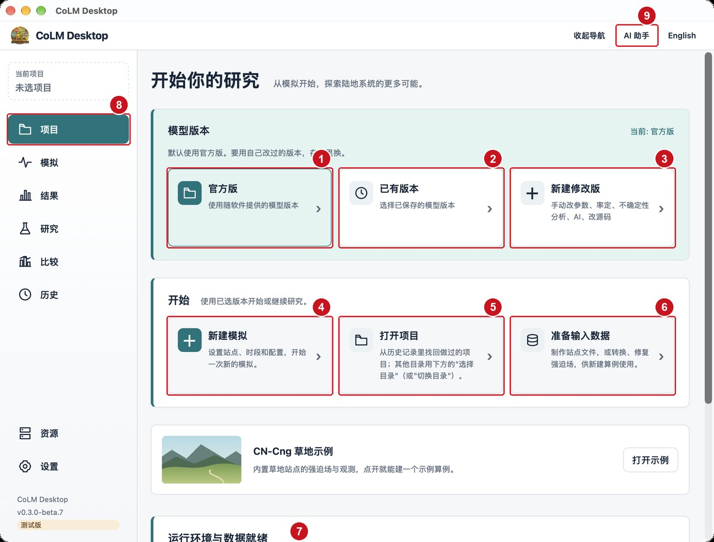

**图 1 标注：** ① 模型版本卡片（官方版/已有版本/新建修改版） ② "已有版本"入口 ③ "新建模拟" ④ "打开项目" ⑤ "准备输入数据" ⑥ 最近项目 ⑦ 左侧主导航 ⑧ AI 助手开关 ⑨ 语言切换。

界面分为三块：

- **顶部栏**：软件名、当前项目、AI 助手开关、语言（中文/English）。
- **左侧导航**：

| 导航 | 作用 |
|---|---|
| 项目 | 首页/当前项目：模型版本、新建模拟、打开项目、准备输入数据 |
| 模拟 | 当前算例的五步设置与运行 |
| 结果 | 运行结果评估、图表、导出 |
| 研究 | 参数修改、率定、不确定性、AI 研究、改源码 |
| 比较 | OpenBench 跨模拟评估 |
| 历史 | 全部操作记录、筛选与导出 |
| 资源 | 计算服务器、本机环境、默认数据路径 |
| 设置 | 界面语言/外观、助手入口、模型缓存、帮助 |

- **主面板**：随导航切换；页面内的长表单支持滚动，底部通常固定"上一步/下一步"或"开始运行"。

> 操作顺序的读法：每张截图的红色圆圈数字就是建议点击顺序；图下方文字给出对应关系。多步页面按"①→②→…"操作即可。

### 3.1 English 界面

软件内置中英文两套完整界面。点右上角 `English` 即可切换，所有页面、按钮、错误信息都会同步切换；再点 `中文` 切回。

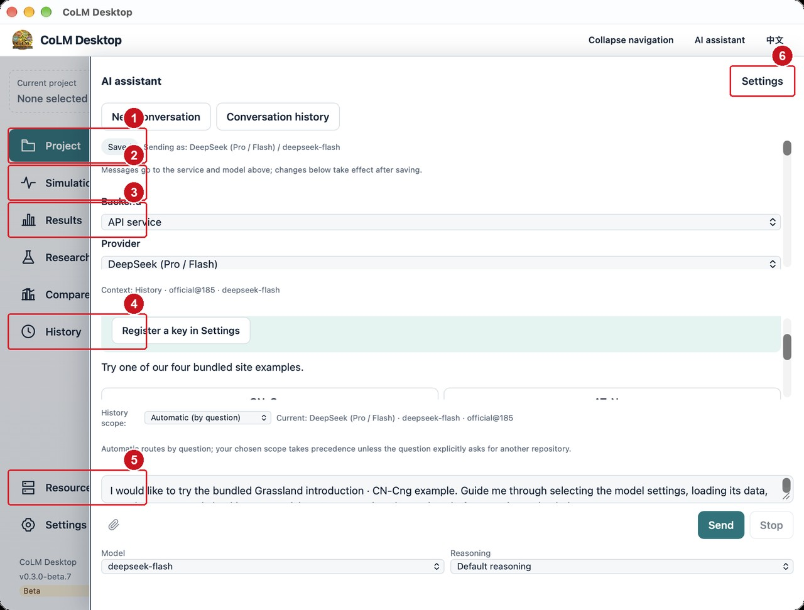

**图 2 标注：** ① Project ② Simulation ③ Results ④ History ⑤ Resources ⑥ Settings。

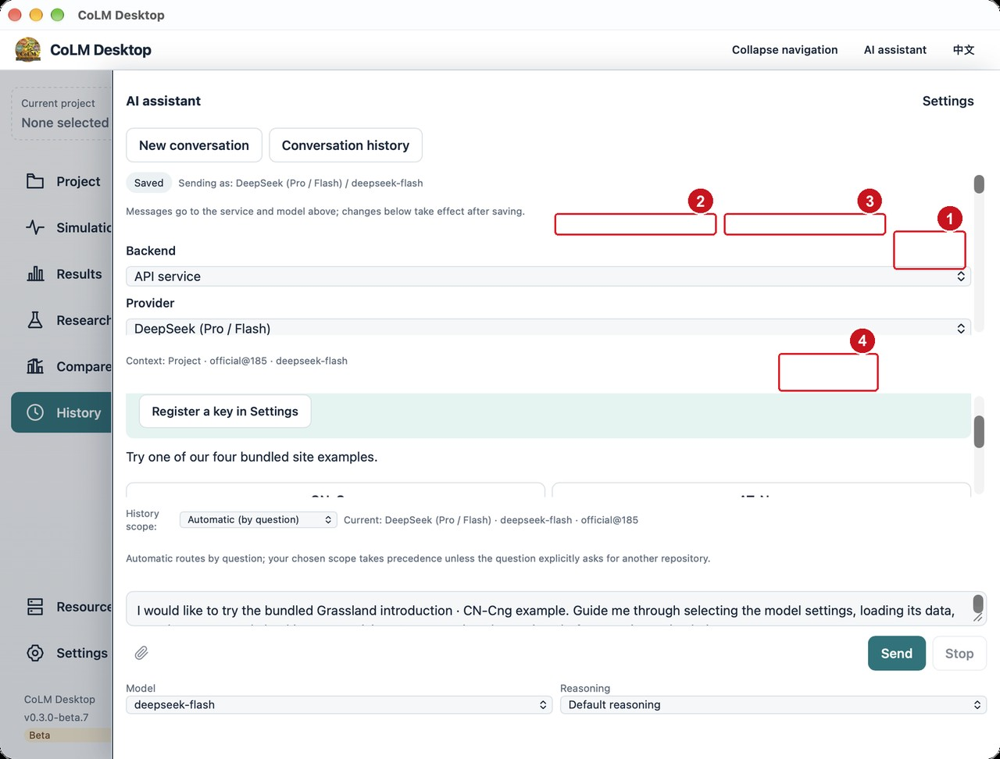

**图 3 标注：** 英文界面的历史页（筛选、导出、记录卡片与中文版一一对应）。

---

## 4. 项目与算例

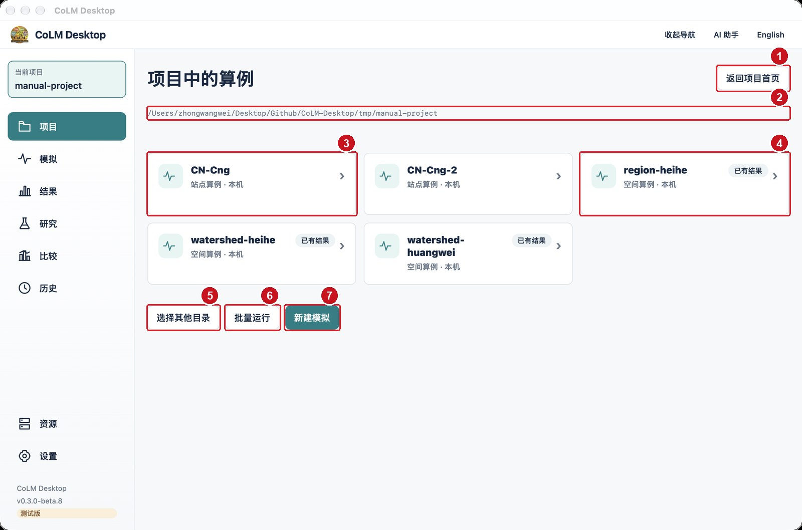

**图 4 标注：** ① 返回项目首页 ② 项目路径 ③ 站点算例卡片（点开进入五步设置） ④ 空间算例卡片 ⑤ 选择其他目录 ⑥ 批量运行 ⑦ 新建模拟。

- **项目 = 一个目录**，目录下每个子文件夹是一个算例（含 `case.nml`、`forcing.nml`、`site.nc`/`mesh.nc` 等）。
- 点算例卡片进入[第 6 章](#6-算例五步设置)。
- "选择其他目录"可打开任意位置的项目；打开后会出现在首页"最近的项目"。
- 项目页和首页的"打开项目"都优先从**历史记录**找回做过的项目；项目页另有"从历史项目打开"，按项目聚合历史、显示算例/研究数量，选中后直接打开。
- 历史里没有的新目录才用"选择目录/切换目录"走系统文件夹选择器。
- "新建模拟"进入[第 5 章](#5-新建模拟向导)。
- "批量运行"进入[第 8 章](#8-批量运行)。

> 当前项目会显示在左侧导航顶部与页面标题；切换项目请回首页"打开项目"或项目页"选择其他目录"。

---

## 5. 新建模拟向导

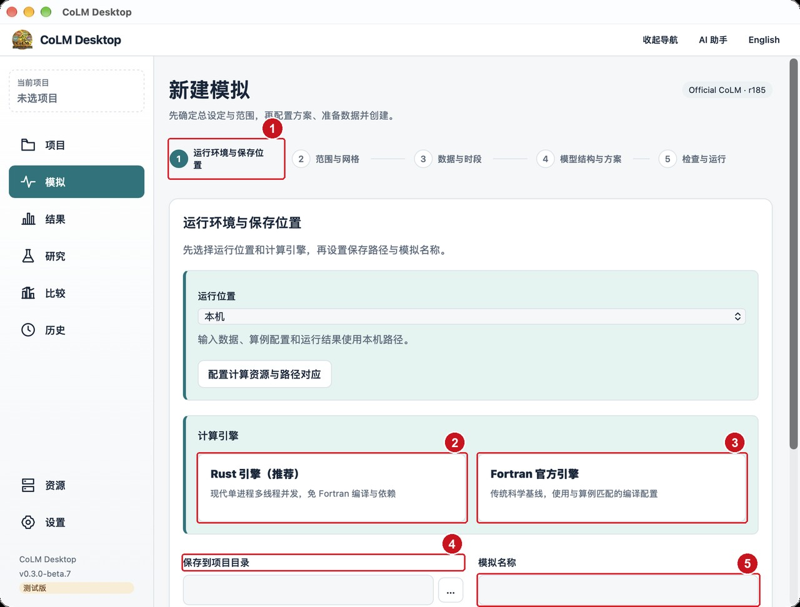

**图 5 标注：** ① 五步向导 ② Rust 引擎（推荐） ③ Fortran 官方引擎 ④ “保存到项目目录” ⑤ 模拟名称（模拟保存目录与下一步在下方）。

新建模拟与编辑已有算例共用同一套五步结构，但**基础配置（网格类型、引擎、尺寸）在创建时固定**，已有算例不能再改（可在第 1 步看到相应提示）。

### 5.1 第 1 步：运行环境与保存位置

| 字段 | 说明 |
|---|---|
| 运行位置 | "本机"，或服务器（先在"资源"里添加服务器）。服务器运行见[第 13 章](#13-资源页与远程服务器) |
| 计算引擎 | **Rust 引擎（推荐）**：所有网格、无需 Fortran/MPI 环境；**Fortran 官方引擎**：传统科学基线，需要匹配的编译配置（本机需构建内核；服务器上需远程内核） |
| 保存到项目目录 | 勾选后算例保存在当前项目下；取消可手选目录 |
| 模拟名称 | 必填；不能含路径分隔符 |
| 模拟保存目录 | 由项目目录 + 模拟名称自动组合；可手动改 |
| 类型/网格 | 站点、经纬度网格、非结构网格、流域网格等（由后续步骤或入口决定） |

### 5.2 第 2–5 步

- **第 2 步 范围与网格**：站点选经纬度；空间算例选网格类型、范围、分辨率/非结构文件。
- **第 3 步 数据与时段**：模拟起止日期、预热、站点/地表/Runtime/强迫场路径与强迫参数。
- **第 4 步 模型结构与方案**：地类方案、土壤水力、变饱和流、河湖汇流、LUC、BGC、城市、作物、材料过程等开关，以及"完整参数目录"。其中 USGS 地类方案已退休、未全面测试，不建议新研究使用。
- **第 5 步 检查与运行**：时间步长/输出设置、变量选择、编译配置、提交阶段，最后"开始运行"。

各字段的完整清单见[附录 A：配置字段总表](appendices/appendix-config-fields.md)（964 项，按页面分组）。

---

## 6. 算例五步设置

打开已有算例后，顶部显示五个步骤；已完成的步骤带 ✓。下面按步骤说明重点。所有图都是同一示例算例 `CN-Cng`。

### 6.1 第 1 步：运行环境与保存位置

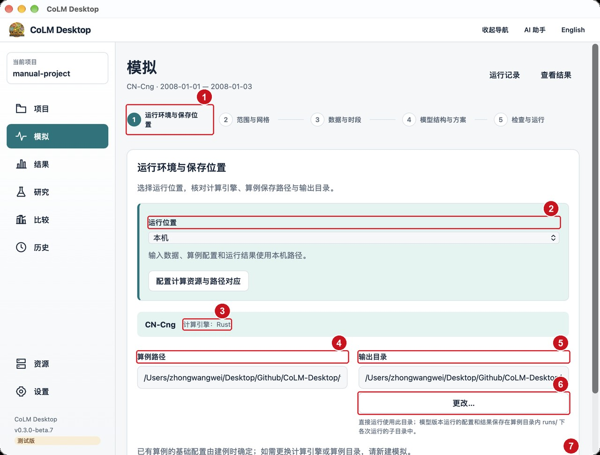

**图 6 标注：** ① 五步导航 ② 运行位置 ③ 计算引擎 ④ 算例路径 ⑤ 输出目录 ⑥ 更改路径 ⑦ 下一步。

要点：
- 运行位置默认"本机"；切到服务器后，下方会显示服务器负载、分区与作业状态。
- 计算引擎在创建时确定；已有算例如需换引擎，请新建模拟。
- 算例路径与输出目录用于定位配置/结果；模型版本运行会在算例目录下 `runs/<操作号>/` 生成独立运行副本。

### 6.2 第 2 步：范围与网格

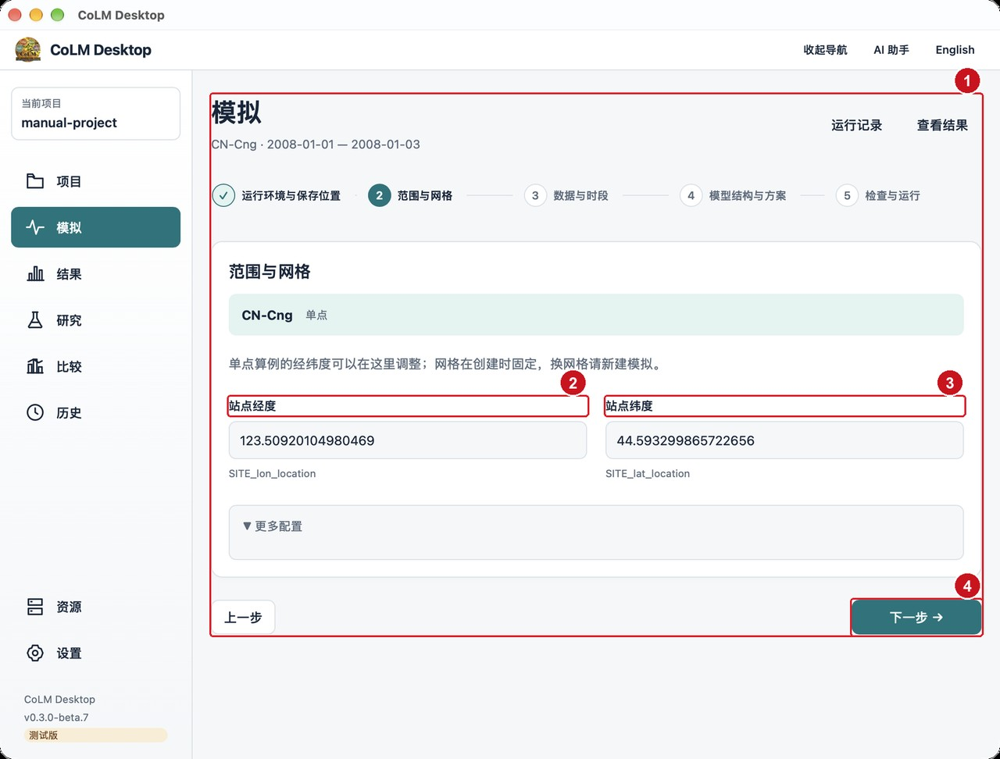

**图 7 标注：** ① 单点说明 ② 站点经度 ③ 站点纬度 ④ 下一步。

- 站点算例可在这里调整经纬度；**网格在创建时固定**，换网格需新建模拟。
- 空间算例的第 2 步显示范围/网格字段，并在创建后锁定（只能查看）；若需更换网格请新建模拟。

### 6.3 第 3 步：数据与时段

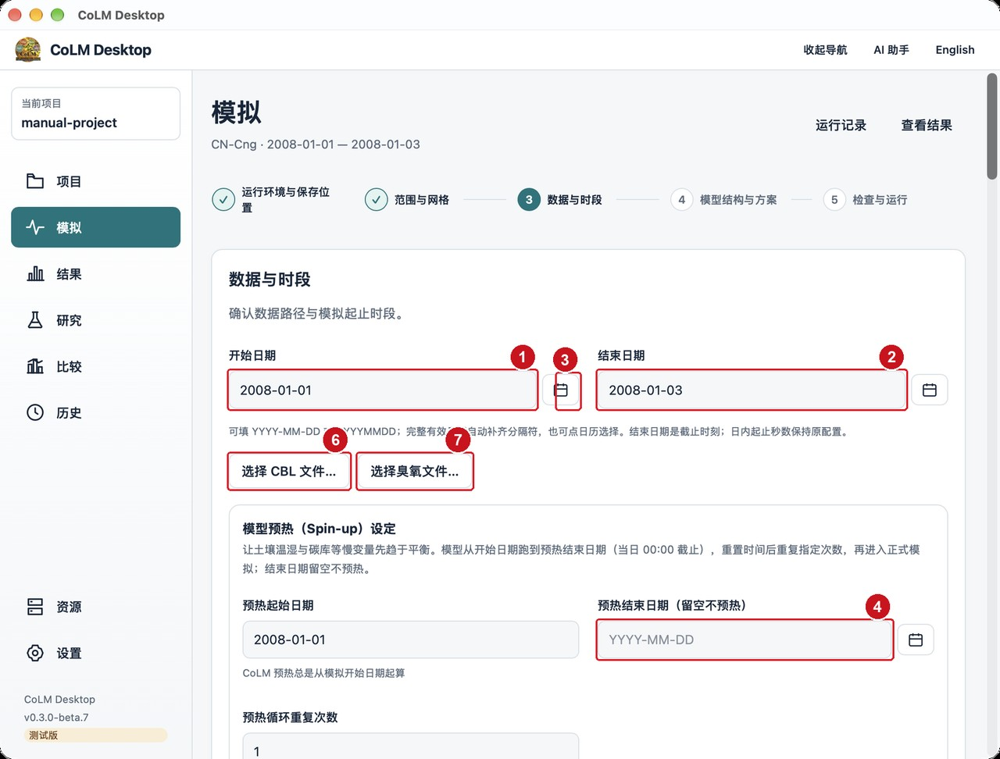

**图 8 标注：** ① 开始日期 ② 结束日期 ③ 日历选择 ④ 预热结束日期 ⑥ 选择 CBL 文件 ⑦ 选择臭氧文件（⑤“预热循环重复次数”在同一区域下方）。

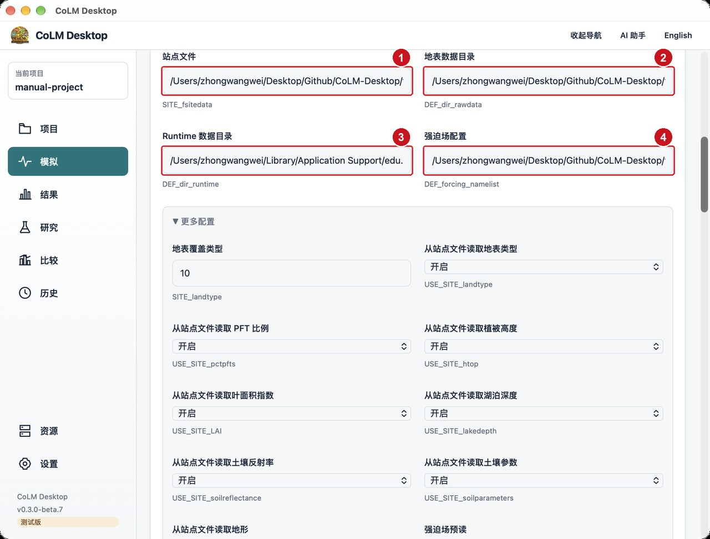

**图 9 标注：** ① 站点文件 ② 地表数据目录 ③ Runtime 数据目录 ④ 强迫场配置（其下的强迫场目录/数据集在同一卡片内）。

关键字段：

| 字段 | 说明 |
|---|---|
| 开始/结束日期 | 支持 `YYYY-MM-DD` 或 `YYYYMMDD`；结束日期是截止时刻。结束必须晚于开始 |
| 预热起始日期 | CoLM 总是从模拟开始日期起算，只读 |
| 预热结束日期 | 留空 = 不预热；模型先跑预热，重置后重复指定次数再进入正式模拟 |
| 站点文件 | `site.nc`，单站地表数据 |
| 地表数据目录 | RawData 目录（空间算例或需要重做地表时）；
| Runtime 数据目录 | 模型运行所需附加数据 |
| 强迫场配置 | `forcing.nml` 路径 |
| 强迫场数据目录/数据集 | 强迫场根目录与数据集名（如 `JRA3Q`、`CMFD`、`POINT`）；可选值来自客户端模板注册表，不是随便填 |
| 观测高度方式/高度 | 强迫场风速/气温/湿度观测高度 |
| 数据含缺测值 | 是否声明缺测值属性与名称 |
| 各变量时间间隔/偏移 | 强迫场变量时间步长与偏移（8 个变量，逗号分隔） |

> 强迫场 `dataset` 必须写引擎实际识别的标识（如 `CMFD`、`ERA5`、`CMIP6`、`POINT`），不是模板文件名（`ERA5_LEddy`、`MPI-ESM1-2-HR_ssp585` 是模板名，会被拒绝）。

### 6.4 第 4 步：模型结构与方案

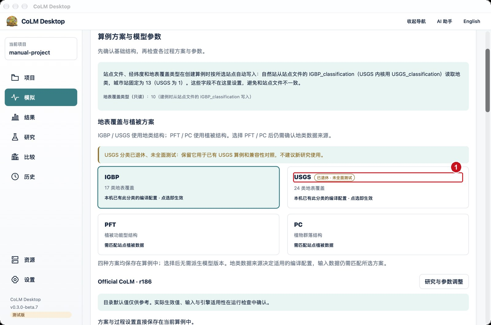

**图 10 标注：** ① 地表覆盖方案（USGS 已标记“已退休 · 未全面测试”，不建议新研究使用；土壤水力方案在同页下方继续）。

- **土壤水力方案**：Campbell 或 van Genuchten；van Genuchten 必须开启变饱和流。
- **过程开关**：变饱和流、河湖汇流、土地覆盖变化、BGC、城市、作物、材料过程等。是否可用取决于当前内核编译宏与算例尺度（例如 SinglePoint 不支持土地覆盖变化）。
- **参数卡片**：次网格与植被、土壤方案、水热过程、生态与生地化、其他模型选项；点"完整参数目录"可搜索全部 1369 个参数。
- 参数修改只写入当前算例的覆盖，不派生新版本；要形成可复用版本，请用"研究 → 新建修改版"并冻结。

### 6.5 第 5 步：检查与运行

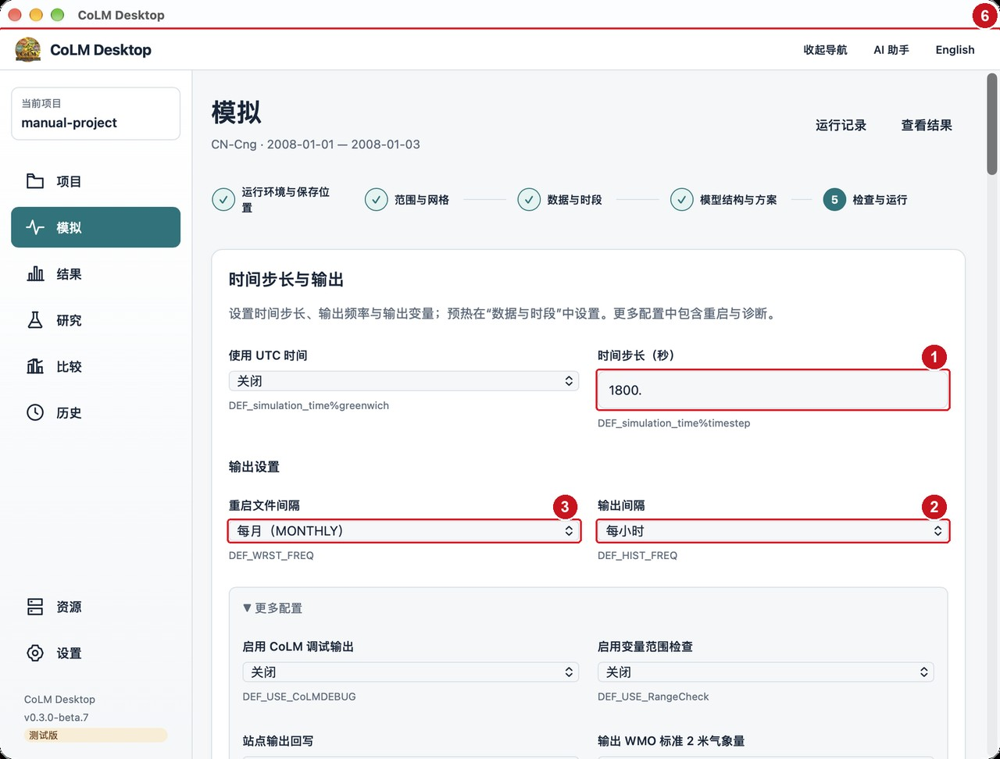

**图 11 标注：** ① 时间步长 ② 输出间隔 ③ 重启文件间隔 ④ 推荐核心量 ⑤ 一键全开启 ⑥ 全部变量（变量表在下方）。

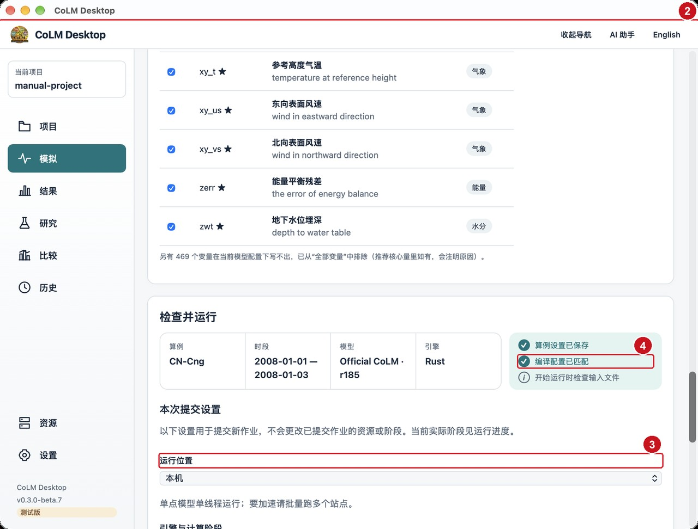

**图 12 标注：** ① 检查并运行 ② 本次提交设置 ③ 运行位置 ④ 编译配置（⑤“本次提交阶段”在同一卡片下方）。

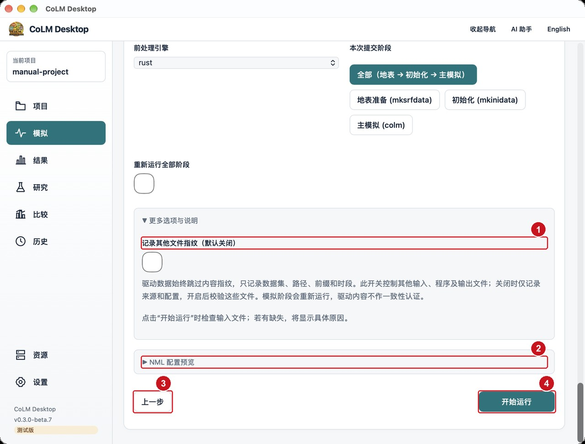

**图 13 标注：** ① 记录其他文件指纹 ② NML 配置预览 ③ 上一步 ④ 开始运行。

要点：
- 输出变量可在"推荐核心量（39）"与"全部变量"之间切换；一键全开/全清。
- **提交阶段**：全部（地表→初始化→主模拟）/ 仅地表 / 仅初始化 / 仅主模拟；切换阶段会自动标记需要重跑的阶段。
- "记录其他文件指纹"默认关闭；开启后会校验输入/程序/输出内容哈希，更严格但更慢。
- 点"开始运行"前会检查输入文件；缺文件会直接列出。
- 运行过程中可"停止"；关闭窗口前如有运行中任务会先询问。

---

## 7. 运行算例

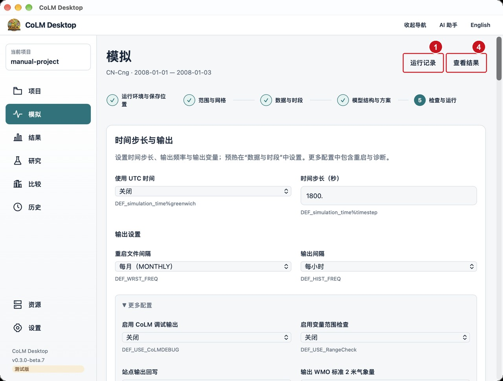

**图 14 标注：** ① 运行记录 ② 运行状态/完成信息 ③ 查看完整日志 ④ 查看结果。

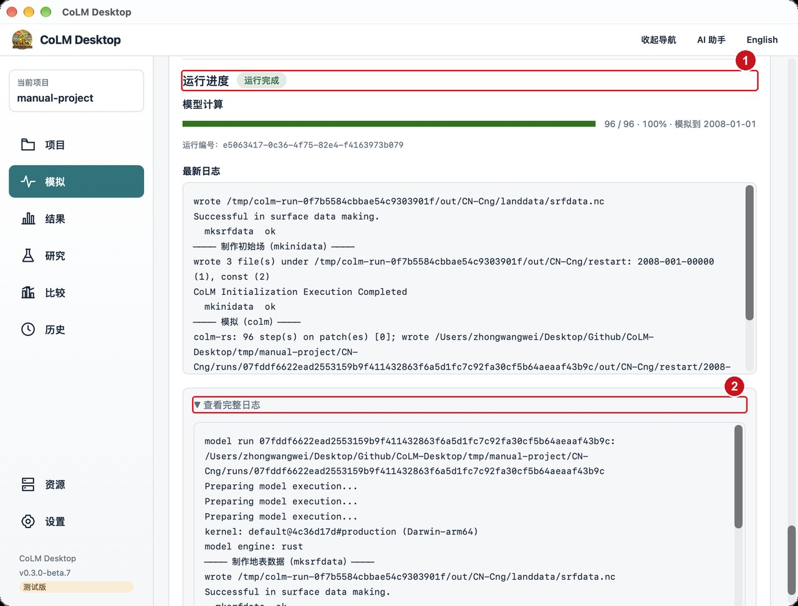

**图 15 标注：** ① 运行进度 ② 完整日志。

- 本机运行：Rust 引擎直接执行三个阶段；日志按阶段分段。
- 远程运行：提交后每约 10 秒核对一次状态；可在"运行进度"查看阶段、日志末尾、服务器作业详情，并可停止/取回结果。
- 失败时展开日志定位；常见原因见[第 22 章](#22-故障排查)。

本次演示实际运行的输出目录（节选）：

```text
tmp/manual-project/CN-Cng/runs/07fddf66…/
├── case.nml            # 物化后的运行配置
├── forcing.nml
├── model-run.json      # 运行清单（版本、输入哈希、产物路径）
└── out/CN-Cng/
    ├── landdata/srfdata.nc
    ├── restart/2008-003-00000/…restart….nc
    └── history/CN-Cng_hist_2008-01.nc
```

---

## 8. 批量运行

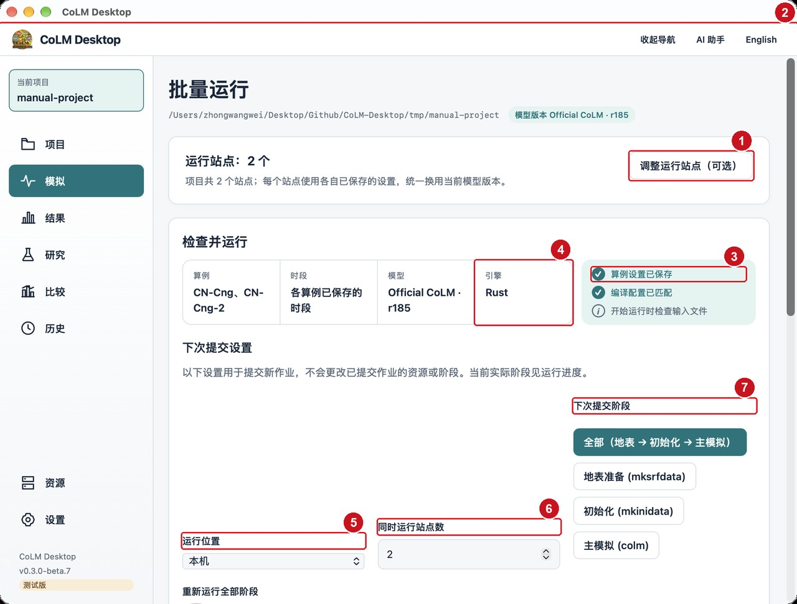

**图 16 标注：** ① 调整运行站点（可选） ② 检查并运行 ③ 算例与时段摘要 ④ 模型与引擎 ⑤ 运行位置 ⑥ 同时运行站点数 ⑦ 提交阶段。

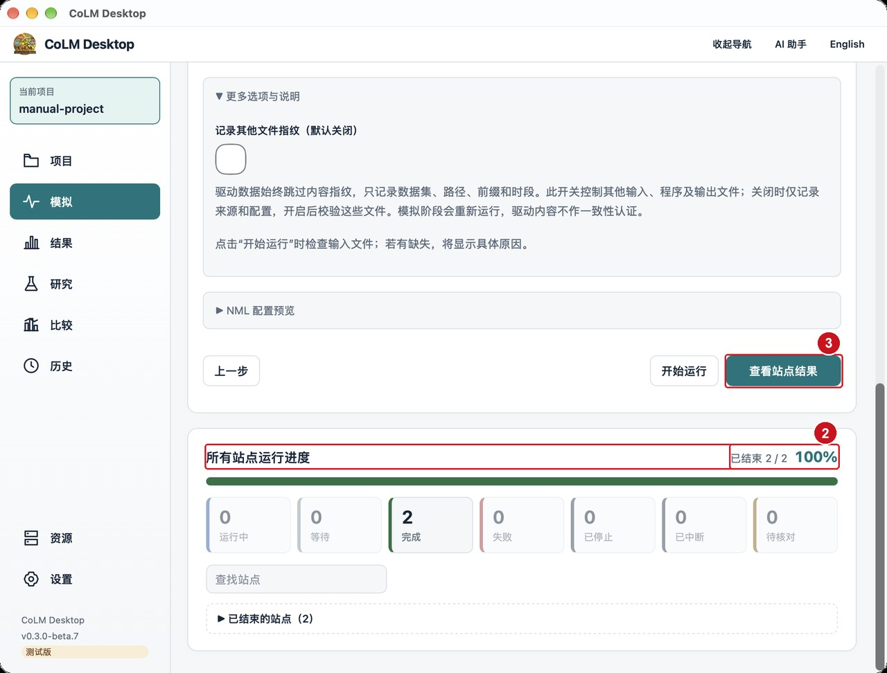

**图 17 标注：** ① 进度汇总 ② 完成/失败计数 ③ 查看站点结果 ④ 只选失败站点重跑。

操作顺序：
1. 项目页点"批量运行"；
2. 在"调整运行站点"里勾选要运行的站点（默认全选；可按未完成/失败筛选）；
3. 选择运行位置（本机/服务器）、模型版本、引擎与提交阶段；
4. 点"开始运行"；
5. 查看每个站点的进度；失败的站点可"只选失败或已停止的"重跑；
6. 完成后点"查看站点结果"或左侧"结果"查看。

**打包与并发：**
- 本机：`同时运行站点数` 决定并发进程数，单点每站固定 1 线程。
- 服务器（Slurm/LSF/PBS）：站点批量默认**按节点打包**——同一批站点进入服务器队列，每个节点作业一次占满节点核数，站点数多时自动多开节点；不再"一个站点占一个节点"。
- Rust 空间算例的并行预算（节点×每节点核数）与站点打包互斥，界面只显示适用的那一种。

本次演示的批量结果：**2 个站点全部完成，0 失败**（与图 17 一致）。

---

## 9. 结果页

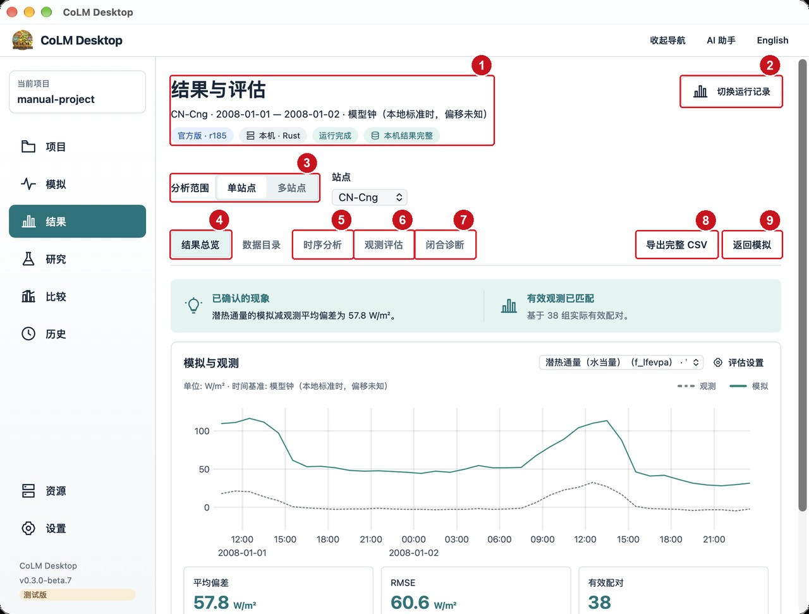

**图 18 标注：** ① 结果与评估标题 ② 切换运行记录 ③ 分析范围 ④ 结果/时序/观测/闭合四个页签 ⑤ 导出完整 CSV ⑥ 返回模拟。

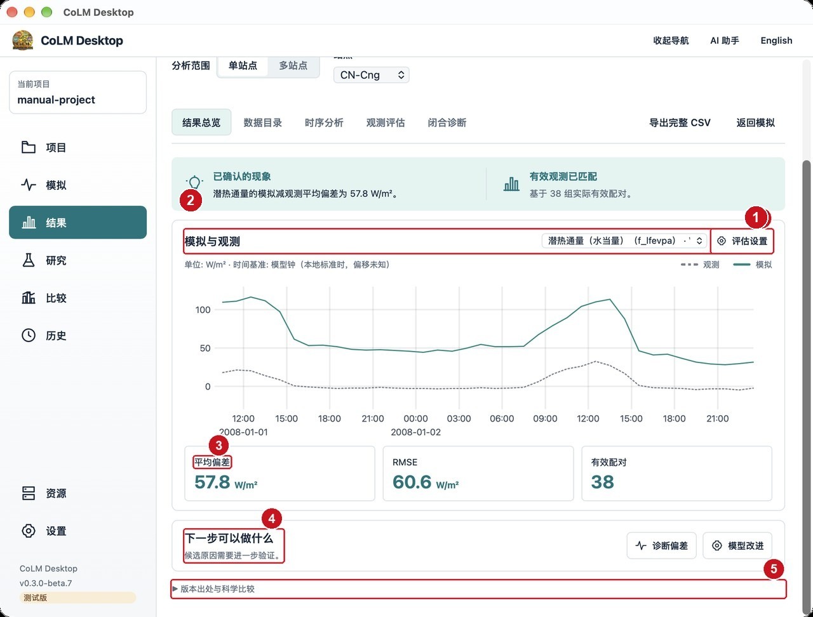

**图 19 标注：** ① 评估设置 ② 已确认的现象与有效观测匹配 ③ 平均偏差/RMSE/有效配对 ④ 候选原因 ⑤ 版本出处与科学比较。

- **分析范围**：单站点 / 多站点（多站点需同一批运行记录）。
- **页签**：结果总览、时序分析、观测评估、闭合诊断。
- **指标**：平均偏差、RMSE、有效配对数量、观测覆盖；时间基准按运行设置（模型钟/本地标准时）。
- **导出完整 CSV**：导出当前分析范围的时序数据。
- **版本出处**：显示运行使用的模型版本/修订与科学比较入口（跨版本对照需在"比较"页用 OpenBench）。

---

## 10. 研究页

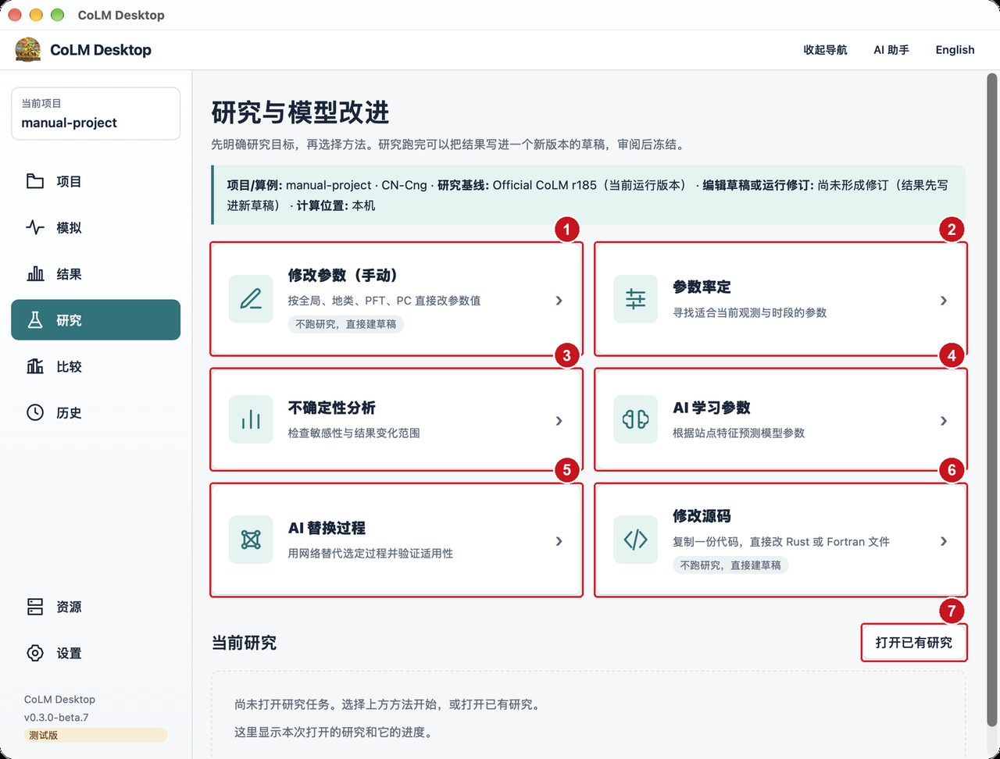

**图 20 标注：** ① 修改参数（手动） ② 参数率定 ③ 不确定性分析 ④ AI 学习参数 ⑤ AI 替换过程 ⑥ 修改源码 ⑦ 打开已有研究。

| 方法 | 用途 |
|---|---|
| 修改参数（手动） | 直接改全局/地类/PFT/PC 参数；不跑研究，直接建草稿 |
| 参数率定 | 用观测寻找适合当前时段与算例的参数（支持共享参数跨站点验证） |
| 不确定性分析 | 敏感性分析与结果变化范围 |
| AI 学习参数 | 根据站点特征预测参数 |
| AI 替换过程 | 用网络替代选定过程并验证适用性 |
| 修改源码 | 复制源码改 Rust/Fortran，编译与测试后形成修订 |

研究跑完后，结果先写进新版本的**草稿**，审阅后冻结为模型修订；结果不比默认参数好时拒绝写回。任务进度、收敛、观测约束程度都显示在"当前研究"区域。

> **Rust 固定引擎**：研究页不再提供计算引擎、服务器前处理引擎或编译配置下拉；研究固定使用 Rust，内核由所选算例的网格/地类/作物设置自动匹配。没有匹配内核时会直接提示，不会静默改用其他内核。已有的旧研究仍按它冻结的引擎与内核运行。
>
> **CROP**：Rust 的单点和空间作物算例都不再要求 CROP 编译内核；单点由站点文件的作物数组识别，空间由“作物过程”开关（正的播种日）识别，CLI 会自动加 `--crop`。Fortran 引擎仍需真正的 CROP 内核。
>
> **USGS**：地类方案中的 USGS 已标记为“已退休 · 未全面测试”，保留给已有 USGS 算例和兼容性对照，不建议新研究使用。

---

## 11. 比较页（OpenBench）

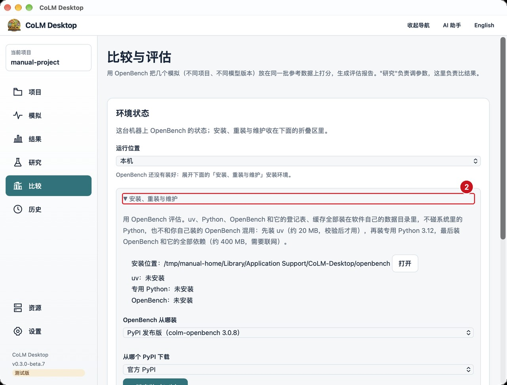

**图 21 标注：** ① 安装、重装与维护（展开后有一键安装；环境状态/本次评估在该节上下方）。

- OpenBench 安装在软件自己的数据目录（约 400 MB），不碰系统 Python，不与你自己的 OpenBench 混用；
- 首次使用：展开"安装、重装与维护" → 一键安装（uv → 专用 Python 3.12 → OpenBench 及依赖），需要联网；
- 安装完成后在"本次评估"选择模拟、参考数据、指标/评分、时间尺度（可到年/月气候态），可本机或服务器运行；日志实时显示、可停止，只取回报告；
- 支持登记模型变量、非标准模拟与多参考数据；评估报告在结果页/比较页查看。

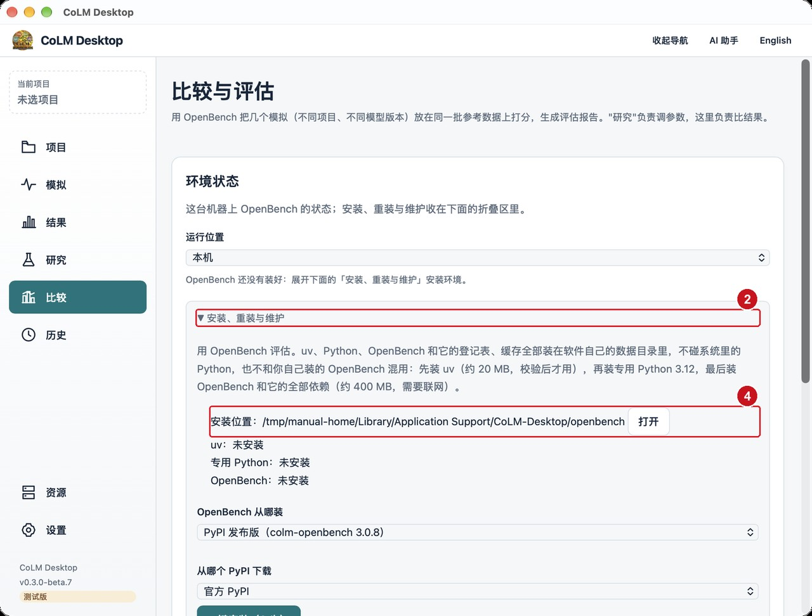

**图 22 标注：** ②"安装、重装与维护"折叠区 ④ 安装位置（打开目录）；环境状态与一键安装在同页上下方。

> 安装过程会先装 uv（约 20 MB，校验后使用），再装专用 Python 3.12，最后装 OpenBench 及依赖（约 400 MB，需要联网）。三个状态全部显示"已安装"后，"本次评估"区域才会出现配置表单。

---

## 12. 历史页

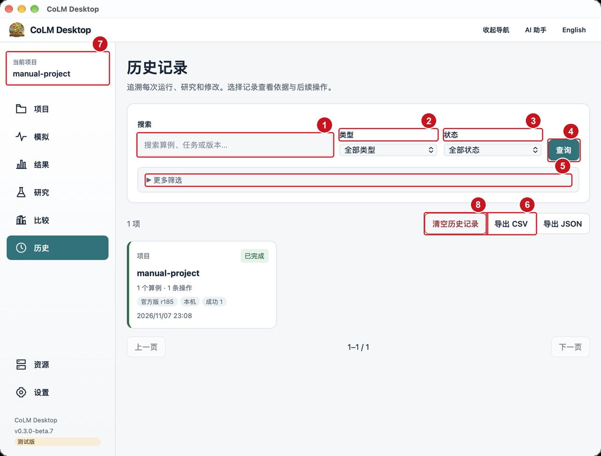

**图 23 标注：** ① 搜索 ② 类型筛选 ③ 状态筛选 ④ 查询 ⑤ 更多筛选 ⑥ 导出 CSV ⑦ 项目记录 ⑧ 清空历史记录。

- 记录每一次运行、研究、配置修改与远程操作；点击记录查看依据与后续操作；
- 筛选可按类型、状态、算例、服务器等组合；
- 导出 `CSV` / `JSON`（全局历史导出为**一行一操作**，不会把批量运行折叠掉）；
- 清空历史可选择是否同时删除本机算例文件夹与未确认结束的记录（危险操作会二次确认）。

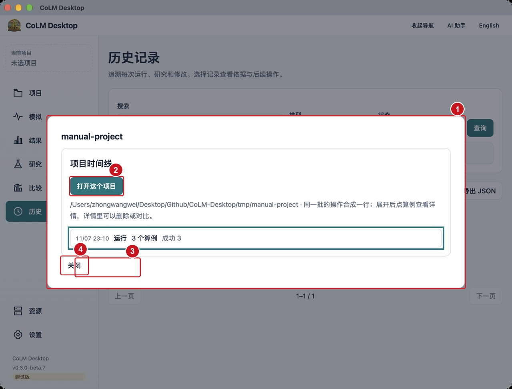

**图 24 标注：** ① 项目时间线 ② 打开这个项目 ③ 算例记录 ④ 关闭。同一批（一次批量运行）的操作合并成一行；展开后可点算例查看详情、删除或对比。

---

## 13. 资源页与远程服务器

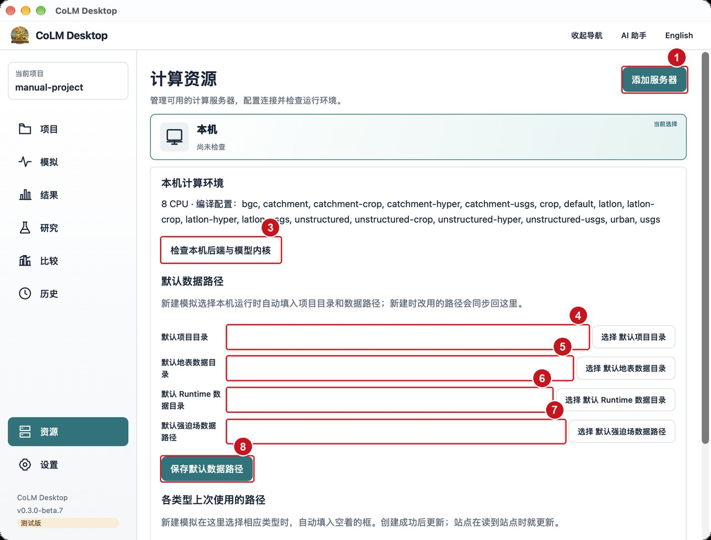

**图 25 标注：** ① 添加服务器 ② 检查本机后端与模型内核 ③ 默认项目目录 ④ 默认地表数据目录 ⑤ 默认 Runtime 数据目录 ⑥ 默认强迫场数据路径 ⑦ 保存默认数据路径（本机服务器卡片在页面中部）。

### 13.1 本机

- 显示 CPU 核数、可用编译配置（内核预设）；
- "检查本机后端与模型内核"会验证 `colm-cli`、sidecar 与内核清单；
- 默认数据路径用于新建模拟时自动填值；新建后改用的路径会同步回这里。

### 13.2 添加远程服务器（SSH）

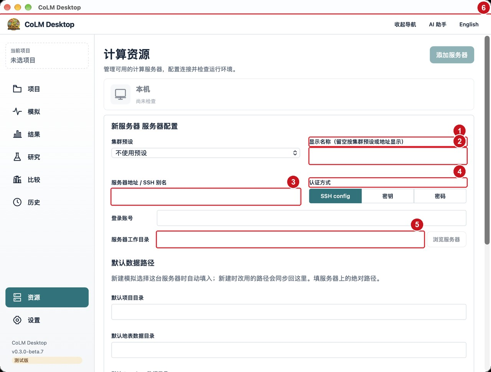

**图 26 标注：** ① 集群预设 ② 显示名称 ③ 服务器地址/SSH 别名 ④ 认证方式（config/密钥/密码） ⑤ 服务器工作目录 ⑥ 默认数据路径（可折叠区）。保存前请先点"检查连接"，全部检查项通过后再保存。


"添加服务器"后填写：

| 字段 | 说明 |
|---|---|
| 名称 | 显示名，也是 `remote.json` 里的 host 别名 |
| SSH 别名/主机 | `~/.ssh/config` 里的 Host，或 `user@host`；需要密码时可用一次性登录缓存 |
| 工作根目录 | 服务器上的 CoLM-Desktop 根目录（引擎、内核、作业、算例副本都在此） |
| 调度器 | `auto` / `bare` / `slurm` / `lsf` / `pbs`；分区/队列、账号、时限 |
| 节点与核数 | 每节点核数用于站点打包与并行预算 |
| 环境准备（env script） | 在服务器每次远程命令前执行，例如 `module load ...` / `source /etc/profile.d/modules.sh; module load ...`。编 Fortran 内核/运行服务器作业都依赖它 |
| 目录映射（map） | 本机路径前缀 = 服务器路径前缀，用于把本地数据目录对应到服务器（如 PLUMBER2s/Sitedata） |
| 环境变量/指令 | 额外 `--directive`（Slurm `#SBATCH` 行）、内存等 |

> 关键规则：
> 1. **外部数据目录必须 map**（强迫场、rawdata、Runtime、Sitedata）。目录不会被自动上传；普通文件（如算例目录内的 `site.nc`、`forcing.nml`）在物化运行时由 CLI staging 自动带走。
> 2. Fortran 引擎需要先在服务器上构建内核（"资源 → 服务器 → 准备环境/内核"），并设置正确的 `env script`（gfortran + MPI + NetCDF-Fortran）。
> 3. Rust 引擎首次远程运行会在服务器上构建 Rust 引擎（登录节点编好），需要 Rust/Cargo/CMake；安装包支持离线自举，也可提前 `remote-engine-prepare`。

### 13.3 服务器运行流程

1. 资源页添加服务器 → 检查连接与目录；
2. 算例第 1 步把"运行位置"切到该服务器；
3. 第 5 步选编译配置/引擎、提交阶段 → "开始运行"；
4. 运行进度里查看服务器作业状态、日志、节点/分区；可"核对服务器状态"、取消、取回结果；
5. 远程结果只取回所需变量/月份（可压缩），本机"结果"页打开。

常用远程 CLI 示例见[第 18.6 节](#186-远程服务器与集群)。

---

## 14. 设置页

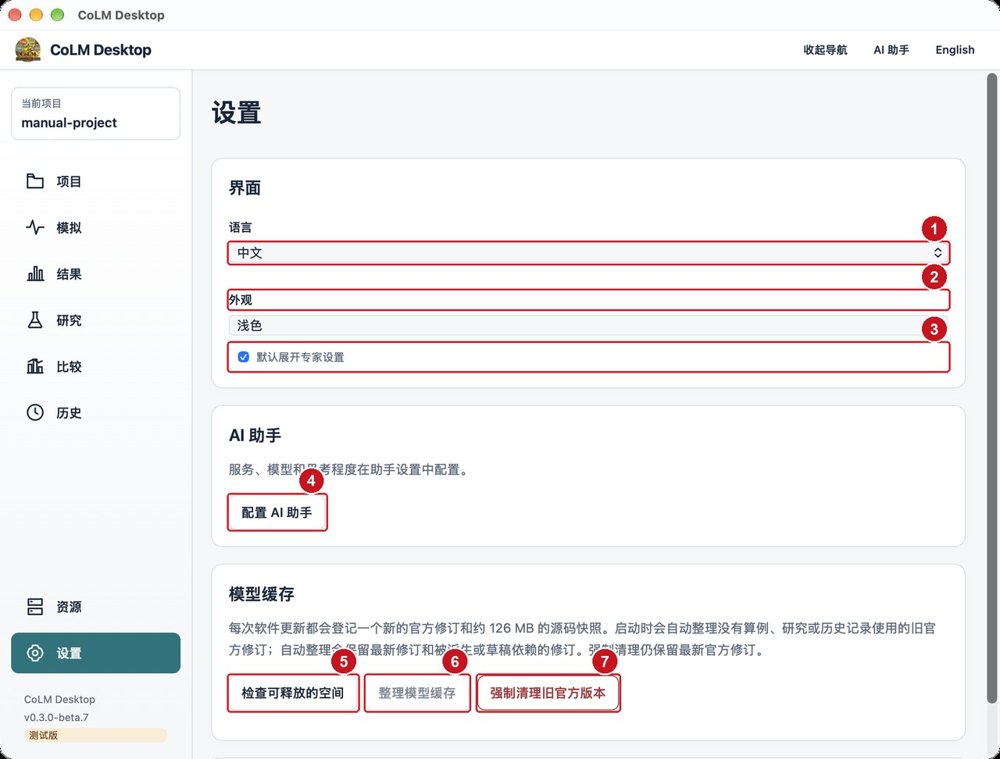

**图 27 标注：** ① 语言 ② 外观 ③ 默认展开专家设置 ④ 配置 AI 助手 ⑤ 检查可释放空间 ⑥ 整理模型缓存 ⑦ 强制清理旧官方版本（帮助在页面下方）。

- **界面**：语言（中文/English）、外观（浅色/深色/跟随系统）、默认展开专家设置。
- **AI 助手**：跳到助手设置（服务地址、模型、API Key、联网搜索、审批方式等），见[第 17 章](#17-ai-助手)。
- **模型缓存**：每次软件更新登记新的官方修订与约 126 MB 源码快照；启动时会自动整理没有被算例/研究/历史使用的旧官方修订（保留最新与被依赖的修订）。"检查可释放空间"先统计，"整理模型缓存"按策略清理，"强制清理"需二次确认。
- **帮助**：关于、版本、文档入口。

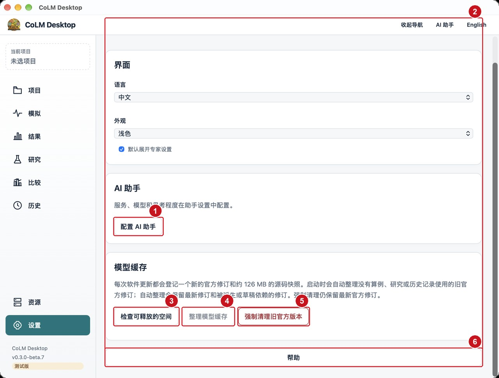

**图 28 标注：** ① 配置 AI 助手 ② 模型缓存说明 ③ 检查可释放空间 ④ 整理模型缓存 ⑤ 强制清理旧官方版本 ⑥ 帮助。

---

## 15. 模型版本

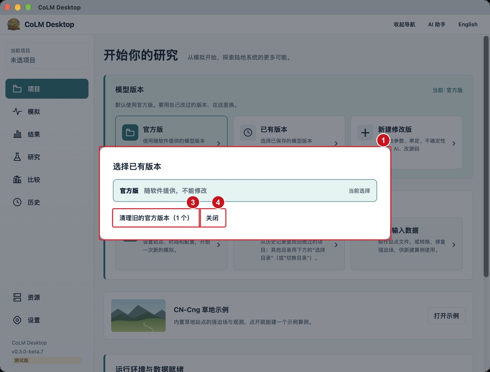

**图 29 标注：** ① "选择已有版本"对话框 ② 官方版修订卡片 ③ 清理旧的官方版本 ④ 关闭。

首页"模型版本"卡片有三种入口：

| 入口 | 说明 |
|---|---|
| 官方版 | 随软件提供、不可修改；每个版本对应一个冻结修订与源码快照 |
| 已有版本 | 列出所有已保存修订（含自己冻结的修改版、旧官方修订），可切换/删除；删除前会检查绑定 |
| 新建修改版 | 进入"研究"：手动改参数、率定、不确定性、AI、改源码；研究结果经草稿审阅后**冻结**为新修订 |

注意事项：
- 运行算例时选择的版本会绑定到算例（`model-binding.json`），重启后保持；
- 修改版与官方版可同时存在，结果页/比较页按版本比较；
- 旧官方修订被自动/手动清理后，绑定它的算例会提示重新绑定；
- 清理/删除是不可逆操作，界面会二次确认并说明项目/研究/历史文件保留。

---

## 16. 准备输入数据

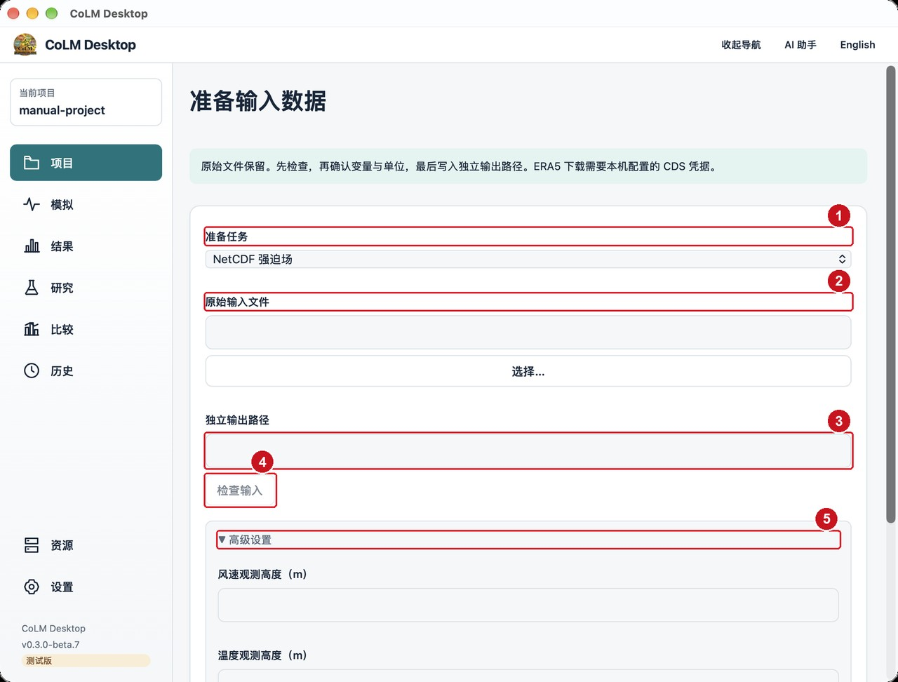

**图 30 标注：** ① 准备任务 ② 原始输入文件 ③ 独立输出路径 ④ 检查输入 ⑤ 高级设置。

用途：制作站点文件、转换/修复强迫场，供新建算例使用。典型流程：

1. **选择准备任务**：站点建站 / 强迫场转换 / 强迫场缺测修复；
2. **选择原始输入文件**（CSV/TXT/NetCDF 等；ERA5 下载需本机配置 CDS 凭据）；
3. **设置独立输出路径**：原始文件不改，产物写到独立路径；
4. **检查输入**：自动识别分隔符、列名、单位、时间范围与站点；
5. **高级设置**：观测高度、单位换算、缺测处理、变量映射等；
6. **生成数据**：写入产物；
7. **用于新算例** 或 **安装到数据集目录并扫描**：安装到 `Sitedata/`、`Forcing/` 后自动调用 `scan_sites` 刷新数据集，页面显示识别到的站点数量。站点与强迫场词干不同会提示无法配对。

产物页会显示 `site_kind`/`mode`、`from_lookup` 计数与 warning；rawdata 为零栅格时给出显式警告而不是静默回退。

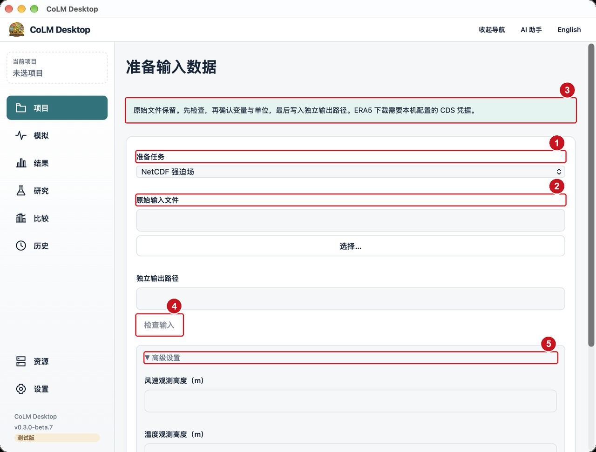

**图 31 标注：** ① 准备任务 ② 原始输入文件 ③ 独立输出路径 ④ 检查输入 ⑤ 高级设置（展开后含观测高度、变量映射等）。

---

## 17. AI 助手

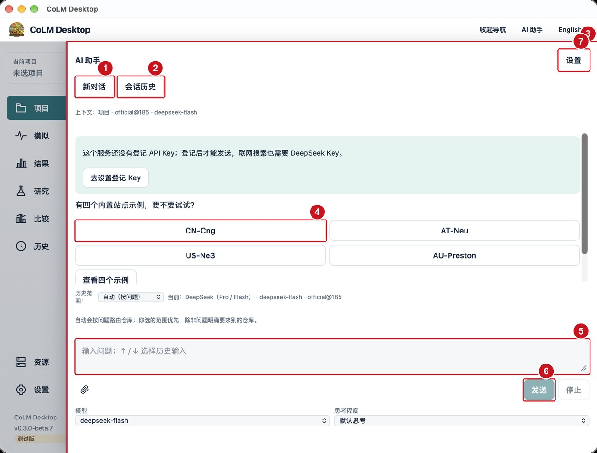

**图 32 标注：** ① 新对话 ② 会话历史 ③ 上下文范围（项目/算例/模拟/结果/研究） ④ 内置示例站点 ⑤ 输入框 ⑥ 发送/停止 ⑦ 助手设置。

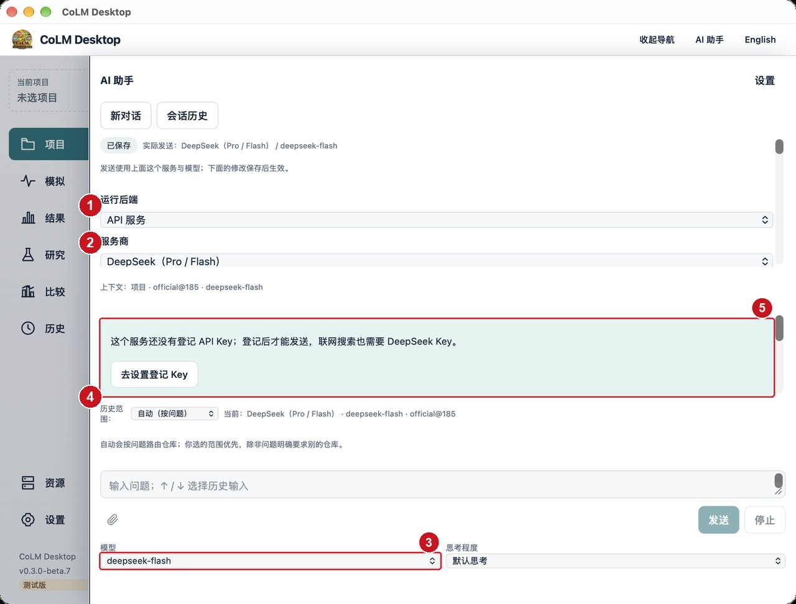

**图 33 标注：** ① 运行后端 ② 服务商 ③ 模型选择 ④ 历史范围 ⑤ 未登记 API Key 提示；联网搜索与文档检索等高级项在设置页下方（需滚动查看）。

### 17.1 首次配置

1. 打开助手设置 → 填写服务地址（如 `https://api.deepseek.com`）、模型名、API Key；
2. 选择 API 格式（chat completions / responses 等）、思考程度、超时；
3. 如使用联网搜索/数据外发，勾选确认外发目标；
4. 保存。若助手正在运行，保存后会自动重配；重配失败会提示"设置已保存，但助手重配失败……下一次发送会自动重试"，不会丢设置。

### 17.2 使用

- 助手**理解当前页面上下文**（项目/算例/模拟/结果/研究），能读取页面合同并执行登记的按钮操作；
- 发送前可修改问题；支持附件（PDF/DOCX/TXT）；
- 工具调用会显示"完成/失败"卡片，可展开查看参数与错误；
- **危险操作（删除、覆盖、清空等）仍需人工确认**；审批方式可在设置里选；
- 页面上的按钮都登记为助手可执行动作；配置字段受页面合同约束——例如空间算例第 2 步的范围字段在助手工具中也是只读（`ui_fill` 会返回 `cannot be changed here`），避免绕过界面约束；
- 会话历史按项目保存，可恢复；上下文接近窗口上限时会提示并折叠较早工具结果。


### 17.3 文件与检索

- 可附加本机 PDF/DOCX/文本文档；
- 联网搜索使用 DeepSeek Search API（需 Key）；
- 文档检索可接本机 Xerj 节点（默认关闭；可用户自己运行，也可由应用托管固定版本）；
- 模型/代码问题会路由官方 CoLM 与 CoLM-Desktop 仓库检索，回答带出处；不编造提交/PR。

---

## 18. 命令行 `colm-cli`

`colm-cli` 与桌面端使用同一套引擎/算例/模型注册表。安装包内路径（macOS）：

```text
/Applications/CoLM Desktop.app/Contents/MacOS/colm-cli
# 或源码构建产物
target/release/colm-cli
```

查看全部命令：

```bash
colm-cli --help
```

> 完整命令索引与 `--help` 原文见[附录 C：CLI 命令参考](appendices/appendix-cli.md)（68 组用法、`.--help` 全文）。

### 18.1 通用约定

- 大多数命令支持 `--json 1` 输出机器可读结果；
- 模型相关命令可带 `--model-root <目录>`（默认 `~/Library/Application Support/CoLM-Desktop/models` 或对应平台目录）与 `--model-id/--model-revision`；
- 远程命令共享 `--host`、`--root`、`--scheduler`、`--partition`、`--walltime`、`--env-script` 等选项；
- 错误信息同时给中英文时，脚本可按固定文本匹配；退出码非 0 表示失败。

### 18.2 站点与强迫场

```bash
# 扫描站点目录（--quick 跳过强迫场读取）
colm-cli scan --dir "$HOME/Library/Application Support/edu.sysu.colm.desktop/examples/Sitedata" --quick 1

# 从 CSV/TXT 建站点文件（带 rawdata 可抽取土壤等字段）
colm-cli site-new --out ./CN-Demo_site.nc --lon 113.5 --lat 23.5 \
  --mode igbp --rawdata /path/to/rawdata --json 1

# 强迫场目录探测/修复
colm-cli forcing-directory-probe --help   # 见 --help 中 remote/forcing 组
```

**实际运行示例**（本手册验证时执行）：

```console
$ colm-cli scan --dir ".../examples/Sitedata" --quick 1 --out sites.json
$ head -c 300 sites.json
[
  {
    "name": "AT-Neu",
    "site_file": ".../Sitedata/AT-Neu_2010-2012_FLUXNET-CH4_site.nc",
    "met_file": ".../Forcing/AT-Neu_2010-2012_FLUXNET-CH4_Met.nc",
```

### 18.3 算例创建与运行

```bash
# 运行一个已有算例（本机 Rust 引擎；--kernel 指向已构建内核）
colm-cli run ./my-project/CN-Cng --kernel ./kernels/default --stream 1

# 指定阶段/重跑
colm-cli run ./my-project/CN-Cng --kernel ./kernels/default --stage mksrfdata

# 查看历史变量目录
colm-cli history-catalog ./my-project/CN-Cng

# 导出/裁剪历史
colm-cli history-subset ./my-project/CN-Cng --out ./subset --vars f_fevpa,f_fsena --from 2008-01 --to 2008-01
```

本次演示实际运行的 `history-catalog` 输出：

```json
{"files":1,"steps":48,"start":1199147400,"end":1199316600,
 "variables":[{"name":"f_alb","units":"-","long_name":"averaged albedo","kind":"category", ...}]}
```

### 18.4 模型版本

```bash
colm-cli model-list --model-root "$HOME/Library/Application Support/CoLM-Desktop/models" --json 1
colm-cli model-get --model-root ... --model-id official --model-revision 185
colm-cli model-freeze --model-root ... --model-id <draft-id> --asset-root ./assets
```

修改版运行：`--model-version <名称>` 或 `--model-id/--model-revision`；运行会物化到算例目录的 `runs/<操作号>/`，结果与运行清单（`model-run.json`）一起保存，可追溯。

### 18.5 评估/研究/历史

```bash
colm-cli evaluation-plan <case> --obs <Flux.nc> --kernel <kernel-dir>
colm-cli study-params
colm-cli history-subset ...
colm-cli model-changes --model-root ... --version <id> --revision <n>
```

### 18.6 远程服务器与集群

```bash
# 构建远程 Fortran 内核（服务器需 gfortran + MPI + NetCDF-Fortran）
colm-cli remote-kernel --host my-cluster --root /path/colm-desktop --preset default \
  --env-script 'source /etc/profile.d/modules.sh; module load gcc mpi netcdf' \
  --scheduler slurm --partition debug --walltime 00:30:00

# 远程运行（Rust 引擎，默认；需本机内核目录提供宏清单）
colm-cli remote-run ./my-project/CN-Cng --host my-cluster --root /path/colm-desktop \
  --kernel ./kernels/default --map /local/data=/server/data --upload-unmapped 1

# 远程 Fortran 引擎
colm-cli remote-run ... --engine fortran --preset default --remote-kernel auto

# 站点批量打包（同一批共享 --pack-batch 值）
colm-cli remote-run ./site1 --host my-cluster --root ... --kernel ... --pack-batch <batch-id> --cores-per-node 64
colm-cli remote-run ./site2 --host my-cluster --root ... --kernel ... --pack-batch <batch-id> --cores-per-node 64

# 查询/取消/取回
colm-cli remote-status ./site1 --host my-cluster --root ...
colm-cli remote-cancel ./site1 --host my-cluster --root ...
colm-cli remote-fetch ./site1 --host my-cluster --root ... --vars f_fevpa,f_fsena
```

> - 远程作业的 SSH 凭据可由桌面端以 stdin 注入（`COLM_SSH_AUTH_STDIN=1`）；命令行直接使用时按 `~/.ssh/config` 连接。
> - 外部大数据目录用 `--map`；算例内部普通文件（site.nc 等）会随 staging 自动上传。
> - 打包批量：同一批站点进同一队列，载体作业按节点槽位并发；每站 1 rank/1 线程。

### 18.7 常用诊断

```bash
colm-cli remote-probe --host my-cluster
colm-cli remote-kernels --host my-cluster --root /path/colm-desktop
colm-cli remote-engines --host my-cluster --root /path/colm-desktop
colm-cli remote-load --host my-cluster
colm-cli verify-completed-outputs ./my-project/CN-Cng
```

---

## 19. 区域与流域算例（Heihe 实测）

本章的例子都在同一台机器上实际跑过：数据来自 `/Volumes/Data`（Heihe 边界、JRA3Q 强迫、CoLMrawdata、CoLMruntime 单元汇流数据），时间窗口 2003-02-01 → 2003-02-04。

### 19.1 项目里同时放站点/区域/流域算例

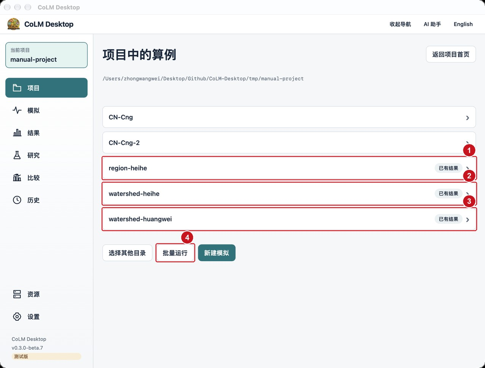

**图 34 标注：** ① 区域算例 `region-heihe` ② 流域算例 `watershed-heihe`（huahai 边界） ③ 流域算例 `watershed-huangwei`（huangwei 边界） ④ 批量运行入口。算例卡片的"已有结果"表示该算例已有运行输出。

### 19.2 区域算例（latlon 经纬度网格）

区域算例使用 0.25° 经纬度网格，范围 **96.25–104.25°E、37.75–43.25°N**（Heihe 流域+周边），强迫场 JRA3Q，开启区域单元汇流（河湖流）。

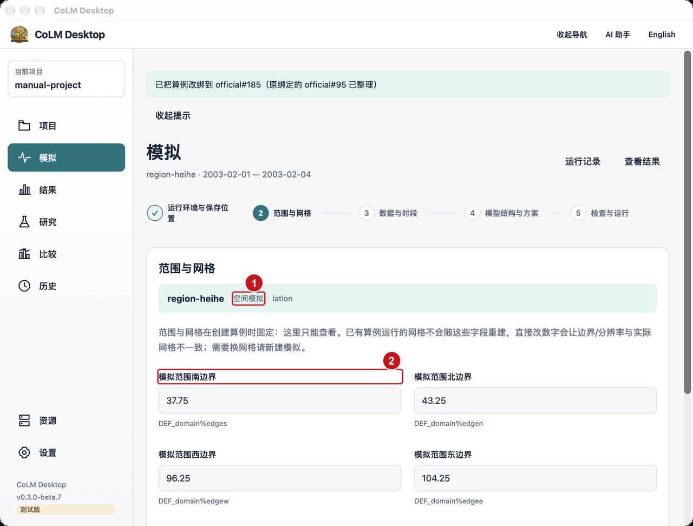

**图 35 标注：** ① 空间模拟说明（网格创建后固定） ② 模拟范围/网格分辨率字段（只读，换网格需新建模拟）。

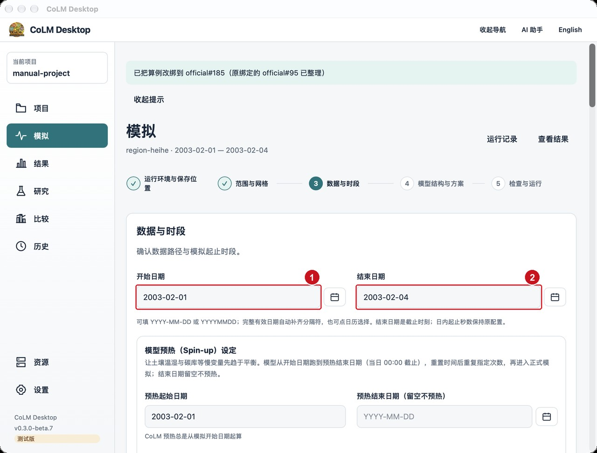

**图 36 标注：** ① 开始日期 ② 结束日期（空间算例同样支持预热与日内秒）。

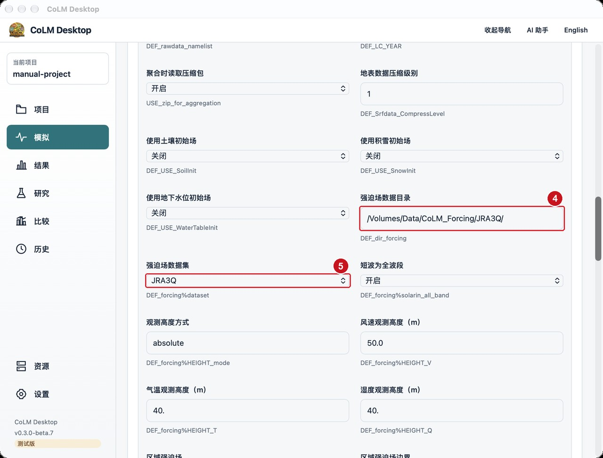

**图 37 标注：** ① 强迫场配置 ② 强迫场数据目录（JRA3Q） ③ 强迫场数据集。

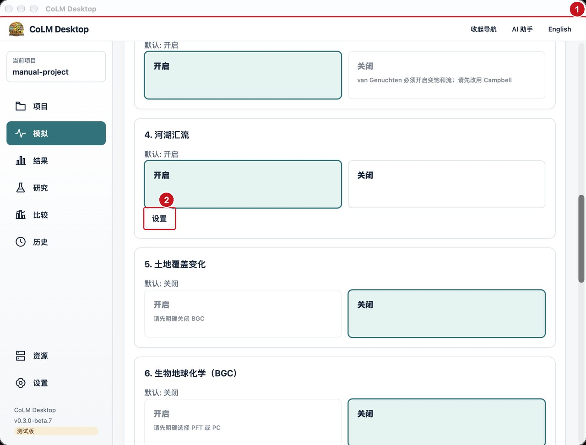

**图 38 标注：** ① "4. 河湖汇流"过程 ② 该过程右侧的"设置"。

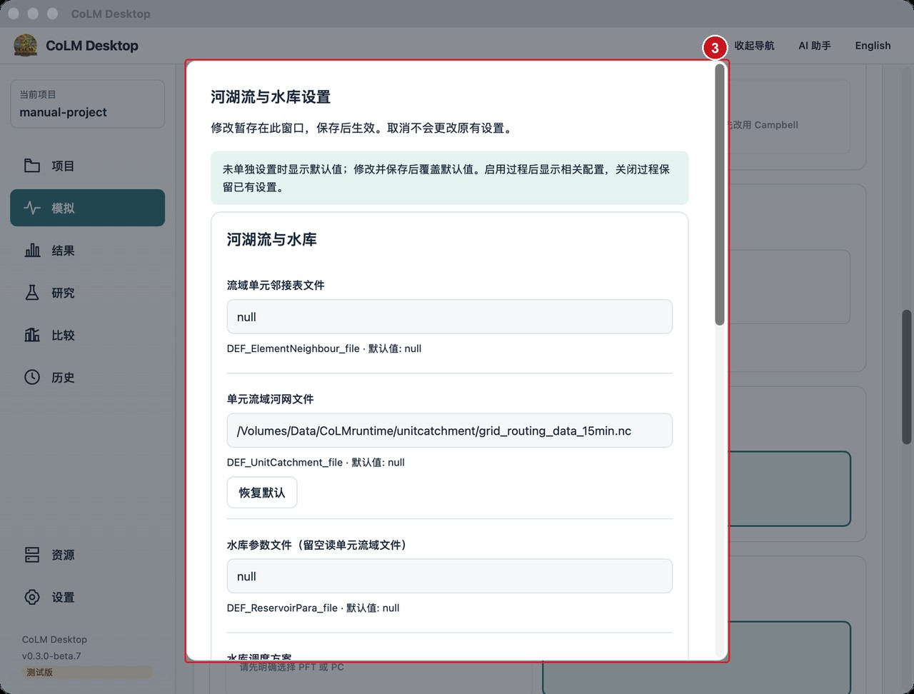

**图 39 标注：** ① 河湖流与水库设置对话框 ② 单元流域河网文件（`grid_routing_data_15min.nc`） ③ 河湖汇流最大子步长等参数。区域单元汇流开关、水库调度方案、估算河道深度等都在这里；改完点"保存设置"。


**图 40 标注：** ① 编译配置（区域网格需要 `latlon` 内核） ② 开始运行。

**实际运行结果（CLI 实跑）**：

```text
kernel: latlon@4c36d17d#production (Darwin-arm64)
model engine: rust
=== colm-stage colm ok ===
  colm       ok
EXIT:0
```

- 96 个时间步（3 天，3600 秒步长），输出 `out/region-heihe/history/`、`restart/`；区域网格由 `DEF_GRIDBASED_lon_res/lat_res=0.25` 自动构建（无需 `DEF_file_mesh`）。
- 河湖流：latlon 内核编译了 `GridRiverLakeFlow`，运行时读取 2.0 GB 的 15min 单元汇流数据。

### 19.3 流域算例（shapefile 边界 → unstructured 网格）

流域算例用 `/Volumes/Data/Data/Heihe-shp/heihe_boundary_with_huahai.shp` 生成非结构网格（0.5°，113 个活跃单元），边界内 267 个 LCT patch，保留河湖流开关。

```bash
# 1) 由流域边界生成非结构网格（0.5° = 720×360 全球网格中落在边界内的单元）
colm-cli mesh-new --out watershed-heihe/mesh.nc --nlon 720 --nlat 360 \
  --grid-kind unstructured --shp /Volumes/Data/Data/Heihe-shp/heihe_boundary_with_huahai.shp

# 2) 建空间算例（JRA3Q 强迫、本机 rawdata/runtime、3 天）
colm-cli spatial-new --grid-kind unstructured --mesh watershed-heihe/mesh.nc \
  --out watershed-heihe --forcing watershed-heihe/forcing.nml \
  --rawdata /Volumes/Data/CoLMrawdata --runtime /Volumes/Data/CoLMruntime \
  --start 2003-02-01 --end 2003-02-04 --timestep 3600 \
  --name watershed-heihe --mode igbp
```

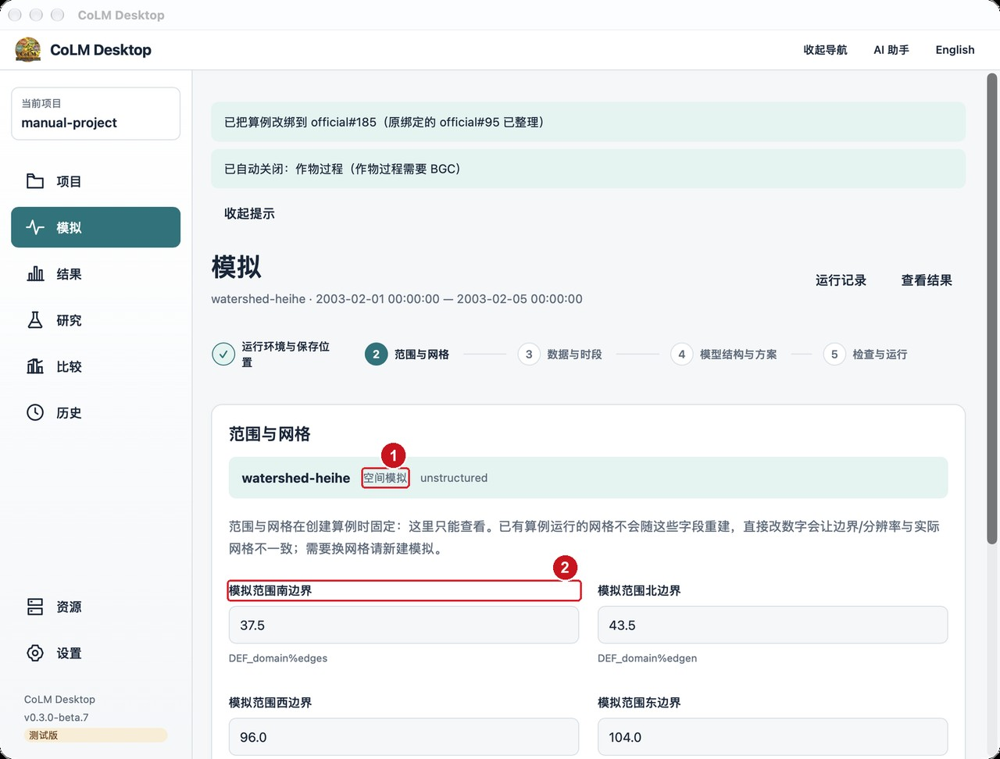

**图 41 标注：** ① 空间模拟说明 ② 模拟范围（由边界文件决定，创建后锁定）。

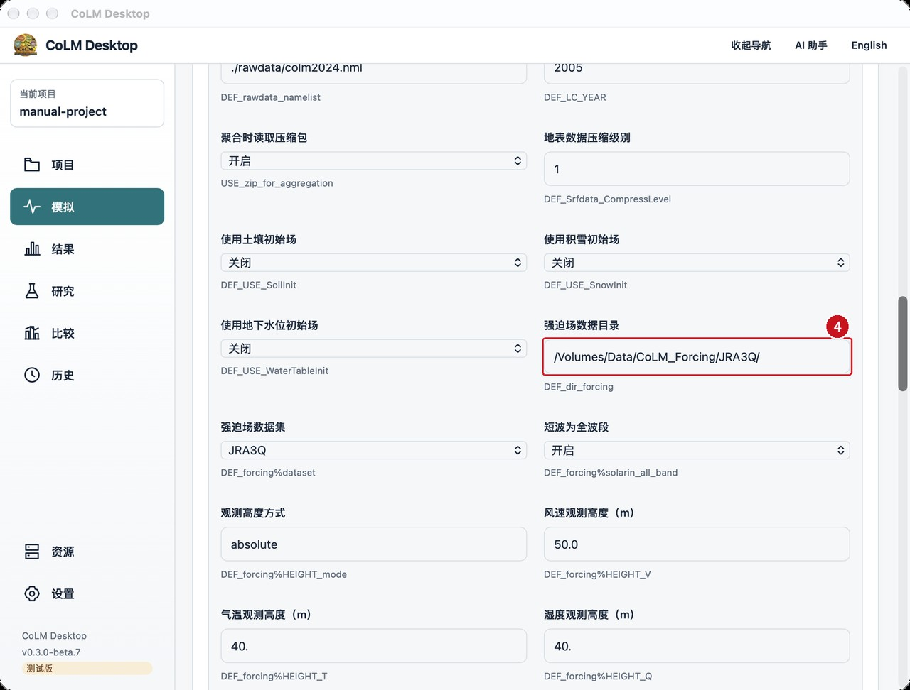

**图 42 标注：** ① 强迫场配置/目录（JRA3Q）；② 地表数据与 Runtime 目录同区域算例。

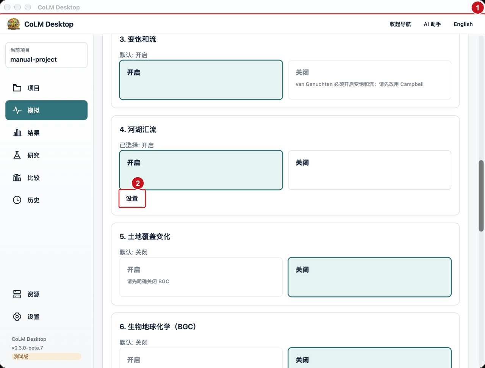

**图 43 标注：** ① "4. 河湖汇流" ② "设置"。

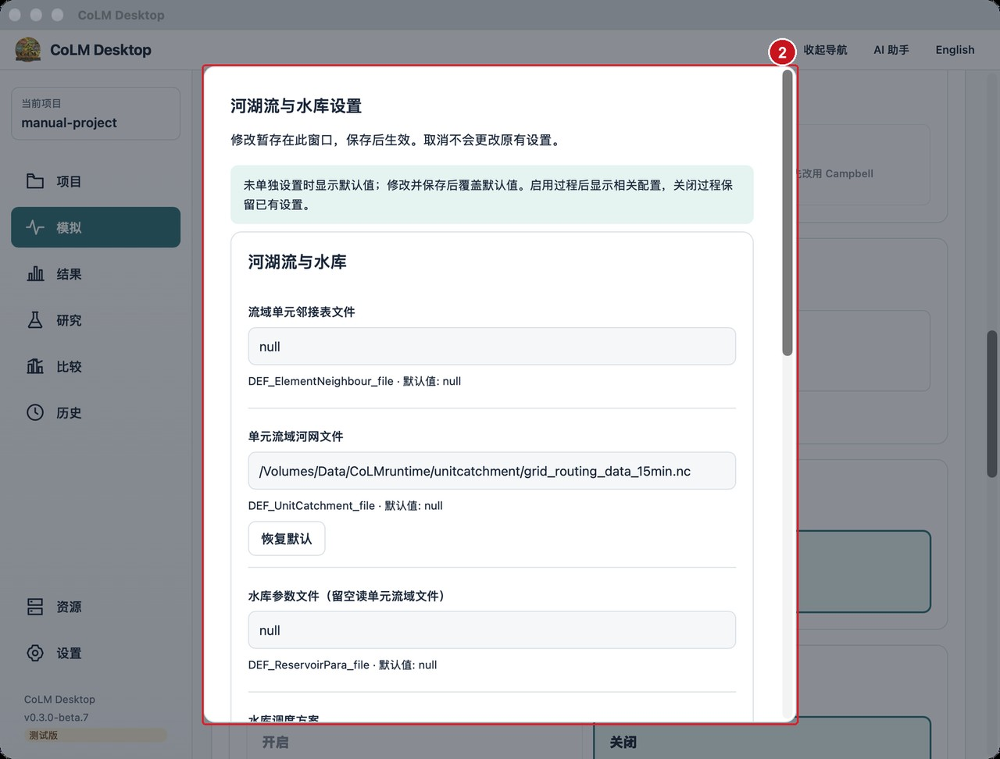

**图 44 标注：** ① 河湖流与水库设置 ② 单元流域河网文件（本机 15min 数据）。

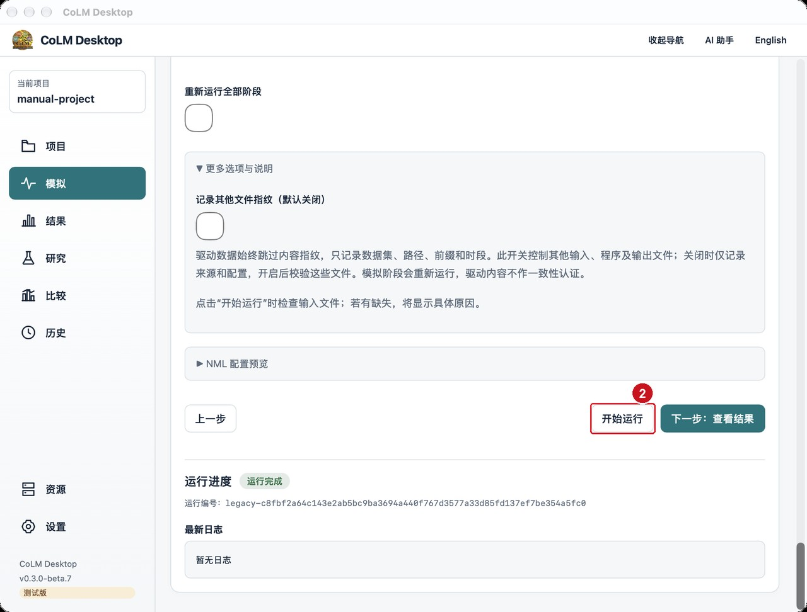

**图 45 标注：** ① 编译配置（unstructured 内核） ② 开始运行。

**实际运行结果（GUI 实跑）**：

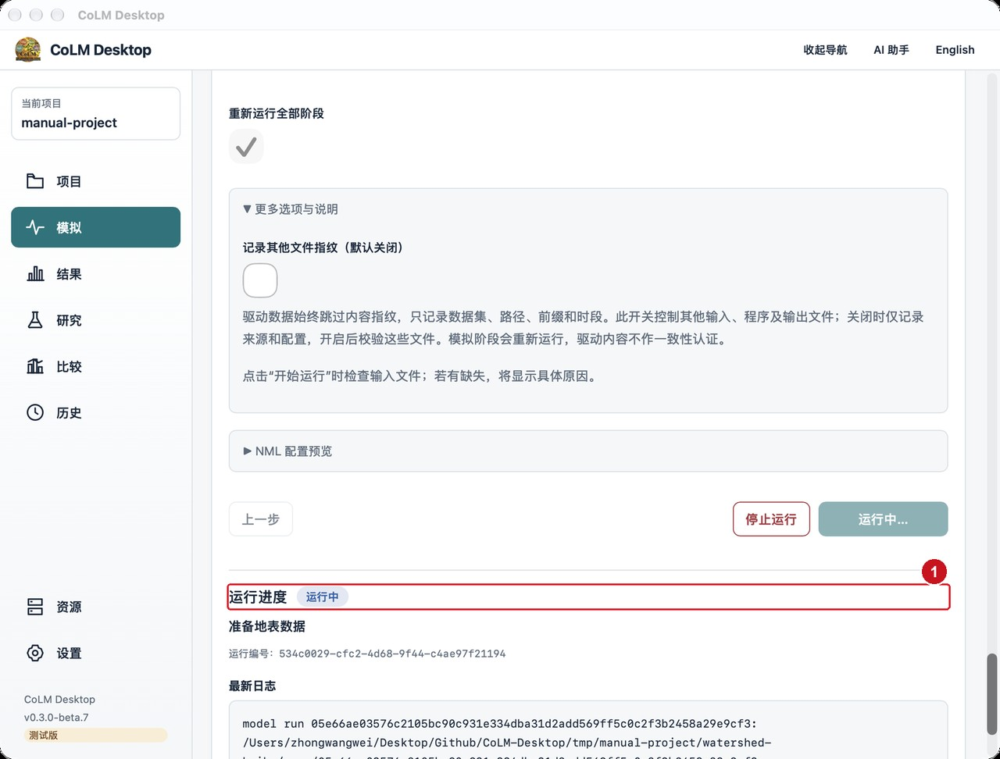

**图 46 标注：** ① 运行进度（mksrfdata → mkinidata → colm 三阶段）。

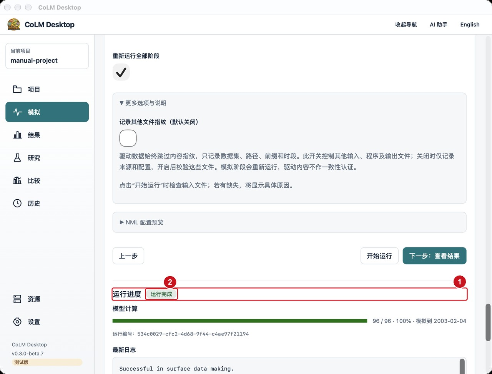

**图 47 标注：** ① 运行进度 ② 完成状态。

```text
wrote 113 spatial land elements and 267 LCT patches
Regional unit-catchment network: 2084 unit catchments in 77 river systems,
  written to .../riverlake/unitcatchment_regional.nc
colm-rs: 96 step(s) on 267 spatial patch(es) in 4 block(s)
CoLM Execution Completed.
=== colm-stage colm ok ===
```

**第二个流域边界（`heihe_huangwei.shp`）** 也用同样流程实跑：0.5° 网格取到 **59 个活跃单元**（177 个 spatial patch），区域河网 **1758 个单元流域、24 个河系**，3 天 96 步，`EXIT 0`：

```text
Regional unit-catchment network: 1758 unit catchments in 24 river systems
colm-rs: 96 step(s) on 177 spatial patch(es) in 4 block(s)
CoLM Execution Completed.
=== colm-stage colm ok ===
EXIT:0
```


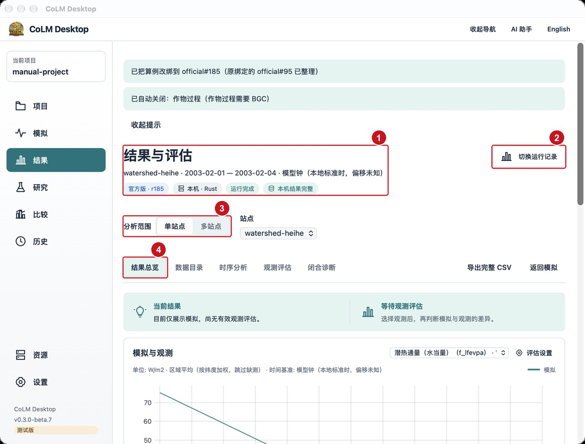

**图 48 标注：** ① 结果与评估 ② 切换运行记录 ③ 分析范围 ④ 结果/时序/观测/闭合页签。空间算例的"模拟与观测"显示**区域平均（按纬度加权）**，下方"空间分布"可逐帧看格点（示例：潜热通量水当量 `f_lfevpa`）。

### 19.4 区域 vs 流域：怎么选

| | 区域（latlon） | 流域（unstructured / catchment） |
|---|---|---|
| 网格 | 规则经纬度网格，`DEF_GRIDBASED_lon_res/lat_res` | 边界文件生成的非结构网格（或用户提供的 catchment mesh） |
| 典型用途 | 区域气候/陆面模拟、与格点观测比较 | 按流域边界做水文/汇流、河湖流 |
| 河湖流 | `GridRiverLakeFlow` + 单元汇流文件（latlon 内核已编入） | 内核含 `GridRiverLakeFlow`，需 `DEF_UnitCatchment_file` +（流域）`unitcatchment_regional` |
| 本例规模 | 0.25°，32×22 单元 | 0.5°，113 单元 / 267 LCT patch |
| 结果展示 | 区域平均 + 空间分布 | 区域平均 + 空间分布（按网格） |

数据准备要点：
- 区域强迫：JRA3Q 目录需含 `tmp2m/tmp2m_YYYY_MM.nc` 等 8 个变量子目录；`forcing.nml` 的 `DEF_forcing%startyr/endyr` 覆盖模拟年份；
- Heihe 边界 shapefile 必须与 `.shx/.dbf/.prj` 同目录；
- `DEF_UnitCatchment_file` 指向 `CoLMruntime/unitcatchment/grid_routing_data_15min.nc`（区域）或用户自己的 unit catchment mesh；
- 空间算例不支持"参数调优/不确定性分析"（界面会自动提示）。

> 说明：本章"区域"用 CLI 实跑验证（EXIT 0），"流域"用 GUI 实跑并截图；两者使用同一套 Rust 引擎与本地内核。

---

## 20. 配置参数总览

界面里所有可编辑字段来自 CoLM namelist schema，共 **964 项**；参数库（研究/助手用）共 **1369 项**。

### 19.1 按页面的参数分组

| 页面/分组 | 主要字段 |
|---|---|
| 运行环境与保存位置 | `DEF_CASE_NAME`、算例/输出目录、引擎、版本绑定 |
| 范围与网格 | `SITE_lon_location`、`SITE_lat_location`、网格/范围/分辨率字段 |
| 数据与时段 | `DEF_simulation_time%*`、`DEF_dir_rawdata`、`DEF_dir_runtime`、`DEF_forcing_namelist`、`DEF_dir_forcing`、`DEF_forcing%*` |
| 模型结构与方案 | 地类方案、土壤水力、过程开关、参数覆盖、参数卡片 |
| 检查与运行 | `DEF_simulation_time%timestep`、输出/重启频率、历史变量、提交阶段、指纹开关 |
| 运行/配置（高级） | 并行、调试、诊断、数据同化等 |

### 19.2 字段表怎么查

- 完整字段表：[附录 A](appendices/appendix-config-fields.md)（按页面分组，含类型、默认值、可选值、依赖宏、派生标记与说明）；
- 参数库：[附录 B](appendices/appendix-tuning-parameters.md)（按分类，含参数 ID、原始键、默认值、作用域、可见性、源码位置）。

常用字段速查：

| 字段 | 含义 | 备注 |
|---|---|---|
| `DEF_CASE_NAME` | 算例名 | 字母/数字/`-`/`_`，不能有路径分隔符 |
| `DEF_simulation_time%start_year/month/day/sec` | 模拟开始 | 结束必须晚于开始 |
| `DEF_simulation_time%timestep` | 时间步长（秒） | 单点常用 1800/3600 |
| `DEF_HIST_FREQ` | 历史输出间隔 | 支持步/时/日/月/年 |
| `DEF_WRST_FREQ` | 重启文件间隔 | 用于续跑 |
| `SITE_fsitedata` | 站点文件路径 | 站点算例必需 |
| `DEF_dir_forcing` / `DEF_forcing%dataset` | 强迫场目录/数据集标识 | 标识必须是引擎实际认识的集合（CMFD/ERA5/CMIP6/POINT 等） |
| `DEF_dir_rawdata` | 地表数据/原始数据目录 | 空间算例或重建地表时需要 |
| `DEF_dir_runtime` | Runtime 数据目录 | 部分过程/资产需要 |
| `DEF_USE_*` | 过程开关 | 是否可用取决于内核编译宏与算例尺度 |

---

## 21. 文件与目录布局

```text
# 项目
<project>/
├── <case>/
│   ├── case.nml                 # 算例配置
│   ├── forcing.nml              # 强迫场配置
│   ├── site.nc / mesh.nc        # 站点或网格输入
│   ├── model-binding.json       # 绑定的模型版本
│   ├── .colm-desktop.json       # 算例界面配置（引擎、运行位置等）
│   ├── runs/<操作号>/           # 模型版本运行的物化副本与结果
│   └── out/                     # 直接运行的默认输出
└── ...

# 应用数据目录（macOS 示例）
~/Library/Application Support/CoLM-Desktop/
├── models/                      # 模型注册表：versions/、sources/、drafts/、runs/
├── history.sqlite3              # 历史台账
├── openbench/                   # OpenBench 私有环境（可选）
└── live-runs/                   # 运行中/残留标记

~/Library/Application Support/edu.sysu.colm.desktop/
├── remote.json                  # 远程服务器配置
├── assistant.json / assistant-keys.json  # 助手设置与 Key
├── examples/                    # 内置示例（Sitedata/Forcing/Observation/Runtime）
└── recent.json                  # 最近项目与界面偏好
```

> 不同平台目录不同：Windows 用 `%APPDATA%\CoLM-Desktop` 等，Linux 用 `~/.local/share/CoLM-Desktop`；桌面端会自动解析。命令行默认模型根目录与历史数据库跟随同一应用数据目录。

---

## 22. 故障排查

| 现象 | 可能原因 | 处理 |
|---|---|---|
| 启动后看不到项目/算例 | 项目目录选择不对 | 首页"打开项目 → 选择目录"，或检查 `recent.json` |
| 新建模拟提示无权/路径无效 | 目标目录不存在/不可写 | 换目录；检查磁盘权限 |
| 运行时缺 `site.nc`/`forcing.nml` | 输入路径被移动 | 第 3 步重新选择；或修复强迫场配置引用 |
| `dataset` 被拒绝 | 填了模板名而非引擎标识 | 用 `CMFD`/`ERA5`/`CMIP6`/`POINT` 等实际标识；见 6.3 |
| Fortran 引擎提示编译配置缺失 | 本机/服务器没有匹配内核 | 资源页构建内核（本机）或 `remote-kernel`（服务器） |
| 远程运行报 "no server path" | 外部目录未 map | 资源→服务器→目录映射；目录不会自动上传 |
| 远程运行报 "host key unknown/changed" | 首次连接或主机密钥变化 | 终端先 `ssh <别名>` 确认并接受密钥 |
| 远程 Fortran 内核构建失败 | 环境脚本没载入 gfortran/MPI/NetCDF-Fortran | 检查 `--env-script`；登录节点可编译，计算节点可能缺开发包 |
| 结果页没有数据 | 没取回结果或变量/月份裁剪为空 | 运行进度里"取回结果"；检查分析范围 |
| 历史导出少了站点 | 用了折叠视图 | 历史导出默认一行一操作；批量运行会展开 |
| 助手无法发送 | 未登记 API Key/服务不可达 | 助手设置填地址+Key；检查网络 |
| 助手提示"重配失败" | 保存成功但启动校验失败（如外发确认缺失） | 按提示补全外发确认/Key；设置已保存，下次发送重试 |
| 空间算例第 2 步字段不可改 | 网格创建后固定 | 新建模拟；助手也不能绕过（契约只读） |
| 模型版本被清理后算例报错 | 旧官方修订被自动/手动清理 | 版本对话框重新选一个可用修订并迁移 |

更多开发/构建问题见仓库 `docs/implementation-verification.md`、`docs/design.md` 与 GitHub Issues。

---

## 23. 附录

- [附录 A：配置字段总表（964 项）](appendices/appendix-config-fields.md)
- [附录 B：参数库索引（1369 项）](appendices/appendix-tuning-parameters.md)
- [附录 C：CLI 命令参考（含完整 `--help`）](appendices/appendix-cli.md)

---

### 本手册的示例与证据

| 示例 | 状态 | 证据 |
|---|---|---|
| 单站 CN-Cng 本机 Rust 运行（3 天） | 实际运行完成 | 图 14/15；日志显示 mksrfdata/mkinidata/colm 全 ok；输出 `history/CN-Cng_hist_2008-01.nc` |
| 2 站点批量运行 | 实际运行完成（2/2，0 失败） | 图 16/17 |
| Heihe 区域算例（latlon 0.25°，JRA3Q） | CLI 实跑 EXIT 0（96 步） | 图 35–40；`tmp/manual/data/region-run.log` |
| Heihe 流域算例（huahai 边界→unstructured，0.5°） | GUI 实跑完成：113 空间单元/267 LCT patch、2084 单元流域/77 河系、96 步 EXIT ok | 图 41–48 |
| Heihe 流域算例（huangwei 边界→unstructured，0.5°） | CLI 实跑 EXIT 0：59 活跃单元/177 patch、96 步 | `tmp/manual/data/huangwei-run.log` |
| CLI `scan` | 实际执行 | 输出 AT-Neu/CN-Cng 等 4 个示例站点 JSON |
| CLI `site-new` | 实际执行 | 生成 `CN-Demo_site.nc` 与 JSON 字段摘要 |
| CLI `history-catalog` | 实际执行 | 输出 48 步、变量目录 JSON |
| 真实远程 Slurm（Rust/Fortran、pack、ranks=1） | 已在 tianhe 实测 | 见 `docs/implementation-verification.md` 2026-11-07 验收章节 |

*手册生成日期：2026-11-08；软件版本 0.3.0-beta.7。*
